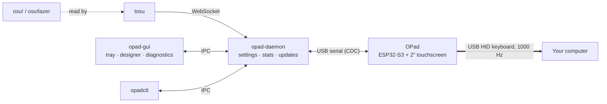

<div align="center">

<picture>
  <source media="(prefers-color-scheme: dark)" srcset="docs/assets/wordmark-dark.svg">
  
</picture>

### A low-latency two-key osu! keypad with a touchscreen, that is just a keyboard until you want more.

[](docs/start/what-you-need.md)
[](docs/explanation/latency.md)
[](LICENSE)
[](hardware/LICENSE)
[](REUSE.toml)

**[Download](https://github.com/OPad-dev/OPad/releases)** ·
**[Documentation](docs/index.md)** ·
[Get started](docs/start/what-you-need.md) ·
[Troubleshooting](docs/troubleshooting.md) ·
[Code signing policy](#code-signing-policy) ·
[Privacy](#privacy)

</div>

---

OPad turns a **Waveshare ESP32-S3-Touch-LCD-2** and two switches into a
competition-grade keypad for osu! and osu!lazer. It is a plain **1000 Hz USB
HID keyboard**: plug it into any Linux or Windows 10/11 machine and it types,
with no driver and no setup. The optional desktop app adds live gameplay stats
on the pad's screen, a screen designer, lifetime key counters, Hall Effect
calibration and one-click firmware updates.

## Highlights

|  |  |
|---|---|
| ⚡ **Latency always wins** | Keys go straight from the switch to the USB report. The screen, storage, tray and tosu are never on that path, and anything that measurably adds latency or jitter is cut. |
| 🔌 **Works with nothing installed** | Standard HID keyboard (`Z` / `X` by default). The desktop software only adds features. |
| 👆 **The touchscreen is a third button** | During a map a resting finger is Quick Retry. Outside a map, swipes change the volume or the track. |
| 📊 **Live telemetry** | With [tosu](https://github.com/KotRikD/tosu), the pad shows PP, accuracy, combo and more, in layouts you design yourself. |
| 🧲 **Mechanical or Hall Effect** | MX switches wired by hand, or the OPad V3 carrier with MX or Hall Effect modules, guided calibration and Rapid Trigger. |
| 🛟 **Can't be bricked by an update** | Updates go to the other flash slot and roll back on their own if the pad doesn't come back. No BOOT or RESET buttons, ever. |
| 🔁 **App and pad update independently** | Any app version talks to any pad version; they negotiate. |
| 🚫 **Every key comes from a finger** | No macros, auto-tap or host-injected keys. Not even as an option. |

## Quick start

1. **Wire two switches** between header **P2 pin 11** (GPIO 14, `Z`) /
   **pin 12** (GPIO 9, `X`) and **GND** (pin 13 or 2), or assemble the V3
   carrier. → [Wiring the keys](docs/start/wiring-the-keys.md)
2. **Plug it in.** It types immediately. → [First connection](docs/start/first-connection.md)
3. **Optional: install the app** for the screen, counters and updates.
   → [Install the app](docs/start/install-the-app.md)

| System | Download from [Releases](https://github.com/OPad-dev/OPad/releases) |
|---|---|
| Windows 10/11 | `OPad-Windows-Setup-<version>.exe` |
| Debian, Ubuntu, Pop!_OS | `OPad-Linux-Debian-Ubuntu-<version>.deb` |
| Fedora, RHEL, Alma, Rocky | `OPad-Linux-Fedora-<version>.rpm` |
| Arch | `OPad-Linux-Arch-<version>.pkg.tar.zst` |
| Any other Linux | `OPad-Linux-<version>.AppImage` |

> [!NOTE]
> The Windows installer is not code-signed yet, so SmartScreen warns about it
> (**More info → Run anyway**). Each release page lists the SHA-256 of every
> file if you'd rather verify the download. See the
> [code signing policy](#code-signing-policy).

## How it fits together



The keyboard link (thick arrow) needs none of the boxes above it.
[Architecture](docs/explanation/architecture.md) explains the rest.

## Documentation

The full documentation lives in [`docs/`](docs/index.md) and is also
published as a website.

| | |
|---|---|
| 🚀 **Getting started** | [What you need](docs/start/what-you-need.md) · [Wiring](docs/start/wiring-the-keys.md) · [First connection](docs/start/first-connection.md) · [Install the app](docs/start/install-the-app.md) |
| 🧭 **Guides** | [Update firmware](docs/guides/update-firmware.md) · [Touchscreen & swipes](docs/guides/touchscreen-and-swipes.md) · [Screen layouts](docs/guides/customize-screen-layout.md) · [Hall Effect calibration](docs/guides/calibrate-hall-effect.md) · [tosu](docs/guides/use-with-tosu.md) · [Backup](docs/guides/backup-and-restore.md) |
| 🛟 **When something's wrong** | [Troubleshooting](docs/troubleshooting.md) · [Recovery & reflashing](docs/recovery.md) |
| 📖 **Reference** | [`opadctl`](docs/reference/opadctl.md) · [GUI](docs/reference/gui.md) · [Device settings](docs/reference/device-settings.md) · [Pinout](docs/reference/pinout.md) · [Serial protocol](docs/reference/serial-protocol.md) |
| 💡 **How it works** | [Architecture](docs/explanation/architecture.md) · [Latency](docs/explanation/latency.md) · [Updates & rollback](docs/explanation/updates-and-rollback.md) · [Hall Effect](docs/explanation/hall-effect.md) |
| 🛠️ **Contributing** | [Developer hub](docs/develop/index.md) · [Building](docs/develop/building.md) · [Testing](docs/develop/testing.md) · [AGENTS.md](AGENTS.md) |

Documentation is also available in [Spanish](docs/es/index.md).

## Building from source

```bash
# Desktop suite (daemon, GUI, opadctl)
cd desktop && cargo build --release

# Firmware (ESP-IDF v5.5.2)
cd firmware && idf.py set-target esp32s3 build

# Flash it over USB: the other OTA slot, rolls back if it never enumerates
opadctl flash firmware/build/opad-firmware.bin
```

System packages, `make install`, tests and CI are covered in
[Building from source](docs/develop/building.md) and
[Testing](docs/develop/testing.md). Contributions are welcome: read
[AGENTS.md](AGENTS.md) first. It holds the product rules every change keeps.

---

## Code signing policy

Free code signing provided by [SignPath.io](https://about.signpath.io), certificate by [SignPath Foundation](https://signpath.org).

The Windows programs (`opad-gui.exe`, `opad-daemon.exe`, `opadctl.exe`) and the Windows installer are built from this repository by GitHub Actions (`.github/workflows/release-app.yml`) and signed only after a maintainer approves each release. Until the SignPath Foundation certificate is in place, Windows releases are published unsigned.

- Committers and reviewers: [GFerreiroS](https://github.com/GFerreiroS)
- Approvers: [GFerreiroS](https://github.com/GFerreiroS)

The installer also contains two programs that are not built from this repository's code and are not signed by this project: `espflash.exe` ([esp-rs/espflash](https://github.com/esp-rs/espflash), the upstream release binary) and `tosu.exe` ([tosu](https://github.com/KotRikD/tosu), built from upstream source).

Privacy policy: see [Privacy](#privacy) below.

## Privacy

OPad collects no personal data and has no telemetry or analytics. The desktop app makes these network requests, and no others:

- **Update check**, once a day while the app's background service runs, and whenever you press *Check now*: it downloads the public release list from `https://updates.opad.dev/` (served by GitHub Pages). The request carries the app's version in its User-Agent (`opad/<version>`) and nothing about you or your pad. Turning off automatic updates in **Settings → Updates** stops installs, not this check.
- **Downloads** of an update you accept (or of tosu, if its automatic updates are on), from GitHub Releases.
- **tosu**, which the app runs, serves osu!'s game state on your own computer (`127.0.0.1`) and does not send it anywhere. When it starts, tosu asks GitHub whether a newer tosu exists; OPad turns its self-update off, so nothing is downloaded.

GitHub, which hosts the update list and the downloads, sees your IP address as it does for any website; see [GitHub's privacy statement](https://docs.github.com/site-policy/privacy-policies/github-general-privacy-statement). Everything the app stores (settings, statistics, backups) stays on your computer and your pad.

## Third-party software

OPad bundles or interacts with the following third-party software:

- **[tosu](https://github.com/KotRikD/tosu)** by Mikhail Babynichev and the tosu contributors, under the [LGPL-3.0](licenses/tosu/LICENSE) ([notice](licenses/tosu/NOTICE)). Under the LGPL you may replace the bundled tosu with your own build: point the `OPAD_TOSU_PATH` environment variable at it, or set an external path in the GUI under **Settings → tosu**.
- **[espflash](https://github.com/esp-rs/espflash)**, bundled with the desktop packages as the upstream release binary.

## Licence

OPad is free and open source, software and hardware:

- **Software**: the firmware, the desktop app (daemon, GUI, CLI), the protocol, the scripts and the documentation, under the [GNU General Public License v3.0 or later](LICENSE) (`GPL-3.0-or-later`).
- **Hardware**: everything in [`hardware/`](hardware/) (the PCB designs, footprints and symbols, the enclosure CAD and the production files), under the [CERN Open Hardware Licence v2, Strongly Reciprocal](hardware/LICENSE) (`CERN-OHL-S-2.0`). The scripts in `hardware/` that generate and check those files are software, under `GPL-3.0-or-later`.

You may build, modify and sell OPad. If you distribute a modified version, of the software or of the hardware, you must publish its source under the same licence. Every file's licence is recorded in [`REUSE.toml`](REUSE.toml).

Third-party components keep their own open licences and ship with their notices:

- [tosu](licenses/tosu/LICENSE) (LGPL-3.0), built from upstream source and bundled with the desktop packages, see above. Not stored in this repository.
- [Montserrat](desktop/gui/assets/fonts/Montserrat-OFL.txt) fonts embedded in the GUI (SIL Open Font License 1.1).
- [nanopb](firmware/main/protocol/nanopb/LICENSE.txt) protobuf runtime vendored in the firmware (zlib licence).

Libraries pulled in at build time (Rust crates, ESP-IDF components such as LVGL and TinyUSB) are not stored here and are used under their own permissive licences.

The firmware's easter-egg animation (`firmware/main/ui/easter_egg_gif.h`) is the one exception: it was made from images found online whose author and licence are unknown, and no rights to it are granted. If you hold the rights and want it credited or no longer used, open an issue or write to the contact in [`SECURITY.md`](SECURITY.md); it is then credited, or removed from the firmware ([`LICENSES/LicenseRef-Unknown-ThirdParty.txt`](LICENSES/LicenseRef-Unknown-ThirdParty.txt)).

## Trademark

OPad is an independent open-source hardware and software project. It is not affiliated with, endorsed by, or sponsored by ppy Pty Ltd or osu!. "osu!" is a registered trademark of ppy Pty Ltd.
