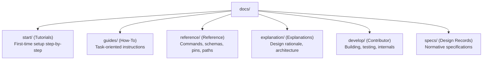

# OPad Documentation Map

Welcome to the OPad documentation suite. This directory is organized according to the [Diátaxis framework](https://diataxis.fr/) into Tutorials, How-To Guides, Technical Reference, and In-Depth Explanations.

<!-- src: /AGENTS.md#Product rules -->
<!-- src: /AGENTS.md#Workflow -->

---

## 1. Documentation Structure

### 🏁 Getting Started (Tutorials)
* [What You Need](start/what-you-need.md) — Hardware prerequisites and supported host systems.
* [First Connection](start/first-connection.md) — Direct USB HID plug-and-play verification without software.
* [Install the Desktop Suite](start/install-the-app.md) — Installing daemon, GUI, and opadctl on Linux and Windows.
* [Wiring the Keys](start/wiring-the-keys.md) — Header P2 pinout, switch wiring, and carrier board connections.

### 🛠️ User Guides (How-To)
* [Updating Firmware](guides/update-firmware.md) — OTA firmware updates via opadctl or GUI updater.
* [Changing Key Pins](guides/change-key-pins.md) — Reassigning GPIO pins and hardware validation.
* [Touchscreen and Swipes](guides/touchscreen-and-swipes.md) — Third button tap, resting finger Quick Retry, and swipe gestures.
* [Calibrating Hall Effect](guides/calibrate-hall-effect.md) — Magnet calibration, Rapid Trigger tuning, and bench diagnostics.
* [Using with tosu](guides/use-with-tosu.md) — Real-time gameplay telemetry, PP counters, and memory permissions.
* [Backup and Restore](guides/backup-and-restore.md) — Exporting and importing configuration JSON files.
* [Uninstallation Guide](guides/uninstall.md) — Clean removal procedures for Linux and Windows installations.

### 📖 Technical Reference
* [opadctl CLI Reference](reference/opadctl.md) — Complete command line reference and help output.
* [Device Settings Catalog](reference/device-settings.md) — Configuration fields, data types, bounds, and defaults.
* [Pinout Reference](reference/pinout.md) — Header P1/P2 mappings, carrier board signals, and ADC channels.
* [Serial Wire Protocol](reference/serial-protocol.md) — COBS/CRC packet framing and protobuf catalog.
* [Desktop IPC Protocol](reference/ipc.md) — Local socket IPC transport, JSON framing, and API methods.
* [Files and Storage Paths](reference/files-and-paths.md) — Directory layout, database schemas, and state locations.
* [Graphical Interface (GUI)](reference/gui.md) — Iced desktop pages, layout designer, and system tray.

### 💡 System Architecture (Explanation)
* [System Architecture](explanation/architecture.md) — Dual-core isolation, IPC design, and runtime state machine.
* [Latency Optimization](explanation/latency.md) — 1000 Hz USB polling, eager debouncing, and jitter minimization.
* [Touchscreen as Third Button](explanation/touchscreen-third-button.md) — CST816S interrupt polling and gesture engine.
* [Version Compatibility](explanation/app-and-pad-versions.md) — Independent app and pad upgrades and protocol negotiation.
* [Counters and Ownership](explanation/counters-and-ownership.md) — Monotonic keystroke counters and pad pairing.
* [Updates and Automatic Rollback](explanation/updates-and-rollback.md) — Dual OTA partitions, trial boot, and recovery.
* [Hall Effect Sensing](explanation/hall-effect.md) — Continuous ADC sampling and Rapid Trigger state machine.

### 🔧 Developer & Contributor Guide
* [Developer Overview](develop/index.md) — Contributor invariants and coding standards.
* [Building from Source](develop/building.md) — Firmware (ESP-IDF v5.5.2) and Desktop (Rust) compilation.
* [Testing Strategy](develop/testing.md) — Host unit tests, `make check`, and hardware checklists.
* [Firmware Subsystems](develop/firmware/overview.md) — Architecture, [input](develop/firmware/input.md), [USB](develop/firmware/usb.md), [touch](develop/firmware/touch.md), [UI](develop/firmware/ui.md), [NVS](develop/firmware/config-and-nvs.md), [counters](develop/firmware/counters.md), and [diagnostics](develop/firmware/diag.md).
* [Desktop Architecture](develop/desktop/overview.md) — Workspace crates, [daemon](develop/desktop/daemon.md), [GUI](develop/desktop/gui.md), [opadctl](develop/desktop/opadctl.md), and [shared crates](develop/desktop/crates.md).
* [Protocol Changes](develop/protocol-changes.md) — Protobuf schema workflow and code generation.
* [Hardware Ecosystem](develop/hardware.md) — V1/V2/V3 PCB designs, FFC cables, and `opadverify`.
* [Packaging Mechanics](develop/packaging.md) — Linux (.deb, .rpm, AppImage, AUR) and Windows installer.
* [Release Pipelines](develop/releases.md) — GitHub Actions automation, release-please, and signed feeds.
* [Testing Laboratory](develop/lab.md) — Multi-OS VirtualBox VM test harness and CI runner.
* [Latency Measurement](develop/latency-testing.md) — Benchmarking methodology, stages A–D, and evdev analysis.

### 🛡️ Recovery & Operations
* [Recovery and Unbricking](recovery.md) — Pad unbricking, USB detachment, and bootloader recovery.
* [Troubleshooting Guide](troubleshooting.md) — Diagnosing serial contention, missing telemetry, and USB errors.
* [Testing Checklist](testing-checklist.md) — End-to-end hardware and software QA checklist.

---

## 2. Contributor Guidelines and Invariants

Every contributor and automated documentation assistant must adhere to these product rules (AGENTS.md):

1. **The Code is the Single Source of Truth**: Documentation reflects what the codebase currently implements.
2. **Every Claim Must Cite Source Code**: Cite exact source locations using invisible comments (formatted as `<!--` `src:` `/path#symbol` `-->`) or visible file links.
3. **Never Instruct Anyone to Press Physical BOOT or RESET Buttons**: Firmware updates, downloads, and device recoveries are driven entirely over USB via software (`opadctl flash` and `opadctl recover`).
4. **Independent Evolution**: The desktop application and keypad firmware update independently; documentation must never instruct users to update both together.
5. **No Synthetic Keystrokes**: OPad strictly emits keystrokes triggered by physical fingers. Macros, auto-tap scripts, or host-to-device tap injections are forbidden.
6. **No Placeholder Pages**: Never commit empty or speculative placeholder documents.
