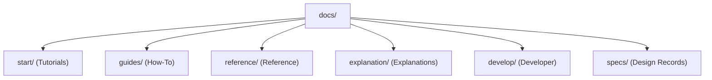

Welcome to the OPad documentation suite. This directory is organized according to the [Diátaxis framework](https://diataxis.fr/) into Getting Started tutorials, How-To Guides, Technical Reference, Explanations, and Developer documentation.
<!-- src: /AGENTS.md#Product rules -->
<!-- src: /AGENTS.md#Workflow -->

---

## 1. Documentation Structure

- [Documentation Home](index.md) — entry point for users and developers.

### Getting Started (Tutorials)
* [What You Need](start/what-you-need.md) — Hardware prerequisites and supported host systems.
* [Wiring the Keys](start/wiring-the-keys.md) — Header P2 pinout, switch wiring, and V3 carrier/module connections.
* [First Connection](start/first-connection.md) — Direct USB HID plug-and-play verification without software.
* [Installing the Desktop App](start/install-the-app.md) — Installing daemon, GUI, `opadctl`, and `tosu` on Linux and Windows.

### User Guides (How-To)
* [Updating the Firmware](guides/update-firmware.md) — USB A/B OTA firmware updates via `opad-gui` or `opadctl`.
* [Using the Touchscreen and Swipes](guides/touchscreen-and-swipes.md) — Quick Retry in a map and configurable swipe actions.
* [Customizing the Screen Layout](guides/customize-screen-layout.md) — Building, exporting, and importing `Idle`/`Playing` layouts in Screen Designer, with every `ui_source_t` data source.
* [Calibrating Hall Effect Switches](guides/calibrate-hall-effect.md) — Guided 5-press calibration and Rapid Trigger tuning.
* [Changing Key Pins](guides/change-key-pins.md) — Reassigning hand-wired GPIO pins and using Auto-Detect.
* [Using with tosu](guides/use-with-tosu.md) — Live osu! telemetry, Linux `ptrace`, and custom `tosu` paths.
* [Backup and Restore](guides/backup-and-restore.md) — Automatic and manual JSON backups via `opadctl` or `opad-gui`.
* [Uninstalling the Software](guides/uninstall.md) — Clean removal on Linux and Windows.

### Technical Reference
* [`opadctl` CLI Reference](reference/opadctl.md) — Verbatim `--help` output and option reference.
* [GUI Reference](reference/gui.md) — `opad-gui` pages, Settings tabs, Screen Designer, Diagnostics, and Stats.
* [Device Settings Catalog](reference/device-settings.md) — Configuration fields, types, ranges, defaults, and NVS keys.
* [Pinout Reference](reference/pinout.md) — Header P1/P2 mappings, onboard peripherals, and V3 FFC pinouts.
* [Serial Wire Protocol](reference/serial-protocol.md) — Marked/Checked framing, CRC-16/CCITT-FALSE, and protobuf catalog.
* [Desktop IPC Protocol](reference/ipc.md) — Local socket / named pipe transport, JSON framing, and API catalog.
* [Files and Storage Paths](reference/files-and-paths.md) — Directory layout, SQLite schema, and install identity.

### System Architecture (Explanation)
* [System Architecture](explanation/architecture.md) — Dual-core isolation, runtime states, and daemon device actor.
* [Latency Engineering](explanation/latency.md) — Split 1000 Hz USB HID endpoints, eager debouncing, and telemetry.
* [Touchscreen as Third Button](explanation/touchscreen-third-button.md) — CST816S interrupt polling and gesture classifier.
* [App and Pad Versions](explanation/app-and-pad-versions.md) — Independent upgrades and framing negotiation.
* [Counters and Ownership](explanation/counters-and-ownership.md) — Monotonic 64-bit counters and pad pairing.
* [Updates and Automatic Rollback](explanation/updates-and-rollback.md) — Dual OTA slots, trial boot, and signed feeds.
* [Hall Effect and Rapid Trigger](explanation/hall-effect.md) — V1 ADC1 DMA, V3 ADS7028 SPI3, and 3-state Rapid Trigger.

### Developer & Contributor Guide
* [Developer Overview](develop/index.md) — Product invariants, git workflow, and documentation rules.
* [Building from Source](develop/building.md) — Firmware (ESP-IDF v5.5.2) and Desktop (Rust) builds.
* [Testing Strategy](develop/testing.md) — `make check`, firmware host tests, CI jobs, and hardware checks.
* [Firmware Subsystems](develop/firmware/overview.md) — [input](develop/firmware/input.md), [USB](develop/firmware/usb.md), [touch](develop/firmware/touch.md), [UI](develop/firmware/ui.md), [NVS](develop/firmware/config-and-nvs.md), [counters](develop/firmware/counters.md), and [diagnostics](develop/firmware/diag.md).
* [Desktop Architecture](develop/desktop/overview.md) — [daemon](develop/desktop/daemon.md), [GUI](develop/desktop/gui.md), [opadctl](develop/desktop/opadctl.md), and [shared crates](develop/desktop/crates.md).
* [Protocol Changes](develop/protocol-changes.md) — Editing `opad.proto` and regenerating nanopb/prost bindings.
* [Hardware Ecosystem](develop/hardware.md) — V1/V2/V3 PCB designs, FFC cables, and `opadverify`.
* [Packaging Mechanics](develop/packaging.md) — Linux (`.deb`, `.rpm`, AppImage, Arch) and Windows Inno Setup.
* [Release Pipelines](develop/releases.md) — `release-please`, GitHub Actions, and signed update feeds.
* [Testing Laboratory](develop/lab.md) — the lab mini PC that runs CI and install tests (`make lab-ci`, `make push`).
* [Latency Measurement](develop/latency-testing.md) — Stages A–D, `latency_row.py`, and `bench_latency.py`.

### Recovery & Operations
* [Counters, Recovery and Unbinding](recovery.md) — counter reconciliation, recovery over USB without BOOT/RESET, and unbinding.
* [Troubleshooting Guide](troubleshooting.md) — Keyboard layouts, Linux `ptrace_scope`, `udev` rules, SmartScreen, and recovery.
* [Hardware & Release Verification Checklist](testing-checklist.md) — End-to-end hardware and software QA checklist.

---

## 2. Contributor Guidelines and Invariants

Every contributor must uphold the product rules in [/AGENTS.md](https://github.com/OPad-dev/OPad/blob/main/AGENTS.md):

1. **The code is the single source of truth**: When code and documentation disagree, fix or remove the doc.
2. **Cite source code**: Use invisible source comments (formatted as `<!--` `src:` `/path#symbol` `-->`); inside a comment the repo-root `/path` form is fine. Visible links to source files use full GitHub URLs (see below). Never use line numbers (`#L120`).
3. **Never instruct anyone to press BOOT or RESET buttons**: Flashing, updating, and recovering happen over USB (`opadctl flash`, `opadctl recover`).
4. **Independent updates**: App and pad update independently; never require updating both together.
5. **Every key comes from a finger**: No macros, auto-tap, scripted input, or host-to-pad key injection.
6. **No placeholder pages**: Never commit empty or speculative placeholder documents.

---

## 3. Fixed Paths, Special Directories, and Translations

### Paths that must not move

Code, CLI messages, workflows, and scripts print or reference these exact paths and numbered headings. Keep them at their current paths and preserve the meaning of each cited section:

- [`docs/recovery.md`](recovery.md) (code cites §3, §5, §7, §7.6, §7.7)
- [`docs/troubleshooting.md`](troubleshooting.md) (code cites §2)
- [`docs/testing-checklist.md`](testing-checklist.md)
- `docs/README.md`
- [`docs/specs/release-and-updates.md`](specs/release-and-updates.md)
- [`docs/specs/v2-hall-effect-decisions.md`](specs/v2-hall-effect-decisions.md)
- [`docs/hardware/components/ads7028.md`](hardware/components/ads7028.md)

### Archive, design records, and internal drafts

- **`docs/history/`**: Historical archive of reviews, incident reports, and snapshots. Do not edit it, and do not publish it on the documentation site.
- **`docs/specs/`** and **`docs/hardware/components/`**: English-only design records and component datasheet notes (published as reference records, not translated).
- **`draft: true` pages** (`docs/launch-checklist.md`, `docs/pad-test-sheet.md`): Internal checklists kept hidden on the public documentation site.

### Pages that read the same on GitHub and on the website

Every page is rendered twice: by GitHub when someone browses `docs/`, and by
the Astro Starlight website, which loads these files as its content. Write
for both:

- **Frontmatter**: every published page starts with `title` and `description`
  (and optionally `sidebar.order`). Starlight prints `title` as the page's
  heading, so the body never has a `# H1`; it starts at `##`.
- **Links between pages** are relative and keep the `.md` extension
  (`../guides/update-firmware.md#anchor`). GitHub follows them as they are;
  the site rewrites them to its own URLs.
- **Links to code and other repository files** are full GitHub URLs
  (`https://github.com/OPad-dev/OPad/blob/main/firmware/main/app_main.c`).
  A `/path` link only works on github.com.
- **Plain GitHub-flavoured Markdown**: no MDX, JSX or HTML except comments.
  Callouts use GitHub alerts (`> [!NOTE]`, `> [!TIP]`, `> [!WARNING]`,
  `> [!CAUTION]`); diagrams are `mermaid` code blocks.
- **Images and the logo** live in [`assets/`](assets/) and are linked
  relatively.

### Adding a new language

The documentation site publishes English from the root of `docs/` and mirrors translations under `docs/<lang>/` (for example, Spanish in `docs/es/`):

1. Mirror every published English page into `docs/<lang>/` using the exact same filenames, directory structure, heading count/order, and `<!--` `src:` `...` `-->` comments—excluding `README.md`, `history/`, `specs/`, `hardware/components/`, and `draft: true` pages.
2. Keep commands, CLI flags, code identifiers, file paths, GUI labels, and error strings verbatim in English. Point relative links to the translated pages inside `docs/<lang>/`.
3. Register the new locale in the separate Starlight website repository's locale configuration.
