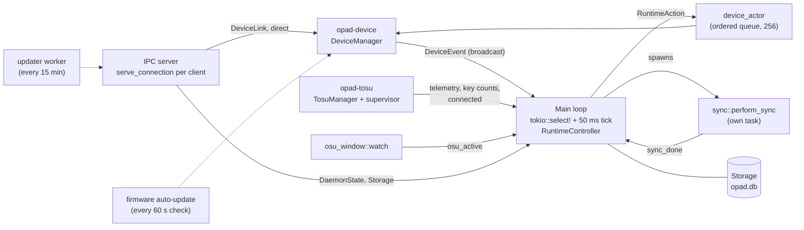

`opad-daemon` is the background tokio service that holds the pad's serial port, runs `tosu`, persists to SQLite, backs up, updates, and serves the GUI and `opadctl` over IPC ([/desktop/daemon/src/main.rs](https://github.com/OPad-dev/OPad/blob/main/desktop/daemon/src/main.rs)). It never sits on the keypress path: the pad sends keys to the OS directly ([/AGENTS.md](https://github.com/OPad-dev/OPad/blob/main/AGENTS.md) §1.1–1.2).

## Tasks and Channels

- **Main loop** (`main.rs`): one `tokio::select!` over `device_rx`, `tosu_rx`, `tosu_keys_rx`, `tosu_connected_rx`, `osu_active_rx`, `sync_done_rx` and a 50 ms tick. Each event becomes a `RuntimeEvent` for the `RuntimeController`, whose `RuntimeAction`s go to the device actor. The tick also retries opening SQLite every 60 s if it failed. A lagging device-event receiver triggers a re-handshake instead of guessing what was missed.
- **Syncs** run in their own task (they can take ~10 s) and report back on `sync_done_rx` ([/desktop/daemon/src/sync.rs](https://github.com/OPad-dev/OPad/blob/main/desktop/daemon/src/sync.rs)).
- **IPC server**: one `ipc_handlers::serve_connection` task per client, sharing `DaemonState`, `Storage`, the log hub and pending operations; it reaches the pad through the `DeviceLink` trait. A client that sent `Subscribe` is sent the answers to its watched requests as they change, from the same task ([IPC subscriptions](../../reference/ipc.md#subscriptions)).
- Shared state lives in `DaemonState` behind a mutex; `DaemonState::pad_guard()` reports why the pad may not be written (a foreign pad, a pending takeover or replacement).

## Modules

| Module | Role |
|---|---|
| [`runtime.rs`](https://github.com/OPad-dev/OPad/blob/main/desktop/daemon/src/runtime.rs) | `RuntimeController`: mode (`RuntimeMode::Idle` / `Playing` / `Cooldown` / `Sync`), heartbeats, write guard, tap attempts, ownership decisions |
| [`device_actor.rs`](https://github.com/OPad-dev/OPad/blob/main/desktop/daemon/src/device_actor.rs) | Ordered queue of host-to-pad commands |
| [`sync.rs`](https://github.com/OPad-dev/OPad/blob/main/desktop/daemon/src/sync.rs) | `perform_sync`: counter reconciliation and `CounterSyncRequest` ([Counters and Ownership](../../explanation/counters-and-ownership.md)) |
| [`telemetry.rs`](https://github.com/OPad-dev/OPad/blob/main/desktop/daemon/src/telemetry.rs) | `DataSync`: tosu values to changed screen sources |
| [`ipc_handlers.rs`](https://github.com/OPad-dev/OPad/blob/main/desktop/daemon/src/ipc_handlers.rs) | One handler per `IpcRequest` |
| [`backup.rs`](https://github.com/OPad-dev/OPad/blob/main/desktop/daemon/src/backup.rs) | Automatic JSON backups, newest `KEEP = 10` kept |
| [`identity.rs`](https://github.com/OPad-dev/OPad/blob/main/desktop/daemon/src/identity.rs) | Per-install UUIDv4 in SQLite, recorded by the pad as its owner |
| [`osu_window.rs`](https://github.com/OPad-dev/OPad/blob/main/desktop/daemon/src/osu_window.rs) | `osu_active` for volume swipes: osu! in the foreground on Windows, osu!lazer running on Linux |
| [`tap_stats.rs`](https://github.com/OPad-dev/OPad/blob/main/desktop/daemon/src/tap_stats.rs) | Keeps the tap-rate history in `DaemonState` in step with SQLite |
| [`log_hub.rs`](https://github.com/OPad-dev/OPad/blob/main/desktop/daemon/src/log_hub.rs) | In-memory log ring (2000 entries) for `opadctl logs` and the Logs page |
| [`he_debug_log.rs`](https://github.com/OPad-dev/OPad/blob/main/desktop/daemon/src/he_debug_log.rs) | Writes HE debug firmware lines to `he-debug.log`, rotated at 50 MB |
| [`updater.rs`](https://github.com/OPad-dev/OPad/blob/main/desktop/daemon/src/updater.rs) | App and `tosu` update worker |
| [`firmware_update.rs`](https://github.com/OPad-dev/OPad/blob/main/desktop/daemon/src/firmware_update.rs) | Firmware offers, consent, install, and the unattended update |

## Device Actor (`device_actor.rs`)

Every runtime command to the pad goes through one actor, so they arrive in order:

- **Bounded queue**: `QUEUE_DEPTH = 256` of `DeviceCommand` (`TimeSync`, `ClaimOwnership`, `Config`, `HostStatus`, `DataUpdate`, `Layout`, `RequestStatus`, `PlayAnimation`).
- **Retries**: each command is awaited in turn; on `DeviceError::Busy` it is retried up to `BUSY_RETRIES = 5` times, `BUSY_BACKOFF = 20 ms` apart. A `DataUpdate` is not retried (its diff would be stale): it sets `resend_data`, so the next flush sends a full snapshot.

## Runtime Controller (`runtime.rs`)

- **Heartbeats**: `STATUS_POLL_INTERVAL = 1 s`; `HOST_STATUS_INTERVAL = 1 s` sends `tosu_connected`, `is_playing`, `play_id`, `osu_active`. The pad leaves `PLAYING` on its own after 3 s without one and falls back to every touch being Quick Retry ([firmware touch](../firmware/touch.md#touch-modes)).
- **Cooldown and write guard**: mirrors the firmware's 5 s cooldown (`COOLDOWN_DURATION`); SQLite writes are refused (`Storage::set_writes_allowed(false)`) in `Playing` and `Cooldown`.
- **Automatic backups**: `AUTO_BACKUP_DELAY = 20 s` after the post-play sync settles in `Idle`, `opad-backup-<timestamp>.json` is written to `<data_dir>/backups/`.
- **Tap rate**: live attempts prefer the pad's own key-down timestamps over tosu's; `TOSU_ONLY_PRESSES = 8` presses that tosu saw but the pad did not mean a replay or another keyboard, which is not measured. Map time jumping back more than `RETRY_REWIND_MS = 2000` ms while playing is a retry and starts a new attempt. Up to `MAX_UNSAVED_ATTEMPTS = 500` attempts are held while writes are paused; history is refreshed every `TAP_HISTORY_REFRESH = 3600 s`.

## Telemetry Diffing (`telemetry.rs`)

`DataSync` takes tosu v2 values and emits only changed `(source_id, SourceValue)` pairs, at `flush_interval_playing(hz)` while playing (1–30 Hz, default 10 Hz) and `FLUSH_INTERVAL_IDLE = 500 ms` otherwise.

## IPC Handlers (`ipc_handlers.rs`)

- **Handshake**: rejects a client whose `IPC_PROTOCOL_VERSION` (1) or package version differs; GUI, CLI and daemon always ship together.
- **Ownership**: a pad owned by another install is taken over automatically (`take_over_if_pad_is_ahead`) when it is at or ahead of this PC on both keys; otherwise `pad_guard()` blocks writes until the user answers the takeover prompt.
- **Flash handoff**: `PrepareFlash` releases the serial port for `opadctl`, `FinishFlash` reconnects and verifies, `ResumeDevice` only reconnects ([opadctl internals](opadctl.md#execution-modes)).
- `BOARD_TEST_TIMEOUT = 3 s` for the pad's PCB test answer.

## Updates

- **App and tosu** (`updater::spawn_update_worker`, every 15 min, manual checks at most once a minute): uses `opad-update` and its gameplay gate; on Linux packages are applied by `opad-update-helper` through `pkexec`, and a failure leaves the running version unchanged ([crates](crates.md#9-opad-update)).
- **Firmware, unattended** (opt-in setting `update.firmware.auto`): checked every 60 s, installed only once the pad has gone unused for `AUTO_IDLE = 30 min` and nothing blocks it; a failed version is not retried for a day. The install waits up to `RECONNECT_TIMEOUT = 45 s` for the pad to come back. Design: [Updates and Automatic Rollback](../../explanation/updates-and-rollback.md).
