`opadctl` ([/desktop/cli/src/main.rs](https://github.com/OPad-dev/OPad/blob/main/desktop/cli/src/main.rs)) is OPad's Clap-based CLI for status queries, counter sync/reset, JSON backups, log monitoring, latency/tap-rate inspection, board tests, environment setup, and hands-free USB flashing/recovery.

## Execution Modes

```mermaid
flowchart TD
    A["opadctl COMMAND"] --> B{command}
    B -->|"status, sync, reset, export, import, monitor,<br/>firmware-update, update, latency, stats,<br/>board-test, animation, restart"| IPC["IPC client:<br/>connect_and_handshake, IpcRequest / IpcResponse"]
    IPC --> D["opad-daemon"]
    B -->|"flash, recover, bootloader"| P{"daemon running?"}
    P -->|yes| PF["PrepareFlash: daemon releases the CDC port"]
    P -->|no| HW
    PF --> HW["opad_device::flash<br/>(espflash 4.6.0)"]
    HW -->|"flash / recover done"| FF["FinishFlash: daemon reconnects and verifies"]
    HW -->|"bootloader, or a failure"| RD["ResumeDevice: port handed back, no verification"]
    B -->|setup| L["Local checks only, no daemon"]
```

1. **IPC client**: `opad_ipc::connect_and_handshake()`, typed `IpcRequest` frames, formatted `IpcResponse` output ([IPC Reference](../../reference/ipc.md)).
2. **Direct hardware (`flash`, `recover`, `bootloader`)**: with the daemon running, `PrepareFlash` makes it release the serial port; then the `opad_device::flash` routines talk to the pad and its ROM bootloader (`303a:1001`) ([crates](crates.md#5-opad-device)). Afterwards `FinishFlash` resumes the daemon and verifies the new firmware, or `ResumeDevice` hands the port back without waiting for the app (after `bootloader`, or when the flash failed). An older daemon that does not know `ResumeDevice` gets `FinishFlash` instead. Without a daemon these commands work standalone.
3. **Local setup (`setup`)**: checks the Linux udev rule (`/etc/udev/rules.d/70-opad.rules` or `/usr/lib/udev/rules.d/70-opad.rules`) and Yama `ptrace_scope` / `cap_sys_ptrace` with no daemon, or reports the inbox drivers on Windows.

## Subcommands (`Commands` enum)

All 17 public subcommands in [/desktop/cli/src/main.rs](https://github.com/OPad-dev/OPad/blob/main/desktop/cli/src/main.rs):
- `status`: Prints daemon mode, pad info, running OTA slot, input module & HE calibration, counters, ownership, `tosu` state, latency (`p50`/`p99.9`/`max`), and config.
- `sync`: Sends `IpcRequest::ForceSync`.
- `reset [--yes]`: Destructive generation-bumping counter reset (aborts without `--yes`).
- `export <FILE>` / `import [--yes] <FILE>`: Exports or previews+imports `JsonBackup` files.
- `monitor [-l <LIMIT>] [-f] [--level <LEVEL>] [--source <SOURCE>]`: Prints the last `LIMIT` (default 50) daemon, pad, program and `tosu` log entries; `-f` follows them, polling every 500 ms.
- `flash [--port <PORT>] [--full] <FIRMWARE>`: Inactive-slot OTA update or `--full` recovery flash.
- `recover [--timeout <SECONDS>] <FIRMWARE>`: Waits (default 300 s) for the ROM bootloader to appear after a cable replug and writes the full image set; no BOOT or RESET button ([Recovery](../../recovery.md) §7.6–7.7).
- `bootloader [--port <PORT>]`: Reboots pad into ROM download mode (`303a:1001`) and leaves it there.
- `firmware-update [--yes]`: Checks signed release manifest and installs firmware update with explicit consent.
- `update [--channel <CHANNEL>] [--check] [--install]`: Shows app update status, switches channel (`stable`/`beta`), checks the feed (waiting up to 120 s), or starts installing an available app update via `IpcRequest::InstallUpdate`.
- `latency [--reset]`: Prints or resets device-measured keypress-to-HID latency (`p50`, `p99`, `p99.9`, `max`, deferred count).
- `stats [--period <DAYS>]`: Prints attempt and historical KPM tap rates (and optionally updates history period, `0` = all time, max `3650`).
- `board-test [--fix-pins] [--magnet]`: Runs carrier/module PCB test (module ID, FFC orientation, key lines, shorts, HE V3 ADS7028/sensors).
- `animation <NAME> [GRADE]`: Previews a result animation (`pop`, `drop`, `burst`, ID, or `none`) for grade `SS`/`S`/`A`/`B`/`C`/`D`.
- `restart`: Flushes counters and restarts the pad once idle.
- `setup`: Verifies platform permissions (`udev` + `ptrace` on Linux).

Two hidden aliases, `freaky67` and `easter-egg`, send `IpcRequest::TriggerEasterEgg`. User-facing usage and examples: [opadctl Reference](../../reference/opadctl.md).
