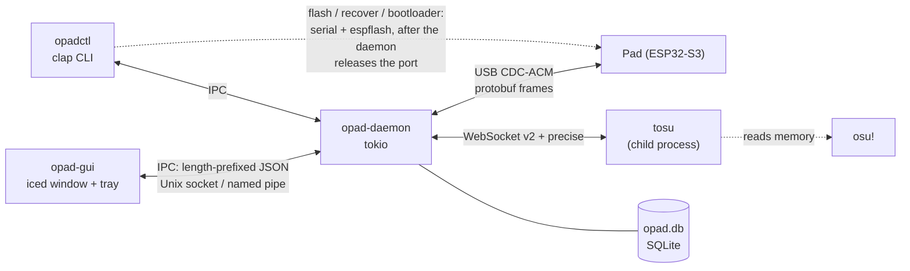

The OPad desktop suite is a Rust (edition 2021) Cargo workspace, version `1.0.0-rc.6` ([/desktop/Cargo.toml](https://github.com/OPad-dev/OPad/blob/main/desktop/Cargo.toml)): three binaries (`opad-daemon`, `opad-gui`, `opadctl`) and nine library crates, for Linux (X11 and Wayland) and Windows 10/11. It is optional: the pad is a plain keyboard without it ([/AGENTS.md](https://github.com/OPad-dev/OPad/blob/main/AGENTS.md) §1.2). Building it: [Building from Source](../building.md); tests: [Testing](../testing.md).

## Process Model

1. **`opad-daemon`** ([/desktop/daemon/src/main.rs](https://github.com/OPad-dev/OPad/blob/main/desktop/daemon/src/main.rs)): the only process that holds the pad's serial port in normal use. Runs the ordered device actor, supervises `tosu`, persists to SQLite, checks for updates, and serves IPC. Details: [Daemon](daemon.md).
2. **`opad-gui`** ([/desktop/gui/src/main.rs](https://github.com/OPad-dev/OPad/blob/main/desktop/gui/src/main.rs)): the window and tray applet (`--tray`, `--page <name>`). Starts the daemon if it is not running. Details: [GUI](gui.md).
3. **`opadctl`** ([/desktop/cli/src/main.rs](https://github.com/OPad-dev/OPad/blob/main/desktop/cli/src/main.rs)): scripting and diagnostics over IPC; `flash`, `recover` and `bootloader` talk to the serial port directly. Details: [opadctl internals](opadctl.md).

The GUI and `opadctl` ship with the daemon and must match its version exactly: the IPC handshake checks `IPC_PROTOCOL_VERSION` and the package version ([/desktop/daemon/src/ipc_handlers.rs](https://github.com/OPad-dev/OPad/blob/main/desktop/daemon/src/ipc_handlers.rs)). The pad, by contrast, updates independently, so the serial protocol negotiates instead ([App and Pad Versions](../../explanation/app-and-pad-versions.md)).

## Workspace Crates (`desktop/crates/`)

Dependencies point downward: `opad-model` depends on none of the others.

| Crate | Role |
|---|---|
| [`opad-model`](crates.md#1-opad-model) | Domain types (`DeviceInfo`, `DeviceConfig`, `CounterState`, `JsonBackup`), paths, swipe actions, tap-rate maths, board-test grading, result animations |
| [`opad-protocol`](crates.md#2-opad-protocol) | Protobuf types built at compile time with `protox` / `prost` (no `protoc`), legacy / marked / checked framing, CRC-16/CCITT-FALSE |
| [`opad-ipc`](crates.md#3-opad-ipc) | Request and response types, `u32` length-prefixed JSON over a Unix socket or Windows named pipe |
| [`opad-storage`](crates.md#4-opad-storage) | SQLite (WAL, schema v19), the gameplay write guard (`StorageError::WritesBlocked`), counter reconciliation |
| [`opad-device`](crates.md#5-opad-device) | Serial discovery, handshake and framing negotiation, the command channel, `espflash`-based flashing and recovery |
| [`opad-layout`](crates.md#6-opad-layout) | 320×240 layout validation and packing to the firmware's `ui_layout_t` |
| [`opad-ui-preview`](crates.md#7-opad-ui-preview) | The firmware's `ui/core` and LVGL compiled for the host, so the Screen Designer previews exactly what the pad draws |
| [`opad-tosu`](crates.md#8-opad-tosu) | `tosu` child-process supervisor and WebSocket client, Linux Yama `ptrace` checks |
| [`opad-update`](crates.md#9-opad-update) | Signed update feed (minisign Ed25519 + SHA-256), install-origin policy, atomic file swaps, `opad-feed` and `opad-update-helper` binaries |

Where each process keeps its files: [Files and Paths](../../reference/files-and-paths.md).
