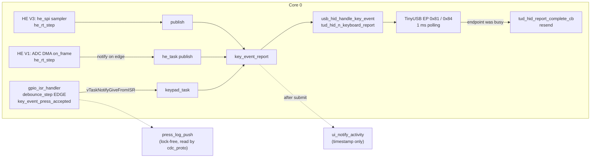
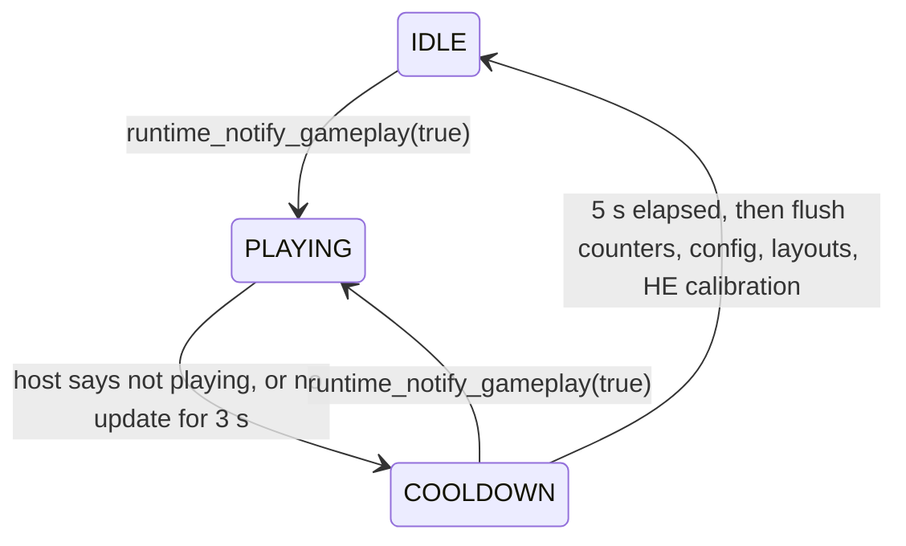

OPad firmware is C on ESP-IDF **v5.5.2** for the Waveshare ESP32-S3-Touch-LCD-2 (dual-core Xtensa LX7 at 240 MHz, 16 MB flash, 8 MB octal PSRAM). Core 0 runs the keys and USB; core 1 runs everything else (protocol, screen, touch, storage) ([/firmware/sdkconfig.defaults](https://github.com/OPad-dev/OPad/blob/main/firmware/sdkconfig.defaults), [/firmware/main/app_main.c](https://github.com/OPad-dev/OPad/blob/main/firmware/main/app_main.c)).

Subsystem pages: [input](input.md), [USB and protocol task](usb.md), [touchscreen](touch.md), [UI](ui.md), [config and NVS](config-and-nvs.md), [counters](counters.md), [diagnostics](diag.md). The design reasons are in [Latency Engineering](../../explanation/latency.md) and [System Architecture](../../explanation/architecture.md).

## Source Tree

| Directory | Contents |
|---|---|
| [/firmware/main/input/](https://github.com/OPad-dev/OPad/tree/main/firmware/main/input) | Key ISR and `keypad_task`, debouncing, Hall Effect backends and calibration, touchscreen and gestures, module detection, latency stats, press log |
| [/firmware/main/usb/](https://github.com/OPad-dev/OPad/tree/main/firmware/main/usb) | TinyUSB descriptors, HID keyboard reports, media/wheel reports, CDC-ACM and the ROM download reboot |
| [/firmware/main/protocol/](https://github.com/OPad-dev/OPad/tree/main/firmware/main/protocol) | Frame parser, nanopb message handling (`protocol.c`), generated `opad.pb.c/.h` (never hand-edited, see [Protocol Changes](../protocol-changes.md)) |
| [/firmware/main/ui/](https://github.com/OPad-dev/OPad/tree/main/firmware/main/ui) | LVGL port, layout store, HE calibration overlay, easter egg; `ui/core/` is the portable layout engine the desktop preview also compiles |
| [/firmware/main/config/](https://github.com/OPad-dev/OPad/tree/main/firmware/main/config) | Device config blobs, validation, owner ID, HE settings record, NVS namespace migration |
| [/firmware/main/counters/](https://github.com/OPad-dev/OPad/tree/main/firmware/main/counters) | Lifetime counter persistence and host-sync rules |
| [/firmware/main/runtime/](https://github.com/OPad-dev/OPad/tree/main/firmware/main/runtime) | `IDLE`/`PLAYING`/`COOLDOWN` state machine and deferred flushes |
| [/firmware/main/diag/](https://github.com/OPad-dev/OPad/tree/main/firmware/main/diag) | Diagnostic event ring, board self-test, ADS7028 test, Hall bench and UI perf builds |
| [/firmware/boards/waveshare_esp32s3_touch_lcd_2/](https://github.com/OPad-dev/OPad/tree/main/firmware/boards/waveshare_esp32s3_touch_lcd_2) | Pin map, key GPIO arming, backlight, ST7789 display bring-up, module ID ADC reads |
| [/firmware/test/host/](https://github.com/OPad-dev/OPad/tree/main/firmware/test/host) | Host-compiled unit tests for the pure-C modules (`run_tests.sh`, part of `make check`) |

## Boot Order (`app_main`)

`app_main` brings HID up first and treats everything after it as optional, so a failure in the screen, NVS or protocol never costs the keyboard ([/firmware/main/app_main.c](https://github.com/OPad-dev/OPad/blob/main/firmware/main/app_main.c)):

1. `device_config_init()` (NVS config, or defaults), then `board_detect_module()` reads the input module ID and picks the key source (MX pins, HE V1 ADC, HE V3 SPI, or keys off for an unsupported module).
2. `key_event_init()`, `keypad_init()` and `usb_hid_init()`, then `tinyusb_driver_install()` with the TinyUSB task on core 0 at `configMAX_PRIORITIES - 2`. **Failures up to here are fatal** (`ESP_ERROR_CHECK`).
3. Non-fatal from here on: `usb_cdc_init()` / `usb_cdc_start_task()`, `he_backend_start()` for a Hall Effect module, `counters_init()` (adds the NVS totals to whatever was pressed since boot), `runtime_init()`, `board_backlight_init()` and `ui_init()`, `touch_retry_init()`, and `module_monitor_start()` (not on an MX pad, whose ID is read once at boot).
4. `DIAG_EVENT_MEMORY` records free internal RAM and the largest DMA-capable block.
5. `confirm_image_once_usb_works()`: a freshly flashed OTA image stays `ESP_OTA_IMG_PENDING_VERIFY` until the host configures USB; if a host is present but never configures it within 20 s (`IMAGE_CONFIRM_TIMEOUT_US`) the pad restarts and the bootloader rolls back (see [Updates and Automatic Rollback](../../explanation/updates-and-rollback.md)).

`CONFIG_OPAD_BENCH_HID_ONLY` stops after step 2; `CONFIG_OPAD_BENCH_NO_DISPLAY` skips the display and touch.

## FreeRTOS Tasks

| Task | Core | Priority | Stack | Source | Purpose |
|---|---|---|---|---|---|
| `keypad_task` | 0 | `configMAX_PRIORITIES - 1` | 4096 | [/firmware/main/input/keypad.c](https://github.com/OPad-dev/OPad/blob/main/firmware/main/input/keypad.c) | Mechanical keys: debounce resample, HID submit, staged pin changes, pin detection, line test |
| `he_task` | 0 | `configMAX_PRIORITIES - 1` | 4096 | [/firmware/main/input/he_backend.c](https://github.com/OPad-dev/OPad/blob/main/firmware/main/input/he_backend.c) | Hall Effect: publishes V1 key edges, health checks, ADC restart, paused probes (HE pads only) |
| `he_spi` | 0 | `configMAX_PRIORITIES - 1` | 3072 | [/firmware/main/input/he_spi_source.c](https://github.com/OPad-dev/OPad/blob/main/firmware/main/input/he_spi_source.c) | HE V3: ADS7028 frame every 50 µs, reports key changes itself (HE V3 only) |
| TinyUSB (`tusb`) | 0 | `configMAX_PRIORITIES - 2` | esp_tinyusb default | [/firmware/main/app_main.c](https://github.com/OPad-dev/OPad/blob/main/firmware/main/app_main.c) | USB device stack, report completions (`tud_hid_report_complete_cb`) |
| `cdc_proto` | 1 | `tskIDLE_PRIORITY + 3` | 6144 | [/firmware/main/usb/usb_cdc.c](https://github.com/OPad-dev/OPad/blob/main/firmware/main/usb/usb_cdc.c) | Serial protocol receive, dispatch and send |
| LVGL port task | 1 | `2` | esp_lvgl_port default | [/firmware/main/ui/ui_port.c](https://github.com/OPad-dev/OPad/blob/main/firmware/main/ui/ui_port.c) | Rendering, 20 ms `pad_timer_cb`, HE calibration overlay timer |
| `touch_retry` | 1 | `2` | 3072 | [/firmware/main/input/touch_retry.c](https://github.com/OPad-dev/OPad/blob/main/firmware/main/input/touch_retry.c) | CST816S touch: Quick Retry and swipes |
| `module_mon` | 1 | `tskIDLE_PRIORITY + 1` | 3072 | [/firmware/main/input/module_monitor.c](https://github.com/OPad-dev/OPad/blob/main/firmware/main/input/module_monitor.c) | Turns the keys off when a module is swapped while powered (not on MX pads) |
| `runtime_task` | 1 | `tskIDLE_PRIORITY + 1` | 4096 | [/firmware/main/runtime/runtime.c](https://github.com/OPad-dev/OPad/blob/main/firmware/main/runtime/runtime.c) | State machine, deferred NVS flushes, host-requested restart |

Debug and measurement builds add `he_debug` / `mx_debug` (core 1, `tskIDLE_PRIORITY + 2`, `CONFIG_OPAD_HE_DEBUG`), `he_trace` (core 1, `tskIDLE_PRIORITY + 2`, `CONFIG_OPAD_HE_TRACE`) and `hall_bench` (core 0, `configMAX_PRIORITIES - 3`, `CONFIG_OPAD_HALL_BENCH`).

## The Keypress Path

Everything on this path is on core 0 and in IRAM; nothing from core 1 (screen, protocol, NVS) is on it.

Press counters are incremented where the press is accepted (ISR or frame step), the HID report is submitted next, and latency is recorded after submit (`latency_stats_record`). Details: [input](input.md), [USB](usb.md).

## Runtime State Machine (`runtime.c`)

`runtime_supervisor_task` wakes every 100 ms ([/firmware/main/runtime/runtime.c](https://github.com/OPad-dev/OPad/blob/main/firmware/main/runtime/runtime.c)). The host drives `PLAYING` through `HostStatus`; the pad leaves it on its own if updates stop.

- `GAMEPLAY_TIMEOUT_US = 3 s`, `COOLDOWN_DURATION_US = 5 s`. `OPAD_STATE_UNKNOWN` and `OPAD_STATE_SYNC` exist in the enum ([/firmware/main/runtime/runtime.h](https://github.com/OPad-dev/OPad/blob/main/firmware/main/runtime/runtime.h)) but the supervisor only moves between the three states above.
- In `IDLE` every tick calls `device_config_flush()`, `ui_store_flush_dirty()` and `he_cal_flush()`, and checkpoints counters when `counters_checkpoint_due()` says so or a USB suspend requested it ([counters](counters.md)).
- No NVS write happens in `PLAYING` or `COOLDOWN`: every writer checks `runtime_get_state() != OPAD_STATE_IDLE` and only marks itself dirty ([config and NVS](config-and-nvs.md)).
- `runtime_request_restart()` (the app's Restart) waits for `IDLE` and a confirmed OTA image, flushes everything, then calls `esp_restart()`.

## Critical `sdkconfig.defaults` Settings

From [/firmware/sdkconfig.defaults](https://github.com/OPad-dev/OPad/blob/main/firmware/sdkconfig.defaults). After editing it, delete `firmware/sdkconfig` and rebuild ([/AGENTS.md](https://github.com/OPad-dev/OPad/blob/main/AGENTS.md) §5).

| Setting | Why |
|---|---|
| `CONFIG_ESP_DEFAULT_CPU_FREQ_MHZ_240=y` | With the key path in IRAM, a press reached USB in ~70 µs under display load instead of ~240 µs at 160 MHz from flash |
| `CONFIG_COMPILER_OPTIMIZATION_PERF=y` | `-O2` |
| `CONFIG_FREERTOS_HZ=1000` | 1 ms tick, matching USB polling |
| `CONFIG_GPIO_CTRL_FUNC_IN_IRAM=y` | `gpio_get_level` and friends in IRAM for the key ISR and `keypad_task` |
| `CONFIG_TINYUSB_HID_COUNT=2`, `CONFIG_TINYUSB_CDC_COUNT=1` | Must match the descriptor; `usb_descriptors.c` fails the build otherwise |
| `CONFIG_TINYUSB_CDC_TX_BUFSIZE=2048` | Room for the largest device frame, so `usb_cdc_write` queues frames whole |
| `CONFIG_TINYUSB_SUSPEND_CALLBACK=y` | `TINYUSB_EVENT_SUSPENDED` requests a counter checkpoint |
| `CONFIG_SPIRAM=y`, `CONFIG_SPIRAM_MODE_OCT=y`, `CONFIG_SPIRAM_SPEED_80M=y`, `CONFIG_SPIRAM_ALLOW_BSS_SEG_EXTERNAL_MEMORY=y` | 8 MB PSRAM, and `EXT_RAM_BSS_ATTR` for off-key-path buffers |
| `CONFIG_LV_MEM_SIZE_KILOBYTES=160`, `CONFIG_LV_DEF_REFR_PERIOD=33` | LVGL's own 160 KB pool (in PSRAM by default) and a 30 fps redraw cap |
| `CONFIG_ESP32S3_INSTRUCTION_CACHE_32KB=y`, `CONFIG_ESP32S3_DATA_CACHE_64KB=y`, `CONFIG_ESP32S3_DATA_CACHE_LINE_64B=y` | Largest caches: halved frame time for flash-resident code/fonts and the PSRAM pool |
| `CONFIG_PARTITION_TABLE_CUSTOM=y`, `CONFIG_BOOTLOADER_APP_ROLLBACK_ENABLE=y` | Two 2 MB OTA slots ([/firmware/partitions.csv](https://github.com/OPad-dev/OPad/blob/main/firmware/partitions.csv): `nvs` 0x9000, `otadata` 0xf000, `ota_0` 0x20000, `ota_1` 0x220000, then `coredump`, `assets` and `user`) with bootloader rollback |

Only the LVGL widgets the layouts use are enabled (label, bar, image, observer, GIF); fonts are Montserrat 12/14/16/20/24/32/48.

## IRAM Placement and Memory Layout

- **IRAM linker fragment** ([/firmware/main/linker.lf](https://github.com/OPad-dev/OPad/blob/main/firmware/main/linker.lf)): `keypad:keypad_task`, all of `usb_hid`, `he_frame`, `he_rt`, `he_spi_source:sampler_task` and `he_spi_frame` are `noflash`, plus TinyUSB's `tud_hid_n_ready` / `tud_hid_n_report` / `tud_hid_n_keyboard_report`, the `usbd` endpoint helpers, `tu_edpt_claim` / `tu_edpt_release`, `tu_hwfifo_write` and the whole of `dcd_dwc2`. Other key-path functions carry `IRAM_ATTR` in the source (`gpio_isr_handler`, `debounce_step`, `key_event_press_accepted`, `key_event_report`, `usb_hid_handle_key_event`, HE `process_frame` / `publish`). A cache miss while core 1 is busy otherwise cost the key path 170–240 µs.
- **Internal RAM vs PSRAM**: only the keys, USB and DMA buffers need internal RAM. With `CONFIG_OPAD_LVGL_PSRAM=y` (default), LVGL's pool is allocated from PSRAM at boot ([/firmware/main/ui/lvgl_psram_pool.h](https://github.com/OPad-dev/OPad/blob/main/firmware/main/ui/lvgl_psram_pool.h)). `EXT_RAM_BSS_ATTR` puts `s_layouts` ([/firmware/main/ui/ui_port.c](https://github.com/OPad-dev/OPad/blob/main/firmware/main/ui/ui_port.c)), `s_pending_layouts` ([/firmware/main/ui/ui_store.c](https://github.com/OPad-dev/OPad/blob/main/firmware/main/ui/ui_store.c)), `s_subjects` / `s_str_buf` / `s_str_prev` ([/firmware/main/ui/core/ui_data.c](https://github.com/OPad-dev/OPad/blob/main/firmware/main/ui/core/ui_data.c)), and the parser, decoded message and layout buffers in [/firmware/main/protocol/protocol.c](https://github.com/OPad-dev/OPad/blob/main/firmware/main/protocol/protocol.c) in PSRAM. The two 40-line draw buffers (`UI_DRAW_BUF_LINES = 40`, 25.6 KB each) stay in internal DMA RAM ([/firmware/main/ui/ui.h](https://github.com/OPad-dev/OPad/blob/main/firmware/main/ui/ui.h)).

## Compile-Time Kconfig Options

Defined in [/firmware/main/Kconfig.projbuild](https://github.com/OPad-dev/OPad/blob/main/firmware/main/Kconfig.projbuild) under **OPad Testing and Benchmark**. All default to `n` except `CONFIG_OPAD_LVGL_PSRAM`.

| Option | Effect |
|---|---|
| `CONFIG_OPAD_TEST_FAIL_LCD` / `CONFIG_OPAD_TEST_FAIL_NVS` | Fault injection: `board_display_init` / NVS init fail, to prove headless keyboard and RAM-only counters |
| `CONFIG_OPAD_BENCH_HID_ONLY` / `CONFIG_OPAD_BENCH_NO_DISPLAY` | Latency stages A (HID and keypad only) and B (CDC on, no display) ([Latency Measurement](../latency-testing.md)) |
| `CONFIG_OPAD_BENCH_DEBUG_GPIO` / `CONFIG_OPAD_BENCH_DEBUG_GPIO_NUM` (default `4`) | Toggles a GPIO right after HID submit for a logic analyser |
| `CONFIG_OPAD_HE_BACKEND` | Hall Effect **V1** input over ADC1 continuous DMA (selects `ADC_CONTINUOUS_ISR_IRAM_SAFE`). HE V3 (ADS7028 over SPI) is always built in |
| `CONFIG_OPAD_HE_TRACE` | Streams every raw V1 conversion (~150 KB/s) over CDC for `scripts/he_trace.py`; needs the daemon stopped |
| `CONFIG_OPAD_HE_DEBUG` | Debug firmware: logs every HE press (`he.*`) or MX tap (`he.mx*`) as LogEvents the daemon writes to `he-debug.log`; version gets `+hedebug`. Adds latency on purpose |
| `CONFIG_OPAD_HALL_BENCH` | Raw HE V1 sensor text stream over CDC for `scripts/hall_bench.py` ([diagnostics](diag.md)) |
| `CONFIG_OPAD_UI_PERF_TEST` | Fake session loop with LVGL FPS/memory overlays and `DIAG_EVENT_UI_PERF` |
| `CONFIG_OPAD_LVGL_PSRAM` (default `y`) | LVGL pool in PSRAM; with it in internal RAM an HE V3 pad had too little DMA RAM left for the draw buffers |
| `CONFIG_OPAD_DEBUG_I2C_SCAN` | Probes all touch-bus I2C addresses at boot (up to ~1.3 s) |

> [!WARNING]
> Benchmark, trace, debug and fault-injection builds are not release builds. Latency measured with `CONFIG_OPAD_HE_TRACE` or `CONFIG_OPAD_HE_DEBUG` does not count.
