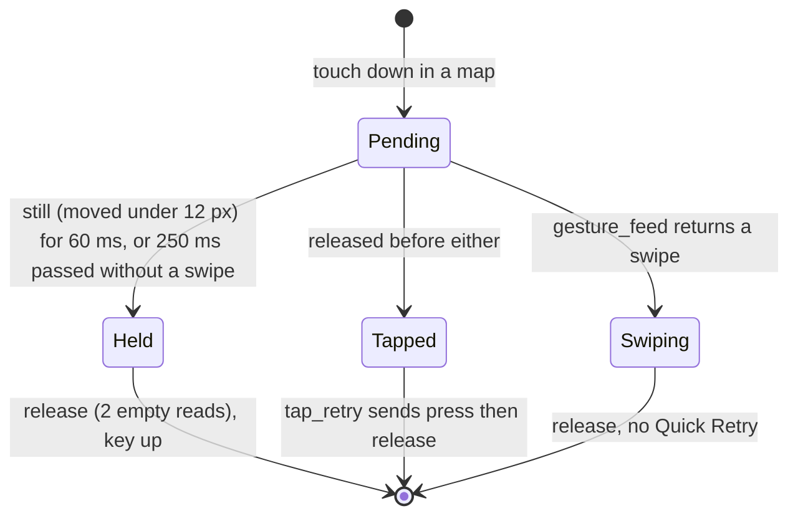

The touchscreen is OPad's fourth button ([/AGENTS.md](https://github.com/OPad-dev/OPad/blob/main/AGENTS.md) §1.4): a clean press, a held state while the finger stays down, and a clean release. It is driven by `touch_retry_task` on **core 1** at priority `2` ([/firmware/main/input/touch_retry.c](https://github.com/OPad-dev/OPad/blob/main/firmware/main/input/touch_retry.c)); its keys reach the keyboard report through `usb_hid_set_touch_key()` ([USB](usb.md#split-endpoint-hid-submission-usb_hidc)). User-facing behaviour: [Touchscreen and Swipes](../../guides/touchscreen-and-swipes.md); design: [Touchscreen as Third Button](../../explanation/touchscreen-button.md).

## Hardware and I2C

- **Controller**: Hynitron CST816S at `CST816_I2C_ADDR = 0x15` on `I2C_NUM_0`, 100 kHz (`CST816_I2C_FREQ_HZ`), 20 ms transaction timeout.
- **Pins** ([/firmware/boards/waveshare_esp32s3_touch_lcd_2/board_pins.h](https://github.com/OPad-dev/OPad/blob/main/firmware/boards/waveshare_esp32s3_touch_lcd_2/board_pins.h)): SDA GPIO48 (`BOARD_I2C_SDA_GPIO`), SCL GPIO47 (`BOARD_I2C_SCL_GPIO`), INT GPIO46 (`BOARD_TOUCH_INT_GPIO`, falling edge, internal pull-up). The IMU (QMI8658) shares the bus.
- **Auto-sleep off**: `0xFF` written to `CST816_REG_AUTO_SLEEP` (`0xFE`) at init and again on the first touch if that failed, so the controller adds no wake-up delay.
- **Reads**: one 5-byte read from `CST816_REG_TOUCH_NUM` (`0x02`) gives the touch count and 12-bit X/Y. A sample is "down" if INT is low or the count is non-zero.
- **Orientation**: the panel is portrait (240×320), the UI landscape (320×240), so coordinates go through `TOUCH_SWAP_XY = 1`, `TOUCH_MIRROR_X = 0`, `TOUCH_MIRROR_Y = 1` so "up" is up as the pad is held.

## Idle on the Interrupt, Poll Only While Down

1. **No finger**: the task blocks in `ulTaskNotifyTake()`, woken by the INT ISR (`touch_int_isr`, `vTaskNotifyGiveFromISR`). No CPU and no I2C traffic. A 1 s timeout (`TOUCH_IDLE_CHECK_MS`) is only a safety net for a silent INT line; if the ISR could not be installed the task falls back to polling every 10 ms.
2. **Finger down**: one confirming read, then a read every `TOUCH_POLL_MS = 10` ms to follow the finger and see the release.
3. **Release**: `TOUCH_RELEASE_READS = 2` empty reads in a row (~20 ms), so one noisy read never ends a hold.

## Touch Modes

The mode is fixed at touch-down by `touch_mode_now()`, from `touch_retry_set_host_status()` (called by the protocol task on every `HostStatus`) and the runtime state:

| Mode | When | Quick Retry | Swipes |
|---|---|---|---|
| `TOUCH_MODE_RETRY` | No `HostStatus` with tosu connected in the last 3 s (`HOST_STATUS_TIMEOUT_US`): no daemon, no tosu | Pressed at touch-down, held until release | Off |
| `TOUCH_MODE_PLAY` | Host alive and `runtime_get_state() == OPAD_STATE_PLAYING` | Pending; see below | Media only (no keyboard report) |
| `TOUCH_MODE_MENU` | Host alive, not playing | Never; a tap sends nothing | All actions |

**Quick Retry during a map.** The `` ` `` key is not sent at touch-down, so a swipe can never send it:

`PLAY_RETRY_STILL_US = 60000`, `PLAY_RETRY_STILL_PX = 12`, `PLAY_SWIPE_WINDOW_US = 250000`. Once Quick Retry is held, swipe tracking stops for the rest of that touch.

## Gesture Classifier (`gesture.c`)

Pure C, host-tested ([/firmware/main/input/gesture.h](https://github.com/OPad-dev/OPad/blob/main/firmware/main/input/gesture.h), [/firmware/main/input/gesture.c](https://github.com/OPad-dev/OPad/blob/main/firmware/main/input/gesture.c)):

- Nothing is a swipe until the finger is `GESTURE_SWIPE_PX = 30` px from where it landed (`gesture_begin`).
- One axis must lead 3:2 (`2·|dy| ≥ 3·|dx|` vertical, `2·|dx| ≥ 3·|dy|` horizontal); a diagonal waits for more movement. The swipe then locks to that axis.
- **Vertical** keeps stepping every 30 px for as long as the finger moves (turning back steps the other way): one volume step each. **Horizontal** fires once per touch. `gesture_feed()` is called repeatedly with the same position until it returns `GESTURE_NONE`, so a fast or late-read swipe keeps its length.

## Swipe Actions

Each direction has an action, key and modifiers from the device config (`touch_retry_set_swipe_actions()`), defaults up/down volume, left/right previous/next track ([/firmware/main/config/device_config.h](https://github.com/OPad-dev/OPad/blob/main/firmware/main/config/device_config.h)). Only volume repeats along a drag; every other action fires once per touch.

| Action | Outside a map | In a map |
|---|---|---|
| Volume up/down, osu! active (`osu_active` from the host, [/desktop/daemon/src/osu_window.rs](https://github.com/OPad-dev/OPad/blob/main/desktop/daemon/src/osu_window.rs)) | Alt held on the keyboard report, wheel notches on the media interface; Alt is held for the whole touch | Plain wheel, no Alt |
| Volume up/down, osu! not active | Consumer volume keys | Consumer volume keys |
| Previous/next track, play/pause, mute | Consumer keys | Consumer keys |
| Keyboard key (`SWIPE_ACTION_KEY`) | Modifiers down, key tapped 15 ms, modifiers up | Nothing |

- **Releasing Alt (`release_alt`)**: waits for the wheel reports to land, then sends Alt+F24, Alt, then nothing. Windows reads a bare Alt press and release as "open the window menu" (`SC_KEYMENU`), which can make a game drop the next key; F24 is bound to nothing. Each step waits up to `TOUCH_KEY_WAIT_MS = 30` ms for delivery, and `TOUCH_ORDER_GAP_MS = 4` keeps Alt ahead of the wheel on the host.
- **Feedback**: outside a map the pad shows a short arrow and label (`ui_show_swipe`). Keyboard-key labels come from [/firmware/main/input/swipe_labels.c](https://github.com/OPad-dev/OPad/blob/main/firmware/main/input/swipe_labels.c) (`SWIPE_LABELS`: osu!'s default shortcuts such as F1 Mods, F2 Random, F3 Options, Ctrl+O Settings), which must list every shortcut in `OSU_SHORTCUTS` ([/desktop/crates/opad-model/src/swipe.rs](https://github.com/OPad-dev/OPad/blob/main/desktop/crates/opad-model/src/swipe.rs)); a host test checks it. **During a map nothing is drawn.**

## Calibration Gating

On an uncalibrated Hall Effect pad, or while calibration runs, touch belongs to the calibration screen (decision D7 in [/docs/specs/v2-hall-effect-decisions.md](../../specs/v2-hall-effect-decisions.md)):

- At touch-down `he_cal_suppress_input(he_backend_is_locked(), he_backend_is_calibrating())` gates the touch: samples go only to `he_cal_ui_touch_sample()`, no Quick Retry, no swipe, no key.
- A lock that starts mid-touch (checked on every read, up or down) releases Quick Retry and clears the touch key without the F24 sequence, and latches until the finger lifts.
- `he_cal_touch_guard.h` interlocks a calibration start with a touch in flight: `touch_retry_reserve_calibration()` fails while a contact or its release cleanup is running.
