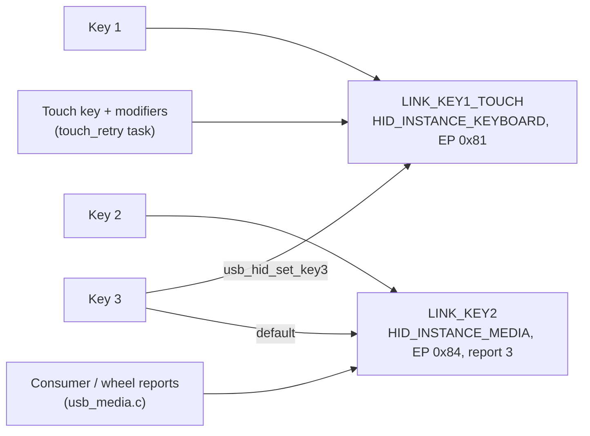

The pad is a USB 2.1 full-speed composite device, `VID 0x303A` / `PID 0x8415` (OPad's own PID, granted by Espressif), `bcdDevice 0x0102`, built on TinyUSB (`espressif/esp_tinyusb` 2.3.0, `espressif/tinyusb` 0.21.0~2 in [/firmware/dependencies.lock](https://github.com/OPad-dev/OPad/blob/main/firmware/dependencies.lock)). The TinyUSB task runs on core 0 at `configMAX_PRIORITIES - 2`, below only the key tasks ([/firmware/main/app_main.c](https://github.com/OPad-dev/OPad/blob/main/firmware/main/app_main.c), [/firmware/main/usb/usb_descriptors.c](https://github.com/OPad-dev/OPad/blob/main/firmware/main/usb/usb_descriptors.c)).

Release-candidate firmware used `303a:4001`; the desktop finds the pad by its descriptor strings, not its PID ([crates](../desktop/crates.md#5-opad-device)). The ROM bootloader is `303a:1001`.

> [!IMPORTANT]
> The pad must stay a plain keyboard with no driver on Linux and Windows 10/11 ([/AGENTS.md](https://github.com/OPad-dev/OPad/blob/main/AGENTS.md) §1.2). Changes under `firmware/main/usb/` must state their latency impact and how it was measured (§1.1).

## Descriptors and Interfaces

Declared in [/firmware/main/usb/usb_descriptors.c](https://github.com/OPad-dev/OPad/blob/main/firmware/main/usb/usb_descriptors.c) and [/firmware/main/usb/usb_descriptors.h](https://github.com/OPad-dev/OPad/blob/main/firmware/main/usb/usb_descriptors.h):

| Interface | Class / protocol | Endpoints | Polling | Carries |
|---|---|---|---|---|
| 0 `ITF_NUM_HID` | HID boot keyboard (`HID_ITF_PROTOCOL_KEYBOARD`) | `0x81` IN, 8 B | 1 ms | Key 1, the touchscreen key (Quick Retry, swipe keys and Alt), and Key 3 when routed here; report ID 0 |
| 1–2 `ITF_NUM_CDC` / `ITF_NUM_CDC_DATA` | CDC-ACM | `0x82` notify IN 8 B, `0x03` OUT 64 B, `0x83` IN 64 B | bulk | Serial protocol |
| 3 `ITF_NUM_MEDIA` | HID, no boot protocol | `0x84` IN, 16 B | 1 ms | `MEDIA_REPORT_ID_CONSUMER = 1` (volume, media keys), `MEDIA_REPORT_ID_MOUSE = 2` (wheel), `MEDIA_REPORT_ID_KEYBOARD = 3` (Key 2, and Key 3 when routed here) |

- The media interface comes after CDC so the keyboard and COM port keep the interface numbers they had before it existed.
- **Strings**: manufacturer `GFerreiroS`, product `OPad ESP32-S3`, serial `OPAD-<MAC>` (`usb_descriptors_init()` from the Wi-Fi STA MAC), interface names `OPad HID Keyboard`, `OPad CDC Telemetry`, `OPad Media Controls`.
- **BOS + MS OS 2.0** (`opad_usb_bos_desc`, `opad_usb_ms_os_20_desc`, served from `tud_vendor_control_xfer_cb`): `FriendlyName = "OPad"` on interface 1, so Windows shows `OPad (COMx)` with no INF.
- **Build guards**: `_Static_assert(CFG_TUD_HID >= HID_INSTANCE_MEDIA + 1)` and `_Static_assert(CFG_TUD_CDC >= 1)`. A stale `firmware/sdkconfig` with one HID interface too few once built a pad the host refused (`can't set config #1, error -32`).
- `bcdDevice` is bumped when the interfaces change so Windows re-reads its cached descriptors (1.0.1 added the media interface, 1.0.2 put Key 2 on it).

## Split-Endpoint HID Submission (`usb_hid.c`)

A report can only be submitted once the host has collected the previous one on the same endpoint (up to 1 ms). With both keys on one endpoint, K2 changing within 1 ms of K1 in a stream had to wait, so each game key now has its own endpoint ([/firmware/main/usb/usb_hid.c](https://github.com/OPad-dev/OPad/blob/main/firmware/main/usb/usb_hid.c)).

- **Links (`hid_link_t`)**: `LINK_KEY1_TOUCH` and `LINK_KEY2`. The ESP32-S3 has at most five IN endpoints including EP0, so Key 2 shares the media interface's endpoint instead of a third HID interface.
- **Key 3 routing (`usb_hid_set_key3`)**: Key 3 rides with Key 2, unless Key 2 is a game key and Key 1 is not; then it moves to Key 1's link. Two game keys never share an endpoint. A key 3 held across the change is resent on both links.
- **Lock-free sequencing**: every writer bumps the link's `change_seq` before `try_submit()`; a successful `tud_hid_n_keyboard_report()` raises `sent_seq` to the sequence it loaded. A change is pending while `sent_seq` is behind. On a busy endpoint `usb_hid_handle_key_event()` returns `false`, arms `pending_edge_us` with the edge time, and `tud_hid_report_complete_cb` (TinyUSB task) resends the current state and records its latency. One submitter can never clear another's change.
- **Touch key (`usb_hid_set_touch_key`)**: the touch task's key and modifiers go on the keyboard link. During a map that slot only ever holds Quick Retry (`` ` ``, `0x35`); Alt and swipe keys are sent outside gameplay only ([touch](touch.md)).
- **Media (`usb_media.c`)**: `usb_media_consumer_tap()` (press, then release with a longer 250 ms wait so a lost release cannot leave volume repeating) and `usb_media_wheel()`. They retry when Key 2's report takes the endpoint first, and are called from the touch task only ([/firmware/main/usb/usb_media.c](https://github.com/OPad-dev/OPad/blob/main/firmware/main/usb/usb_media.c)).
- **Report barrier (`usb_report_barrier_wait`)**: used only when HE calibration starts; it queues a deferred function on the TinyUSB task and waits for it, so no completion still holding an old key state can resend it ([/firmware/main/usb/usb_report_barrier.c](https://github.com/OPad-dev/OPad/blob/main/firmware/main/usb/usb_report_barrier.c)).

## CDC and the Protocol Task (`usb_cdc.c`)

[/firmware/main/usb/usb_cdc.c](https://github.com/OPad-dev/OPad/blob/main/firmware/main/usb/usb_cdc.c) runs `cdc_proto` on core 1 at `tskIDLE_PRIORITY + 3` (6144 B stack). It sleeps on a task notification from `tud_cdc_rx_cb` with a 200 ms safety timeout (10 ms while the app's live HE view is open, 20 ms in the HE debug build). Each wake, `usb_cdc_task_poll()`:

1. Resets the frame parser after a DTR drop (`protocol_reset_rx()`: framing negotiation forgotten, app-started HE calibration told the host left).
2. Reboots to ROM download mode if one was requested.
3. Reads up to 256 bytes at a time into `protocol_feed_cdc_bytes()`. The plain-text commands `BOOTLOADER` and `FREAKY67` are honoured only when they are the entire read and the parser is between frames (`protocol_rx_idle()`), so a song title containing them can never trigger them.
4. Polls pin detection, HE calibration progress, HE live samples and HE debug lines, then sends key-press timestamps (`protocol_send_key_presses`) and drains the diagnostic ring (`protocol_drain_diag_logs`).

`usb_cdc_write()` is all-or-nothing: a frame is queued only when the TX FIFO (2048 B, `CONFIG_TINYUSB_CDC_TX_BUFSIZE`) has room for all of it, waiting at most `CDC_TX_WAIT_MS = 20` ms, so the host never receives a header without its payload.

The framing (legacy, marked `AA 55`, checked `AA 5A` + CRC-16) and message catalogue are in [Serial Wire Protocol](../../reference/serial-protocol.md) and [/firmware/main/protocol/frame_parser.h](https://github.com/OPad-dev/OPad/blob/main/firmware/main/protocol/frame_parser.h); the pad answers in the framing the host used ([App and Pad Versions](../../explanation/app-and-pad-versions.md)). Changing messages: [Protocol Changes](../protocol-changes.md).

## Hands-Free ROM Download Reboot

Two triggers schedule `reboot_to_rom_download()`, the same two the host flasher tries in order (`BOOT_TRIGGERS` in [/desktop/crates/opad-device/src/flash.rs](https://github.com/OPad-dev/OPad/blob/main/desktop/crates/opad-device/src/flash.rs)): the `BOOTLOADER` text command, and the 1200-baud touch (line coding set to 1200 baud arms it; the next DTR drop fires it, or at once if DTR is already low). There is no protobuf message for it. The esptool DTR/RTS reset pattern is deliberately **not** honoured: ModemManager and serial probes toggle those lines on every open.

`reboot_to_rom_download()` hands the internal PHY back to the USB-Serial-JTAG controller so the chip enumerates as `303a:1001` with no button ([/AGENTS.md](https://github.com/OPad-dev/OPad/blob/main/AGENTS.md) §1.5, §6):

1. Flushes CDC, then `tud_disconnect()`. Never `tinyusb_driver_uninstall()`, which frees mutexes and FIFOs the HID and protocol tasks may still use.
2. Routes the PHY to USJ and holds SE0 (both lines pulled down, no pull-up) for 300 ms so the host sees a real detach; without it the host fails with `error -71` and the app comes back.
3. Re-attaches with the D+ pull-up override set to 1 **before** dropping the override (leaving it 0 makes the board vanish until a replug), then waits up to 1.5 s for the host's bus reset.
4. Writes `RTC_CNTL_FORCE_DOWNLOAD_BOOT` to `RTC_CNTL_OPTION1_REG` and calls `esp_restart()`; `app_main` clears that register on the next normal boot.

Leaving download mode needs an RTC watchdog reset, which the host flasher performs itself (`reset_to_app` in [/desktop/crates/opad-device/src/flash.rs](https://github.com/OPad-dev/OPad/blob/main/desktop/crates/opad-device/src/flash.rs)). Recovery when the app never enumerates: [Recovery](../../recovery.md) §7.6–7.7.
