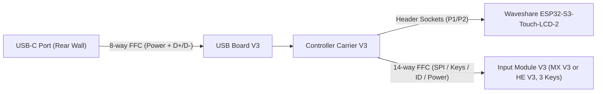

OPad separates the Waveshare ESP32-S3-Touch-LCD-2 controller from the physical switches through modular carrier and input-module PCBs.

## 1. Hardware Generations Overview

| Generation | Carrier Board | Cable Type | Key Modules | ADC & Sensor Architecture | Status |
|---|---|---|---|---|---|
| **V1** | Controller carrier V1 (headers P1/P2) | 8-pin JST SH (1.0 mm) | MX V1 (2-key), HE V1.1 (2-key) | Analog DRV5055A3 voltages routed over cable to ESP32-S3 internal ADC1. | Superseded ([/hardware/pcb/V1/README.md](/hardware/pcb/V1/README.md)) |
| **V2** | Controller carrier V1 | 8-pin JST SH (1.0 mm) | HE V2 prototype | On-module TI ADS7038 12-bit SPI ADC. | Prototype ([/hardware/pcb/V2/README.md](/hardware/pcb/V2/README.md)) |
| **V3** | Controller carrier V3 + USB Board V3 | 14-way 1.0 mm type B FFC (module), 8-way 1.0 mm type A FFC (USB) | MX V3 (3-key), HE V3 (3-key) | On-module TI **ADS7028** 12-bit SPI ADC, **LP5907** 3.3 V LDO from 5 V VBUS, 3x3 mm sensor ground keepouts. | Current ([/hardware/pcb/V3/README.md](/hardware/pcb/V3/README.md)) |

## 2. V3 PCB Ecosystem

Defined in [/hardware/pcb/V3/README.md](/hardware/pcb/V3/README.md):



- **USB Board V3** (`20.0 x 22.0 mm`): Passive rear USB-C port with ProTek SRV05-4 ESD protection, Murata ferrite, capacitors, and B5817W Schottky diode preventing back-feeding from the Waveshare port.
- **Controller Carrier V3** (`35.0 x 48.2 mm`): Dual 1x14 female header sockets seating onto Waveshare P1/P2 plus 14-way module and 8-way USB FFC connectors.
- **MX Input Module V3** (`71.05 x 24.0 mm`): 3-key Kailh hot-swap (`CPG151101S11`) mechanical switch PCB.
- **HE Input Module V3** (`71.05 x 24.0 mm`): 3-key Hall Effect PCB with three TI DRV5055A3 sensors, TI ADS7028 12-bit SPI ADC, and TI LP5907 3.3 V LDO.
- **Single-sided assembly**: Top side on carrier and USB board; bottom side on MX/HE modules.

## 3. Cable Pinouts and Module ID Detection

### Module Cable (14-Way, 1.0 mm, Type B, 80 mm)

| Contact | Carrier Pin | HE V3 | MX V3 |
|---|---|---|---|
| 1 | `GND` | `GND` | `GND` |
| 2 | `5V` | `5V` (to LP5907 LDO) | – |
| 3 | `3V3` | `3V3` | `3V3` |
| 4 | `GPIO 8` | `ID` (1.65 V) | `ID` (2.24 V) |
| 5 | `GPIO 6` | `MISO` | `KEY3` |
| 6 | `GND` | `GND` | `GND` |
| 7 | `GPIO 2` | `SCLK` | – |
| 8 | `GPIO 4` | `MOSI` | – |
| 9 | `GND` | `GND` | `GND` |
| 10 | `GPIO 10` | `CS` | `KEY1` |
| 11 | `GPIO 7` | – (alt `ID` if reversed) | `KEY2` |
| 12 | `3V3` | `3V3` | `3V3` |
| 13 | `5V` | `5V` | – |
| 14 | `GND` | `GND` | `GND` |

If the 14-way FFC is inserted reversed (`k` -> `15 - k`), power/ground still match and `ID` moves from `GPIO 8` to `GPIO 7`; firmware automatically remaps SPI3 pins for **HE V3**. An **MX V3** module on a reversed cable is not read ([/hardware/pcb/V3/README.md](/hardware/pcb/V3/README.md)).

### Module ID Voltage Thresholds ([/firmware/main/input/module_id.h](/firmware/main/input/module_id.h))

| Module | Divider (`R_top / R_bottom`) | Nominal ID | Cut-off Range |
|---|---|---|---|
| **MX V1** | `100 kΩ / 10 kΩ` | `0.30 V` | `60 mV` – `680 mV` (loaded >= `60 mV`) |
| **HE V1.1** | `100 kΩ / 47 kΩ` | `1.06 V` | `680 mV` – `1350 mV` |
| **HE V3 (and V2)** | `100 kΩ / 100 kΩ` | `1.65 V` | `1350 mV` – `1950 mV` |
| **MX V3** | `47 kΩ / 100 kΩ` | `2.24 V` | `1950 mV` – `2600 mV` |
| **None** | Floating or shorted to 3V3 | `~0 V` or `>= 2.6 V` | Hand-wired defaults |

### USB Cable (8-Way, 1.0 mm, Type A, 80 mm)

| Contact | 1 | 2 | 3 | 4 | 5 | 6 | 7 | 8 |
|---|---|---|---|---|---|---|---|---|
| **Net** | `GND` | `5V` | `D-` | `D+` | `D+` | `D-` | `5V` | `GND` |

Mirror-symmetric (`k` -> `9 - k`), carrying up to 1.0 A across the paired 5 V contacts.

## 4. 3D Enclosure Design

Parametric OpenSCAD enclosure files live in [/hardware/3d/README.md](/hardware/3d/README.md) (`hardware/3d/custom_case/V4/`), using a 1.5 mm switch plate with `14.0 x 14.0 mm` cutouts, `19.05 mm` key pitch, and four corner locating pins.

## 5. Automated Hardware Verification (`opadverify`)

[/hardware/verify/README.md](/hardware/verify/README.md) checks generated Gerbers, drill files, BOMs, and JLCPCB CPL models against golden netlists and runs cable-reversal net tracing (`test_system.py`):

```bash
python3 -m venv .tools/venv && .tools/venv/bin/pip install -r hardware/verify/requirements.txt
cd hardware/verify
../../.tools/venv/bin/python -m opadverify golden/carrier_v3.toml
../../.tools/venv/bin/python -m opadverify golden/he_v3.toml
../../.tools/venv/bin/python tests/test_system.py
```
