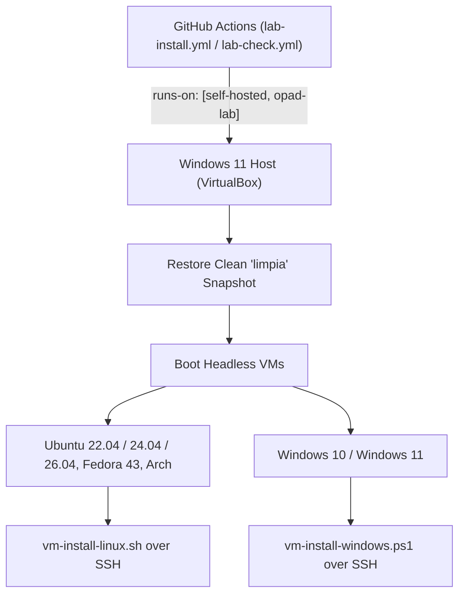

The lab is a Windows 11 mini PC running VirtualBox. It does two jobs: it runs every CI job before `main` is pushed (the `ci-linux` VM and the mini PC itself, see [Testing](testing.md#where-ci-runs)), and it installs, upgrades and uninstalls every app release in clean VMs of each supported system ([lab-common.ps1](https://github.com/OPad-dev/OPad/blob/main/scripts/lab/lab-common.ps1)). Package tests in CI check that files land in the right place; only a real desktop session shows that OPad starts at login, finds its tray, keeps its data across an upgrade and leaves nothing behind.

## Host and security model

The mini PC keeps its files in `C:\opad-lab` and is registered as a self-hosted GitHub Actions runner with the labels `[self-hosted, opad-lab]`. One lab job runs at a time (`concurrency: opad-lab`).

> [!IMPORTANT]
> **No pull request code.** A self-hosted runner must never run code from a pull request or a fork. `lab-install.yml` runs only when `release-app.yml` calls it for a release, or by hand; `lab-check.yml` only by hand ([lab-install.yml](https://github.com/OPad-dev/OPad/blob/main/.github/workflows/lab-install.yml), [lab-check.yml](https://github.com/OPad-dev/OPad/blob/main/.github/workflows/lab-check.yml)).

## VMs

Defined in `$AllVms` ([lab-common.ps1](https://github.com/OPad-dev/OPad/blob/main/scripts/lab/lab-common.ps1)):

| VM Name | Guest OS | Package Format | Forwarded SSH Port |
|---|---|---|---|
| `ubuntu-22.04` | Ubuntu 22.04 LTS | `.deb` | `2222` |
| `ubuntu-24.04` | Ubuntu 24.04 LTS | `.deb` | `2224` |
| `ubuntu-26.04` | Ubuntu 26.04 LTS | `.deb` | `2226` |
| `fedora-43` | Fedora 43 | `.rpm` | `2243` |
| `arch` | Arch Linux | `opad-bin` / `pacman` | `2250` |
| `windows-10` | Windows 10 | `OPad-Windows-Setup-*.exe` | `2310` |
| `windows-11` | Windows 11 | `OPad-Windows-Setup-*.exe` | `2311` |

One more VM, `ci-linux` (Ubuntu 24.04, SSH port `2260`), is not in `$AllVms` and has no `limpia` snapshot: it is kept between runs, with its build caches, for the Linux jobs of the lab CI that runs before every push of `main` ([lab-ci.sh](https://github.com/OPad-dev/OPad/blob/main/scripts/ci/lab-ci.sh), set up by [provision-linux.sh](https://github.com/OPad-dev/OPad/blob/main/scripts/ci/provision-linux.sh); see [Testing](testing.md#where-ci-runs)). The Windows jobs run on the mini PC itself, in `C:\opad-lab\ci`. The mini PC's disk is small for all of this: `ci-linux`'s disk has discard on (`VBoxManage storageattach ci-linux --storagectl SATA --port 0 --device 0 --nonrotational on --discard on`) and each run ends with `fstrim`, so its image shrinks back; `lab-ci.sh` removes the Windows build cache under 20 GB free and stops under 10 GB, and `lab-run.sh` starts the Linux cache over past 10 GB.

Each VM auto-logs into an `opad` desktop session (`seat0` on Linux, active console on Windows) with passwordless `sudo` / Administrator elevation over loopback SSH (`127.0.0.1`).

## Install, upgrade and uninstall

The release's packages are its assets, picked by type and checked against the SHA-256 GitHub gives for each (`digest`), so the names from `1.0.0-rc.7` on (`OPad-Linux-*`, `OPad-Windows-Setup-*`) and the older ones both work. `FILES.sha256` and the `opad-bin` PKGBUILD are assets of the older releases; from `1.0.0-rc.7` on they are the `release-extras-<tag>` artifact of the run that built the release (kept 90 days, read with the job's `actions: read` token). Once it has expired, Arch installs the built `.pkg.tar.zst` with `pacman -U` and the installed files are not checked against `FILES.sha256`.

Driven by [lab-install.ps1](https://github.com/OPad-dev/OPad/blob/main/scripts/lab/lab-install.ps1), [vm-install-linux.sh](https://github.com/OPad-dev/OPad/blob/main/scripts/lab/vm-install-linux.sh) (normalized to LF line endings before upload), and [vm-install-windows.ps1](https://github.com/OPad-dev/OPad/blob/main/scripts/lab/vm-install-windows.ps1):

1. **Clean Baseline**: Restores the `limpia` snapshot, boots headless until the desktop session is ready, installs the baseline release, and reboots to verify autostart.
2. **In-Place Upgrade (`-Feed` or direct)**:
   - When invoked with `feed: true` (from `release-app.yml`, unpacking the not-yet-deployed `github-pages` artifact) or `deployed_feed: true` (manual dispatch), `lab-install.ps1` copies `beta.json` and `beta.json.minisig` into the VM and runs the `update` phase: serves the feed on loopback (`127.0.0.1:8000`), restarts `opad-daemon` with `OPAD_MANIFEST_URL=http://127.0.0.1:8000/beta.json`, and asks it over IPC to switch to `beta`, check, and install. OPad's own updater downloads and verifies the candidate release and installs it: on Linux through `pkexec` and the update helper (`apt`, `dnf` or `pacman`), on Windows with the installer's `/SILENT`. The running OPad must keep running and report the new version as installed for the next start. If the updater fails, the run is marked failed and the package is installed directly so the remaining checks still execute.
   - Without `-Feed`, installs the candidate package directly. Reboots and verifies binary version (`FILES.sha256`), running `opad-daemon` and tray GUI, `opadctl status` (decoding missing-DLL NTSTATUS codes on Windows), `cap_sys_ptrace=eip` on `.deb`/`.rpm` `tosu`, and persistence of `opad.db` (`~/.local/share/opad/opad.db` on Linux, `%APPDATA%\opad\opad.db` on Windows).
3. **Clean Uninstallation**: Uninstalls the package/installer and verifies removal of binaries (`/usr/bin/` on Linux, `%LOCALAPPDATA%\Programs\opad` on Windows), autostart/systemd files, `udev` rules, background processes, and any `tosu` directories carrying OPad's `.created-by-opad` marker (unmarked directories are kept and noted with `info:`), then powers off and restores `limpia`.

## Health checks

[lab-check.yml](https://github.com/OPad-dev/OPad/blob/main/.github/workflows/lab-check.yml), started by hand, runs [lab-check.ps1](https://github.com/OPad-dev/OPad/blob/main/scripts/lab/lab-check.ps1): it checks the runner's desktop session, that osu! and the tosu replay fixture (`replays/expected.json`) are in place, then boots VMs from `limpia`, verifies SSH/session readiness, captures desktop screenshots via `VBoxManage controlvm screenshotpng`, and publishes summaries with [lab-results.ps1](https://github.com/OPad-dev/OPad/blob/main/scripts/lab/lab-results.ps1) (which also marks any prior orphaned `"running"` run as failed with an `Interrupted` group and records `info:` lines).
