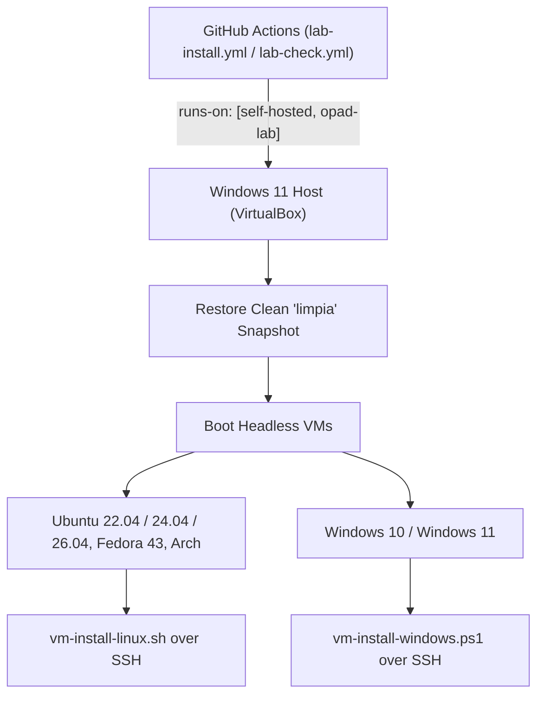

OPad validates installers, upgrades, and clean uninstallation across Linux and Windows in a self-hosted VirtualBox lab ([/scripts/lab/lab-common.ps1](/scripts/lab/lab-common.ps1)).

## 1. Host Architecture & Security Model

The lab runs on a Windows 11 host with Oracle VirtualBox (`C:\opad-lab`), registered as a self-hosted GitHub Actions runner with labels `[self-hosted, opad-lab]`.

> [!IMPORTANT]
> **No Pull Request Execution**: The self-hosted runner never executes untrusted pull requests or forks. It runs only on official release / `main` workflows ([/.github/workflows/lab-install.yml](/.github/workflows/lab-install.yml), [/.github/workflows/lab-check.yml](/.github/workflows/lab-check.yml)).

## 2. Target VM Topology

Defined in `$AllVms` ([/scripts/lab/lab-common.ps1](/scripts/lab/lab-common.ps1)):

| VM Name | Guest OS | Package Format | Forwarded SSH Port |
|---|---|---|---|
| `ubuntu-22.04` | Ubuntu 22.04 LTS | `.deb` | `2222` |
| `ubuntu-24.04` | Ubuntu 24.04 LTS | `.deb` | `2224` |
| `ubuntu-26.04` | Ubuntu 26.04 LTS | `.deb` | `2226` |
| `fedora-43` | Fedora 43 | `.rpm` | `2243` |
| `arch` | Arch Linux | `opad-bin` / `pacman` | `2250` |
| `windows-10` | Windows 10 | `opad-setup.exe` | `2310` |
| `windows-11` | Windows 11 | `opad-setup.exe` | `2311` |

Each VM auto-logs into an `opad` desktop session (`seat0` on Linux, active console on Windows) with passwordless `sudo` / Administrator elevation over loopback SSH (`127.0.0.1`).

## 3. Automated Install, Upgrade, and Uninstall Lifecycle

Driven by [/scripts/lab/lab-install.ps1](/scripts/lab/lab-install.ps1) and [/scripts/lab/vm-install-linux.sh](/scripts/lab/vm-install-linux.sh):

1. **Clean Baseline**: Restores the `limpia` snapshot, boots headless until the desktop session is ready, installs the baseline release, and reboots to verify autostart.
2. **In-Place Upgrade**: Transfers and installs the candidate release, reboots, and verifies binary version, running `opad-daemon` and tray GUI, `opadctl status`, `cap_sys_ptrace=eip` on `.deb`/`.rpm` `tosu`, and persistence of `opad.db` (`~/.local/share/opad/opad.db` on Linux, `%APPDATA%\opad\opad.db` on Windows).
3. **Clean Uninstallation**: Uninstalls the package/installer and verifies removal of binaries (`/usr/bin/` on Linux, `%LOCALAPPDATA%\Programs\opad` on Windows), autostart/systemd files, `udev` rules, and background processes, then powers off and restores `limpia`.

## 4. On-Demand Health Checks

[/.github/workflows/lab-check.yml](/.github/workflows/lab-check.yml) boots VMs from `limpia`, verifies SSH/session readiness, captures desktop screenshots via `VBoxManage controlvm screenshotpng`, and publishes summaries with [/scripts/lab/lab-results.ps1](/scripts/lab/lab-results.ps1).
