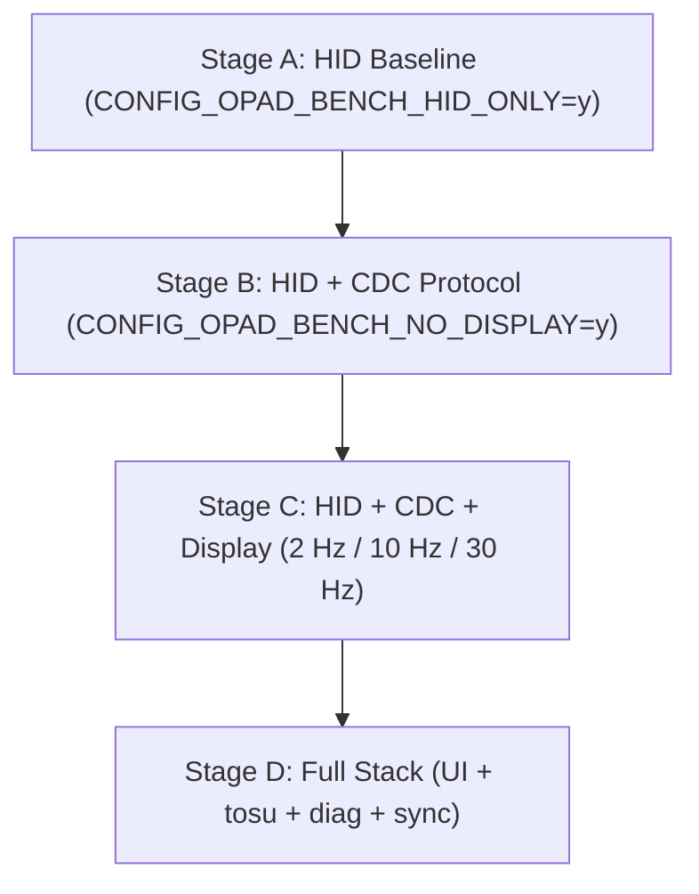

Low, jitter-free keypress latency is OPad's primary invariant ([/AGENTS.md](/AGENTS.md) §1.1). This page documents the on-device histogram, benchmark stages A–D, and measurement scripts.

## 1. Release Gate Criteria

1. **Zero missed presses** during rapid alternating streams (`> 15`–`20` presses/s).
2. **Zero stuck keys** under any load condition.
3. **No outliers > 1 ms** caused by display SPI transfers, CDC serial traffic, timers, or flash writes.
4. **Negligible full-stack overhead**: `p99.9` delta between Stage D (full stack) and Stage A (HID-only baseline) under `100 µs`.
5. **Core isolation**: Core 0 handles input and TinyUSB HID; Core 1 handles LVGL, CDC protocol, touch, and runtime tasks.

## 2. On-Device Histogram (`latency_stats.c`)

[/firmware/main/input/latency_stats.c](/firmware/main/input/latency_stats.c) measures the microsecond delta from physical edge timestamp (`edge_us`) to TinyUSB HID report acceptance:

- **10 µs buckets**: 500 atomic buckets (`BUCKET_US = 10`, `BUCKET_COUNT = 500`, `0`–`5000 µs`). Percentiles `p50`, `p99`, and `p99.9` report the upper edge of the covering bucket (multiples of 10 µs).
- **Exact maximum & outliers**: `max_us` stores the exact slowest microsecond value; samples `> 1000 µs` also increment `s_outlier_count` and update `s_outlier_max_us`.
- **Deferred count**: `deferred_reports` counts key edges that arrived while the endpoint had an in-flight USB transfer and were resent on completion.

## 3. Benchmark Stages (A through D)



- **Stage A (`CONFIG_OPAD_BENCH_HID_ONLY=y`)**: Only keypad + TinyUSB HID run; stats log to UART0 every 10 s ([/firmware/main/app_main.c](/firmware/main/app_main.c)).
- **Stage B (`CONFIG_OPAD_BENCH_NO_DISPLAY=y`)**: Adds CDC-ACM protocol and daemon polling with display disabled.
- **Stage C (`C (2 Hz)`, `C (10 Hz)`, `C (30 Hz)`)**: Adds LVGL display rendering with live telemetry at 2, 10 (default), and 30 Hz.
- **Stage D**: Full production firmware with UI, `tosu`, diagnostics, and background sync active.

## 4. Measurement Procedure (`latency_row.py`)

1. Reset on-device counters right before tapping:
   ```bash
   python3 scripts/latency_row.py --reset
   ```
2. Tap both keys alternately at `> 15` presses/s for 2 minutes.
3. Read back a formatted markdown table row with the current firmware git hash (`-dirty` if `firmware/` or `protocol/` has uncommitted edits) using [/scripts/latency_row.py](/scripts/latency_row.py):
   ```bash
   python3 scripts/latency_row.py --stage "C (10 Hz)"
   ```
   Known stage names (`KNOWN_STAGES`): `A`, `B`, `C (2 Hz)`, `C (10 Hz)`, `C (30 Hz)`, `D`.

## 5. Host-Side Linux `evdev` Polling Script (`bench_latency.py`)

[/scripts/bench_latency.sh](/scripts/bench_latency.sh) runs [/scripts/bench_latency.py](/scripts/bench_latency.py), which locates the pad's Linux input node (`/dev/input/by-id/*OPad*` or `/sys/class/input/event*/device/name`), collects 100 `EV_KEY` intervals under `50 ms`, and reports mean, min, max, and standard deviation (target `< 0.25 ms`, max `<= 2.5 ms`).
