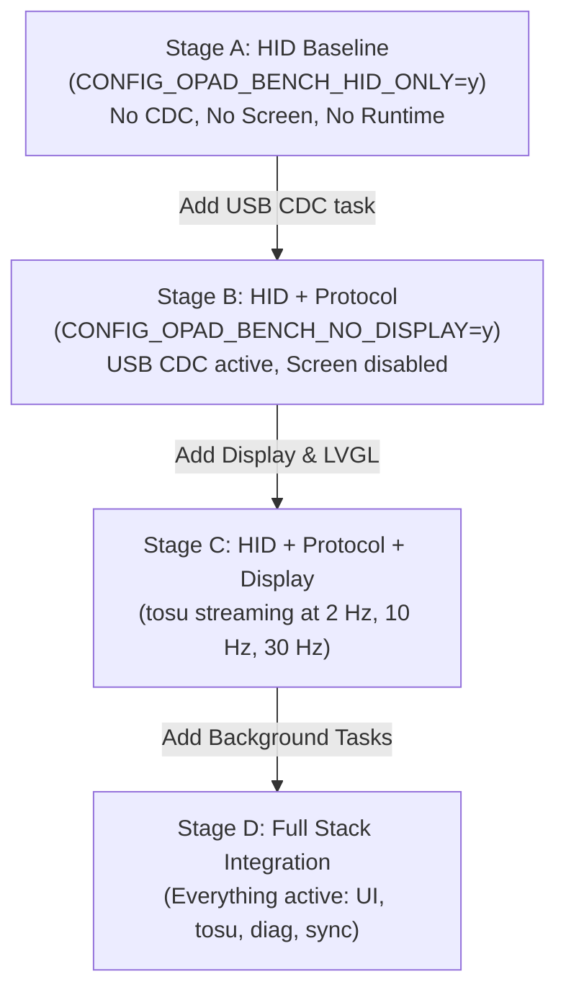

# Latency Measurement and Benchmark Methodology

Low latency and jitter-free key reporting are the central product requirements for OPad (AGENTS.md §1.1). No auxiliary subsystem—whether LCD rendering, USB serial logging, NVS writes, or tosu telemetry—is permitted to delay keystrokes.

This document details the benchmarking methodology, regression gating criteria, instrumentation tools, and the four benchmark stages (A through D).

<!-- src: /scripts/bench_latency.py#find_opad_event_device -->
<!-- src: /scripts/latency_row.py#KNOWN_STAGES -->
<!-- src: /scripts/bench_latency.sh#bench_latency.py -->

---

## 1. Release Gate Criteria

Input latency acts as a non-negotiable release gate. Before any firmware or desktop update is published, it must satisfy the following criteria:

1. **Zero Missed Presses**: 0 missed accepted keystrokes during rapid alternating key streams (> 20 presses/s).
2. **Zero Stuck Keys**: 0 stuck key-down or key-up states under any operating or load condition.
3. **No Outliers > 1 ms**: Auxiliary background processes (LVGL display transfers, CDC serial frames, timer interrupts, flash writes) must never introduce a latency spike greater than 1 ms.
4. **Negligible Latency Delta**: The $p99.9$ input-to-HID-submit latency delta between the full stack (Stage D) and the bare HID baseline (Stage A) must remain below 100 µs (0.1 ms).
5. **Hardware Isolation**: Core 0 handles input interrupts, keypad debouncing, and TinyUSB HID transmission. Core 1 handles display UI rendering, serial protocol parsing, and background maintenance tasks.

---

## 2. On-Device Histogram & Resolution

Keystroke latency is measured directly on the ESP32-S3 microcontroller (`firmware/main/input/latency_stats.c`) by capturing the exact hardware timer delta between:
- The GPIO edge interrupt (or Hall Effect rapid trigger displacement threshold), and
- The moment the HID report is enqueued into the TinyUSB endpoint buffer via `tud_hid_n_report()`.

### Histogram Characteristics

- **10 µs Bucket Resolution**: The on-device statistical accumulator sorts event latencies into 10 µs buckets. Consequently, $p50$, $p99$, and $p99.9$ percentiles are always reported as multiples of 10 µs (the upper edge of each bucket).
- **Exact Maximum**: The absolute maximum latency value (`max`) records the exact microsecond timestamp of the slowest event.
- **Host Independence**: Because measurement occurs entirely inside Core 0 prior to the USB physical wire, on-device histogram statistics reflect pad performance independently of the host OS or USB host controller scheduling.

---

## 3. Benchmark Stages (A through D)

To isolate latency regressions, firmware can be compiled into four progressive configurations:



- **Stage A (HID-Only Baseline)**: Compiled with `CONFIG_OPAD_BENCH_HID_ONLY=y`. Only the GPIO interrupt, debouncing logic, and TinyUSB HID 1000 Hz keyboard endpoint are active. Display, CDC-ACM serial, and runtime tasks are disabled. Statistics output is directed to UART0 (GPIO43, 115200 baud).
- **Stage B (HID + CDC Protocol)**: Compiled with `CONFIG_OPAD_BENCH_NO_DISPLAY=y`. USB CDC-ACM communication is active, handling telemetry, heartbeat queries, and status polls from `opad-daemon`. Display and backlight PWM remain disabled.
- **Stage C (HID + CDC + Gameplay Display)**: Standard firmware with the display enabled and `opad-daemon` actively streaming simulated beatmap telemetry (hit errors, PP, progress bar) via `tosu`. Evaluated across refresh rates: 2 Hz, 10 Hz (default), and 30 Hz.
- **Stage D (Full Stack Integration)**: Standard production firmware operating under peak background load: active tosu streaming, LVGL rendering, diagnostic ring buffer logging, and periodic NVS counter synchronization.

---

## 4. Measurement Procedure and Tooling

### Step 1: Flashing the Firmware Stage

Compile and flash the desired configuration:

```bash
cd firmware
idf.py -D CONFIG_OPAD_BENCH_NO_DISPLAY=y build
opadctl flash build/opad-firmware.bin
```

### Step 2: Resetting Statistics

Clear accumulated histogram buckets on the keypad:

```bash
# Using opadctl
opadctl latency --reset

# Or using the automated markdown helper
python3 scripts/latency_row.py --reset
```

### Step 3: Fast Alternating Stream Run

Stream both keys alternately at rapid speed (> 15 presses/second) for at least 2 minutes.

### Step 4: Reading Latency Statistics

Retrieve statistical percentiles:

```bash
# Formatted console output
opadctl latency

# Generate markdown table row directly
python3 scripts/latency_row.py --stage "C (10 Hz)"
```

[scripts/latency_row.py](file:///home/paella/Documents/projects/esp32/osu-pad-esp32-docs/scripts/latency_row.py) queries the device, reads $p50$, $p99$, $p99.9$, and $max$, appends the current git commit SHA (marking `-dirty` if modified), and prints a formatted markdown table row.

---

## 5. Host-Side USB Polling Benchmark (`bench_latency.py`)

To verify that the host operating system's USB HID stack is consistently polling at 1000 Hz without packet dropping, run [scripts/bench_latency.sh](file:///home/paella/Documents/projects/esp32/osu-pad-esp32-docs/scripts/bench_latency.sh):

```bash
./scripts/bench_latency.sh
```

[scripts/bench_latency.py](file:///home/paella/Documents/projects/esp32/osu-pad-esp32-docs/scripts/bench_latency.py) opens the Linux evdev device node (`/dev/input/by-id/*OPad*`), collects high-resolution kernel event timestamps (`input_event`), and computes:
- **Mean Interval**: Expected at ~1.000 ms for 1000 Hz USB HID polling.
- **Jitter Standard Deviation**: Measures timing variance across consecutive event deliveries.
- **Maximum Jitter**: Identifies host kernel scheduling stalls or USB hub interference.
