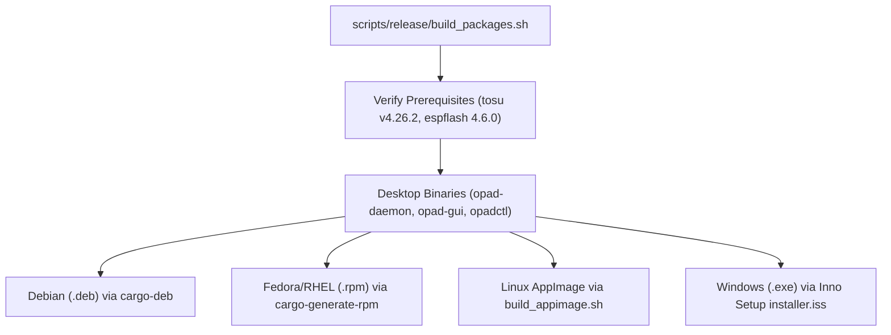

OPad packages distribute `opad-daemon`, `opad-gui`, and `opadctl` together with pinned `tosu` (**v4.26.2**) and `espflash` (**4.6.0**).

## 1. Package Architecture & Install-Origin Markers

Every packaging path writes a single-word `install-origin` marker file read by [/desktop/crates/opad-update/src/origin.rs](/desktop/crates/opad-update/src/origin.rs) so the updater follows the exact policy for that install:

| Target | Marker Path | Marker Value | App Update Policy | Bundled `tosu` Self-Update? |
|---|---|---|---|---|
| **Windows (`.exe`)** | `{localappdata}\Programs\opad\install-origin` | `windows` | `Installer` (`/SILENT /NORESTART /RELAUNCH=1`) | Yes |
| **Debian / Ubuntu (`.deb`)** | `/usr/lib/opad/install-origin` | `deb` | `PackageManager(Apt)` (polkit prompt) | No (owned by `dpkg`) |
| **Fedora / RHEL (`.rpm`)** | `/usr/lib/opad/install-origin` | `rpm` | `PackageManager(Dnf)` (polkit prompt) | No (owned by `rpm`) |
| **AppImage** | AppDir `/usr/lib/opad/install-origin` | `appimage` | `DirectReplace` | Yes |
| **Arch (`PKGBUILD`)** | `/usr/lib/opad/install-origin` | `aur` | `NotifyOnly` | No (owned by `pacman`) |
| **User local (`make install-user`)** | `~/.local/lib/opad/install-origin` | `user` | `DirectReplace` | Yes |
| **System source (`make install`)** | `<prefix>/lib/opad/install-origin` | `source` | `NotifyOnly` | No |

Missing or unknown markers always degrade safely to `NotifyOnly`.

## 2. Build Automation (`build_packages.sh`)

[/scripts/release/build_packages.sh](/scripts/release/build_packages.sh) generates release packages into `dist/`:

1. Builds `build/tosu` (`make tosu`) and `build/espflash/espflash` (`make espflash`) if absent.
2. Uses prebuilt binaries when `OPAD_PREBUILT=1` (CI builds against glibc 2.31 via `cargo-zigbuild`), or compiles natively via `make all`.
3. Expands `@BINDIR@` -> `/usr/bin` in [/packaging/linux/systemd-user/opad-daemon.service.in](/packaging/linux/systemd-user/opad-daemon.service.in) and writes `install-origin` markers without trailing newlines.
4. Builds `.deb` (`cargo deb -p opad-gui --no-build`), `.rpm` (`cargo generate-rpm --auto-req disabled`, translating SemVer `-` to `~` so prereleases sort before finals), AppImage ([/packaging/linux/appimage/build_appimage.sh](/packaging/linux/appimage/build_appimage.sh)), Windows installer (`iscc` on [/packaging/windows/installer.iss](/packaging/windows/installer.iss) if available), and `dist/SHA256SUMS`.

## 3. Linux Targets

- **`.deb` / `.rpm`**: Install binaries in `/usr/bin/`, private files in `/usr/lib/opad/`, systemd user unit in `/usr/lib/systemd/user/opad-daemon.service`, and `70-opad.rules` ([/packaging/linux/udev/70-opad.rules](/packaging/linux/udev/70-opad.rules)). Post-install ([/packaging/linux/deb/postinst](/packaging/linux/deb/postinst)) reloads `udevadm` and applies `setcap cap_sys_ptrace=eip /usr/lib/opad/tosu/tosu`. Uninstall runs `/usr/lib/opad/uninstall-cleanup` ([/packaging/linux/uninstall-cleanup.sh](/packaging/linux/uninstall-cleanup.sh)) on remove/purge (never on upgrade).
- **Arch Linux**: [/packaging/linux/arch/PKGBUILD](/packaging/linux/arch/PKGBUILD) builds from source with `TOSU_STANDALONE=0` (system `nodejs`) and `INSTALL_ORIGIN=aur`. The prebuilt AUR package template [/packaging/linux/arch/PKGBUILD-bin.in](/packaging/linux/arch/PKGBUILD-bin.in) (rendered by [/scripts/release/aur_bin.sh](/scripts/release/aur_bin.sh)) sets `options=('!strip' '!debug')` so the release binaries are installed unstripped and match `FILES.sha256`.
- **AppImage**: [/packaging/linux/appimage/AppRun](/packaging/linux/appimage/AppRun) sets `PATH`/`LD_LIBRARY_PATH` and supports `install-udev` (via `pkexec`), `daemon`, `ctl`, or launching `opad-gui`.

## 4. Windows Inno Setup (`installer.iss`)

Defined in [/packaging/windows/installer.iss](/packaging/windows/installer.iss):
- Fixed `AppId={{E581335A-9877-4C7D-894C-97495B422B59}}` for clean in-place upgrades.
- Per-user install (`PrivilegesRequired=lowest`) into `{localappdata}\Programs\opad` (`%LOCALAPPDATA%\Programs\opad`), bundling `opad-gui.exe`, `opad-daemon.exe`, `opadctl.exe`, `espflash.exe`, `install-origin`, `tosu\tosu.exe`, and license notices.
- Optional login autostart (`HKCU\Software\Microsoft\Windows\CurrentVersion\Run` for `opad-daemon` and `opad-gui --tray`).
- Strong uninstall: stops `opad-daemon.exe`, `opad-gui.exe`, `opadctl.exe`, and `tosu.exe`, removes `{app}`, deletes Run keys, and deletes `{userappdata}\opad`.
