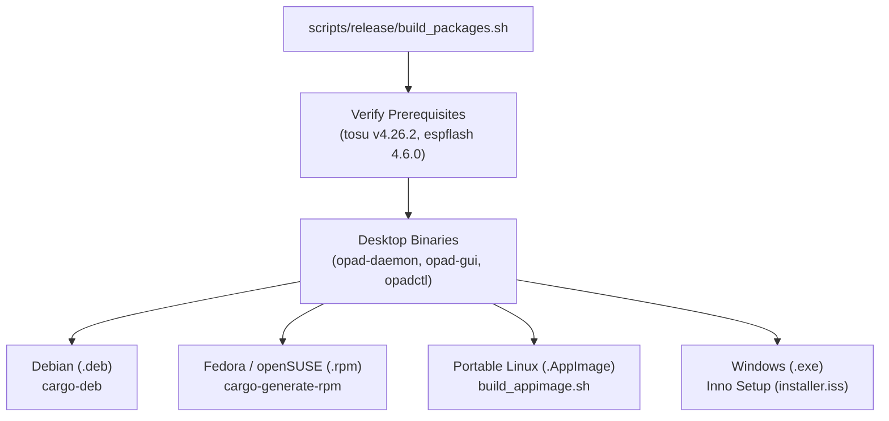

# Packaging and Distribution Mechanics

OPad packages distribute the full desktop suite—`opad-daemon`, `opad-gui`, and `opadctl`—alongside bundled prerequisites (`tosu` v4.26.2 and `espflash` v4.6.0).

This document details the build scripts, target formats, permission configurations, and packaging invariants for Linux and Windows.

<!-- src: /scripts/release/build_packages.sh#OPAD_PREBUILT -->
<!-- src: /packaging/windows/installer.iss#AppId -->
<!-- src: /packaging/linux/deb/postinst#udevadm -->
<!-- src: /packaging/linux/appimage/build_appimage.sh#AppRun -->
<!-- src: /packaging/linux/udev/70-opad.rules#303a -->

---

## 1. Package Architecture and Manifest



### Install-Origin Markers

To prevent self-updaters from overwriting packages managed by native system package managers, every installer drops an `install-origin` file into the installation directory:

| Packaging Target | Install Location | File Content |
|---|---|---|
| **Debian (.deb)** | `/usr/lib/opad/install-origin` | `deb` |
| **RPM (.rpm)** | `/usr/lib/opad/install-origin` | `rpm` |
| **AppImage** | Internal AppDir `/usr/lib/opad/install-origin` | `appimage` |
| **Arch (AUR)** | `/usr/lib/opad/install-origin` | `arch` |
| **Windows (.exe)**| `{localappdata}\Programs\opad\install-origin` | `windows` |

The desktop updater crate (`opad-update`) inspects this marker at runtime. If installed via `.deb`, `.rpm`, or `arch`, it suppresses in-app binary replacement and instead directs the user to update through their distribution package manager.

---

## 2. Build Automation (`build_packages.sh`)

Package generation is driven by [scripts/release/build_packages.sh](file:///home/paella/Documents/projects/esp32/osu-pad-esp32-docs/scripts/release/build_packages.sh):

```bash
# Generate all release packages into dist/
./scripts/release/build_packages.sh
```

### Script Execution Stages

1. **Prerequisites Check**: Verifies that bundled `tosu` and `espflash` binaries exist in `build/`, compiling them via `make tosu` and `make espflash` if missing.
2. **Release Binaries**:
   - If `OPAD_PREBUILT=1` is set (used by GitHub Actions release workflows), the script uses existing binaries compiled against glibc 2.31 with `cargo-zigbuild`.
   - Otherwise, it invokes `make all` to compile native release binaries.
3. **Template Resolution**: Replaces `@BINDIR@` in [packaging/linux/systemd-user/opad-daemon.service.in](file:///home/paella/Documents/projects/esp32/osu-pad-esp32-docs/packaging/linux/systemd-user/opad-daemon.service.in) with `/usr/bin`.
4. **Origin Markers**: Writes the exact marker text without trailing newlines.
5. **Debian Build**: Runs `cargo deb -p opad-gui --no-build` in `desktop/`.
6. **RPM Build**: Translates SemVer prerelease tags (e.g., `-rc.1` to `~rc.1`) and invokes `cargo generate-rpm --auto-req disabled`.
7. **AppImage Assembly**: Calls `packaging/linux/appimage/build_appimage.sh` to produce `dist/opad-x86_64.AppImage`.
8. **Windows Installer**: If `iscc` (Inno Setup Compiler) is present, compiles `packaging/windows/installer.iss`.
9. **Checksums**: Generates SHA256 checksums in `dist/SHA256SUMS`.

---

## 3. Linux Distribution Targets

### Debian (.deb)
- **Tool**: `cargo-deb` configured via metadata in `desktop/gui/Cargo.toml`.
- **System Integration**:
  - Installs binaries to `/usr/bin/`.
  - Installs systemd user service to `/usr/lib/systemd/user/opad-daemon.service`.
  - Installs udev rules to `/usr/lib/udev/rules.d/70-opad.rules`.
  - Post-installation script ([packaging/linux/deb/postinst](file:///home/paella/Documents/projects/esp32/osu-pad-esp32-docs/packaging/linux/deb/postinst#L7-L14)) reloads udev rules (`udevadm control --reload-rules`) and sets Linux capabilities on tosu:
    ```bash
    setcap cap_sys_ptrace=eip /usr/lib/opad/tosu/tosu
    ```
    This grants memory-reading permission for osu! under Yama `ptrace_scope` 1–2 without needing root.

### Fedora / openSUSE (.rpm)
- **Tool**: `cargo-generate-rpm`.
- Follows the same file layout as Debian, maintaining distro-agnostic user paths.

### Arch Linux (AUR)
- Located in `packaging/linux/arch/PKGBUILD` (source build) and `PKGBUILD-bin.in` (prebuilt binary package).
- Integrates `opad-bin.install` which runs equivalent udev reload and `setcap` hooks.

### AppImage
- Assembled by [packaging/linux/appimage/build_appimage.sh](file:///home/paella/Documents/projects/esp32/osu-pad-esp32-docs/packaging/linux/appimage/build_appimage.sh).
- Bundles all binaries into `AppDir`.
- Uses an embedded [AppRun](file:///home/paella/Documents/projects/esp32/osu-pad-esp32-docs/packaging/linux/appimage/AppRun) script to set up environment variables (`PATH`, `LD_LIBRARY_PATH`) and launch `opad-gui`.

---

## 4. Windows Inno Setup (`installer.iss`)

The Windows installer is defined in [packaging/windows/installer.iss](file:///home/paella/Documents/projects/esp32/osu-pad-esp32-docs/packaging/windows/installer.iss):

- **Unique Application ID**: `AppId={{E581335A-9877-4C7D-894C-97495B422B59}}`. Preserving this fixed GUID across versions guarantees seamless in-place upgrades.
- **Privilege Level**: `PrivilegesRequired=lowest`. Installs into `{localappdata}\Programs\opad` without requiring administrator privileges or UAC elevation.
- **Auto-Start**: Can optionally configure registry run keys for the daemon and system tray GUI on user logon.
- **Bundled Binaries**: Copies `opad-gui.exe`, `opad-daemon.exe`, `opadctl.exe`, and bundled `tosu.exe`.
