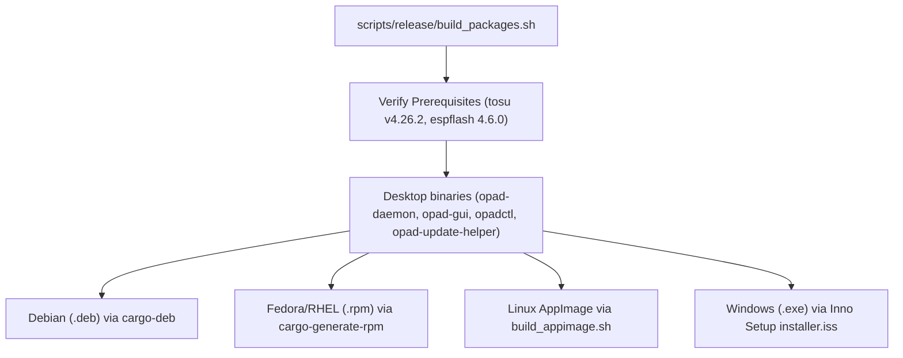

Every OPad package carries `opad-daemon`, `opad-gui` and `opadctl`, the pinned `tosu` (**v4.26.2**) and `espflash` (**4.6.0**). They differ in who owns the installed files afterwards (a package manager, the user, or nobody), and that decides how OPad may update itself. Each install therefore records how it was made in an `install-origin` marker.

## Packages and install origins

| Target | Marker path | Marker | App update policy (`ApplyPolicy`) | Bundled tosu updates itself? |
|---|---|---|---|---|
| **Windows (`.exe`)** | `%LOCALAPPDATA%\Programs\opad\install-origin` | `windows` | `Installer`: the new installer with `/SILENT /NORESTART /RELAUNCH=1` | Yes |
| **Debian / Ubuntu (`.deb`)** | `/usr/lib/opad/install-origin` | `deb` | `Helper(Apt)`: `pkexec /usr/lib/opad/opad-update-helper` | No (the package owns it) |
| **Fedora / RHEL (`.rpm`)** | `/usr/lib/opad/install-origin` | `rpm` | `Helper(Dnf)` | No (the package owns it) |
| **Arch (`opad-bin`, `PKGBUILD`)** | `/usr/lib/opad/install-origin` | `aur` | `Helper(Pacman)`: `pacman -U` | No (the package owns it) |
| **AppImage** | inside the AppDir, `usr/lib/opad/install-origin` | `appimage` | `DirectReplace`: the `$APPIMAGE` file is replaced atomically | Yes |
| **`make install-user`** | `~/.local/lib/opad/install-origin` | `user` | `DirectReplace`: the archive is extracted over `~/.local` | Yes |
| **`make install`** | `<prefix>/lib/opad/install-origin` | `source` | `NotifyOnly` | No |

The marker is found relative to the running binary (`install_lib_dir()` in [paths.rs](https://github.com/OPad-dev/OPad/blob/main/desktop/crates/opad-model/src/paths.rs): `/usr/bin/opad-daemon` gives `/usr/lib/opad`; on Windows it is the install directory). The policy table and `owns_bundled_tosu()` are in [origin.rs](https://github.com/OPad-dev/OPad/blob/main/desktop/crates/opad-update/src/origin.rs).

The `.deb`, `.rpm` and `opad-bin` packages install the update helper and a polkit action ([dev.opad.update.policy](https://github.com/OPad-dev/OPad/blob/main/packaging/linux/polkit/dev.opad.update.policy)) that lets the user at the computer run it without a password. The helper therefore checks everything itself: it installs only a newer OPad release that the signed feed names, with the SHA-256 the feed gives ([helper.rs](https://github.com/OPad-dev/OPad/blob/main/desktop/crates/opad-update/src/helper.rs)).

A missing or unknown marker gives `NotifyOnly`: an install OPad cannot place is never overwritten, the user is only told an update exists. Why each origin gets its policy, and how an update is verified, is in [Updates and Rollback](../explanation/updates-and-rollback.md).

## Building the packages

[build_packages.sh](https://github.com/OPad-dev/OPad/blob/main/scripts/release/build_packages.sh) generates release packages into `dist/`:

1. Builds `build/tosu` (`make tosu`) and `build/espflash/espflash` (`make espflash`) if absent.
2. Uses prebuilt binaries when `OPAD_PREBUILT=1` (CI builds against glibc 2.31 via `cargo-zigbuild`), or compiles natively via `make all`.
3. Expands `@BINDIR@` -> `/usr/bin` in [/packaging/linux/systemd-user/opad-daemon.service.in](https://github.com/OPad-dev/OPad/blob/main/packaging/linux/systemd-user/opad-daemon.service.in) and writes `install-origin` markers without trailing newlines.
4. Builds `.deb` (`cargo deb -p opad-gui --no-build`), `.rpm` (`cargo generate-rpm --auto-req disabled`, translating SemVer `-` to `~` so prereleases sort before finals), AppImage ([/packaging/linux/appimage/build_appimage.sh](https://github.com/OPad-dev/OPad/blob/main/packaging/linux/appimage/build_appimage.sh)), Windows installer (`iscc` on [/packaging/windows/installer.iss](https://github.com/OPad-dev/OPad/blob/main/packaging/windows/installer.iss) if available), and `dist/SHA256SUMS`.

## Linux

- **`.deb` / `.rpm`** (file lists in [desktop/gui/Cargo.toml](https://github.com/OPad-dev/OPad/blob/main/desktop/gui/Cargo.toml), `[package.metadata.deb]` and `[package.metadata.generate-rpm]`): binaries in `/usr/bin/`, private files in `/usr/lib/opad/` (the `install-origin` marker, `tosu/`, `bin/espflash`, `opad-update-helper`), the polkit action in `/usr/share/polkit-1/actions/dev.opad.update.policy`, systemd user unit in `/usr/lib/systemd/user/opad-daemon.service`, and `70-opad.rules` ([/packaging/linux/udev/70-opad.rules](https://github.com/OPad-dev/OPad/blob/main/packaging/linux/udev/70-opad.rules)). Post-install ([/packaging/linux/deb/postinst](https://github.com/OPad-dev/OPad/blob/main/packaging/linux/deb/postinst)) reloads the udev rules and applies `setcap cap_sys_ptrace=eip /usr/lib/opad/tosu/tosu` (tosu reads osu!'s memory, which Yama `ptrace_scope` 1–2 otherwise forbids); the `.rpm`'s `post_install_script` does the same. Uninstall runs `/usr/lib/opad/uninstall-cleanup` ([/packaging/linux/uninstall-cleanup.sh](https://github.com/OPad-dev/OPad/blob/main/packaging/linux/uninstall-cleanup.sh)) on remove/purge (never on upgrade).
- **Arch Linux**: [/packaging/linux/arch/PKGBUILD](https://github.com/OPad-dev/OPad/blob/main/packaging/linux/arch/PKGBUILD) builds from source with `TOSU_STANDALONE=0` (system `nodejs`) and `INSTALL_ORIGIN=aur`. The prebuilt AUR package template [/packaging/linux/arch/PKGBUILD-bin.in](https://github.com/OPad-dev/OPad/blob/main/packaging/linux/arch/PKGBUILD-bin.in) (rendered by [/scripts/release/aur_bin.sh](https://github.com/OPad-dev/OPad/blob/main/scripts/release/aur_bin.sh)) sets `options=('!strip' '!debug')` so the release binaries are installed unstripped and match `FILES.sha256`.
- **AppImage**: [/packaging/linux/appimage/AppRun](https://github.com/OPad-dev/OPad/blob/main/packaging/linux/appimage/AppRun) sets `PATH`/`LD_LIBRARY_PATH` and supports `install-udev` (via `pkexec`), `daemon`, `ctl`, or launching `opad-gui`.

## Windows

Defined in [installer.iss](https://github.com/OPad-dev/OPad/blob/main/packaging/windows/installer.iss):
- Fixed `AppId={{E581335A-9877-4C7D-894C-97495B422B59}}` for clean in-place upgrades.
- Per-user install (`PrivilegesRequired=lowest`) into `{localappdata}\Programs\opad` (`%LOCALAPPDATA%\Programs\opad`), bundling `opad-gui.exe`, `opad-daemon.exe`, `opadctl.exe`, `espflash.exe`, `install-origin`, `tosu\tosu.exe`, and license notices.
- Optional login autostart (`HKCU\Software\Microsoft\Windows\CurrentVersion\Run` for `opad-daemon` and `opad-gui --tray`).
- Strong uninstall: stops `opad-daemon.exe`, `opad-gui.exe`, `opadctl.exe`, and `tosu.exe`, removes `{app}`, deletes Run keys, and deletes `{userappdata}\opad`.
