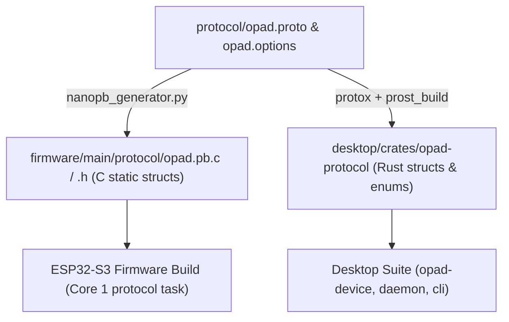

The OPad communication protocol between the desktop suite and the keypad firmware is defined by a single schema: [`protocol/opad.proto`](https://github.com/OPad-dev/OPad/blob/main/protocol/opad.proto). Both the Rust desktop crates and the ESP32-S3 C firmware generate their wire types from this file.

Because the pad and the app update independently ([AGENTS.md](https://github.com/OPad-dev/OPad/blob/main/AGENTS.md) §1.3), every change has to work with a new app on old firmware and an old app on new firmware. The design behind that (framings, capability flags, what each side does when the other is older) is in [App and Pad Versions](../explanation/app-and-pad-versions.md); this page is the procedure.

## Where the types come from

The protocol pipeline feeds two code generators:



- **Firmware (C)**: Uses vendored nanopb ([`firmware/main/protocol/nanopb/pb.h`](https://github.com/OPad-dev/OPad/blob/main/firmware/main/protocol/nanopb/pb.h)) to encode and decode messages with static memory allocation (`pb_byte_t`). Never modify the vendored nanopb files ([AGENTS.md](https://github.com/OPad-dev/OPad/blob/main/AGENTS.md) §5).
- **Desktop (Rust)**: Uses `protox` to compile [`protocol/opad.proto`](https://github.com/OPad-dev/OPad/blob/main/protocol/opad.proto) in-process without needing a system `protoc` binary, then generates Rust structs with `prost-build` in [`desktop/crates/opad-protocol/build.rs`](https://github.com/OPad-dev/OPad/blob/main/desktop/crates/opad-protocol/build.rs).

## Rules

Whenever you modify [`protocol/opad.proto`](https://github.com/OPad-dev/OPad/blob/main/protocol/opad.proto):

1. **Never renumber existing field tags**: Protobuf wire tags identify fields; changing a tag breaks decoding against older/newer peers.
2. **Never change existing field types**: Changing `uint32` to `uint64` or `string` to `bytes` changes the wire type.
3. **Keep new fields backward compatible**: In proto3, omitted scalar fields decode to their zero value (`0`, `false`, empty string), and `optional` fields distinguish absence from zero when `0` is a valid value (as with `ConfigPayload.key3_hid_usage`). Mark retired tag numbers `reserved` instead of reusing them (see `reserved 14;` in `ConfigPayload`).
4. **Negotiate behavioral changes during handshake**: If a feature changes wire behavior or requires the host to know whether the pad supports it, advertise it in `Hello` (what the host can do) and `HelloAck` (what the pad can do). Old firmware sends no flag, which decodes as `false`, so the host falls back to the old behaviour without a version check: `HelloAck.board_test`, `restart`, `he_live` and `frame_crc` all work this way. Never send a peer a message it has not said it understands.
5. **Define static bounds in `protocol/opad.options`**: Every `string` and `bytes` field needs `max_size`, and every `repeated` field needs `max_count` in [`protocol/opad.options`](https://github.com/OPad-dev/OPad/blob/main/protocol/opad.options) so nanopb generates fixed arrays instead of callback pointers.

## Procedure

### 1. Edit `protocol/opad.proto`

Add new messages or fields with strictly increasing, unused field numbers (for example, `HelloAck` currently ends at tag `21` for `frame_crc`):

```protobuf
message HelloAck {
    // ... existing fields ...
    uint32 key_count = 19;
    InputModule input_module = 20;
    bool frame_crc = 21;

    // Example new feature flag
    bool experimental_feature = 22;
}
```

### 2. Set bounds in `protocol/opad.options`

If your new fields include `string`, `bytes`, or `repeated` members, add their bounds to [`protocol/opad.options`](https://github.com/OPad-dev/OPad/blob/main/protocol/opad.options):

```text
opad.MyNewMessage.name max_size:32
opad.MyNewMessage.items max_count:16
```

### 3. Regenerate the nanopb files

Run [`scripts/gen_proto.sh`](https://github.com/OPad-dev/OPad/blob/main/scripts/gen_proto.sh) from the repository root:

```sh
./scripts/gen_proto.sh
```

The script finds `nanopb_generator` on the `PATH` or in ESP-IDF's Python environment and overwrites `firmware/main/protocol/opad.pb.c` and `firmware/main/protocol/opad.pb.h`.

> [!WARNING]
> Never hand-edit `firmware/main/protocol/opad.pb.c` or `firmware/main/protocol/opad.pb.h`. CI regenerates them and fails on any diff. Use nanopb **0.4.9.1**, the version CI installs: the generated files name the generator version, and a different one fails the diff on that line alone.

### 4. Rebuild the desktop crates

[`desktop/crates/opad-protocol/build.rs`](https://github.com/OPad-dev/OPad/blob/main/desktop/crates/opad-protocol/build.rs) emits `cargo:rerun-if-changed` for `protocol/opad.proto`, so Cargo automatically regenerates the Rust bindings on the next build:

```sh
cd desktop && cargo check
```

### 5. A new host-to-pad message

The firmware decides which framing an old or new host speaks from the first frame that decodes to a message it knows, and only `HostToDevice` payloads from `hello` (tag 2) to `cancel_he_calibration` (tag 20) count (the `msg.which_payload` range check in `on_frame_received` in [protocol.c](https://github.com/OPad-dev/OPad/blob/main/firmware/main/protocol/protocol.c)). A new message outside that range is handled normally but is not evidence of the host's framing; `he_live_view` (tag 21) is already outside it, which is harmless because OPad hosts send `Hello` first. If a new message could be the first a host sends, widen the check.

## Checking it

1. **Drift check:** the `proto-check` job ([scripts/ci/jobs.sh](https://github.com/OPad-dev/OPad/blob/main/scripts/ci/jobs.sh)) runs `./scripts/gen_proto.sh` and then:
   ```sh
   git diff --exit-code firmware/main/protocol/
   ```
2. **Tests:** `make check` runs the `opad-protocol` round-trip and framing tests and the firmware's `test_frame_parser` ([Testing](testing.md#make-check)).
3. **Both directions on a pad:** flash the new firmware and connect the previous app release, then the new app with the previous firmware, and check that each side ignores what it does not know.

## Commit

When committing protocol changes, include a `Compatibility:` trailer saying how old and new app and firmware work together ([AGENTS.md](https://github.com/OPad-dev/OPad/blob/main/AGENTS.md) §3):

```text
feat(protocol): add experimental feature flag to HelloAck

Negotiate experimental capabilities during initial handshake.

Compatibility: older firmware never sets field 22, so a new app sees
false and keeps the old behaviour; an old app ignores the field.
AI: assisted
```
