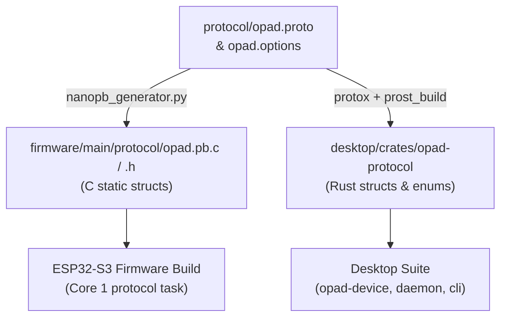

# Protocol Changes and Schema Evolution

The OPad communication protocol between the desktop suite and the keypad firmware is defined by a single schema: `protocol/opad.proto`. Both desktop Rust crates and ESP32-S3 C firmware derive their wire serialization types from this source of truth.

Because pad firmware and desktop software update independently (AGENTS.md §1.3), any change to this schema must strictly adhere to bidirectional compatibility rules.

<!-- src: /protocol/opad.proto#Hello -->
<!-- src: /protocol/opad.proto#HelloAck -->
<!-- src: /protocol/opad.options#max_size -->
<!-- src: /scripts/gen_proto.sh#nanopb_generator -->
<!-- src: /firmware/main/protocol/nanopb/pb.h#pb_byte_t -->
<!-- src: /desktop/crates/opad-protocol/build.rs#protox::compile -->

---

## 1. Schema Architecture and Codegen

The protocol workflow connects two independent code generators:



- **Firmware (C)**: Uses vendored [nanopb](file:///home/paella/Documents/projects/esp32/osu-pad-esp32-docs/firmware/main/protocol/nanopb/pb.h) to decode and encode protobuf messages using static memory allocation (`pb_byte_t`).
- **Desktop (Rust)**: Uses `protox` to parse `.proto` files in-process without requiring a system `protoc` installation, compiling them into Rust structs via `prost-build` ([build.rs](file:///home/paella/Documents/projects/esp32/osu-pad-esp32-docs/desktop/crates/opad-protocol/build.rs#L16-L19)).

---

## 2. Invariants for Schema Evolution

Whenever modifying `protocol/opad.proto`, you must follow these rules:

1. **Never renumber existing field tags**: Protobuf tags identify fields on the wire. Changing a tag breaks decoding for any device running a different version.
2. **Never change existing field types**: E.g., changing `uint32` to `uint64` or `string` to `bytes` alters the wire format.
3. **All new fields must be optional**: In Proto3, all scalar fields are optional by default. A missing field decodes to its default value (0, false, empty string).
4. **Feature flags for behavioral changes**: If a new feature requires active negotiation (such as higher telemetry rates or new batch types), negotiate it during the handshake via [Hello](file:///home/paella/Documents/projects/esp32/osu-pad-esp32-docs/protocol/opad.proto#L32) and [HelloAck](file:///home/paella/Documents/projects/esp32/osu-pad-esp32-docs/protocol/opad.proto#L43).
5. **Static bounds in `opad.options`**: Nanopb requires explicit maximum sizes for strings and byte arrays (`max_size`), and maximum counts for repeated fields (`max_count`). Without them, Nanopb defaults to allocating callback pointers, which increases memory overhead and code complexity.

---

## 3. Step-by-Step Procedure

### Step 1: Update `protocol/opad.proto`

Add your new message or new fields to existing messages. Keep field numbers strictly increasing:

```protobuf
message HelloAck {
    // ... existing fields ...
    bool tap_rate_per_second = 18;
    uint32 key_count = 19;
    InputModule input_module = 20;

    // Example new feature flag
    bool experimental_feature = 21;
}
```

### Step 2: Configure Bounds in `protocol/opad.options`

If your new field contains strings, byte vectors, or repeated elements, define their bounds in [protocol/opad.options](file:///home/paella/Documents/projects/esp32/osu-pad-esp32-docs/protocol/opad.options):

```text
opad.MyNewMessage.name max_size:32
opad.MyNewMessage.items max_count:16
```

### Step 3: Regenerate Nanopb Bindings

Run the generator script from the repository root:

```bash
./scripts/gen_proto.sh
```

This invokes [scripts/gen_proto.sh](file:///home/paella/Documents/projects/esp32/osu-pad-esp32-docs/scripts/gen_proto.sh#L30-L31) to regenerate `firmware/main/protocol/opad.pb.c` and `firmware/main/protocol/opad.pb.h`.

> [!WARNING]
> Never manually edit `opad.pb.c` or `opad.pb.h`. Any hand edits will be overwritten on regeneration and CI will fail the build diff check.

### Step 4: Rebuild Desktop Crates

Because [desktop/crates/opad-protocol/build.rs](file:///home/paella/Documents/projects/esp32/osu-pad-esp32-docs/desktop/crates/opad-protocol/build.rs#L14) watches `protocol/opad.proto`, running `cargo build` in `desktop/` will automatically recompile the Rust structures:

```bash
cd desktop && cargo check
```

---

## 4. Verification and CI Checks

Continuous Integration enforces strict protobuf hygiene:

1. **Protobuf Diff Check**: CI regenerates the C bindings using `scripts/gen_proto.sh` and runs:
   ```bash
   git diff --exit-code firmware/main/protocol/
   ```
   If any discrepancy exists between `opad.proto` and the committed C files, CI fails immediately.
2. **Host Unit Tests**: Host protocol round-trip tests run via `make check` (`cargo test -p opad-protocol`).

---

## 5. Commit Standards

When committing protocol changes, include the compatibility trailer required by AGENTS.md §3:

```text
feat(protocol): add experimental feature flag to HelloAck

Negotiate experimental capabilities during initial handshake.

Compatibility: bidirectional; older firmware ignores field 21.
AI: assisted
```
