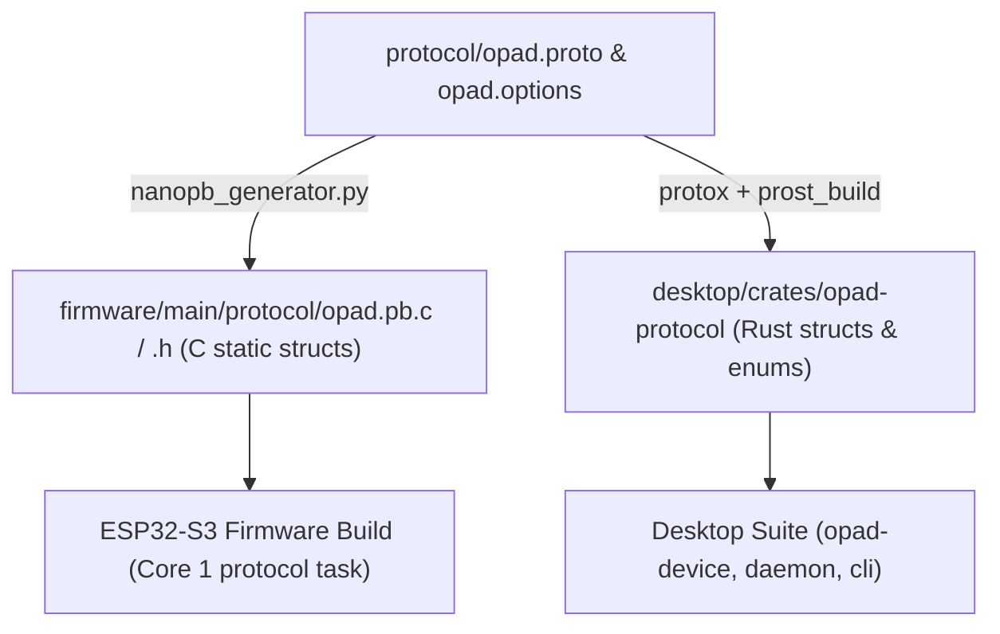

The OPad communication protocol between the desktop suite and the keypad firmware is defined by a single schema: [`protocol/opad.proto`](/protocol/opad.proto). Both the Rust desktop crates and the ESP32-S3 C firmware generate their wire types from this file.

Because pad firmware and desktop software update independently (AGENTS.md §1.3), every schema change must preserve bidirectional wire compatibility.

## 1. Schema Architecture and Codegen

The protocol pipeline feeds two code generators:



- **Firmware (C)**: Uses vendored nanopb ([`firmware/main/protocol/nanopb/pb.h`](/firmware/main/protocol/nanopb/pb.h)) to encode and decode messages with static memory allocation (`pb_byte_t`). Never modify the vendored nanopb files (AGENTS.md §5).
- **Desktop (Rust)**: Uses `protox` to compile [`protocol/opad.proto`](/protocol/opad.proto) in-process without needing a system `protoc` binary, then generates Rust structs with `prost-build` in [`desktop/crates/opad-protocol/build.rs`](/desktop/crates/opad-protocol/build.rs).

## 2. Invariants for Schema Evolution

Whenever you modify [`protocol/opad.proto`](/protocol/opad.proto):

1. **Never renumber existing field tags**: Protobuf wire tags identify fields; changing a tag breaks decoding against older/newer peers.
2. **Never change existing field types**: Changing `uint32` to `uint64` or `string` to `bytes` changes the wire type.
3. **Keep new fields backward compatible**: In proto3, omitted scalar fields decode to their zero value (`0`, `false`, empty string), and `optional` fields distinguish absence from zero when `0` is a valid value (as with `ConfigPayload.key3_hid_usage`). Mark retired tag numbers `reserved` instead of reusing them (see `reserved 14;` in `ConfigPayload`).
4. **Negotiate behavioral changes during handshake**: If a feature changes wire behavior or requires the host to know whether the pad supports it, advertise it in [`Hello`](/protocol/opad.proto) and [`HelloAck`](/protocol/opad.proto).
5. **Define static bounds in `protocol/opad.options`**: Every `string` and `bytes` field needs `max_size`, and every `repeated` field needs `max_count` in [`protocol/opad.options`](/protocol/opad.options) so nanopb generates fixed arrays instead of callback pointers.

## 3. Step-by-Step Procedure

### Step 1: Update `protocol/opad.proto`

Add new messages or fields with strictly increasing, unused field numbers (for example, `HelloAck` currently ends at tag `21` for `frame_crc`):

```protobuf
message HelloAck {
    // ... existing fields ...
    uint32 key_count = 19;
    InputModule input_module = 20;
    bool frame_crc = 21;

    // Example new feature flag
    bool experimental_feature = 22;
}
```

### Step 2: Configure Bounds in `protocol/opad.options`

If your new fields include `string`, `bytes`, or `repeated` members, add their bounds to [`protocol/opad.options`](/protocol/opad.options):

```text
opad.MyNewMessage.name max_size:32
opad.MyNewMessage.items max_count:16
```

### Step 3: Regenerate Nanopb Bindings

Run [`scripts/gen_proto.sh`](/scripts/gen_proto.sh) from the repository root:

```sh
./scripts/gen_proto.sh
```

The script invokes `nanopb_generator` (CI pins `nanopb==0.4.9.1` in [`.github/workflows/ci.yml`](/.github/workflows/ci.yml) because generated files embed the generator version comment) to overwrite `firmware/main/protocol/opad.pb.c` and `firmware/main/protocol/opad.pb.h`.

> [!WARNING]
> Never hand-edit `firmware/main/protocol/opad.pb.c` or `firmware/main/protocol/opad.pb.h`. CI regenerates them and fails on any diff.

### Step 4: Rebuild Desktop Crates

[`desktop/crates/opad-protocol/build.rs`](/desktop/crates/opad-protocol/build.rs) emits `cargo:rerun-if-changed` for `protocol/opad.proto`, so Cargo automatically regenerates the Rust bindings on the next build:

```sh
cd desktop && cargo check
```

## 4. Verification and CI Checks

1. **Protobuf Drift Check**: The `proto-check` job in [`.github/workflows/ci.yml`](/.github/workflows/ci.yml) installs `nanopb==0.4.9.1`, runs `./scripts/gen_proto.sh`, and checks:
   ```sh
   git diff --exit-code firmware/main/protocol/
   ```
2. **Host & Firmware Unit Tests**: Run `make check` ([`Makefile`](/Makefile)), which runs `cargo fmt --check`, `cargo clippy --all-targets -- -D warnings`, `cargo test` (including `opad-protocol` round-trip and framing tests), `./firmware/test/host/run_tests.sh`, and `python3 scripts/release/check_versions.py`.

## 5. Commit Standards

When committing protocol changes, include a `Compatibility:` line describing how old and new app/firmware combinations interoperate (AGENTS.md §3):

```text
feat(protocol): add experimental feature flag to HelloAck

Negotiate experimental capabilities during initial handshake.

Compatibility: bidirectional; older firmware ignores field 22.
AI: assisted
```
