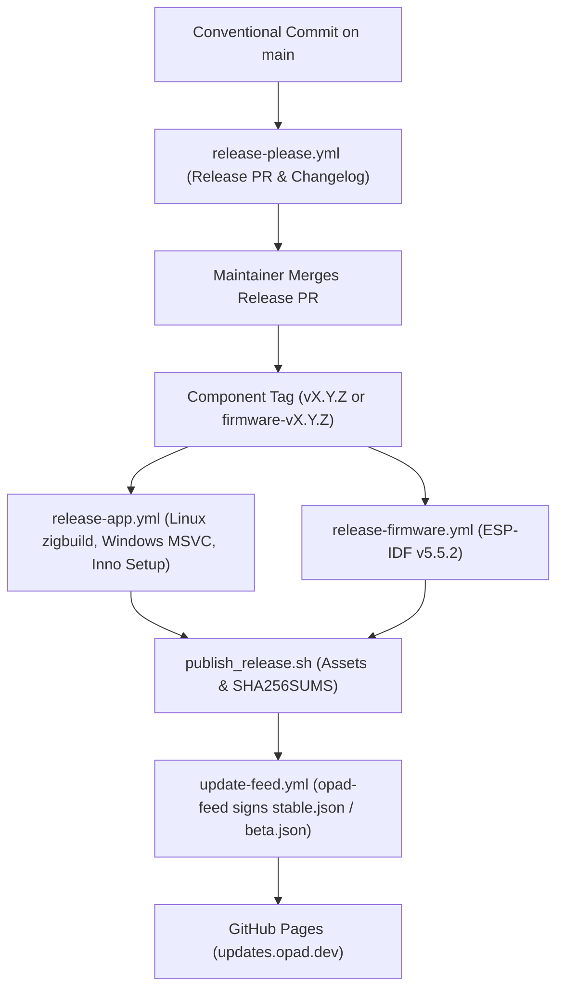

Because the desktop app, firmware, and bundled `tosu` update independently ([/AGENTS.md](/AGENTS.md) §1.3), OPad runs decoupled release pipelines feeding a cryptographically signed update manifest.

## 1. Pipeline Overview

## 2. Release Management (`release-please`)

Configured in [/release-please-config.json](/release-please-config.json) and [/.github/workflows/release-please.yml](/.github/workflows/release-please.yml):

- **Two `release-please` packages**:
  1. **Desktop App (`.`, component `app`)**: Excludes `firmware` and `hardware`; updates `desktop/Cargo.toml` and produces tags `vX.Y.Z` (or `vX.Y.Z-rc.N` while `prerelease: true`).
  2. **Firmware (`firmware`, component `firmware`)**: Updates `firmware/CMakeLists.txt` and produces tags `firmware-vX.Y.Z`.
  (Bundled `tosu` is version-pinned separately in [/Makefile](/Makefile) at `v4.26.2`.)
- **`Cargo.lock` sync**: `release-please.yml` runs a `lockfile` job executing `cargo update -w` whenever Release Please updates the app release PR so `--locked` builds remain valid.

## 3. Artifact Builders & Publication

- **Desktop ([/.github/workflows/release-app.yml](/.github/workflows/release-app.yml))**: Compiles Linux x86_64 binaries via `cargo-zigbuild` (glibc 2.31), Windows x86_64 binaries via MSVC, and packages `.deb`, `.rpm`, AppImage, and `opad-setup.exe`.
- **Firmware ([/.github/workflows/release-firmware.yml](/.github/workflows/release-firmware.yml))**: Compiles in `espressif/idf:v5.5.2`, publishing the OTA binary and full recovery artifacts.
- **Publication ([/scripts/release/publish_release.sh](/scripts/release/publish_release.sh))**: Uploads artifacts and `SHA256SUMS` to GitHub Releases.

## 4. Signed Update Feeds (`opad-feed`)

[/.github/workflows/update-feed.yml](/.github/workflows/update-feed.yml) runs `opad-feed` on every release, weekly cron, or manual dispatch to publish and sign `stable.json` and `beta.json` to `https://updates.opad.dev/` (GitHub Pages), refreshing signatures before the 30-day feed expiry window.

## 5. Security Guardrails (`opad-update`)

Enforced in [/desktop/crates/opad-update/src/lib.rs](/desktop/crates/opad-update/src/lib.rs), [/desktop/crates/opad-update/src/verify.rs](/desktop/crates/opad-update/src/verify.rs), and [/desktop/crates/opad-update/src/origin.rs](/desktop/crates/opad-update/src/origin.rs):

1. **Minisign (Ed25519) signature verification**: Signed feeds are checked against the compiled-in public key; missing or invalid signatures fail with `UpdateError::NoPublicKey` or `UpdateError::Signature`.
2. **SHA-256 hash-before-execute**: Every downloaded archive, installer, or firmware image is verified against the signed manifest's SHA-256 before execution or flashing.
3. **Atomic writes**: `write_atomic` writes to a temp file, `fsync`s, and atomically renames into place.
4. **Gameplay safety gate (`may_update_now`)**: Never applies app, `tosu`, or firmware updates during `Playing` or `Cooldown`.
5. **Install-origin policies**: `windows` runs the installer; `deb`/`rpm` delegate to `apt`/`dnf` via polkit (never swapping package-owned `tosu`); `appimage`/`user` replace user-owned files directly; `aur`/`source`/`unknown` notify only.
