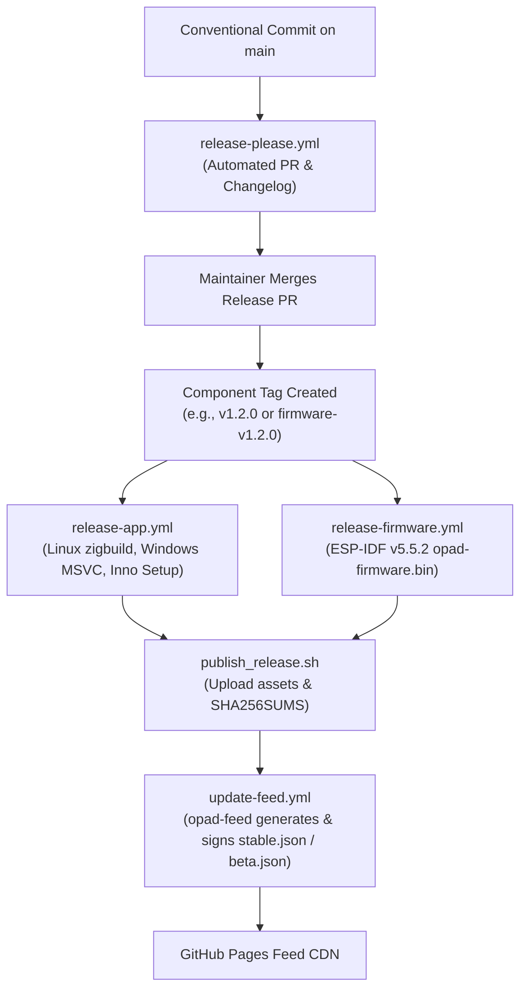

# Release Automation and Update Feeds

OPad's release pipeline enforces independent lifecycle management across its core components: the desktop application suite, the microcontroller firmware, and bundled dependencies like `tosu`.

Because the app and pad update independently (AGENTS.md §1.3), releases are decoupled, reproducible, and cryptographically verified.

<!-- src: /release-please-config.json#bootstrap-sha -->
<!-- src: /scripts/release/publish_release.sh#publish_release.sh -->
<!-- src: /.github/workflows/release-please.yml#release-please -->
<!-- src: /desktop/crates/opad-update/src/lib.rs#may_update_now -->
<!-- src: /desktop/crates/opad-update/src/manifest.rs#ReleaseManifest -->

---

## 1. Architectural Model and Pipeline Overview

---

## 2. Release Management (`release-please`)

OPad uses Google's [Release Please](file:///home/paella/Documents/projects/esp32/osu-pad-esp32-docs/.github/workflows/release-please.yml) configured via [release-please-config.json](file:///home/paella/Documents/projects/esp32/osu-pad-esp32-docs/release-please-config.json).

### Component Separation

The repository is partitioned into distinct release components:
1. **Desktop App (`.`)**: Tracks `desktop/` and root changes. Produces semver tags formatted as `vX.Y.Z` (or `vX.Y.Z-rc.N` during prereleases).
2. **Firmware (`firmware`)**: Tracks changes in `firmware/` exclusively. Produces tags prefixed as `firmware-vX.Y.Z`.
3. **Tosu (`build/tosu`)**: Tracked and released as separate pinned bundles (e.g., `tosu-v4.26.2-r1`).

### Cargo.lock Synchronization

Standard Release Please modifies `Cargo.toml` but cannot update `Cargo.lock` workspace member entries. To maintain `--locked` build fidelity, [release-please.yml](file:///home/paella/Documents/projects/esp32/osu-pad-esp32-docs/.github/workflows/release-please.yml#L43-L60) includes a dedicated `lockfile` job:
- Runs automatically whenever Release Please updates the release PR branch.
- Executes `cargo update -w` to align the lockfile to the newly bumped version.
- Pushes the updated lockfile directly to the release pull request.

---

## 3. Artifact Compilation and Publication

When a release PR is merged, GitHub Actions runs the corresponding artifact builder:

- **Desktop Release ([.github/workflows/release-app.yml](file:///home/paella/Documents/projects/esp32/osu-pad-esp32-docs/.github/workflows/release-app.yml))**:
  - Compiles Linux x86_64 binaries against glibc 2.31 using `cargo-zigbuild` to ensure broad compatibility across older distributions (Ubuntu 20.04+, Debian 11+).
  - Builds Windows x86_64 binaries using the standard MSVC toolchain.
  - Generates `.deb`, `.rpm`, AppImage, and Windows Inno Setup installer packages.
- **Firmware Release ([.github/workflows/release-firmware.yml](file:///home/paella/Documents/projects/esp32/osu-pad-esp32-docs/.github/workflows/release-firmware.yml))**:
  - Compiles the ESP32-S3 firmware inside a pinned `espressif/idf:v5.5.2` container.
  - Produces `opad-firmware.bin` (the OTA update binary) and `opad-firmware-merged.bin` (full flash image including bootloader and partition table).
- **Publication ([scripts/release/publish_release.sh](file:///home/paella/Documents/projects/esp32/osu-pad-esp32-docs/scripts/release/publish_release.sh))**:
  - Uploads all compiled binaries and their SHA256 checksums to GitHub Releases.
  - Updates release notes, appends code signing policies, and sets the release visibility (`latest` or `prerelease`).

---

## 4. Signed Update Feeds (`opad-feed`)

Desktop applications and keypad firmware locate available updates by polling signed JSON update feeds published to GitHub Pages:

- **Workflow**: [.github/workflows/update-feed.yml](file:///home/paella/Documents/projects/esp32/osu-pad-esp32-docs/.github/workflows/update-feed.yml) runs on every release, weekly cron, or manual dispatch.
- **Feed Generator**: Compiles and executes the `opad-feed` tool from the `opad-update` crate.
- **Channel Feeds**:
  - `stable.json`: Contains production release artifacts.
  - `beta.json`: Contains prerelease and release-candidate artifacts.
- **Expiration Guard**: Each feed has an explicit 30-day validity window. Weekly scheduled builds ensure feeds are continually refreshed and re-signed before expiration.

---

## 5. Security Invariants and Guardrails (`opad-update`)

Because automated updaters represent a potential remote code execution vector, the [opad-update](file:///home/paella/Documents/projects/esp32/osu-pad-esp32-docs/desktop/crates/opad-update/src/lib.rs) crate enforces rigid defensive constraints:

1. **Cryptographic Signature Verification**: Update manifests are signed with an Ed25519 private key. The public key is compiled into the client. Manifests without a valid signature are rejected (`UpdateError::NoPublicKey`, `UpdateError::Signature`).
2. **Hash-Before-Execute**: Binary payloads are downloaded to temporary storage and verified against the manifest SHA256 hash before permissions are modified or execution is attempted.
3. **Atomic File Swapping**: Updates overwrite targets via atomic renames of `fsync`'d temporary files. A sudden power loss or process kill leaves the existing functional binary intact.
4. **Gameplay Safety Gating**: [may_update_now](file:///home/paella/Documents/projects/esp32/osu-pad-esp32-docs/desktop/crates/opad-update/src/lib.rs#L39) monitors device state; updates are strictly deferred while the player is active in a beatmap.
5. **Package Manager Respect**: If the local `install-origin` indicates a system package manager (`deb`, `rpm`, `arch`), background self-updates are disabled to prevent conflict with system package managers.
