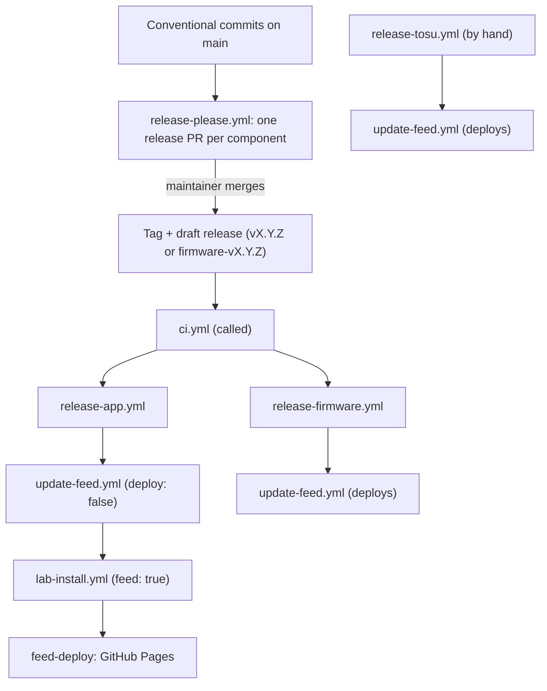

The app, the firmware and the bundled tosu update independently ([AGENTS.md](https://github.com/OPad-dev/OPad/blob/main/AGENTS.md) §1.3), so each has its own version, tag and release, and all three reach installs through one signed update feed. The design behind the feed and the pad's A/B update is in [Updates and Rollback](../explanation/updates-and-rollback.md); this page is the pipeline.

## Pipeline

A tag pushed with `GITHUB_TOKEN` starts no workflow, so nothing is triggered by tags: [release-please.yml](https://github.com/OPad-dev/OPad/blob/main/.github/workflows/release-please.yml) calls CI and then the build workflow itself. A release is built only if [ci.yml](https://github.com/OPad-dev/OPad/blob/main/.github/workflows/ci.yml) passes on that commit (the same jobs as [Testing](testing.md#ci-jobs)). Every build workflow can also be started by hand with a tag.

## Versions and tags

[release-please-config.json](https://github.com/OPad-dev/OPad/blob/main/release-please-config.json) defines two components:

- **App** (path `.`, excluding `firmware/` and `hardware/`): version in `desktop/Cargo.toml`, tags `vX.Y.Z`, or `vX.Y.Z-rc.N` while the config sets `"prerelease": true` with `prerelease-type: rc` (as it does now, for both components). On the app's release PR, the `lockfile` job runs `cargo update -w` so `Cargo.lock` follows and `cargo build --locked` still works at release time.
- **Firmware** (path `firmware`): version in `firmware/CMakeLists.txt` (`PROJECT_VER`), tags `firmware-vX.Y.Z` (`-rc.N` likewise).

Merging a release PR tags it and creates a **draft** release; the build workflow uploads the files and publishes the draft. [scripts/release/check_versions.py](https://github.com/OPad-dev/OPad/blob/main/scripts/release/check_versions.py) checks in `make check` that all of these agree, and with `--tag` that a tag matches the tree.

**tosu** has no release PR. Its version is the pin in the [Makefile](https://github.com/OPad-dev/OPad/blob/main/Makefile) (`TOSU_VERSION`, v4.26.2). [release-tosu.yml](https://github.com/OPad-dev/OPad/blob/main/.github/workflows/release-tosu.yml) is run by hand after bumping it, and publishes `tosu-v<version>-r<revision>`; a higher revision rebuilds the same upstream version. This lets the bundled tosu be updated between app releases.

Until the repository variable `SIGNING_ENABLED` is `true`, nothing is signed and every release is published as a GitHub pre-release. Only a final app release becomes GitHub's "Latest"; firmware and tosu never do ([publish_release.sh](https://github.com/OPad-dev/OPad/blob/main/scripts/release/publish_release.sh)).

## What each release contains

| Release | Files | Built by |
|---|---|---|
| App `vX.Y.Z` | `OPad-Windows-Setup-<v>.exe`, `OPad-Linux-Debian-Ubuntu-<v>.deb`, `OPad-Linux-Fedora-<v>.rpm`, `OPad-Linux-Arch-<v>.pkg.tar.zst`, `OPad-Linux-<v>.AppImage`, and the bundled tosu's source (`Source-*`) | [release-app.yml](https://github.com/OPad-dev/OPad/blob/main/.github/workflows/release-app.yml): Linux binaries with `cargo-zigbuild` against glibc 2.31, Windows with MSVC, the Arch package with `makepkg` in an `archlinux:base-devel` container |
| Firmware `firmware-vX.Y.Z` | `opad-firmware.bin` (the OTA image), `bootloader.bin`, `partition-table.bin`, `ota_data_initial.bin` and `opad-assets.bin` (for a full recovery flash) | [release-firmware.yml](https://github.com/OPad-dev/OPad/blob/main/.github/workflows/release-firmware.yml) in `espressif/idf:v5.5.2` |
| tosu `tosu-v<version>-r<n>` | tosu for Linux and Windows | [release-tosu.yml](https://github.com/OPad-dev/OPad/blob/main/.github/workflows/release-tosu.yml) |

`opad-setup.exe` is only the installer's name inside the build; the release asset is renamed. App release notes start with which file to download ([release_notes.sh](https://github.com/OPad-dev/OPad/blob/main/scripts/release/release_notes.sh)). There is no `SHA256SUMS` file, because GitHub shows each asset's SHA-256. What only the lab and the AUR need (`FILES.sha256`, the `opad-bin` PKGBUILD and `.SRCINFO`) is the run's `release-extras-<tag>` workflow artifact, not a release asset.

With `SIGNING_ENABLED`:

- the Windows programs and the installer are signed through SignPath;
- the `.rpm` is GPG-signed (`sign-rpm`), since dnf's `gpgcheck=1` checks the package itself;
- every release carries build provenance from `actions/attest@v4`, checkable with `gh attestation verify`.

## Update feed

[update-feed.yml](https://github.com/OPad-dev/OPad/blob/main/.github/workflows/update-feed.yml) runs `opad-feed` to build `stable.json` and `beta.json` from the published (non-draft) releases and [updates/policy.json](https://github.com/OPad-dev/OPad/blob/main/updates/policy.json), signs them, and deploys them to GitHub Pages, where every install reads them. It runs:

- after every release (called by each build workflow);
- by hand, after editing `updates/policy.json` to pull a release or change a rollout;
- weekly (`cron: "17 6 * * 1"`), because a feed expires 30 days after it was built and must be republished before then.

Each feed gets two minisign signatures:

- `<channel>.json.release.minisig`, which builds from 1.0.0-rc.6 on check, is signed with the feed key in the `release` environment, which waits for approval, once `FEED_KEY_ENABLED` or `SIGNING_ENABLED` is `true`;
- `<channel>.json.minisig`, for builds up to 1.0.0-rc.5, which trust nothing else, is signed with the committed test key.

Until the feed key is enabled, both are signed with the test key, which new builds trust only on lab machines (`OPAD_TRUST_TEST_KEY`). With `SIGNING_ENABLED`, the same run also builds signed apt and dnf repositories from the `.deb` and `.rpm` of the last three app releases on each channel ([build_repos.sh](https://github.com/OPad-dev/OPad/blob/main/scripts/release/build_repos.sh)).

### The lab gate

An app release never reaches the feed untested. `release-app.yml` calls `update-feed.yml` with `deploy: false`, which signs the feeds and keeps them as the run's Pages artifact. It then runs [lab-install.yml](https://github.com/OPad-dev/OPad/blob/main/.github/workflows/lab-install.yml) with `feed: true`, where each VM serves that feed to itself and the previous release updates from it. Only when every VM passes does `feed-deploy` publish the same feed. If the lab fails, the release exists on GitHub but no install is offered it. Firmware and tosu releases deploy their feed directly. The lab is described in [Testing Lab](lab.md).

## What the updater enforces

[opad-update](https://github.com/OPad-dev/OPad/tree/main/desktop/crates/opad-update/src) (`lib.rs`, `verify.rs`, `gate.rs`, `origin.rs`) applies these rules whatever the feed says:

1. **Signature first.** A feed is used only if its minisign (Ed25519) signature checks against the compiled-in public key (`UpdateError::NoPublicKey`, `UpdateError::Signature` otherwise).
2. **Hash before use.** Every downloaded archive, installer or firmware image is checked against the SHA-256 in the signed feed before it is run, extracted or flashed.
3. **Atomic writes.** `write_atomic` writes a temporary file, syncs it and renames it into place, so a crash never leaves half a binary.
4. **Never during a map.** `may_update_now` refuses app, tosu and firmware updates unless the pad is `Idle`: not while `Playing`, in `Cooldown` or syncing counters.
5. **Each install updates its own way.** The `install-origin` marker picks the policy: the installer on Windows, the update helper through `pkexec` for `.deb`, `.rpm` and Arch (`apt`, `dnf`, `pacman`), a direct replacement for the AppImage and `make install-user`, and only a notice for `make install` or an unknown origin. The packaged tosu is updated only with the package. The full table is in [Packaging](packaging.md#packages-and-install-origins).
