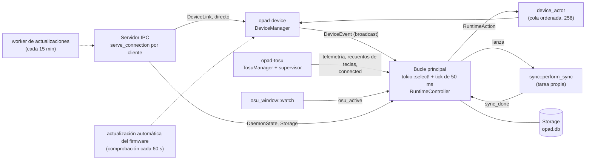

`opad-daemon` es el servicio tokio en segundo plano que tiene abierto el puerto serie del pad, ejecuta `tosu`, guarda en SQLite, hace copias de seguridad, actualiza y sirve a la GUI y a `opadctl` por IPC ([/desktop/daemon/src/main.rs](https://github.com/OPad-dev/OPad/blob/main/desktop/daemon/src/main.rs)). Nunca está en la ruta de las pulsaciones: el pad envía las teclas directamente al sistema operativo ([/AGENTS.md](https://github.com/OPad-dev/OPad/blob/main/AGENTS.md) §1.1–1.2).

## Tareas y canales

- **Bucle principal** (`main.rs`): un único `tokio::select!` sobre `device_rx`, `tosu_rx`, `tosu_keys_rx`, `tosu_connected_rx`, `osu_active_rx`, `sync_done_rx` y un tick de 50 ms. Cada evento se convierte en un `RuntimeEvent` para el `RuntimeController`, cuyas `RuntimeAction` van al actor del dispositivo. El tick también reintenta abrir SQLite cada 60 s si falló. Un receptor de eventos del dispositivo que se queda atrás provoca un nuevo handshake en lugar de adivinar qué se ha perdido.
- Las **sincronizaciones** se ejecutan en su propia tarea (pueden tardar ~10 s) e informan por `sync_done_rx` ([/desktop/daemon/src/sync.rs](https://github.com/OPad-dev/OPad/blob/main/desktop/daemon/src/sync.rs)).
- **Servidor IPC**: una tarea `ipc_handlers::serve_connection` por cliente, que comparte `DaemonState`, `Storage`, el log hub y las operaciones pendientes; llega al pad a través del trait `DeviceLink`.
- El estado compartido está en `DaemonState` tras un mutex; `DaemonState::pad_guard()` indica por qué no se puede escribir en el pad (un pad ajeno, una toma de control o una sustitución pendiente).

## Módulos

| Módulo | Función |
|---|---|
| [`runtime.rs`](https://github.com/OPad-dev/OPad/blob/main/desktop/daemon/src/runtime.rs) | `RuntimeController`: modo (`RuntimeMode::Idle` / `Playing` / `Cooldown` / `Sync`), heartbeats, protección de escritura, intentos de toques, decisiones de propiedad |
| [`device_actor.rs`](https://github.com/OPad-dev/OPad/blob/main/desktop/daemon/src/device_actor.rs) | Cola ordenada de comandos del host al pad |
| [`sync.rs`](https://github.com/OPad-dev/OPad/blob/main/desktop/daemon/src/sync.rs) | `perform_sync`: conciliación de contadores y `CounterSyncRequest` ([Contadores y propiedad](../../explanation/counters-and-ownership.md)) |
| [`telemetry.rs`](https://github.com/OPad-dev/OPad/blob/main/desktop/daemon/src/telemetry.rs) | `DataSync`: de valores de tosu a fuentes de pantalla que han cambiado |
| [`ipc_handlers.rs`](https://github.com/OPad-dev/OPad/blob/main/desktop/daemon/src/ipc_handlers.rs) | Un manejador por cada `IpcRequest` |
| [`backup.rs`](https://github.com/OPad-dev/OPad/blob/main/desktop/daemon/src/backup.rs) | Copias de seguridad JSON automáticas; se conservan las `KEEP = 10` más recientes |
| [`identity.rs`](https://github.com/OPad-dev/OPad/blob/main/desktop/daemon/src/identity.rs) | UUIDv4 por instalación en SQLite, que el pad guarda como su propietario |
| [`osu_window.rs`](https://github.com/OPad-dev/OPad/blob/main/desktop/daemon/src/osu_window.rs) | `osu_active` para los deslizamientos de volumen: osu! en primer plano en Windows, osu!lazer en ejecución en Linux |
| [`tap_stats.rs`](https://github.com/OPad-dev/OPad/blob/main/desktop/daemon/src/tap_stats.rs) | Mantiene el historial de frecuencia de toques de `DaemonState` al día con SQLite |
| [`log_hub.rs`](https://github.com/OPad-dev/OPad/blob/main/desktop/daemon/src/log_hub.rs) | Anillo de logs en memoria (2000 entradas) para `opadctl logs` y la página Logs |
| [`he_debug_log.rs`](https://github.com/OPad-dev/OPad/blob/main/desktop/daemon/src/he_debug_log.rs) | Escribe las líneas del firmware de depuración HE en `he-debug.log`, rotado a los 50 MB |
| [`updater.rs`](https://github.com/OPad-dev/OPad/blob/main/desktop/daemon/src/updater.rs) | Worker de actualizaciones de la app y de `tosu` |
| [`firmware_update.rs`](https://github.com/OPad-dev/OPad/blob/main/desktop/daemon/src/firmware_update.rs) | Ofertas de firmware, consentimiento, instalación y la actualización desatendida |

## Actor del dispositivo (`device_actor.rs`)

Todos los comandos de ejecución hacia el pad pasan por un único actor, para que lleguen en orden:

- **Cola acotada**: `QUEUE_DEPTH = 256` de `DeviceCommand` (`TimeSync`, `ClaimOwnership`, `Config`, `HostStatus`, `DataUpdate`, `Layout`, `RequestStatus`, `PlayAnimation`).
- **Reintentos**: cada comando se espera por turno; ante `DeviceError::Busy` se reintenta hasta `BUSY_RETRIES = 5` veces, con `BUSY_BACKOFF = 20 ms` entre intentos. Un `DataUpdate` no se reintenta (su diferencia ya estaría obsoleta): fija `resend_data`, así que el siguiente envío manda una instantánea completa.

## Controlador de ejecución (`runtime.rs`)

- **Heartbeats**: `STATUS_POLL_INTERVAL = 1 s`; `HOST_STATUS_INTERVAL = 1 s` envía `tosu_connected`, `is_playing`, `play_id`, `osu_active`. El pad sale de `PLAYING` por su cuenta tras 3 s sin recibir uno y vuelve a que todo toque sea Quick Retry ([táctil del firmware](../firmware/touch.md#modos-táctiles)).
- **Cooldown y protección de escritura**: refleja el cooldown de 5 s del firmware (`COOLDOWN_DURATION`); las escrituras en SQLite se rechazan (`Storage::set_writes_allowed(false)`) en `Playing` y `Cooldown`.
- **Copias de seguridad automáticas**: `AUTO_BACKUP_DELAY = 20 s` después de que la sincronización de después de la partida se asiente en `Idle`, se escribe `opad-backup-<timestamp>.json` en `<data_dir>/backups/`.
- **Frecuencia de toques**: los intentos en vivo prefieren las marcas de tiempo de bajada de tecla del propio pad a las de tosu; `TOSU_ONLY_PRESSES = 8` pulsaciones que tosu vio pero el pad no significan una repetición (replay) u otro teclado, y eso no se mide. Si el tiempo del mapa retrocede más de `RETRY_REWIND_MS = 2000` ms durante la partida, es un retry y empieza un intento nuevo. Se retienen hasta `MAX_UNSAVED_ATTEMPTS = 500` intentos mientras las escrituras están en pausa; el historial se refresca cada `TAP_HISTORY_REFRESH = 3600 s`.

## Diferencias de telemetría (`telemetry.rs`)

`DataSync` toma los valores v2 de tosu y solo emite los pares `(source_id, SourceValue)` que han cambiado, a `flush_interval_playing(hz)` durante la partida (1–30 Hz, por defecto 10 Hz) y a `FLUSH_INTERVAL_IDLE = 500 ms` el resto del tiempo.

## Manejadores de IPC (`ipc_handlers.rs`)

- **Handshake**: rechaza a un cliente cuyo `IPC_PROTOCOL_VERSION` (1) o versión de paquete sea distinta; la GUI, la CLI y el daemon siempre se distribuyen juntos.
- **Propiedad**: un pad que pertenece a otra instalación se toma automáticamente (`take_over_if_pad_is_ahead`) cuando está igual o por delante de este PC en las dos teclas; si no, `pad_guard()` bloquea las escrituras hasta que el usuario responde al aviso de toma de control.
- **Traspaso para el flasheo**: `PrepareFlash` libera el puerto serie para `opadctl`, `FinishFlash` reconecta y verifica, `ResumeDevice` solo reconecta ([funcionamiento interno de opadctl](opadctl.md#modos-de-ejecución)).
- `BOARD_TEST_TIMEOUT = 3 s` para la respuesta del pad a la prueba de PCB.

## Actualizaciones

- **App y tosu** (`updater::spawn_update_worker`, cada 15 min, comprobaciones manuales como mucho una vez por minuto): usa `opad-update` y su bloqueo durante la partida; en Linux los paquetes los aplica `opad-update-helper` mediante `pkexec`, y un fallo deja sin cambios la versión en ejecución ([crates](crates.md#9-opad-update)).
- **Firmware, desatendido** (ajuste opcional `update.firmware.auto`): se comprueba cada 60 s y solo se instala cuando el pad lleva `AUTO_IDLE = 30 min` sin usarse y nada lo impide; una versión que falló no se reintenta durante un día. La instalación espera hasta `RECONNECT_TIMEOUT = 45 s` a que vuelva el pad. Diseño: [Actualizaciones y reversión automática](../../explanation/updates-and-rollback.md).
