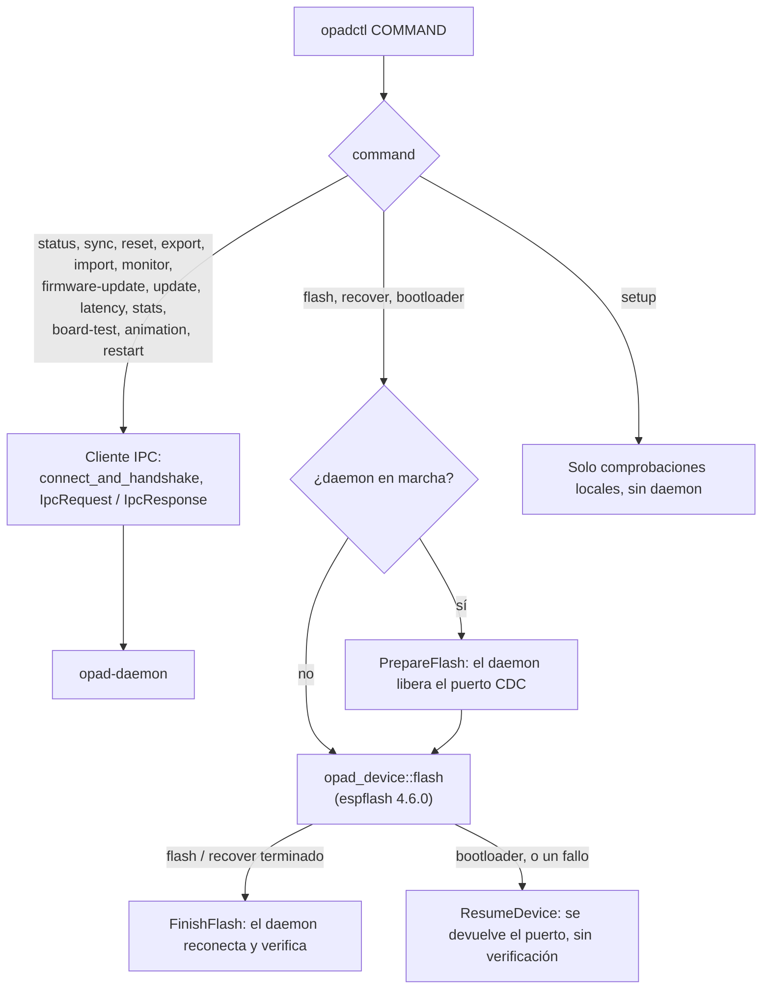

`opadctl` ([/desktop/cli/src/main.rs](https://github.com/OPad-dev/OPad/blob/main/desktop/cli/src/main.rs)) es la CLI de OPad basada en Clap para consultar el estado, sincronizar/reiniciar contadores, hacer copias de seguridad JSON, monitorizar logs, inspeccionar la latencia y la frecuencia de toques, lanzar pruebas de placa, preparar el entorno y flashear/recuperar por USB sin tocar botones.

## Modos de ejecución

1. **Cliente IPC**: `opad_ipc::connect_and_handshake()`, tramas `IpcRequest` tipadas, salida formateada de `IpcResponse` ([Referencia de IPC](../../reference/ipc.md)).
2. **Hardware directo (`flash`, `recover`, `bootloader`)**: con el daemon en marcha, `PrepareFlash` hace que libere el puerto serie; después, las rutinas de `opad_device::flash` hablan con el pad y con su bootloader de la ROM (`303a:1001`) ([crates](crates.md#5-opad-device)). Al terminar, `FinishFlash` reanuda el daemon y verifica el nuevo firmware, o `ResumeDevice` devuelve el puerto sin esperar a la app (tras `bootloader`, o cuando el flasheo falló). Un daemon antiguo que no conoce `ResumeDevice` recibe `FinishFlash` en su lugar. Sin daemon, estos comandos funcionan por sí solos.
3. **Preparación local (`setup`)**: comprueba sin daemon la regla udev de Linux (`/etc/udev/rules.d/70-opad.rules` o `/usr/lib/udev/rules.d/70-opad.rules`) y `ptrace_scope` de Yama / `cap_sys_ptrace`, o informa de los drivers integrados en Windows.

## Subcomandos (enum `Commands`)

Los 17 subcomandos públicos de [/desktop/cli/src/main.rs](https://github.com/OPad-dev/OPad/blob/main/desktop/cli/src/main.rs):
- `status`: muestra el modo del daemon, la información del pad, la ranura OTA en ejecución, el módulo de entrada y la calibración HE, los contadores, la propiedad, el estado de `tosu`, la latencia (`p50`/`p99.9`/`max`) y la configuración.
- `sync`: envía `IpcRequest::ForceSync`.
- `reset [--yes]`: reinicio destructivo de los contadores que incrementa la generación (se cancela sin `--yes`).
- `export <FILE>` / `import [--yes] <FILE>`: exporta, o previsualiza e importa, archivos `JsonBackup`.
- `monitor [-l <LIMIT>] [-f] [--level <LEVEL>] [--source <SOURCE>]`: muestra las últimas `LIMIT` (por defecto 50) entradas de log del daemon, del pad, del programa y de `tosu`; `-f` las sigue, sondeando cada 500 ms.
- `flash [--port <PORT>] [--full] <FIRMWARE>`: actualización OTA a la ranura inactiva, o flasheo de recuperación con `--full`.
- `recover [--timeout <SECONDS>] <FIRMWARE>`: espera (por defecto 300 s) a que aparezca el bootloader de la ROM tras volver a enchufar el cable y escribe el conjunto completo de imágenes; sin botones BOOT ni RESET ([Recuperación](../../recovery.md) §7.6–7.7).
- `bootloader [--port <PORT>]`: reinicia el pad en el modo de descarga de la ROM (`303a:1001`) y lo deja ahí.
- `firmware-update [--yes]`: comprueba el manifiesto de release firmado e instala la actualización de firmware con consentimiento explícito.
- `update [--channel <CHANNEL>] [--check] [--install]`: muestra el estado de actualización de la app, cambia de canal (`stable`/`beta`), comprueba el feed (esperando hasta 120 s) o empieza a instalar una actualización de la app disponible mediante `IpcRequest::InstallUpdate`.
- `latency [--reset]`: muestra o reinicia la latencia de pulsación a HID medida en el dispositivo (`p50`, `p99`, `p99.9`, `max`, número de diferidos).
- `stats [--period <DAYS>]`: muestra la frecuencia de toques en KPM del intento y del historial (y, opcionalmente, cambia el periodo del historial; `0` = todo, máximo `3650`).
- `board-test [--fix-pins] [--magnet]`: ejecuta la prueba de PCB de la placa portadora y del módulo (ID del módulo, orientación del FFC, líneas de tecla, cortos, ADS7028/sensores de HE V3).
- `animation <NAME> [GRADE]`: previsualiza una animación de resultado (`pop`, `drop`, `burst`, un ID o `none`) para la nota `SS`/`S`/`A`/`B`/`C`/`D`.
- `restart`: escribe los contadores y reinicia el pad cuando está en reposo.
- `setup`: verifica los permisos de la plataforma (`udev` + `ptrace` en Linux).

Dos alias ocultos, `freaky67` y `easter-egg`, envían `IpcRequest::TriggerEasterEgg`. Uso y ejemplos de cara al usuario: [Referencia de opadctl](../../reference/opadctl.md).
