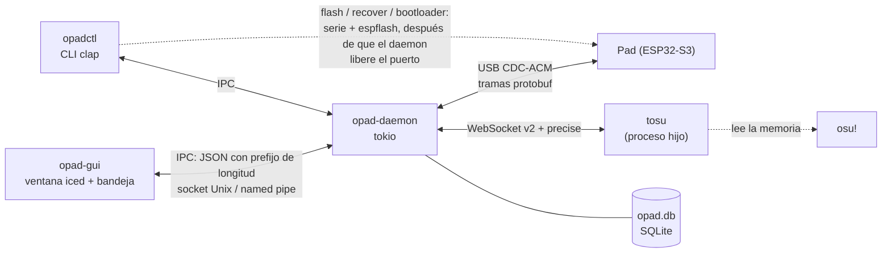

La suite de escritorio de OPad es un workspace de Cargo en Rust (edición 2021), versión `1.0.0-rc.6` ([/desktop/Cargo.toml](https://github.com/OPad-dev/OPad/blob/main/desktop/Cargo.toml)): tres binarios (`opad-daemon`, `opad-gui`, `opadctl`) y nueve crates de biblioteca, para Linux (X11 y Wayland) y Windows 10/11. Es opcional: sin ella, el pad es un teclado normal ([/AGENTS.md](https://github.com/OPad-dev/OPad/blob/main/AGENTS.md) §1.2). Cómo compilarla: [Compilar desde el código fuente](../building.md); tests: [Pruebas](../testing.md).

## Modelo de procesos

1. **`opad-daemon`** ([/desktop/daemon/src/main.rs](https://github.com/OPad-dev/OPad/blob/main/desktop/daemon/src/main.rs)): el único proceso que tiene abierto el puerto serie del pad en el uso normal. Ejecuta el actor ordenado del dispositivo, supervisa `tosu`, guarda en SQLite, busca actualizaciones y sirve la IPC. Detalles: [Daemon](daemon.md).
2. **`opad-gui`** ([/desktop/gui/src/main.rs](https://github.com/OPad-dev/OPad/blob/main/desktop/gui/src/main.rs)): la ventana y el applet de bandeja (`--tray`, `--page <name>`). Arranca el daemon si no está en marcha. Detalles: [GUI](gui.md).
3. **`opadctl`** ([/desktop/cli/src/main.rs](https://github.com/OPad-dev/OPad/blob/main/desktop/cli/src/main.rs)): scripts y diagnóstico por IPC; `flash`, `recover` y `bootloader` hablan directamente con el puerto serie. Detalles: [Funcionamiento interno de opadctl](opadctl.md).

La GUI y `opadctl` se distribuyen con el daemon y deben coincidir exactamente con su versión: el handshake de IPC comprueba `IPC_PROTOCOL_VERSION` y la versión del paquete ([/desktop/daemon/src/ipc_handlers.rs](https://github.com/OPad-dev/OPad/blob/main/desktop/daemon/src/ipc_handlers.rs)). El pad, en cambio, se actualiza por separado, así que el protocolo serie negocia ([Versiones de la app y del pad](../../explanation/app-and-pad-versions.md)).

## Crates del workspace (`desktop/crates/`)

Las dependencias apuntan hacia abajo: `opad-model` no depende de ninguno de los demás.

| Crate | Función |
|---|---|
| [`opad-model`](crates.md#1-opad-model) | Tipos de dominio (`DeviceInfo`, `DeviceConfig`, `CounterState`, `JsonBackup`), rutas, acciones de deslizamiento, cálculos de frecuencia de toques, evaluación de la prueba de placa, animaciones de resultado |
| [`opad-protocol`](crates.md#2-opad-protocol) | Tipos protobuf generados en tiempo de compilación con `protox` / `prost` (sin `protoc`), framing legacy / marcado / comprobado, CRC-16/CCITT-FALSE |
| [`opad-ipc`](crates.md#3-opad-ipc) | Tipos de petición y respuesta, JSON con prefijo de longitud `u32` sobre un socket Unix o un named pipe de Windows |
| [`opad-storage`](crates.md#4-opad-storage) | SQLite (WAL, esquema v19), la protección de escritura durante la partida (`StorageError::WritesBlocked`), conciliación de contadores |
| [`opad-device`](crates.md#5-opad-device) | Descubrimiento de puertos serie, handshake y negociación del framing, el canal de comandos, flasheo y recuperación basados en `espflash` |
| [`opad-layout`](crates.md#6-opad-layout) | Validación de layouts de 320×240 y empaquetado al `ui_layout_t` del firmware |
| [`opad-ui-preview`](crates.md#7-opad-ui-preview) | El `ui/core` del firmware y LVGL compilados para el host, para que el Screen Designer muestre exactamente lo que dibuja el pad |
| [`opad-tosu`](crates.md#8-opad-tosu) | Supervisor del proceso hijo `tosu` y cliente WebSocket, comprobaciones de `ptrace` de Yama en Linux |
| [`opad-update`](crates.md#9-opad-update) | Feed de actualizaciones firmado (minisign Ed25519 + SHA-256), política según el origen de la instalación, sustitución atómica de archivos, binarios `opad-feed` y `opad-update-helper` |

Dónde guarda sus archivos cada proceso: [Archivos y rutas](../../reference/files-and-paths.md).
