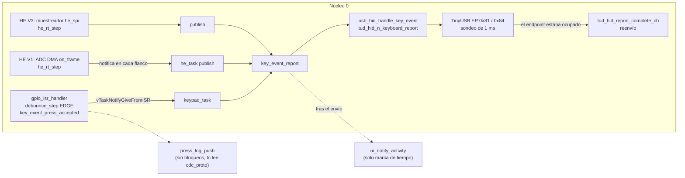

El firmware de OPad está escrito en C sobre ESP-IDF **v5.5.2** para la Waveshare ESP32-S3-Touch-LCD-2 (Xtensa LX7 de doble núcleo a 240 MHz, 16 MB de flash, 8 MB de PSRAM octal). El núcleo 0 ejecuta las teclas y el USB; el núcleo 1, todo lo demás (protocolo, pantalla, táctil, almacenamiento) ([/firmware/sdkconfig.defaults](https://github.com/OPad-dev/OPad/blob/main/firmware/sdkconfig.defaults), [/firmware/main/app_main.c](https://github.com/OPad-dev/OPad/blob/main/firmware/main/app_main.c)).

Páginas de los subsistemas: [entrada](input.md), [USB y tarea del protocolo](usb.md), [pantalla táctil](touch.md), [UI](ui.md), [configuración y NVS](config-and-nvs.md), [contadores](counters.md), [diagnóstico](diag.md). Los motivos del diseño están en [Ingeniería de latencia](../../explanation/latency.md) y [Arquitectura del sistema](../../explanation/architecture.md).

## Árbol de código fuente

| Directorio | Contenido |
|---|---|
| [/firmware/main/input/](https://github.com/OPad-dev/OPad/tree/main/firmware/main/input) | ISR de teclas y `keypad_task`, antirrebote, backends Hall Effect y calibración, pantalla táctil y gestos, detección de módulo, estadísticas de latencia, registro de pulsaciones |
| [/firmware/main/usb/](https://github.com/OPad-dev/OPad/tree/main/firmware/main/usb) | Descriptores TinyUSB, reports HID de teclado, reports multimedia/rueda, CDC-ACM y el reinicio al modo de descarga de la ROM |
| [/firmware/main/protocol/](https://github.com/OPad-dev/OPad/tree/main/firmware/main/protocol) | Parser de tramas, gestión de mensajes nanopb (`protocol.c`), `opad.pb.c/.h` generados (nunca se editan a mano, ver [Cambios en el protocolo](../protocol-changes.md)) |
| [/firmware/main/ui/](https://github.com/OPad-dev/OPad/tree/main/firmware/main/ui) | Port de LVGL, almacén de layouts, superposición de calibración HE, easter egg; `ui/core/` es el motor de layouts portable que también compila la vista previa de escritorio |
| [/firmware/main/config/](https://github.com/OPad-dev/OPad/tree/main/firmware/main/config) | Blobs de configuración del dispositivo, validación, ID de propietario, registro de ajustes HE, migración de namespaces NVS |
| [/firmware/main/counters/](https://github.com/OPad-dev/OPad/tree/main/firmware/main/counters) | Persistencia de los contadores de por vida y reglas de sincronización con el host |
| [/firmware/main/runtime/](https://github.com/OPad-dev/OPad/tree/main/firmware/main/runtime) | Máquina de estados `IDLE`/`PLAYING`/`COOLDOWN` y escrituras diferidas |
| [/firmware/main/diag/](https://github.com/OPad-dev/OPad/tree/main/firmware/main/diag) | Anillo de eventos de diagnóstico, autoprueba de placa, prueba del ADS7028, compilaciones de banco Hall y de rendimiento de UI |
| [/firmware/boards/waveshare_esp32s3_touch_lcd_2/](https://github.com/OPad-dev/OPad/tree/main/firmware/boards/waveshare_esp32s3_touch_lcd_2) | Mapa de pines, armado de los GPIO de teclas, retroiluminación, arranque de la pantalla ST7789, lecturas ADC del ID de módulo |
| [/firmware/test/host/](https://github.com/OPad-dev/OPad/tree/main/firmware/test/host) | Tests unitarios compilados en el host para los módulos en C puro (`run_tests.sh`, parte de `make check`) |

## Orden de arranque (`app_main`)

`app_main` levanta primero el HID y trata todo lo posterior como opcional, de modo que un fallo de la pantalla, la NVS o el protocolo nunca cuesta el teclado ([/firmware/main/app_main.c](https://github.com/OPad-dev/OPad/blob/main/firmware/main/app_main.c)):

1. `device_config_init()` (configuración de NVS, o valores por defecto); después `board_detect_module()` lee el ID del módulo de entrada y elige la fuente de teclas (pines MX, ADC de HE V1, SPI de HE V3, o teclas desactivadas si el módulo no está soportado).
2. `key_event_init()`, `keypad_init()` y `usb_hid_init()`; después `tinyusb_driver_install()` con la tarea de TinyUSB en el núcleo 0 a `configMAX_PRIORITIES - 2`. **Los fallos hasta aquí son fatales** (`ESP_ERROR_CHECK`).
3. A partir de aquí, nada es fatal: `usb_cdc_init()` / `usb_cdc_start_task()`, `he_backend_start()` en un módulo Hall Effect, `counters_init()` (suma los totales de NVS a lo que se haya pulsado desde el arranque), `runtime_init()`, `board_backlight_init()` y `ui_init()`, `touch_retry_init()` y `module_monitor_start()` (no en un pad MX, cuyo ID se lee una sola vez al arrancar).
4. `DIAG_EVENT_MEMORY` registra la RAM interna libre y el mayor bloque apto para DMA.
5. `confirm_image_once_usb_works()`: una imagen OTA recién flasheada sigue en `ESP_OTA_IMG_PENDING_VERIFY` hasta que el host configura el USB; si hay un host pero no lo configura en 20 s (`IMAGE_CONFIRM_TIMEOUT_US`), el pad se reinicia y el bootloader revierte (ver [Actualizaciones y reversión automática](../../explanation/updates-and-rollback.md)).

`CONFIG_OPAD_BENCH_HID_ONLY` se detiene tras el paso 2; `CONFIG_OPAD_BENCH_NO_DISPLAY` se salta la pantalla y el táctil.

## Tareas de FreeRTOS

| Tarea | Núcleo | Prioridad | Pila | Fuente | Función |
|---|---|---|---|---|---|
| `keypad_task` | 0 | `configMAX_PRIORITIES - 1` | 4096 | [/firmware/main/input/keypad.c](https://github.com/OPad-dev/OPad/blob/main/firmware/main/input/keypad.c) | Teclas mecánicas: remuestreo del antirrebote, envío HID, cambios de pines escalonados, detección de pines, prueba de líneas |
| `he_task` | 0 | `configMAX_PRIORITIES - 1` | 4096 | [/firmware/main/input/he_backend.c](https://github.com/OPad-dev/OPad/blob/main/firmware/main/input/he_backend.c) | Hall Effect: publica los flancos de tecla de V1, comprobaciones de salud, reinicio del ADC, sondeos en pausa (solo pads HE) |
| `he_spi` | 0 | `configMAX_PRIORITIES - 1` | 3072 | [/firmware/main/input/he_spi_source.c](https://github.com/OPad-dev/OPad/blob/main/firmware/main/input/he_spi_source.c) | HE V3: una trama del ADS7028 cada 50 µs; informa ella misma de los cambios de tecla (solo HE V3) |
| TinyUSB (`tusb`) | 0 | `configMAX_PRIORITIES - 2` | valor por defecto de esp_tinyusb | [/firmware/main/app_main.c](https://github.com/OPad-dev/OPad/blob/main/firmware/main/app_main.c) | Pila de dispositivo USB, finalización de reports (`tud_hid_report_complete_cb`) |
| `cdc_proto` | 1 | `tskIDLE_PRIORITY + 3` | 6144 | [/firmware/main/usb/usb_cdc.c](https://github.com/OPad-dev/OPad/blob/main/firmware/main/usb/usb_cdc.c) | Recepción, despacho y envío del protocolo serie |
| Tarea del port de LVGL | 1 | `2` | valor por defecto de esp_lvgl_port | [/firmware/main/ui/ui_port.c](https://github.com/OPad-dev/OPad/blob/main/firmware/main/ui/ui_port.c) | Renderizado, `pad_timer_cb` cada 20 ms, temporizador de la superposición de calibración HE |
| `touch_retry` | 1 | `2` | 3072 | [/firmware/main/input/touch_retry.c](https://github.com/OPad-dev/OPad/blob/main/firmware/main/input/touch_retry.c) | Táctil CST816S: Quick Retry y deslizamientos |
| `module_mon` | 1 | `tskIDLE_PRIORITY + 1` | 3072 | [/firmware/main/input/module_monitor.c](https://github.com/OPad-dev/OPad/blob/main/firmware/main/input/module_monitor.c) | Desactiva las teclas si se cambia un módulo en caliente (no en pads MX) |
| `runtime_task` | 1 | `tskIDLE_PRIORITY + 1` | 4096 | [/firmware/main/runtime/runtime.c](https://github.com/OPad-dev/OPad/blob/main/firmware/main/runtime/runtime.c) | Máquina de estados, escrituras NVS diferidas, reinicio pedido por el host |

Las compilaciones de depuración y medida añaden `he_debug` / `mx_debug` (núcleo 1, `tskIDLE_PRIORITY + 2`, `CONFIG_OPAD_HE_DEBUG`), `he_trace` (núcleo 1, `tskIDLE_PRIORITY + 2`, `CONFIG_OPAD_HE_TRACE`) y `hall_bench` (núcleo 0, `configMAX_PRIORITIES - 3`, `CONFIG_OPAD_HALL_BENCH`).

## La ruta de una pulsación

Todo lo que hay en esta ruta está en el núcleo 0 y en IRAM; nada del núcleo 1 (pantalla, protocolo, NVS) forma parte de ella.

Los contadores de pulsaciones se incrementan donde se acepta la pulsación (ISR o paso de trama), a continuación se envía el report HID y la latencia se registra después del envío (`latency_stats_record`). Detalles: [entrada](input.md), [USB](usb.md).

## Máquina de estados de ejecución (`runtime.c`)

`runtime_supervisor_task` se despierta cada 100 ms ([/firmware/main/runtime/runtime.c](https://github.com/OPad-dev/OPad/blob/main/firmware/main/runtime/runtime.c)). El host lleva al pad a `PLAYING` mediante `HostStatus`; el pad sale de él por su cuenta si dejan de llegar actualizaciones.

```mermaid
stateDiagram-v2
    IDLE --> PLAYING: runtime_notify_gameplay(true)
    PLAYING --> COOLDOWN: el host dice que no se juega, o 3 s sin actualizaciones
    COOLDOWN --> PLAYING: runtime_notify_gameplay(true)
    COOLDOWN --> IDLE: pasan 5 s; después se escriben contadores, configuración, layouts y calibración HE
```

- `GAMEPLAY_TIMEOUT_US = 3 s`, `COOLDOWN_DURATION_US = 5 s`. `OPAD_STATE_UNKNOWN` y `OPAD_STATE_SYNC` existen en el enum ([/firmware/main/runtime/runtime.h](https://github.com/OPad-dev/OPad/blob/main/firmware/main/runtime/runtime.h)), pero el supervisor solo se mueve entre los tres estados de arriba.
- En `IDLE`, cada tick llama a `device_config_flush()`, `ui_store_flush_dirty()` y `he_cal_flush()`, y guarda un checkpoint de los contadores cuando `counters_checkpoint_due()` lo indica o cuando lo ha pedido una suspensión USB ([contadores](counters.md)).
- En `PLAYING` y `COOLDOWN` no se escribe nada en NVS: cada escritor comprueba `runtime_get_state() != OPAD_STATE_IDLE` y solo se marca como pendiente ([configuración y NVS](config-and-nvs.md)).
- `runtime_request_restart()` (el Restart de la app) espera a `IDLE` y a una imagen OTA confirmada, escribe todo y después llama a `esp_restart()`.

## Ajustes críticos de `sdkconfig.defaults`

De [/firmware/sdkconfig.defaults](https://github.com/OPad-dev/OPad/blob/main/firmware/sdkconfig.defaults). Después de editarlo, borra `firmware/sdkconfig` y vuelve a compilar ([/AGENTS.md](https://github.com/OPad-dev/OPad/blob/main/AGENTS.md) §5).

| Ajuste | Motivo |
|---|---|
| `CONFIG_ESP_DEFAULT_CPU_FREQ_MHZ_240=y` | Con la ruta de teclas en IRAM, una pulsación llegaba al USB en ~70 µs bajo carga de pantalla, frente a ~240 µs a 160 MHz desde flash |
| `CONFIG_COMPILER_OPTIMIZATION_PERF=y` | `-O2` |
| `CONFIG_FREERTOS_HZ=1000` | Tick de 1 ms, a juego con el sondeo USB |
| `CONFIG_GPIO_CTRL_FUNC_IN_IRAM=y` | `gpio_get_level` y similares en IRAM para la ISR de teclas y `keypad_task` |
| `CONFIG_TINYUSB_HID_COUNT=2`, `CONFIG_TINYUSB_CDC_COUNT=1` | Deben coincidir con el descriptor; si no, `usb_descriptors.c` hace fallar la compilación |
| `CONFIG_TINYUSB_CDC_TX_BUFSIZE=2048` | Espacio para la trama más grande del dispositivo, para que `usb_cdc_write` encole tramas enteras |
| `CONFIG_TINYUSB_SUSPEND_CALLBACK=y` | `TINYUSB_EVENT_SUSPENDED` pide un checkpoint de los contadores |
| `CONFIG_SPIRAM=y`, `CONFIG_SPIRAM_MODE_OCT=y`, `CONFIG_SPIRAM_SPEED_80M=y`, `CONFIG_SPIRAM_ALLOW_BSS_SEG_EXTERNAL_MEMORY=y` | 8 MB de PSRAM, y `EXT_RAM_BSS_ATTR` para los búferes que no están en la ruta de teclas |
| `CONFIG_LV_MEM_SIZE_KILOBYTES=160`, `CONFIG_LV_DEF_REFR_PERIOD=33` | El pool propio de LVGL de 160 KB (en PSRAM por defecto) y un límite de redibujado de 30 fps |
| `CONFIG_ESP32S3_INSTRUCTION_CACHE_32KB=y`, `CONFIG_ESP32S3_DATA_CACHE_64KB=y`, `CONFIG_ESP32S3_DATA_CACHE_LINE_64B=y` | Las cachés más grandes: reducen a la mitad el tiempo de fotograma del código y las fuentes en flash y del pool en PSRAM |
| `CONFIG_PARTITION_TABLE_CUSTOM=y`, `CONFIG_BOOTLOADER_APP_ROLLBACK_ENABLE=y` | Dos ranuras OTA de 2 MB ([/firmware/partitions.csv](https://github.com/OPad-dev/OPad/blob/main/firmware/partitions.csv): `nvs` 0x9000, `otadata` 0xf000, `ota_0` 0x20000, `ota_1` 0x220000) con reversión desde el bootloader |

Solo están activados los widgets de LVGL que usan los layouts (label, bar, image, observer, GIF); las fuentes son Montserrat 12/14/16/20/24/32/48.

## Colocación en IRAM y distribución de memoria

- **Fragmento de enlazador para IRAM** ([/firmware/main/linker.lf](https://github.com/OPad-dev/OPad/blob/main/firmware/main/linker.lf)): `keypad:keypad_task`, todo `usb_hid`, `he_frame`, `he_rt`, `he_spi_source:sampler_task` y `he_spi_frame` son `noflash`, junto con `tud_hid_n_ready` / `tud_hid_n_report` / `tud_hid_n_keyboard_report` de TinyUSB, las funciones auxiliares de endpoints de `usbd`, `tu_edpt_claim` / `tu_edpt_release`, `tu_hwfifo_write` y todo `dcd_dwc2`. Otras funciones de la ruta de teclas llevan `IRAM_ATTR` en el código (`gpio_isr_handler`, `debounce_step`, `key_event_press_accepted`, `key_event_report`, `usb_hid_handle_key_event`, `process_frame` / `publish` de HE). Si no, un fallo de caché mientras el núcleo 1 está ocupado le costaba a la ruta de teclas 170–240 µs.
- **RAM interna frente a PSRAM**: solo las teclas, el USB y los búferes DMA necesitan RAM interna. Con `CONFIG_OPAD_LVGL_PSRAM=y` (por defecto), el pool de LVGL se reserva en PSRAM al arrancar ([/firmware/main/ui/lvgl_psram_pool.h](https://github.com/OPad-dev/OPad/blob/main/firmware/main/ui/lvgl_psram_pool.h)). `EXT_RAM_BSS_ATTR` coloca en PSRAM `s_layouts` ([/firmware/main/ui/ui_port.c](https://github.com/OPad-dev/OPad/blob/main/firmware/main/ui/ui_port.c)), `s_pending_layouts` ([/firmware/main/ui/ui_store.c](https://github.com/OPad-dev/OPad/blob/main/firmware/main/ui/ui_store.c)), `s_subjects` / `s_str_buf` / `s_str_prev` ([/firmware/main/ui/core/ui_data.c](https://github.com/OPad-dev/OPad/blob/main/firmware/main/ui/core/ui_data.c)) y los búferes del parser, del mensaje decodificado y del layout de [/firmware/main/protocol/protocol.c](https://github.com/OPad-dev/OPad/blob/main/firmware/main/protocol/protocol.c). Los dos búferes de dibujo de 40 líneas (`UI_DRAW_BUF_LINES = 40`, 25,6 KB cada uno) se quedan en RAM interna apta para DMA ([/firmware/main/ui/ui.h](https://github.com/OPad-dev/OPad/blob/main/firmware/main/ui/ui.h)).

## Opciones Kconfig en tiempo de compilación

Definidas en [/firmware/main/Kconfig.projbuild](https://github.com/OPad-dev/OPad/blob/main/firmware/main/Kconfig.projbuild) bajo **OPad Testing and Benchmark**. Todas valen `n` por defecto salvo `CONFIG_OPAD_LVGL_PSRAM`.

| Opción | Efecto |
|---|---|
| `CONFIG_OPAD_TEST_FAIL_LCD` / `CONFIG_OPAD_TEST_FAIL_NVS` | Inyección de fallos: falla `board_display_init` / la inicialización de NVS, para demostrar el teclado sin pantalla y los contadores solo en RAM |
| `CONFIG_OPAD_BENCH_HID_ONLY` / `CONFIG_OPAD_BENCH_NO_DISPLAY` | Etapas de latencia A (solo HID y teclado) y B (CDC activo, sin pantalla) ([Medición de latencia](../latency-testing.md)) |
| `CONFIG_OPAD_BENCH_DEBUG_GPIO` / `CONFIG_OPAD_BENCH_DEBUG_GPIO_NUM` (por defecto `4`) | Conmuta un GPIO justo después del envío HID, para un analizador lógico |
| `CONFIG_OPAD_HE_BACKEND` | Entrada Hall Effect **V1** por DMA continuo del ADC1 (selecciona `ADC_CONTINUOUS_ISR_IRAM_SAFE`). HE V3 (ADS7028 por SPI) se compila siempre |
| `CONFIG_OPAD_HE_TRACE` | Envía por CDC cada conversión en bruto de V1 (~150 KB/s) para `scripts/he_trace.py`; requiere el daemon parado |
| `CONFIG_OPAD_HE_DEBUG` | Firmware de depuración: registra cada pulsación HE (`he.*`) o toque MX (`he.mx*`) como LogEvents que el daemon escribe en `he-debug.log`; la versión lleva `+hedebug`. Añade latencia a propósito |
| `CONFIG_OPAD_HALL_BENCH` | Flujo de texto en bruto de los sensores HE V1 por CDC para `scripts/hall_bench.py` ([diagnóstico](diag.md)) |
| `CONFIG_OPAD_UI_PERF_TEST` | Bucle de sesión simulada con superposiciones de FPS/memoria de LVGL y `DIAG_EVENT_UI_PERF` |
| `CONFIG_OPAD_LVGL_PSRAM` (por defecto `y`) | Pool de LVGL en PSRAM; con él en RAM interna, a un pad HE V3 le quedaba muy poca RAM DMA para los búferes de dibujo |
| `CONFIG_OPAD_DEBUG_I2C_SCAN` | Sondea al arrancar todas las direcciones I2C del bus táctil (hasta ~1,3 s) |

> [!WARNING]
> Las compilaciones de banco de pruebas, traza, depuración e inyección de fallos no son compilaciones de release. La latencia medida con `CONFIG_OPAD_HE_TRACE` o `CONFIG_OPAD_HE_DEBUG` no cuenta.
