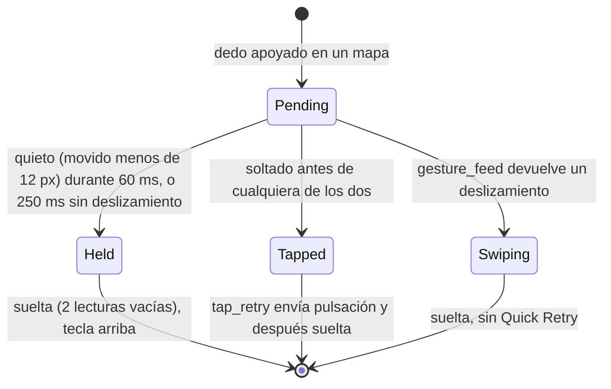

La pantalla táctil es el cuarto botón de OPad ([/AGENTS.md](https://github.com/OPad-dev/OPad/blob/main/AGENTS.md) §1.4): una pulsación limpia, un estado mantenido mientras el dedo sigue apoyado y una suelta limpia. La maneja `touch_retry_task` en el **núcleo 1** con prioridad `2` ([/firmware/main/input/touch_retry.c](https://github.com/OPad-dev/OPad/blob/main/firmware/main/input/touch_retry.c)); sus teclas llegan al report de teclado a través de `usb_hid_set_touch_key()` ([USB](usb.md#envío-hid-con-endpoints-separados-usb_hidc)). Comportamiento de cara al usuario: [Pantalla táctil y deslizamientos](../../guides/touchscreen-and-swipes.md); diseño: [La pantalla táctil como tercer botón](../../explanation/touchscreen-button.md).

## Hardware e I2C

- **Controlador**: Hynitron CST816S en `CST816_I2C_ADDR = 0x15` sobre `I2C_NUM_0`, 100 kHz (`CST816_I2C_FREQ_HZ`), tiempo de espera de 20 ms por transacción.
- **Pines** ([/firmware/boards/waveshare_esp32s3_touch_lcd_2/board_pins.h](https://github.com/OPad-dev/OPad/blob/main/firmware/boards/waveshare_esp32s3_touch_lcd_2/board_pins.h)): SDA GPIO48 (`BOARD_I2C_SDA_GPIO`), SCL GPIO47 (`BOARD_I2C_SCL_GPIO`), INT GPIO46 (`BOARD_TOUCH_INT_GPIO`, flanco de bajada, pull-up interno). La IMU (QMI8658) comparte el bus.
- **Autosuspensión desactivada**: se escribe `0xFF` en `CST816_REG_AUTO_SLEEP` (`0xFE`) al inicializar, y otra vez en el primer toque si aquello falló, para que el controlador no añada retardo de despertar.
- **Lecturas**: una lectura de 5 bytes desde `CST816_REG_TOUCH_NUM` (`0x02`) da el número de toques y X/Y de 12 bits. Una muestra está "abajo" si INT está a nivel bajo o el número no es cero.
- **Orientación**: el panel es vertical (240×320) y la UI horizontal (320×240), así que las coordenadas pasan por `TOUCH_SWAP_XY = 1`, `TOUCH_MIRROR_X = 0`, `TOUCH_MIRROR_Y = 1` para que "arriba" sea arriba tal como se sostiene el pad.

## En reposo con la interrupción, sondeo solo con el dedo apoyado

1. **Sin dedo**: la tarea se bloquea en `ulTaskNotifyTake()` y la despierta la ISR de INT (`touch_int_isr`, `vTaskNotifyGiveFromISR`). Ni CPU ni tráfico I2C. Un tiempo de espera de 1 s (`TOUCH_IDLE_CHECK_MS`) es solo una red de seguridad por si la línea INT se queda muda; si no se pudo instalar la ISR, la tarea pasa a sondear cada 10 ms.
2. **Dedo apoyado**: una lectura de confirmación y después una lectura cada `TOUCH_POLL_MS = 10` ms para seguir el dedo y ver la suelta.
3. **Suelta**: `TOUCH_RELEASE_READS = 2` lecturas vacías seguidas (~20 ms), para que una sola lectura con ruido nunca termine una pulsación mantenida.

## Modos táctiles

El modo se fija al apoyar el dedo mediante `touch_mode_now()`, a partir de `touch_retry_set_host_status()` (que llama la tarea del protocolo en cada `HostStatus`) y del estado de ejecución:

| Modo | Cuándo | Quick Retry | Deslizamientos |
|---|---|---|---|
| `TOUCH_MODE_RETRY` | Ningún `HostStatus` con tosu conectado en los últimos 3 s (`HOST_STATUS_TIMEOUT_US`): sin daemon, sin tosu | Se pulsa al apoyar el dedo y se mantiene hasta soltar | Desactivados |
| `TOUCH_MODE_PLAY` | Host vivo y `runtime_get_state() == OPAD_STATE_PLAYING` | Pendiente; ver abajo | Solo multimedia (sin report de teclado) |
| `TOUCH_MODE_MENU` | Host vivo, sin partida | Nunca; un toque no envía nada | Todas las acciones |

**Quick Retry durante un mapa.** La tecla `` ` `` no se envía al apoyar el dedo, así que un deslizamiento nunca puede enviarla:

`PLAY_RETRY_STILL_US = 60000`, `PLAY_RETRY_STILL_PX = 12`, `PLAY_SWIPE_WINDOW_US = 250000`. Una vez que Quick Retry está mantenido, se deja de seguir el deslizamiento durante el resto de ese toque.

## Clasificador de gestos (`gesture.c`)

C puro, probado en el host ([/firmware/main/input/gesture.h](https://github.com/OPad-dev/OPad/blob/main/firmware/main/input/gesture.h), [/firmware/main/input/gesture.c](https://github.com/OPad-dev/OPad/blob/main/firmware/main/input/gesture.c)):

- Nada es un deslizamiento hasta que el dedo está a `GESTURE_SWIPE_PX = 30` px de donde se apoyó (`gesture_begin`).
- Un eje debe dominar en proporción 3:2 (`2·|dy| ≥ 3·|dx|` vertical, `2·|dx| ≥ 3·|dy|` horizontal); una diagonal espera a que haya más movimiento. Después, el deslizamiento queda fijado a ese eje.
- El **vertical** sigue dando pasos cada 30 px mientras el dedo se mueva (al volver atrás da pasos en sentido contrario): un paso de volumen cada uno. El **horizontal** se dispara una vez por toque. `gesture_feed()` se llama repetidamente con la misma posición hasta que devuelve `GESTURE_NONE`, de modo que un deslizamiento rápido o leído tarde conserva su longitud.

## Acciones de deslizamiento

Cada dirección tiene una acción, tecla y modificadores tomados de la configuración del dispositivo (`touch_retry_set_swipe_actions()`); por defecto, arriba/abajo volumen e izquierda/derecha pista anterior/siguiente ([/firmware/main/config/device_config.h](https://github.com/OPad-dev/OPad/blob/main/firmware/main/config/device_config.h)). Solo el volumen se repite a lo largo de un arrastre; las demás acciones se disparan una vez por toque.

| Acción | Fuera de un mapa | En un mapa |
|---|---|---|
| Subir/bajar volumen, osu! activo (`osu_active` desde el host, [/desktop/daemon/src/osu_window.rs](https://github.com/OPad-dev/OPad/blob/main/desktop/daemon/src/osu_window.rs)) | Alt mantenido en el report de teclado, muescas de rueda en la interfaz multimedia; Alt se mantiene durante todo el toque | Rueda sin más, sin Alt |
| Subir/bajar volumen, osu! no activo | Teclas consumer de volumen | Teclas consumer de volumen |
| Pista anterior/siguiente, reproducir/pausa, silencio | Teclas consumer | Teclas consumer |
| Tecla de teclado (`SWIPE_ACTION_KEY`) | Modificadores abajo, tecla pulsada 15 ms, modificadores arriba | Nada |

- **Soltar Alt (`release_alt`)**: espera a que lleguen los reports de rueda y después envía Alt+F24, Alt y luego nada. Windows interpreta pulsar y soltar Alt a solas como "abrir el menú de la ventana" (`SC_KEYMENU`), lo que puede hacer que un juego pierda la siguiente tecla; F24 no está asignada a nada. Cada paso espera hasta `TOUCH_KEY_WAIT_MS = 30` ms a la entrega, y `TOUCH_ORDER_GAP_MS = 4` mantiene Alt por delante de la rueda en el host.
- **Respuesta visual**: fuera de un mapa el pad muestra una flecha breve y una etiqueta (`ui_show_swipe`). Las etiquetas de teclas de teclado vienen de [/firmware/main/input/swipe_labels.c](https://github.com/OPad-dev/OPad/blob/main/firmware/main/input/swipe_labels.c) (`SWIPE_LABELS`: los atajos por defecto de osu!, como F1 Mods, F2 Random, F3 Options, Ctrl+O Settings), que debe incluir todos los atajos de `OSU_SHORTCUTS` ([/desktop/crates/opad-model/src/swipe.rs](https://github.com/OPad-dev/OPad/blob/main/desktop/crates/opad-model/src/swipe.rs)); lo comprueba un test en el host. **Durante un mapa no se dibuja nada.**

## Bloqueo por calibración

En un pad Hall Effect sin calibrar, o mientras se calibra, el táctil pertenece a la pantalla de calibración (decisión D7 en [/docs/specs/v2-hall-effect-decisions.md](../../../specs/v2-hall-effect-decisions.md)):

- Al apoyar el dedo, `he_cal_suppress_input(he_backend_is_locked(), he_backend_is_calibrating())` filtra el toque: las muestras solo van a `he_cal_ui_touch_sample()`, sin Quick Retry, sin deslizamiento, sin tecla.
- Un bloqueo que empieza a mitad de un toque (se comprueba en cada lectura, con el dedo arriba o abajo) suelta Quick Retry y borra la tecla táctil sin la secuencia de F24, y se mantiene hasta que se levanta el dedo.
- `he_cal_touch_guard.h` impide que coincidan un inicio de calibración y un toque en curso: `touch_retry_reserve_calibration()` falla mientras haya un contacto o su limpieza tras la suelta esté en marcha.
