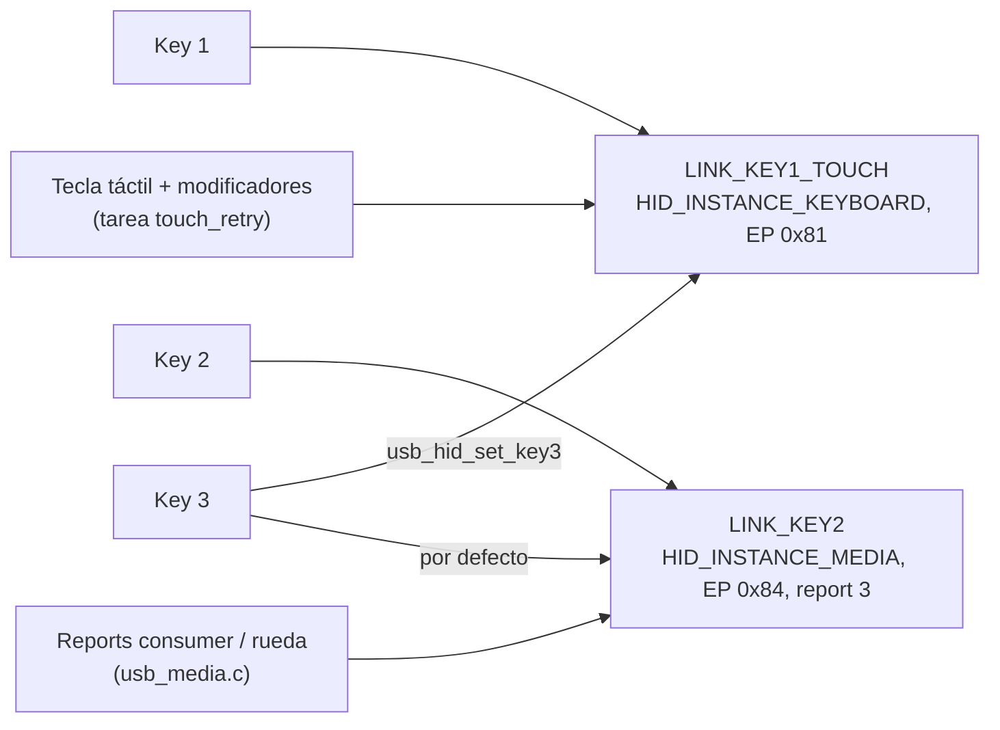

El pad es un dispositivo compuesto USB 2.1 full-speed, `VID 0x303A` / `PID 0x8415` (el PID propio de OPad, concedido por Espressif), `bcdDevice 0x0102`, construido sobre TinyUSB (`espressif/esp_tinyusb` 2.3.0, `espressif/tinyusb` 0.21.0~2 en [/firmware/dependencies.lock](https://github.com/OPad-dev/OPad/blob/main/firmware/dependencies.lock)). La tarea de TinyUSB se ejecuta en el núcleo 0 a `configMAX_PRIORITIES - 2`, solo por debajo de las tareas de teclas ([/firmware/main/app_main.c](https://github.com/OPad-dev/OPad/blob/main/firmware/main/app_main.c), [/firmware/main/usb/usb_descriptors.c](https://github.com/OPad-dev/OPad/blob/main/firmware/main/usb/usb_descriptors.c)).

El firmware release candidate usaba `303a:4001`; el escritorio encuentra el pad por sus cadenas de descriptor, no por su PID ([crates](../desktop/crates.md#5-opad-device)). El bootloader de la ROM es `303a:1001`.

> [!IMPORTANT]
> El pad debe seguir siendo un teclado normal sin driver en Linux y Windows 10/11 ([/AGENTS.md](https://github.com/OPad-dev/OPad/blob/main/AGENTS.md) §1.2). Los cambios bajo `firmware/main/usb/` deben indicar su impacto en la latencia y cómo se midió (§1.1).

## Descriptores e interfaces

Declarados en [/firmware/main/usb/usb_descriptors.c](https://github.com/OPad-dev/OPad/blob/main/firmware/main/usb/usb_descriptors.c) y [/firmware/main/usb/usb_descriptors.h](https://github.com/OPad-dev/OPad/blob/main/firmware/main/usb/usb_descriptors.h):

| Interfaz | Clase / protocolo | Endpoints | Sondeo | Transporta |
|---|---|---|---|---|
| 0 `ITF_NUM_HID` | Teclado HID de arranque (`HID_ITF_PROTOCOL_KEYBOARD`) | `0x81` IN, 8 B | 1 ms | Key 1, la tecla táctil (Quick Retry, teclas de deslizamiento y Alt) y la Key 3 cuando se enruta aquí; report ID 0 |
| 1–2 `ITF_NUM_CDC` / `ITF_NUM_CDC_DATA` | CDC-ACM | `0x82` notificación IN 8 B, `0x03` OUT 64 B, `0x83` IN 64 B | bulk | Protocolo serie |
| 3 `ITF_NUM_MEDIA` | HID, sin protocolo de arranque | `0x84` IN, 16 B | 1 ms | `MEDIA_REPORT_ID_CONSUMER = 1` (volumen, teclas multimedia), `MEDIA_REPORT_ID_MOUSE = 2` (rueda), `MEDIA_REPORT_ID_KEYBOARD = 3` (Key 2, y Key 3 cuando se enruta aquí) |

- La interfaz multimedia va después de CDC para que el teclado y el puerto COM conserven los números de interfaz que tenían antes de que existiera.
- **Cadenas**: fabricante `GFerreiroS`, producto `OPad ESP32-S3`, número de serie `OPAD-<MAC>` (`usb_descriptors_init()` a partir de la MAC STA de Wi-Fi), nombres de interfaz `OPad HID Keyboard`, `OPad CDC Telemetry`, `OPad Media Controls`.
- **BOS + MS OS 2.0** (`opad_usb_bos_desc`, `opad_usb_ms_os_20_desc`, servidos desde `tud_vendor_control_xfer_cb`): `FriendlyName = "OPad"` en la interfaz 1, para que Windows muestre `OPad (COMx)` sin INF.
- **Protecciones de compilación**: `_Static_assert(CFG_TUD_HID >= HID_INSTANCE_MEDIA + 1)` y `_Static_assert(CFG_TUD_CDC >= 1)`. Un `firmware/sdkconfig` obsoleto con una interfaz HID de menos generó una vez un pad que el host rechazaba (`can't set config #1, error -32`).
- `bcdDevice` se incrementa cuando cambian las interfaces para que Windows vuelva a leer los descriptores que tiene en caché (1.0.1 añadió la interfaz multimedia, 1.0.2 puso en ella la Key 2).

## Envío HID con endpoints separados (`usb_hid.c`)

Un report solo se puede enviar cuando el host ha recogido el anterior en el mismo endpoint (hasta 1 ms). Con las dos teclas en un mismo endpoint, si K2 cambiaba menos de 1 ms después de K1 en un stream tenía que esperar, así que ahora cada tecla de juego tiene su propio endpoint ([/firmware/main/usb/usb_hid.c](https://github.com/OPad-dev/OPad/blob/main/firmware/main/usb/usb_hid.c)).

- **Enlaces (`hid_link_t`)**: `LINK_KEY1_TOUCH` y `LINK_KEY2`. El ESP32-S3 tiene como mucho cinco endpoints IN contando EP0, así que la Key 2 comparte el endpoint de la interfaz multimedia en lugar de usar una tercera interfaz HID.
- **Enrutado de la Key 3 (`usb_hid_set_key3`)**: la Key 3 va con la Key 2, salvo que la Key 2 sea tecla de juego y la Key 1 no; entonces pasa al enlace de la Key 1. Dos teclas de juego nunca comparten endpoint. Si la Key 3 está mantenida durante el cambio, se reenvía por los dos enlaces.
- **Secuenciación sin bloqueos**: cada escritor incrementa el `change_seq` del enlace antes de `try_submit()`; un `tud_hid_n_keyboard_report()` correcto sube `sent_seq` a la secuencia que había cargado. Un cambio está pendiente mientras `sent_seq` vaya por detrás. Con el endpoint ocupado, `usb_hid_handle_key_event()` devuelve `false`, arma `pending_edge_us` con el instante del flanco, y `tud_hid_report_complete_cb` (tarea de TinyUSB) reenvía el estado actual y registra su latencia. Un emisor nunca puede borrar el cambio de otro.
- **Tecla táctil (`usb_hid_set_touch_key`)**: la tecla y los modificadores de la tarea táctil van en el enlace del teclado. Durante un mapa, ese hueco solo contiene Quick Retry (`` ` ``, `0x35`); Alt y las teclas de deslizamiento solo se envían fuera de la partida ([táctil](touch.md)).
- **Multimedia (`usb_media.c`)**: `usb_media_consumer_tap()` (pulsación y después suelta, con una espera más larga de 250 ms para que una suelta perdida no deje el volumen repitiéndose) y `usb_media_wheel()`. Reintentan cuando el report de la Key 2 ocupa antes el endpoint, y solo se llaman desde la tarea táctil ([/firmware/main/usb/usb_media.c](https://github.com/OPad-dev/OPad/blob/main/firmware/main/usb/usb_media.c)).
- **Barrera de reports (`usb_report_barrier_wait`)**: solo se usa al iniciar la calibración HE; encola una función diferida en la tarea de TinyUSB y espera a que se ejecute, para que ninguna finalización que aún tenga un estado de tecla antiguo pueda reenviarlo ([/firmware/main/usb/usb_report_barrier.c](https://github.com/OPad-dev/OPad/blob/main/firmware/main/usb/usb_report_barrier.c)).

## CDC y la tarea del protocolo (`usb_cdc.c`)

[/firmware/main/usb/usb_cdc.c](https://github.com/OPad-dev/OPad/blob/main/firmware/main/usb/usb_cdc.c) ejecuta `cdc_proto` en el núcleo 1 a `tskIDLE_PRIORITY + 3` (pila de 6144 B). Duerme esperando una notificación de tarea desde `tud_cdc_rx_cb`, con un tiempo de espera de seguridad de 200 ms (10 ms mientras está abierta la vista HE en vivo de la app, 20 ms en la compilación de depuración HE). En cada despertar, `usb_cdc_task_poll()`:

1. Reinicia el parser de tramas tras una caída de DTR (`protocol_reset_rx()`: se olvida la negociación de framing y a una calibración HE iniciada por la app se le indica que el host se ha ido).
2. Reinicia al modo de descarga de la ROM si se ha pedido.
3. Lee hasta 256 bytes cada vez y los pasa a `protocol_feed_cdc_bytes()`. Los comandos de texto plano `BOOTLOADER` y `FREAKY67` solo se atienden si son la lectura entera y el parser está entre tramas (`protocol_rx_idle()`), de modo que un título de canción que los contenga nunca puede activarlos.
4. Sondea la detección de pines, el progreso de la calibración HE, las muestras HE en vivo y las líneas de depuración HE; después envía las marcas de tiempo de las pulsaciones (`protocol_send_key_presses`) y vacía el anillo de diagnóstico (`protocol_drain_diag_logs`).

`usb_cdc_write()` es todo o nada: una trama solo se encola cuando el FIFO de TX (2048 B, `CONFIG_TINYUSB_CDC_TX_BUFSIZE`) tiene sitio para toda ella, esperando como mucho `CDC_TX_WAIT_MS = 20` ms, así que el host nunca recibe una cabecera sin su carga útil.

El framing (legacy, marcado con `AA 55`; comprobado, `AA 5A` + CRC-16) y el catálogo de mensajes están en [Protocolo serie](../../reference/serial-protocol.md) y en [/firmware/main/protocol/frame_parser.h](https://github.com/OPad-dev/OPad/blob/main/firmware/main/protocol/frame_parser.h); el pad responde con el framing que usó el host ([Versiones de la app y del pad](../../explanation/app-and-pad-versions.md)). Para cambiar mensajes: [Cambios en el protocolo](../protocol-changes.md).

## Reinicio sin botones al modo de descarga de la ROM

Dos disparadores programan `reboot_to_rom_download()`, los mismos dos que prueba en orden el flasheador del host (`BOOT_TRIGGERS` en [/desktop/crates/opad-device/src/flash.rs](https://github.com/OPad-dev/OPad/blob/main/desktop/crates/opad-device/src/flash.rs)): el comando de texto `BOOTLOADER` y el toque a 1200 baudios (fijar la codificación de línea a 1200 baudios lo arma; la siguiente caída de DTR lo dispara, o lo hace al instante si DTR ya está bajo). No hay mensaje protobuf para ello. El patrón de reinicio DTR/RTS de esptool **no** se atiende a propósito: ModemManager y los sondeos de puertos serie conmutan esas líneas en cada apertura.

`reboot_to_rom_download()` devuelve el PHY interno al controlador USB-Serial-JTAG para que el chip se enumere como `303a:1001` sin pulsar ningún botón ([/AGENTS.md](https://github.com/OPad-dev/OPad/blob/main/AGENTS.md) §1.5, §6):

1. Vacía el CDC y después llama a `tud_disconnect()`. Nunca `tinyusb_driver_uninstall()`, que libera mutex y FIFO que las tareas de HID y del protocolo pueden seguir usando.
2. Enruta el PHY al USJ y mantiene SE0 (las dos líneas con pull-down, sin pull-up) durante 300 ms para que el host vea una desconexión real; sin esto, el host falla con `error -71` y vuelve la app.
3. Se reconecta con el override del pull-up de D+ a 1 **antes** de quitar el override (dejarlo a 0 hace que la placa desaparezca hasta volver a enchufarla), y después espera hasta 1,5 s al reset de bus del host.
4. Escribe `RTC_CNTL_FORCE_DOWNLOAD_BOOT` en `RTC_CNTL_OPTION1_REG` y llama a `esp_restart()`; `app_main` borra ese registro en el siguiente arranque normal.

Salir del modo de descarga requiere un reset por watchdog del RTC, que hace el propio flasheador del host (`reset_to_app` en [/desktop/crates/opad-device/src/flash.rs](https://github.com/OPad-dev/OPad/blob/main/desktop/crates/opad-device/src/flash.rs)). Recuperación cuando la app nunca se enumera: [Recuperación](../../recovery.md) §7.6–7.7.
