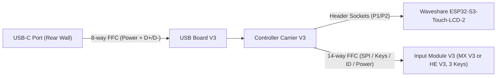

OPad separa la controladora Waveshare ESP32-S3-Touch-LCD-2 de los interruptores físicos mediante PCBs modulares de carrier y módulo de entrada.

## 1. Resumen de generaciones de hardware

| Generación | Placa carrier | Tipo de cable | Módulos de teclas | Arquitectura de ADC y sensores | Estado |
|---|---|---|---|---|---|
| **V1** | Controller carrier V1 (cabezales P1/P2) | JST SH de 8 pines (1.0 mm) | MX V1 (2 teclas), HE V1.1 (2 teclas) | Tensiones analógicas DRV5055A3 enrutadas por cable al ADC1 interno del ESP32-S3. | Reemplazada ([/hardware/pcb/V1/README.md](/hardware/pcb/V1/README.md)) |
| **V2** | Controller carrier V1 | JST SH de 8 pines (1.0 mm) | Prototipo HE V2 | ADC SPI de 12 bits TI ADS7038 en el módulo. | Prototipo ([/hardware/pcb/V2/README.md](/hardware/pcb/V2/README.md)) |
| **V3** | Controller carrier V3 + USB Board V3 | FFC tipo B de 14 vías y 1.0 mm (módulo), FFC tipo A de 8 vías y 1.0 mm (USB) | MX V3 (3 teclas), HE V3 (3 teclas) | ADC SPI de 12 bits TI **ADS7028** en el módulo, LDO **LP5907** de 3.3 V desde 5 V VBUS, zonas sin plano de masa de 3x3 mm bajo los sensores. | Actual ([/hardware/pcb/V3/README.md](/hardware/pcb/V3/README.md)) |

## 2. Ecosistema PCB V3

Definido en [/hardware/pcb/V3/README.md](/hardware/pcb/V3/README.md):



- **USB Board V3** (`20.0 x 22.0 mm`): Puerto USB-C trasero pasivo con protección ESD ProTek SRV05-4, ferrita Murata, condensadores y diodo Schottky B5817W que impide el retorno de alimentación desde el puerto de la Waveshare.
- **Controller Carrier V3** (`35.0 x 48.2 mm`): Dos conectores hembra 1x14 que encajan sobre P1/P2 de la Waveshare más los conectores FFC de 14 vías para el módulo y de 8 vías para USB.
- **MX Input Module V3** (`71.05 x 24.0 mm`): PCB de interruptores mecánicos hot-swap Kailh (`CPG151101S11`) de 3 teclas.
- **HE Input Module V3** (`71.05 x 24.0 mm`): PCB Hall Effect de 3 teclas con tres sensores TI DRV5055A3, ADC SPI de 12 bits TI ADS7028 y LDO TI LP5907 de 3.3 V.
- **Ensamblaje a una cara**: Cara superior en el carrier y la placa USB; cara inferior en los módulos MX/HE.

## 3. Pinout de cables y detección de ID de módulo

### Cable de módulo (14 vías, 1.0 mm, Tipo B, 80 mm)

| Contacto | Pin del carrier | HE V3 | MX V3 |
|---|---|---|---|
| 1 | `GND` | `GND` | `GND` |
| 2 | `5V` | `5V` (hacia LDO LP5907) | – |
| 3 | `3V3` | `3V3` | `3V3` |
| 4 | `GPIO 8` | `ID` (1.65 V) | `ID` (2.24 V) |
| 5 | `GPIO 6` | `MISO` | `KEY3` |
| 6 | `GND` | `GND` | `GND` |
| 7 | `GPIO 2` | `SCLK` | – |
| 8 | `GPIO 4` | `MOSI` | – |
| 9 | `GND` | `GND` | `GND` |
| 10 | `GPIO 10` | `CS` | `KEY1` |
| 11 | `GPIO 7` | – (`ID` alt si se invierte) | `KEY2` |
| 12 | `3V3` | `3V3` | `3V3` |
| 13 | `5V` | `5V` | – |
| 14 | `GND` | `GND` | `GND` |

Si el FFC de 14 vías se inserta al revés (`k` -> `15 - k`), alimentación y masa siguen coincidiendo y `ID` pasa de `GPIO 8` a `GPIO 7`; el firmware remapea automáticamente los pines SPI3 para **HE V3**. Un módulo **MX V3** con el cable invertido no se lee ([/hardware/pcb/V3/README.md](/hardware/pcb/V3/README.md)).

### Umbrales de tensión de ID de módulo ([/firmware/main/input/module_id.h](/firmware/main/input/module_id.h))

| Módulo | Divisor (`R_top / R_bottom`) | ID nominal | Rango de corte |
|---|---|---|---|
| **MX V1** | `100 kΩ / 10 kΩ` | `0.30 V` | `60 mV` – `680 mV` (cargado >= `60 mV`) |
| **HE V1.1** | `100 kΩ / 47 kΩ` | `1.06 V` | `680 mV` – `1350 mV` |
| **HE V3 (y V2)** | `100 kΩ / 100 kΩ` | `1.65 V` | `1350 mV` – `1950 mV` |
| **MX V3** | `47 kΩ / 100 kΩ` | `2.24 V` | `1950 mV` – `2600 mV` |
| **Ninguno** | Flotante o en corto a 3V3 | `~0 V` o `>= 2.6 V` | Valores predeterminados cableados a mano |

### Cable USB (8 vías, 1.0 mm, Tipo A, 80 mm)

| Contacto | 1 | 2 | 3 | 4 | 5 | 6 | 7 | 8 |
|---|---|---|---|---|---|---|---|---|
| **Red** | `GND` | `5V` | `D-` | `D+` | `D+` | `D-` | `5V` | `GND` |

Simétrico en espejo (`k` -> `9 - k`), transportando hasta 1.0 A entre los contactos emparejados de 5 V.

## 4. Diseño de carcasa 3D

Los archivos paramétricos de OpenSCAD para la carcasa residen en [/hardware/3d/README.md](/hardware/3d/README.md) (`hardware/3d/custom_case/V3/`), usando una placa de interruptores de 1.5 mm con huecos de `14.0 x 14.0 mm`, paso de tecla de `19.05 mm` y cuatro pasadores de centrado en las esquinas.

## 5. Verificación automatizada de hardware (`opadverify`)

[/hardware/verify/README.md](/hardware/verify/README.md) verifica los Gerbers generados, archivos de taladro, BOMs y modelos CPL de JLCPCB contra netlists de referencia y ejecuta trazado de redes con inversión de cables (`test_system.py`):

```bash
python3 -m venv .tools/venv && .tools/venv/bin/pip install -r hardware/verify/requirements.txt
cd hardware/verify
../../.tools/venv/bin/python -m opadverify golden/carrier_v3.toml
../../.tools/venv/bin/python -m opadverify golden/he_v3.toml
../../.tools/venv/bin/python tests/test_system.py
```
