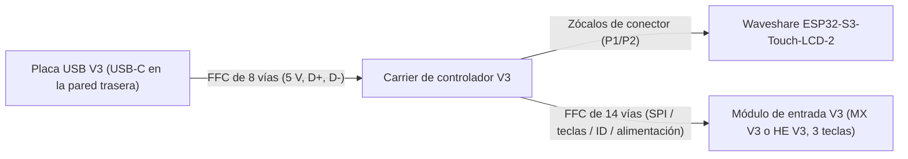

OPad mantiene la Waveshare ESP32-S3-Touch-LCD-2 como controlador sin modificar y pone todo lo demás en sus propias PCB: un carrier que se enchufa en los conectores de la Waveshare y un módulo de entrada con los interruptores. Esta separación permite cambiar de módulo (de MX a Hall Effect, de dos teclas a tres) sin tocar el controlador ni el núcleo del firmware, y el módulo se identifica mediante un divisor resistivo para que el firmware elija la ruta de entrada correcta en el arranque. Los proyectos de KiCad, los scripts generadores y las listas completas de piezas están en [`hardware/pcb/`](https://github.com/OPad-dev/OPad/tree/main/hardware/pcb); esta página es la visión general.

## Generaciones

El OPad que se vende es el **OPad V1**; sus placas y su carcasa son la revisión **V3** de abajo. En esta documentación, V1, V2 y V3 nombran revisiones de placa y de carcasa, nunca el producto. <!-- src: /docs/launch-checklist.md#Decisions (owner, 2026-11-21) --> <!-- src: /hardware/pcb/V3/README.md -->

| Generación | Placa carrier | Tipo de cable | Módulos de teclas | Arquitectura de ADC y sensores | Estado |
|---|---|---|---|---|---|
| **V1** | Carrier de controlador V1 (conectores P1/P2) | JST SH de 8 pines (1,0 mm) | MX V1 (2 teclas), HE V1.1 (2 teclas) | Tensiones analógicas de los DRV5055A3 llevadas por el cable hasta el ADC1 interno del ESP32-S3. | Sustituida ([/hardware/pcb/V1/README.md](https://github.com/OPad-dev/OPad/blob/main/hardware/pcb/V1/README.md)) |
| **V2** | Carrier de controlador V1 | JST SH de 8 pines (1,0 mm) | HE V2 (3 teclas) | ADC SPI TI ADS7038 de 12 bits en el módulo. | Diseñada, nunca fabricada; sustituida por V3 ([/hardware/pcb/V2/README.md](https://github.com/OPad-dev/OPad/blob/main/hardware/pcb/V2/README.md)) |
| **V3** | Carrier de controlador V3 + placa USB V3 | FFC tipo B de 14 vías y 1,0 mm (módulo), FFC tipo A de 8 vías y 1,0 mm (USB) | MX V3 (3 teclas), HE V3 (3 teclas) | ADC SPI TI **ADS7028** de 12 bits en el módulo, LDO **LP5907** de 3,3 V desde los 5 V de VBUS, zonas de exclusión de masa de 3x3 mm bajo los sensores. | Actual; fabricada y funcionando en el banco de pruebas ([/hardware/pcb/V3/README.md](https://github.com/OPad-dev/OPad/blob/main/hardware/pcb/V3/README.md)) |

## Placas V3

Definidas en [/hardware/pcb/V3/README.md](https://github.com/OPad-dev/OPad/blob/main/hardware/pcb/V3/README.md):



- **Placa USB V3** (`20.0 x 22.0 mm`): puerto USB-C trasero pasivo con protección ESD ProTek SRV05-4, ferrita Murata, condensadores y diodo Schottky B5817W que impide la retroalimentación desde el puerto de la Waveshare.
- **Carrier de controlador V3** (`35.0 x 48.2 mm`): dos zócalos hembra 1x14 que encajan en P1/P2 de la Waveshare, más los conectores FFC de 14 vías para el módulo y de 8 vías para el USB.
- **Módulo de entrada MX V3** (`71.05 x 24.0 mm`): PCB de 3 teclas para interruptores mecánicos con zócalos hot-swap Kailh (`CPG151101S11`).
- **Módulo de entrada HE V3** (`71.05 x 24.0 mm`): PCB Hall Effect de 3 teclas con tres sensores TI DRV5055A3, ADC SPI TI ADS7028 de 12 bits y LDO TI LP5907 de 3,3 V.
- **Montaje a una sola cara**: cara superior en el carrier y la placa USB; cara inferior en los módulos MX/HE.

## Cables e ID de módulo

### Cable del módulo (14 vías, 1,0 mm, tipo B, 80 mm)

| Contacto | Pin del carrier | HE V3 | MX V3 |
|---|---|---|---|
| 1 | `GND` | `GND` | `GND` |
| 2 | `5V` | `5V` (al LDO LP5907) | – |
| 3 | `3V3` | `3V3` | `3V3` |
| 4 | `GPIO 8` | `ID` (1,65 V) | `ID` (2,24 V) |
| 5 | `GPIO 6` | `MISO` | `KEY3` |
| 6 | `GND` | `GND` | `GND` |
| 7 | `GPIO 2` | `SCLK` | – |
| 8 | `GPIO 4` | `MOSI` | – |
| 9 | `GND` | `GND` | `GND` |
| 10 | `GPIO 10` | `CS` | `KEY1` |
| 11 | `GPIO 7` | – (`ID` alternativo si está invertido) | `KEY2` |
| 12 | `3V3` | `3V3` | `3V3` |
| 13 | `5V` | `5V` | – |
| 14 | `GND` | `GND` | `GND` |

Si el FFC de 14 vías se inserta al revés (`k` -> `15 - k`), la alimentación y la masa siguen coincidiendo y `ID` pasa de `GPIO 8` a `GPIO 7`; el firmware detecta el cable dado la vuelta en el arranque e intercambia los pines de SPI3 para **HE V3** (`ads7028_carrier_pins`, tabla de pines en [las notas del ADS7028](../../hardware/components/ads7028.md)). Un módulo **MX V3** con el cable invertido no se lee ([/hardware/pcb/V3/README.md](https://github.com/OPad-dev/OPad/blob/main/hardware/pcb/V3/README.md)).

### Umbrales del ID de módulo

El firmware lee el divisor de ID una vez en el arranque y elige la ruta de entrada del módulo según la banda en la que cae ([module_id.h](https://github.com/OPad-dev/OPad/blob/main/firmware/main/input/module_id.h)). Las bandas quedan entre las tensiones nominales, así que la tolerancia de las resistencias no puede llevar un módulo a la banda del vecino. Después, la ejecución sigue sondeando el ID: un módulo que se saca o se cambia con el teclado encendido desactiva las teclas al instante (las salidas analógicas de un módulo Hall Effect en pines de tecla digitales vibrarían), y un módulo distinto requiere un reinicio ([module_watch.h](https://github.com/OPad-dev/OPad/blob/main/firmware/main/input/module_watch.h)).

| Módulo | Divisor (`R_top / R_bottom`) | ID nominal | Rango de corte |
|---|---|---|---|
| **MX V1** | `100 kΩ / 10 kΩ` | `0.30 V` | `60 mV` – `680 mV` (con carga >= `60 mV`) |
| **HE V1.1** | `100 kΩ / 47 kΩ` | `1.06 V` | `680 mV` – `1350 mV` |
| **HE V3 (y V2)** | `100 kΩ / 100 kΩ` | `1.65 V` | `1350 mV` – `1950 mV` |
| **MX V3** | `47 kΩ / 100 kΩ` | `2.24 V` | `1950 mV` – `2600 mV` |
| **Ninguno** | Al aire o en cortocircuito con 3V3 | `~0 V` o `>= 2.6 V` | Valores por defecto del cableado a mano |

### Cable USB (8 vías, 1,0 mm, tipo A, 80 mm)

| Contacto | 1 | 2 | 3 | 4 | 5 | 6 | 7 | 8 |
|---|---|---|---|---|---|---|---|---|
| **Red** | `GND` | `5V` | `D-` | `D+` | `D+` | `D-` | `5V` | `GND` |

Simétrico en espejo (`k` -> `9 - k`), lleva hasta 1,0 A repartidos entre los contactos de 5 V emparejados.

## Carcasa

Los archivos paramétricos de la carcasa en OpenSCAD están en [/hardware/3d/README.md](https://github.com/OPad-dev/OPad/blob/main/hardware/3d/README.md) (`hardware/3d/custom_case/V3/`), con una placa de interruptores de 1,5 mm con recortes de `14.0 x 14.0 mm`, paso de tecla de `19.05 mm` y cuatro pines de posicionamiento en las esquinas.

## Comprobar una placa antes de encargarla (`opadverify`)

[/hardware/verify/README.md](https://github.com/OPad-dev/OPad/blob/main/hardware/verify/README.md) comprueba los Gerber, los archivos de taladro, las BOM y los modelos CPL de JLCPCB generados contra netlists de referencia, y traza las redes con el cable invertido (`test_system.py`).

Existe porque HE V1.0 salió con una huella SOT-23 reflejada que pasó el ERC, el DRC y al montador: el comprobador reconstruye la conectividad a partir del cobre de los Gerber en lugar de fiarse de KiCad, y compara cada huella con el dibujo de la hoja de datos y con el propio modelo de pieza de JLCPCB en la posición del CPL.

```bash
python3 -m venv .tools/venv && .tools/venv/bin/pip install -r hardware/verify/requirements.txt
cd hardware/verify
../../.tools/venv/bin/python -m opadverify golden/he_v3.toml     # also carrier_v3, usb_v3, mx_v3; -v lists every pass
../../.tools/venv/bin/python tests/test_mutations.py             # proves each check can fail
../../.tools/venv/bin/python tests/test_system.py                # cables both ways round, ID margins
```

Un código de salida 0 significa que no hay errores. Los archivos de placa se regeneran con `hardware/pcb/V3/scripts/generate_v3.py`, `route_v3.py` y `export_v3.py`; lee el README de V3 antes de encargar.
