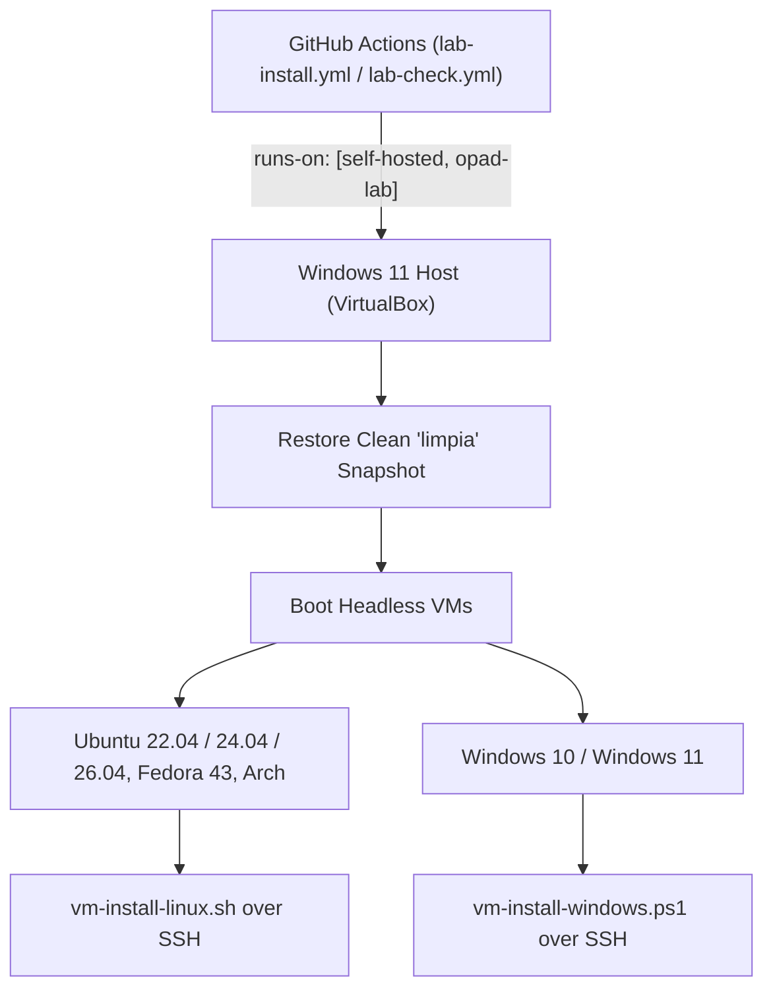

OPad valida instaladores, actualizaciones y desinstalación limpia en Linux y Windows en un laboratorio autoalojado con VirtualBox ([/scripts/lab/lab-common.ps1](/scripts/lab/lab-common.ps1)).

## 1. Arquitectura del anfitrión y modelo de seguridad

El laboratorio funciona en un anfitrión Windows 11 con Oracle VirtualBox (`C:\opad-lab`), registrado como runner autoalojado de GitHub Actions con las etiquetas `[self-hosted, opad-lab]`.

> [!IMPORTANT]
> **Sin ejecución de Pull Requests**: El runner autoalojado nunca ejecuta pull requests ni forks no confiables. Solo corre en flujos oficiales de lanzamiento / `main` ([/.github/workflows/lab-install.yml](/.github/workflows/lab-install.yml), [/.github/workflows/lab-check.yml](/.github/workflows/lab-check.yml)).

## 2. Topología de máquinas virtuales objetivo

Definida en `$AllVms` ([/scripts/lab/lab-common.ps1](/scripts/lab/lab-common.ps1)):

| Nombre de VM | SO invitado | Formato de paquete | Puerto SSH reenviado |
|---|---|---|---|
| `ubuntu-22.04` | Ubuntu 22.04 LTS | `.deb` | `2222` |
| `ubuntu-24.04` | Ubuntu 24.04 LTS | `.deb` | `2224` |
| `ubuntu-26.04` | Ubuntu 26.04 LTS | `.deb` | `2226` |
| `fedora-43` | Fedora 43 | `.rpm` | `2243` |
| `arch` | Arch Linux | `opad-bin` / `pacman` | `2250` |
| `windows-10` | Windows 10 | `opad-setup.exe` | `2310` |
| `windows-11` | Windows 11 | `opad-setup.exe` | `2311` |

Hay una VM más, `ci-linux` (Ubuntu 24.04, puerto SSH `2260`), que no está en `$AllVms` ni tiene snapshot `limpia`: se conserva entre ejecuciones, con sus cachés de compilación, para los trabajos de Linux del CI del laboratorio que se ejecuta antes de cada push de `main` ([/scripts/ci/lab-ci.sh](/scripts/ci/lab-ci.sh), preparada por [/scripts/ci/provision-linux.sh](/scripts/ci/provision-linux.sh); ver [testing.md](testing.md)). Los trabajos de Windows se ejecutan en el propio mini PC, en `C:\opad-lab\ci`.

Cada VM inicia sesión automáticamente en una sesión de escritorio `opad` (`seat0` en Linux, consola activa en Windows) con `sudo` sin contraseña / elevación de Administrador sobre SSH en loopback (`127.0.0.1`).

## 3. Ciclo automatizado de instalación, actualización y desinstalación

Los paquetes son los archivos de la release, elegidos por tipo y comprobados con el SHA-256 que GitHub da de cada uno (`digest`), así que sirven tanto los nombres desde `1.0.0-rc.7` (`OPad-Linux-*`, `OPad-Windows-Setup-*`) como los anteriores. `FILES.sha256` y el PKGBUILD de `opad-bin` son archivos de las releases anteriores; desde `1.0.0-rc.7` son el artefacto `release-extras-<tag>` de la ejecución que construyó la release (se guarda 90 días y se lee con el token `actions: read` del job). Si ya caducó, Arch instala el `.pkg.tar.zst` ya construido con `pacman -U` y los archivos instalados no se comprueban contra `FILES.sha256`.

Dirigido por [/scripts/lab/lab-install.ps1](/scripts/lab/lab-install.ps1), [/scripts/lab/vm-install-linux.sh](/scripts/lab/vm-install-linux.sh) (normalizado a saltos de línea LF antes de subirlo) y [/scripts/lab/vm-install-windows.ps1](/scripts/lab/vm-install-windows.ps1):

1. **Línea base limpia**: Restaura la instantánea `limpia`, arranca en modo headless hasta que la sesión de escritorio está lista, instala la versión base y reinicia para verificar el inicio automático.
2. **Actualización en sitio (`-Feed` o directa)**:
   - Cuando se invoca con `feed: true` (desde `release-app.yml`, desempaquetando el artefacto `github-pages` aún sin desplegar) o `deployed_feed: true` (disparo manual), `lab-install.ps1` copia `beta.json` y `beta.json.minisig` a la VM y ejecuta la fase `update`: sirve el feed en loopback (`127.0.0.1:8000`), reinicia `opad-daemon` con `OPAD_MANIFEST_URL=http://127.0.0.1:8000/beta.json` y le pide por IPC cambiar a `beta`, comprobar e instalar. En Ubuntu/Fedora/Windows el propio actualizador de OPad descarga, verifica e instala la versión candidata (vía `pkexec` o `/SILENT`); en Arch el actualizador debe responder `notify_only` y `makepkg` instala el paquete directamente. Si el actualizador falla, la ejecución se marca como fallida y el paquete se instala directamente para continuar con el resto de comprobaciones.
   - Sin `-Feed`, instala el paquete candidato directamente. Reinicia y verifica la versión de binarios (`FILES.sha256`), la ejecución de `opad-daemon` y la GUI en la bandeja del sistema, `opadctl status` (decodificando códigos NTSTATUS de DLL ausente en Windows), `cap_sys_ptrace=eip` en el `tosu` de `.deb`/`.rpm` y la persistencia de `opad.db` (`~/.local/share/opad/opad.db` en Linux, `%APPDATA%\opad\opad.db` en Windows).
3. **Desinstalación limpia**: Desinstala el paquete/instalador y verifica la eliminación de binarios (`/usr/bin/` en Linux, `%LOCALAPPDATA%\Programs\opad` en Windows), archivos de inicio automático/systemd, reglas `udev`, procesos en segundo plano y los directorios de `tosu` marcados con `.created-by-opad` (los directorios sin marcador se conservan y se anotan con `info:`); luego apaga y restaura `limpia`.

## 4. Comprobaciones de salud bajo demanda

[/.github/workflows/lab-check.yml](/.github/workflows/lab-check.yml) arranca las VMs desde `limpia`, verifica la disponibilidad de SSH y sesión, captura pantallas del escritorio mediante `VBoxManage controlvm screenshotpng` y publica resúmenes con [/scripts/lab/lab-results.ps1](/scripts/lab/lab-results.ps1) (que además marca cualquier ejecución previa huérfana en estado `"running"` como fallida con un grupo `Interrupted` y registra líneas `info:`).
