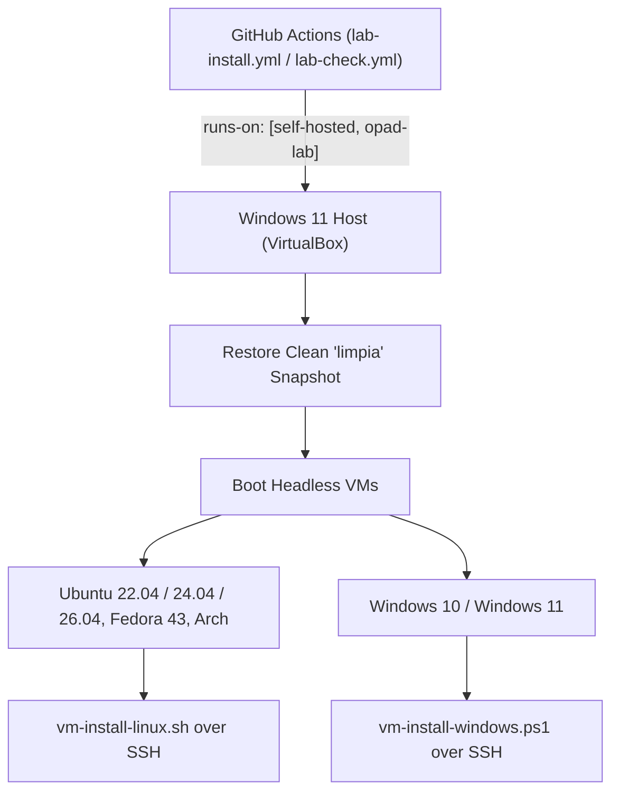

OPad valida instaladores, actualizaciones y desinstalación limpia en Linux y Windows en un laboratorio autoalojado con VirtualBox ([/scripts/lab/lab-common.ps1](/scripts/lab/lab-common.ps1)).

## 1. Arquitectura del anfitrión y modelo de seguridad

El laboratorio funciona en un anfitrión Windows 11 con Oracle VirtualBox (`C:\opad-lab`), registrado como runner autoalojado de GitHub Actions con las etiquetas `[self-hosted, opad-lab]`.

> [!IMPORTANT]
> **Sin ejecución de Pull Requests**: El runner autoalojado nunca ejecuta pull requests ni forks no confiables. Solo corre en flujos oficiales de lanzamiento / `main` ([/.github/workflows/lab-install.yml](/.github/workflows/lab-install.yml), [/.github/workflows/lab-check.yml](/.github/workflows/lab-check.yml)).

## 2. Topología de máquinas virtuales objetivo

Definida en `$AllVms` ([/scripts/lab/lab-common.ps1](/scripts/lab/lab-common.ps1)):

| Nombre de VM | SO invitado | Formato de paquete | Puerto SSH reenviado |
|---|---|---|---|
| `ubuntu-22.04` | Ubuntu 22.04 LTS | `.deb` | `2222` |
| `ubuntu-24.04` | Ubuntu 24.04 LTS | `.deb` | `2224` |
| `ubuntu-26.04` | Ubuntu 26.04 LTS | `.deb` | `2226` |
| `fedora-43` | Fedora 43 | `.rpm` | `2243` |
| `arch` | Arch Linux | `opad-bin` / `pacman` | `2250` |
| `windows-10` | Windows 10 | `opad-setup.exe` | `2310` |
| `windows-11` | Windows 11 | `opad-setup.exe` | `2311` |

Cada VM inicia sesión automáticamente en una sesión de escritorio `opad` (`seat0` en Linux, consola activa en Windows) con `sudo` sin contraseña / elevación de Administrador sobre SSH en loopback (`127.0.0.1`).

## 3. Ciclo automatizado de instalación, actualización y desinstalación

Dirigido por [/scripts/lab/lab-install.ps1](/scripts/lab/lab-install.ps1) y [/scripts/lab/vm-install-linux.sh](/scripts/lab/vm-install-linux.sh):

1. **Línea base limpia**: Restaura la instantánea `limpia`, arranca en modo headless hasta que la sesión de escritorio está lista, instala la versión base y reinicia para verificar el inicio automático.
2. **Actualización en sitio**: Transfiere e instala la versión candidata, reinicia y verifica la versión de binarios, la ejecución de `opad-daemon` y la GUI en la bandeja del sistema, `opadctl status`, `cap_sys_ptrace=eip` en el `tosu` de `.deb`/`.rpm` y la persistencia de `opad.db` (`~/.local/share/opad/opad.db` en Linux, `%APPDATA%\opad\opad.db` en Windows).
3. **Desinstalación limpia**: Desinstala el paquete/instalador y verifica la eliminación de binarios (`/usr/bin/` en Linux, `%LOCALAPPDATA%\Programs\opad` en Windows), archivos de inicio automático/systemd, reglas `udev` y procesos en segundo plano; luego apaga y restaura `limpia`.

## 4. Comprobaciones de salud bajo demanda

[/.github/workflows/lab-check.yml](/.github/workflows/lab-check.yml) arranca las VMs desde `limpia`, verifica la disponibilidad de SSH y sesión, captura pantallas del escritorio mediante `VBoxManage controlvm screenshotpng` y publica resúmenes con [/scripts/lab/lab-results.ps1](/scripts/lab/lab-results.ps1).
