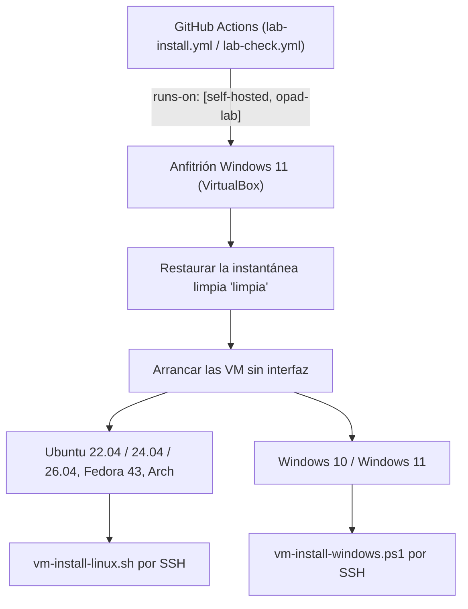

El laboratorio es un mini PC con Windows 11 que ejecuta VirtualBox. Tiene dos tareas: ejecuta todos los trabajos de CI antes de que se suba `main` (la VM `ci-linux` y el propio mini PC, consulta [Pruebas](testing.md#dónde-se-ejecuta-ci)), e instala, actualiza y desinstala cada versión de la app en VM limpias de cada sistema compatible ([lab-common.ps1](https://github.com/OPad-dev/OPad/blob/main/scripts/lab/lab-common.ps1)). Las pruebas de paquetes de CI comprueban que los archivos acaban en el sitio correcto; solo una sesión de escritorio real demuestra que OPad arranca al iniciar sesión, encuentra su bandeja, conserva sus datos tras una actualización y no deja nada atrás.

## Anfitrión y modelo de seguridad

El mini PC guarda sus archivos en `C:\opad-lab` y está registrado como runner autoalojado de GitHub Actions con las etiquetas `[self-hosted, opad-lab]`. Se ejecuta un único trabajo del laboratorio a la vez (`concurrency: opad-lab`).

> [!IMPORTANT]
> **Nada de código de pull requests.** Un runner autoalojado nunca debe ejecutar código de un pull request ni de un fork. `lab-install.yml` solo se ejecuta cuando `release-app.yml` lo llama para una publicación, o a mano; `lab-check.yml`, solo a mano ([lab-install.yml](https://github.com/OPad-dev/OPad/blob/main/.github/workflows/lab-install.yml), [lab-check.yml](https://github.com/OPad-dev/OPad/blob/main/.github/workflows/lab-check.yml)).

## VM

Definidas en `$AllVms` ([lab-common.ps1](https://github.com/OPad-dev/OPad/blob/main/scripts/lab/lab-common.ps1)):

| Nombre de la VM | Sistema invitado | Formato de paquete | Puerto SSH redirigido |
|---|---|---|---|
| `ubuntu-22.04` | Ubuntu 22.04 LTS | `.deb` | `2222` |
| `ubuntu-24.04` | Ubuntu 24.04 LTS | `.deb` | `2224` |
| `ubuntu-26.04` | Ubuntu 26.04 LTS | `.deb` | `2226` |
| `fedora-43` | Fedora 43 | `.rpm` | `2243` |
| `arch` | Arch Linux | `opad-bin` / `pacman` | `2250` |
| `windows-10` | Windows 10 | `OPad-Windows-Setup-*.exe` | `2310` |
| `windows-11` | Windows 11 | `OPad-Windows-Setup-*.exe` | `2311` |

Hay una VM más, `ci-linux` (Ubuntu 24.04, puerto SSH `2260`), que no está en `$AllVms` y no tiene instantánea `limpia`: se conserva entre ejecuciones, con sus cachés de compilación, para los trabajos de Linux del CI del laboratorio que se ejecuta antes de cada push de `main` ([lab-ci.sh](https://github.com/OPad-dev/OPad/blob/main/scripts/ci/lab-ci.sh), preparada por [provision-linux.sh](https://github.com/OPad-dev/OPad/blob/main/scripts/ci/provision-linux.sh); consulta [Pruebas](testing.md#dónde-se-ejecuta-ci)). Los trabajos de Windows se ejecutan en el propio mini PC, en `C:\opad-lab\ci`. El disco del mini PC se queda corto para todo esto: el disco de `ci-linux` tiene discard activado (`VBoxManage storageattach ci-linux --storagectl SATA --port 0 --device 0 --nonrotational on --discard on`) y cada ejecución termina con `fstrim`, para que su imagen vuelva a encoger; `lab-ci.sh` borra la caché de compilación de Windows por debajo de 20 GB libres y se detiene por debajo de 10 GB, y `lab-run.sh` empieza de cero la caché de Linux cuando supera los 10 GB.

Cada VM inicia sesión automáticamente en una sesión de escritorio `opad` (`seat0` en Linux, consola activa en Windows) con elevación `sudo` / Administrador sin contraseña por SSH en loopback (`127.0.0.1`).

## Instalar, actualizar y desinstalar

Los paquetes de la versión son sus assets, elegidos por tipo y comprobados contra el SHA-256 que GitHub da para cada uno (`digest`), así que funcionan tanto los nombres a partir de `1.0.0-rc.7` (`OPad-Linux-*`, `OPad-Windows-Setup-*`) como los antiguos. `FILES.sha256` y el PKGBUILD de `opad-bin` son assets de las versiones antiguas; a partir de `1.0.0-rc.7` son el artefacto `release-extras-<tag>` de la ejecución que construyó la versión (se conserva 90 días y se lee con el token `actions: read` del trabajo). Cuando ha caducado, Arch instala el `.pkg.tar.zst` construido con `pacman -U` y los archivos instalados no se comprueban contra `FILES.sha256`.

Lo dirigen [lab-install.ps1](https://github.com/OPad-dev/OPad/blob/main/scripts/lab/lab-install.ps1), [vm-install-linux.sh](https://github.com/OPad-dev/OPad/blob/main/scripts/lab/vm-install-linux.sh) (convertido a finales de línea LF antes de subirlo) y [vm-install-windows.ps1](https://github.com/OPad-dev/OPad/blob/main/scripts/lab/vm-install-windows.ps1):

1. **Punto de partida limpio**: restaura la instantánea `limpia`, arranca sin interfaz hasta que la sesión de escritorio está lista, instala la versión de referencia y reinicia para verificar el inicio automático.
2. **Actualización in situ (`-Feed` o directa)**:
   - Cuando se invoca con `feed: true` (desde `release-app.yml`, desempaquetando el artefacto `github-pages` aún sin desplegar) o `deployed_feed: true` (ejecución manual), `lab-install.ps1` copia `beta.json` y `beta.json.minisig` a la VM y ejecuta la fase `update`: sirve el feed en loopback (`127.0.0.1:8000`), reinicia `opad-daemon` con `OPAD_MANIFEST_URL=http://127.0.0.1:8000/beta.json` y le pide por IPC que cambie a `beta`, compruebe e instale. El propio actualizador de OPad descarga y verifica la versión candidata y la instala: en Linux mediante `pkexec` y el asistente de actualización (`apt`, `dnf` o `pacman`), en Windows con el `/SILENT` del instalador. El OPad en ejecución tiene que seguir funcionando e informar de que la nueva versión está instalada para el siguiente inicio. Si el actualizador falla, la ejecución se marca como fallida y el paquete se instala directamente para que el resto de comprobaciones se ejecuten igualmente.
   - Sin `-Feed`, instala directamente el paquete candidato. Reinicia y verifica la versión de los binarios (`FILES.sha256`), que `opad-daemon` y la GUI de la bandeja están en marcha, `opadctl status` (decodificando en Windows los códigos NTSTATUS de DLL ausentes), `cap_sys_ptrace=eip` en el `tosu` de `.deb`/`.rpm` y la persistencia de `opad.db` (`~/.local/share/opad/opad.db` en Linux, `%APPDATA%\opad\opad.db` en Windows).
3. **Desinstalación limpia**: desinstala el paquete o el instalador y verifica que se han eliminado los binarios (`/usr/bin/` en Linux, `%LOCALAPPDATA%\Programs\opad` en Windows), los archivos de inicio automático y de systemd, las reglas `udev`, los procesos en segundo plano y cualquier directorio de `tosu` que lleve el marcador `.created-by-opad` de OPad (los directorios sin marcar se conservan y se anotan con `info:`); después apaga y restaura `limpia`.

## Comprobaciones de estado

[lab-check.yml](https://github.com/OPad-dev/OPad/blob/main/.github/workflows/lab-check.yml), lanzado a mano, ejecuta [lab-check.ps1](https://github.com/OPad-dev/OPad/blob/main/scripts/lab/lab-check.ps1): comprueba la sesión de escritorio del runner y que osu! y el fixture de repetición de tosu (`replays/expected.json`) están en su sitio; después arranca las VM desde `limpia`, verifica que SSH y la sesión están listos, captura pantallazos del escritorio con `VBoxManage controlvm screenshotpng` y publica resúmenes con [lab-results.ps1](https://github.com/OPad-dev/OPad/blob/main/scripts/lab/lab-results.ps1) (que además marca como fallida, con un grupo `Interrupted`, cualquier ejecución anterior que quedara huérfana en `"running"`, y registra líneas `info:`).
