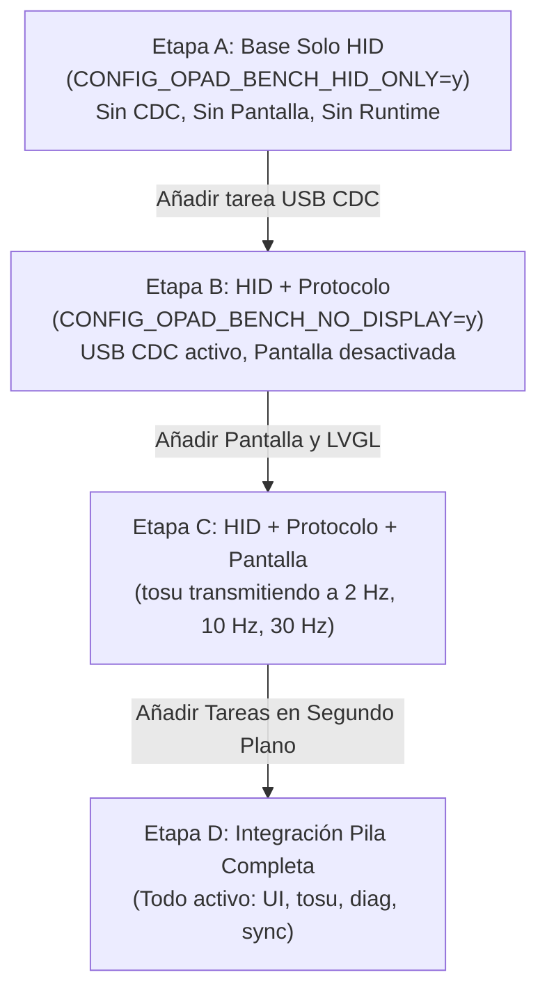

# Medición de Latencia y Metodología de Benchmarks

La baja latencia y el reporte de pulsaciones sin jitter son los requisitos centrales del producto para OPad (AGENTS.md §1.1). Ningún subsistema auxiliar (ya sea el renderizado LCD, los registros serie USB, escrituras en NVS o telemetría de tosu) tiene permitido retrasar las pulsaciones.

Este documento detalla la metodología de benchmark, los criterios de control de calidad ante regresiones, las herramientas de instrumentación y las cuatro etapas de benchmark (de la A a la D).

<!-- src: /scripts/bench_latency.py#find_opad_event_device -->
<!-- src: /scripts/latency_row.py#KNOWN_STAGES -->
<!-- src: /scripts/bench_latency.sh#bench_latency.py -->

---

## 1. Release Gate Criteria

La latencia de entrada actúa como un control de calidad no negociable para las releases. Antes de publicar cualquier actualización de firmware o escritorio, debe satisfacer los siguientes criterios:

1. **Cero Pulsaciones Perdidas**: 0 pulsaciones aceptadas perdidas durante secuencias rápidas de pulsaciones alternadas (> 20 pulsaciones/s).
2. **Cero Teclas Atascadas**: 0 estados de tecla presionada o liberada atascados bajo cualquier condición operativa o de carga.
3. **Sin Valores Atípicos > 1 ms**: Los procesos secundarios en segundo plano (transferencias de pantalla LVGL, tramas serie CDC, interrupciones de temporizadores, escrituras flash) nunca deben introducir picos de latencia superiores a 1 ms.
4. **Delta de Latencia Despreciable**: La diferencia de latencia $p99.9$ desde la entrada hasta el envío HID entre la pila completa (Etapa D) y la base pura HID (Etapa A) debe mantenerse por debajo de 100 µs (0,1 ms).
5. **Aislamiento de Hardware**: El Núcleo 0 procesa las interrupciones de entrada, el filtrado de rebote del teclado y la transmisión TinyUSB HID. El Núcleo 1 gestiona el renderizado de la UI de pantalla, el parseo del protocolo serie y las tareas de mantenimiento en segundo plano.

---

## 2. On-Device Histogram & Resolution

La latencia de las pulsaciones se mide directamente en el microcontrolador ESP32-S3 (`firmware/main/input/latency_stats.c`) capturando la diferencia exacta de los temporizadores de hardware entre:
- La interrupción por flanco de GPIO (o el umbral de desplazamiento rapid trigger de efecto Hall), y
- El instante en el que el reporte HID se añade a la cola del búfer del endpoint TinyUSB mediante `tud_hid_n_report()`.

### Histogram Characteristics

- **Resolución de Cubos de 10 µs**: El acumulador estadístico en el dispositivo clasifica las latencias de los eventos en cubos de 10 µs. Por lo tanto, los percentiles $p50$, $p99$ y $p99.9$ siempre se informan como múltiplos de 10 µs (el borde superior de cada cubo).
- **Máximo Exacto**: El valor máximo absoluto de latencia (`max`) registra la marca de tiempo exacta en microsegundos del evento más lento.
- **Independencia del Host**: Dado que la medición se realiza por completo dentro del Núcleo 0 antes del cable físico USB, las estadísticas del histograma en el dispositivo reflejan el rendimiento del pad independientemente del sistema operativo host o de la planificación del controlador host USB.

---

## 3. Benchmark Stages (A through D)

Para aislar regresiones de latencia, el firmware puede compilarse en cuatro configuraciones progresivas:



- **Etapa A (Base Solo HID)**: Compilado con `CONFIG_OPAD_BENCH_HID_ONLY=y`. Solo la interrupción GPIO, la lógica de debouncing y el endpoint de teclado TinyUSB HID a 1000 Hz están activos. La pantalla, el puerto serie CDC-ACM y las tareas de runtime están desactivados. La salida de estadísticas se redirige a UART0 (GPIO43, 115200 baudios).
- **Etapa B (HID + Protocolo CDC)**: Compilado con `CONFIG_OPAD_BENCH_NO_DISPLAY=y`. La comunicación USB CDC-ACM está activa, gestionando telemetría, consultas de latido y sondeos de estado desde `opad-daemon`. La pantalla y el PWM de retroiluminación permanecen desactivados.
- **Etapa C (HID + CDC + Pantalla en Partida)**: Firmware estándar con la pantalla habilitada y `opad-daemon` transmitiendo activamente telemetría simulada de beatmaps (errores de impacto, PP, barra de progreso) vía `tosu`. Evaluado a distintas tasas de refresco: 2 Hz, 10 Hz (por defecto) y 30 Hz.
- **Etapa D (Integración Pila Completa)**: Firmware de producción estándar funcionando bajo carga máxima en segundo plano: transmisión activa de tosu, renderizado LVGL, registro en búfer circular de diagnóstico y sincronización periódica de contadores NVS.

---

## 4. Measurement Procedure and Tooling

### Step 1: Flashing the Firmware Stage

Compilar y flashear la configuración deseada:

```bash
cd firmware
idf.py -D CONFIG_OPAD_BENCH_NO_DISPLAY=y build
opadctl flash build/opad-firmware.bin
```

### Step 2: Resetting Statistics

Limpiar los cubos acumulados del histograma en el teclado:

```bash
# Usando opadctl
opadctl latency --reset

# O usando el script auxiliar para markdown
python3 scripts/latency_row.py --reset
```

### Step 3: Fast Alternating Stream Run

Realizar una secuencia de pulsaciones rápidas alternando ambas teclas (> 15 pulsaciones/segundo) durante al menos 2 minutos.

### Step 4: Reading Latency Statistics

Recuperar los percentiles estadísticos:

```bash
# Salida formateada en consola
opadctl latency

# Generar directamente la fila de la tabla markdown
python3 scripts/latency_row.py --stage "C (10 Hz)"
```

[scripts/latency_row.py](file:///home/paella/Documents/projects/esp32/osu-pad-esp32-docs/scripts/latency_row.py) consulta el dispositivo, lee $p50$, $p99$, $p99.9$ y $max$, añade el hash SHA del commit actual de git (marcando `-dirty` si está modificado) e imprime una fila de tabla markdown formateada.

---

## 5. Host-Side USB Polling Benchmark (`bench_latency.py`)

Para verificar que la pila USB HID del sistema operativo host realice sondeos de manera constante a 1000 Hz sin pérdidas de paquetes, ejecute [scripts/bench_latency.sh](file:///home/paella/Documents/projects/esp32/osu-pad-esp32-docs/scripts/bench_latency.sh):

```bash
./scripts/bench_latency.sh
```

[scripts/bench_latency.py](file:///home/paella/Documents/projects/esp32/osu-pad-esp32-docs/scripts/bench_latency.py) abre el nodo de dispositivo evdev de Linux (`/dev/input/by-id/*OPad*`), recopila marcas de tiempo de eventos del kernel de alta resolución (`input_event`) y calcula:
- **Intervalo Medio**: Esperado en aproximadamente ~1,000 ms para sondeo USB HID a 1000 Hz.
- **Desviación Estándar de Jitter**: Mide la varianza temporal entre entregas de eventos consecutivas.
- **Jitter Máximo**: Identifica pausas en la planificación del kernel del host o interferencias del hub USB.
