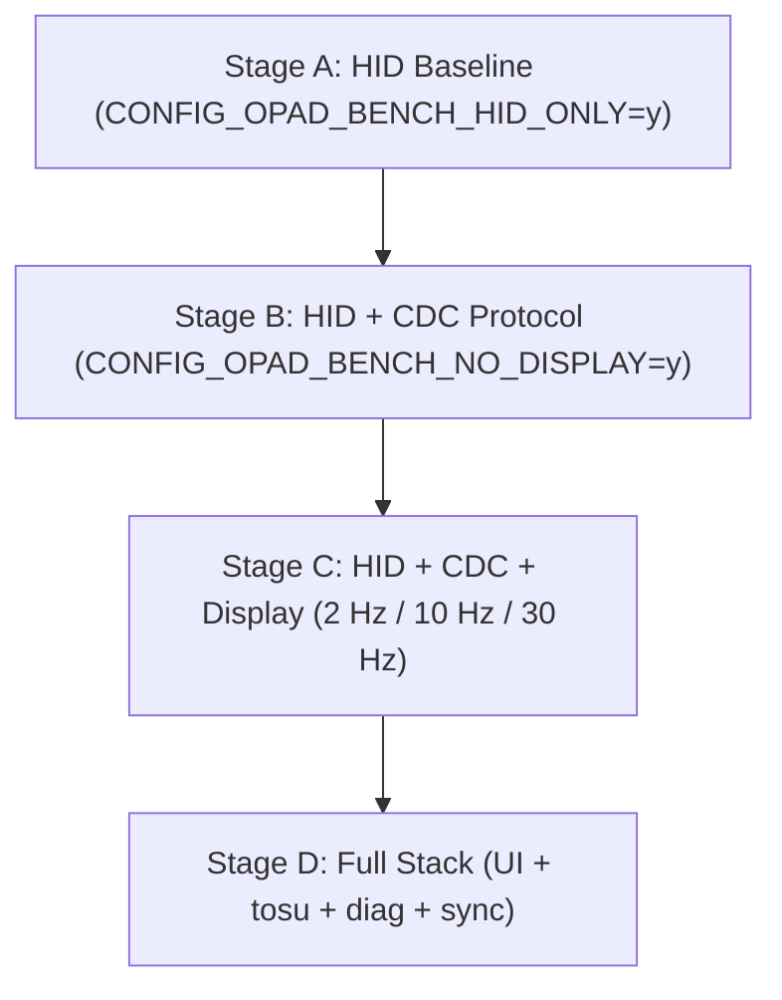

Una latencia de pulsación baja y sin fluctuaciones es el invariante principal de OPad ([/AGENTS.md](/AGENTS.md) §1.1). Esta página documenta el histograma en el dispositivo, las etapas de prueba A–D y los scripts de medición.

## 1. Criterios de aprobación para lanzamiento

1. **Cero pulsaciones perdidas** durante ráfagas alternas rápidas (`> 15`–`20` pulsaciones/s).
2. **Cero teclas atascadas** bajo cualquier condición de carga.
3. **Sin valores atípicos > 1 ms** provocados por transferencias SPI de pantalla, tráfico serie CDC, temporizadores o escrituras en flash.
4. **Sobrecarga despreciable de la pila completa**: diferencia de `p99.9` entre la Etapa D (pila completa) y la Etapa A (línea base solo HID) inferior a `100 µs`.
5. **Aislamiento de núcleos**: Core 0 gestiona la entrada y TinyUSB HID; Core 1 gestiona LVGL, protocolo CDC, táctil y tareas de ejecución.

## 2. Histograma en el dispositivo (`latency_stats.c`)

[/firmware/main/input/latency_stats.c](/firmware/main/input/latency_stats.c) mide el intervalo en microsegundos desde la marca temporal del flanco físico (`edge_us`) hasta la aceptación del reporte HID por TinyUSB:

- **Cubetas de 10 µs**: 500 cubetas atómicas (`BUCKET_US = 10`, `BUCKET_COUNT = 500`, `0`–`5000 µs`). Los percentiles `p50`, `p99` y `p99.9` informan el borde superior de la cubeta que los cubre (múltiplos de 10 µs).
- **Máximo exacto y atípicos**: `max_us` guarda el valor más lento exacto en microsegundos; las muestras `> 1000 µs` también incrementan `s_outlier_count` y actualizan `s_outlier_max_us`.
- **Conteo diferido**: `deferred_reports` cuenta los flancos de tecla llegados mientras el endpoint tenía una transferencia USB en curso y reenviados al completarse.

## 3. Etapas de referencia (A a D)



- **Etapa A (`CONFIG_OPAD_BENCH_HID_ONLY=y`)**: Solo se ejecutan teclado + TinyUSB HID; las estadísticas se imprimen en UART0 cada 10 s ([/firmware/main/app_main.c](/firmware/main/app_main.c)).
- **Etapa B (`CONFIG_OPAD_BENCH_NO_DISPLAY=y`)**: Añade el protocolo CDC-ACM y el sondeo del daemon con la pantalla desactivada.
- **Etapa C (`C (2 Hz)`, `C (10 Hz)`, `C (30 Hz)`)**: Añade renderizado de pantalla LVGL con telemetría en vivo a 2, 10 (por defecto) y 30 Hz.
- **Etapa D**: Firmware completo de producción con UI, `tosu`, diagnósticos y sincronización en segundo plano activos.

## 4. Procedimiento de medición (`latency_row.py`)

1. Reinicia los contadores del dispositivo justo antes de pulsar:
   ```bash
   python3 scripts/latency_row.py --reset
   ```
2. Pulsa ambas teclas alternando a `> 15` pulsaciones/s durante 2 minutos.
3. Obtén una fila de tabla markdown formateada con el hash git actual del firmware (`-dirty` si `firmware/` o `protocol/` tiene cambios sin confirmar) mediante [/scripts/latency_row.py](/scripts/latency_row.py):
   ```bash
   python3 scripts/latency_row.py --stage "C (10 Hz)"
   ```
   Nombres de etapa conocidos (`KNOWN_STAGES`): `A`, `B`, `C (2 Hz)`, `C (10 Hz)`, `C (30 Hz)`, `D`.

## 5. Script de sondeo `evdev` en anfitrión Linux (`bench_latency.py`)

[/scripts/bench_latency.sh](/scripts/bench_latency.sh) ejecuta [/scripts/bench_latency.py](/scripts/bench_latency.py), que localiza el nodo de entrada Linux del teclado (`/dev/input/by-id/*OPad*` o `/sys/class/input/event*/device/name`), recoge 100 intervalos `EV_KEY` menores de `50 ms` e informa media, mínimo, máximo y desviación estándar (objetivo `< 0.25 ms`, máximo `<= 2.5 ms`).
