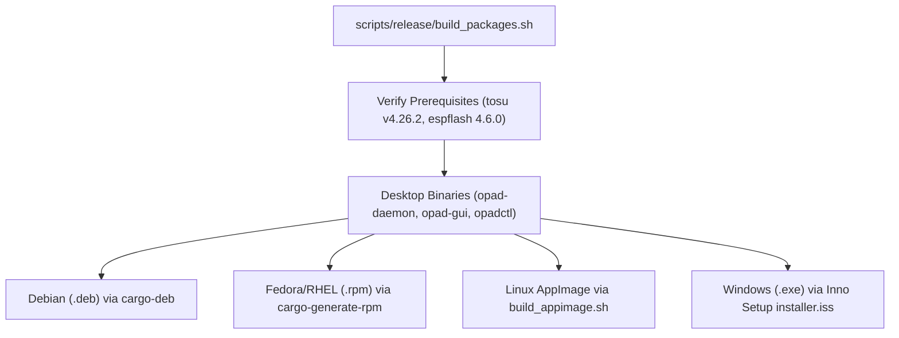

Los paquetes de OPad distribuyen `opad-daemon`, `opad-gui` y `opadctl` junto con `tosu` (**v4.26.2**) y `espflash` (**4.6.0**) fijados.

## 1. Arquitectura de paquetes y marcadores `install-origin`

Cada vía de empaquetado escribe un archivo marcador `install-origin` de una sola palabra leído por [/desktop/crates/opad-update/src/origin.rs](/desktop/crates/opad-update/src/origin.rs) para que el actualizador siga la política exacta de esa instalación:

| Objetivo | Ruta del marcador | Valor del marcador | Política de actualización de app | ¿Autoactualización del `tosu` incluido? |
|---|---|---|---|---|
| **Windows (`.exe`)** | `{localappdata}\Programs\opad\install-origin` | `windows` | `Installer` (`/SILENT /RELAUNCH=1`) | Sí |
| **Debian / Ubuntu (`.deb`)** | `/usr/lib/opad/install-origin` | `deb` | `PackageManager(Apt)` (aviso polkit) | No (propiedad de `dpkg`) |
| **Fedora / RHEL (`.rpm`)** | `/usr/lib/opad/install-origin` | `rpm` | `PackageManager(Dnf)` (aviso polkit) | No (propiedad de `rpm`) |
| **AppImage** | AppDir `/usr/lib/opad/install-origin` | `appimage` | `DirectReplace` | Sí |
| **Arch (`PKGBUILD`)** | `/usr/lib/opad/install-origin` | `aur` | `NotifyOnly` | No (propiedad de `pacman`) |
| **Usuario local (`make install-user`)** | `~/.local/lib/opad/install-origin` | `user` | `DirectReplace` | Sí |
| **Fuente de sistema (`make install`)** | `<prefix>/lib/opad/install-origin` | `source` | `NotifyOnly` | No |

Los marcadores ausentes o desconocidos degradan siempre de forma segura a `NotifyOnly`.

## 2. Automatización de compilación (`build_packages.sh`)

[/scripts/release/build_packages.sh](/scripts/release/build_packages.sh) genera los paquetes de lanzamiento en `dist/`:

1. Compila `build/tosu` (`make tosu`) y `build/espflash/espflash` (`make espflash`) si no existen.
2. Usa binarios precompilados cuando `OPAD_PREBUILT=1` (CI compila contra glibc 2.31 con `cargo-zigbuild`), o compila de forma nativa mediante `make all`.
3. Expande `@BINDIR@` -> `/usr/bin` en [/packaging/linux/systemd-user/opad-daemon.service.in](/packaging/linux/systemd-user/opad-daemon.service.in) y escribe marcadores `install-origin` sin salto de línea final.
4. Genera `.deb` (`cargo deb -p opad-gui --no-build`), `.rpm` (`cargo generate-rpm --auto-req disabled`, traduciendo `-` de SemVer a `~` para que las versiones preliminares se ordenen antes de las finales), AppImage ([/packaging/linux/appimage/build_appimage.sh](/packaging/linux/appimage/build_appimage.sh)), instalador de Windows (`iscc` sobre [/packaging/windows/installer.iss](/packaging/windows/installer.iss) si está disponible) y `dist/SHA256SUMS`.

## 3. Objetivos Linux

- **`.deb` / `.rpm`**: Instalan binarios en `/usr/bin/`, archivos privados en `/usr/lib/opad/`, unidad de usuario de systemd en `/usr/lib/systemd/user/opad-daemon.service` y `70-opad.rules` ([/packaging/linux/udev/70-opad.rules](/packaging/linux/udev/70-opad.rules)). Postinstalación ([/packaging/linux/deb/postinst](/packaging/linux/deb/postinst)) recarga `udevadm` y aplica `setcap cap_sys_ptrace=eip /usr/lib/opad/tosu/tosu`. La desinstalación ejecuta `/usr/lib/opad/uninstall-cleanup` ([/packaging/linux/uninstall-cleanup.sh](/packaging/linux/uninstall-cleanup.sh)) al eliminar/purgar (nunca al actualizar).
- **Arch Linux**: [/packaging/linux/arch/PKGBUILD](/packaging/linux/arch/PKGBUILD) compila desde el código fuente con `TOSU_STANDALONE=0` (`nodejs` del sistema) e `INSTALL_ORIGIN=aur`. La plantilla del paquete binario de AUR [/packaging/linux/arch/PKGBUILD-bin.in](/packaging/linux/arch/PKGBUILD-bin.in) (generada por [/scripts/release/aur_bin.sh](/scripts/release/aur_bin.sh)) establece `options=('!strip' '!debug')` para que los binarios del lanzamiento se instalen sin recortar símbolos y coincidan con `FILES.sha256`.
- **AppImage**: [/packaging/linux/appimage/AppRun](/packaging/linux/appimage/AppRun) define `PATH`/`LD_LIBRARY_PATH` y admite `install-udev` (mediante `pkexec`), `daemon`, `ctl` o lanzar `opad-gui`.

## 4. Inno Setup de Windows (`installer.iss`)

Definido en [/packaging/windows/installer.iss](/packaging/windows/installer.iss):
- `AppId={{E581335A-9877-4C7D-894C-97495B422B59}}` fijo para actualizaciones limpias en su sitio.
- Instalación por usuario (`PrivilegesRequired=lowest`) en `{localappdata}\Programs\opad` (`%LOCALAPPDATA%\Programs\opad`), incluyendo `opad-gui.exe`, `opad-daemon.exe`, `opadctl.exe`, `espflash.exe`, `install-origin`, `tosu\tosu.exe` y avisos de licencia.
- Inicio automático opcional al iniciar sesión (`HKCU\Software\Microsoft\Windows\CurrentVersion\Run` para `opad-daemon` y `opad-gui --tray`).
- Desinstalación completa: detiene `opad-daemon.exe`, `opad-gui.exe`, `opadctl.exe` y `tosu.exe`, elimina `{app}`, borra las claves `Run` y borra `{userappdata}\opad`.
