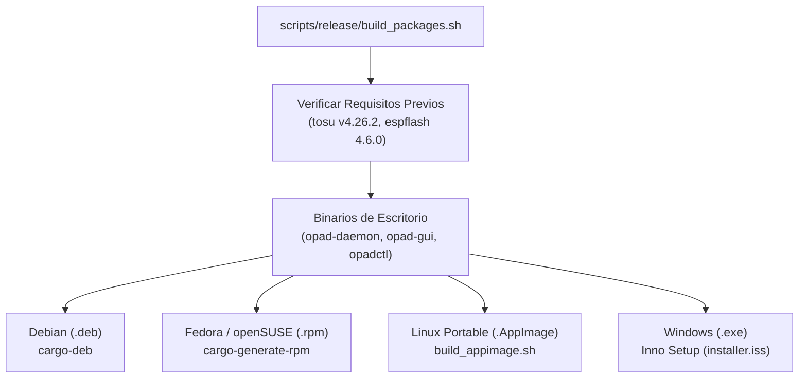

# Mecánica de Empaquetado y Distribución

Los paquetes de OPad distribuyen la suite de escritorio completa —`opad-daemon`, `opad-gui` y `opadctl`— junto con los requisitos previos empaquetados (`tosu` v4.26.2 y `espflash` v4.6.0).

Este documento detalla los scripts de compilación, formatos objetivo, configuraciones de permisos e invariantes de empaquetado para Linux y Windows.

<!-- src: /scripts/release/build_packages.sh#OPAD_PREBUILT -->
<!-- src: /packaging/windows/installer.iss#AppId -->
<!-- src: /packaging/linux/deb/postinst#udevadm -->
<!-- src: /packaging/linux/appimage/build_appimage.sh#AppRun -->
<!-- src: /packaging/linux/udev/70-opad.rules#303a -->

---

## 1. Package Architecture and Manifest



### Install-Origin Markers

Para evitar que los autoactualizadores sobrescriban paquetes gestionados por los gestores de paquetes nativos del sistema, cada instalador crea un archivo `install-origin` en el directorio de instalación:

| Objetivo de Empaquetado | Ubicación de Instalación | Contenido del Archivo |
|---|---|---|
| **Debian (.deb)** | `/usr/lib/opad/install-origin` | `deb` |
| **RPM (.rpm)** | `/usr/lib/opad/install-origin` | `rpm` |
| **AppImage** | AppDir Interno `/usr/lib/opad/install-origin` | `appimage` |
| **Arch (AUR)** | `/usr/lib/opad/install-origin` | `arch` |
| **Windows (.exe)**| `{localappdata}\Programs\opad\install-origin` | `windows` |

La crate del actualizador de escritorio (`opad-update`) inspecciona este marcador en tiempo de ejecución. Si se instaló mediante `.deb`, `.rpm` o `arch`, suprime la sustitución de binarios desde la aplicación y, en su lugar, indica al usuario que actualice mediante el gestor de paquetes de su distribución.

---

## 2. Build Automation (build_packages.sh)

La generación de paquetes está controlada por [scripts/release/build_packages.sh](file:///home/paella/Documents/projects/esp32/osu-pad-esp32-docs/scripts/release/build_packages.sh):

```bash
# Generar todos los paquetes de publicación en dist/
./scripts/release/build_packages.sh
```

### Script Execution Stages

1. **Comprobación de Requisitos Previos**: Comprueba que los binarios empaquetados de `tosu` y `espflash` existan en `build/`, compilándolos mediante `make tosu` y `make espflash` si faltan.
2. **Binarios de Publicación**:
   - Si `OPAD_PREBUILT=1` está definido (usado por los flujos de trabajo de publicación en GitHub Actions), el script utiliza los binarios existentes compilados contra glibc 2.31 con `cargo-zigbuild`.
   - De lo contrario, invoca `make all` para compilar binarios de lanzamiento nativos.
3. **Resolución de Plantillas**: Reemplaza `@BINDIR@` en [packaging/linux/systemd-user/opad-daemon.service.in](file:///home/paella/Documents/projects/esp32/osu-pad-esp32-docs/packaging/linux/systemd-user/opad-daemon.service.in) con `/usr/bin`.
4. **Marcadores de Origen**: Escribe el texto exacto del marcador sin saltos de línea al final.
5. **Compilación para Debian**: Ejecuta `cargo deb -p opad-gui --no-build` en `desktop/`.
6. **Compilación para RPM**: Traduce etiquetas de pre-lanzamiento de SemVer (por ejemplo, `-rc.1` a `~rc.1`) e invoca `cargo generate-rpm --auto-req disabled`.
7. **Ensamblado de AppImage**: Llama a `packaging/linux/appimage/build_appimage.sh` para producir `dist/opad-x86_64.AppImage`.
8. **Instalador de Windows**: Si `iscc` (Compilador de Inno Setup) está disponible, compila `packaging/windows/installer.iss`.
9. **Sumas de Comprobación**: Genera sumas de comprobación SHA256 en `dist/SHA256SUMS`.

---

## 3. Linux Distribution Targets

### Debian (.deb)
- **Herramienta**: `cargo-deb` configurada mediante metadatos en `desktop/gui/Cargo.toml`.
- **Integración con el Sistema**:
  - Instala los binarios en `/usr/bin/`.
  - Instala el servicio de usuario de systemd en `/usr/lib/systemd/user/opad-daemon.service`.
  - Instala las reglas de udev en `/usr/lib/udev/rules.d/70-opad.rules`.
  - El script post-instalación ([packaging/linux/deb/postinst](file:///home/paella/Documents/projects/esp32/osu-pad-esp32-docs/packaging/linux/deb/postinst#L7-L14)) recarga las reglas udev (`udevadm control --reload-rules`) y asigna capacidades Linux a tosu:
    ```bash
    setcap cap_sys_ptrace=eip /usr/lib/opad/tosu/tosu
    ```
    Esto otorga permisos de lectura de memoria para osu! bajo Yama `ptrace_scope` 1–2 sin necesidad de root.

### Fedora / openSUSE (.rpm)
- **Herramienta**: `cargo-generate-rpm`.
- Sigue la misma estructura de archivos que Debian, manteniendo rutas de usuario agnósticas a la distribución.

### Arch Linux (AUR)
- Ubicado en `packaging/linux/arch/PKGBUILD` (compilación desde fuente) y `PKGBUILD-bin.in` (paquete con binarios precompilados).
- Integra `opad-bin.install`, que ejecuta los ganchos equivalentes de recarga de udev y `setcap`.

### AppImage
- Ensamblado por [packaging/linux/appimage/build_appimage.sh](file:///home/paella/Documents/projects/esp32/osu-pad-esp32-docs/packaging/linux/appimage/build_appimage.sh).
- Empaqueta todos los binarios en `AppDir`.
- Utiliza un script [AppRun](file:///home/paella/Documents/projects/esp32/osu-pad-esp32-docs/packaging/linux/appimage/AppRun) incrustado para configurar variables de entorno (`PATH`, `LD_LIBRARY_PATH`) e iniciar `opad-gui`.

---

## 4. Windows Inno Setup (installer.iss)

El instalador de Windows está definido en [packaging/windows/installer.iss](file:///home/paella/Documents/projects/esp32/osu-pad-esp32-docs/packaging/windows/installer.iss):

- **ID Único de Aplicación**: `AppId={{E581335A-9877-4C7D-894C-97495B422B59}}`. Mantener este GUID fijo entre versiones asegura actualizaciones directas sin fricción.
- **Nivel de Privilegios**: `PrivilegesRequired=lowest`. Se instala en `{localappdata}\Programs\opad` sin requerir privilegios de administrador ni elevación UAC.
- **Inicio Automático**: Opcionalmente puede configurar claves de ejecución en el registro para el daemon y la interfaz de bandeja del sistema en el inicio de sesión del usuario.
- **Binarios Empaquetados**: Copia `opad-gui.exe`, `opad-daemon.exe`, `opadctl.exe` y el binario empaquetado `tosu.exe`.
