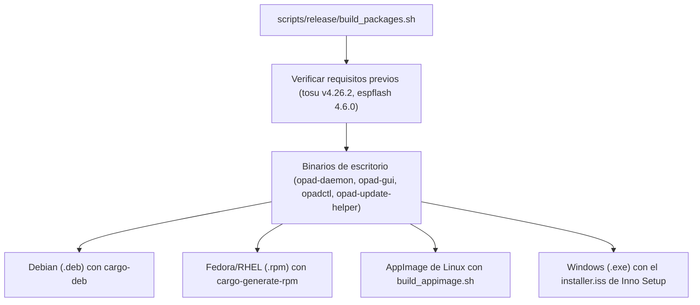

Todo paquete de OPad lleva `opad-daemon`, `opad-gui` y `opadctl`, el `tosu` fijado (**v4.26.2**) y `espflash` (**4.6.0**). Se diferencian en quién es dueño de los archivos instalados después (un gestor de paquetes, el usuario o nadie), y eso decide cómo puede actualizarse OPad a sí mismo. Por eso cada instalación registra cómo se hizo en un marcador `install-origin`.

## Paquetes y orígenes de instalación

| Destino | Ruta del marcador | Marcador | Política de actualización de la app (`ApplyPolicy`) | ¿El tosu incluido se actualiza solo? |
|---|---|---|---|---|
| **Windows (`.exe`)** | `%LOCALAPPDATA%\Programs\opad\install-origin` | `windows` | `Installer`: el nuevo instalador con `/SILENT /NORESTART /RELAUNCH=1` | Sí |
| **Debian / Ubuntu (`.deb`)** | `/usr/lib/opad/install-origin` | `deb` | `Helper(Apt)`: `pkexec /usr/lib/opad/opad-update-helper` | No (es del paquete) |
| **Fedora / RHEL (`.rpm`)** | `/usr/lib/opad/install-origin` | `rpm` | `Helper(Dnf)` | No (es del paquete) |
| **Arch (`opad-bin`, `PKGBUILD`)** | `/usr/lib/opad/install-origin` | `aur` | `Helper(Pacman)`: `pacman -U` | No (es del paquete) |
| **AppImage** | dentro del AppDir, `usr/lib/opad/install-origin` | `appimage` | `DirectReplace`: el archivo `$APPIMAGE` se sustituye de forma atómica | Sí |
| **`make install-user`** | `~/.local/lib/opad/install-origin` | `user` | `DirectReplace`: el archivo comprimido se extrae sobre `~/.local` | Sí |
| **`make install`** | `<prefix>/lib/opad/install-origin` | `source` | `NotifyOnly` | No |

El marcador se busca en relación con el binario en ejecución (`install_lib_dir()` en [paths.rs](https://github.com/OPad-dev/OPad/blob/main/desktop/crates/opad-model/src/paths.rs): `/usr/bin/opad-daemon` da `/usr/lib/opad`; en Windows es el directorio de instalación). La tabla de políticas y `owns_bundled_tosu()` están en [origin.rs](https://github.com/OPad-dev/OPad/blob/main/desktop/crates/opad-update/src/origin.rs).

Los paquetes `.deb`, `.rpm` y `opad-bin` instalan el asistente de actualización y una acción de polkit ([dev.opad.update.policy](https://github.com/OPad-dev/OPad/blob/main/packaging/linux/polkit/dev.opad.update.policy)) que permite al usuario sentado ante el ordenador ejecutarlo sin contraseña. Por eso el asistente lo comprueba todo por sí mismo: solo instala una versión de OPad más nueva que nombre el feed firmado, con el SHA-256 que da el feed ([helper.rs](https://github.com/OPad-dev/OPad/blob/main/desktop/crates/opad-update/src/helper.rs)).

Un marcador ausente o desconocido da `NotifyOnly`: una instalación que OPad no sabe ubicar nunca se sobrescribe; al usuario solo se le avisa de que hay una actualización. Por qué cada origen tiene su política, y cómo se verifica una actualización, está en [Actualizaciones y reversión automática](../explanation/updates-and-rollback.md).

## Construir los paquetes

[build_packages.sh](https://github.com/OPad-dev/OPad/blob/main/scripts/release/build_packages.sh) genera los paquetes de publicación en `dist/`:

1. Construye `build/tosu` (`make tosu`) y `build/espflash/espflash` (`make espflash`) si no existen.
2. Usa binarios ya compilados cuando `OPAD_PREBUILT=1` (CI compila contra glibc 2.31 con `cargo-zigbuild`), o compila de forma nativa con `make all`.
3. Expande `@BINDIR@` -> `/usr/bin` en [/packaging/linux/systemd-user/opad-daemon.service.in](https://github.com/OPad-dev/OPad/blob/main/packaging/linux/systemd-user/opad-daemon.service.in) y escribe los marcadores `install-origin` sin salto de línea final.
4. Construye el `.deb` (`cargo deb -p opad-gui --no-build`), el `.rpm` (`cargo generate-rpm --auto-req disabled`, traduciendo el `-` de SemVer a `~` para que las prerreleases se ordenen antes que las definitivas), el AppImage ([/packaging/linux/appimage/build_appimage.sh](https://github.com/OPad-dev/OPad/blob/main/packaging/linux/appimage/build_appimage.sh)), el instalador de Windows (`iscc` sobre [/packaging/windows/installer.iss](https://github.com/OPad-dev/OPad/blob/main/packaging/windows/installer.iss) si está disponible) y `dist/SHA256SUMS`.

## Linux

- **`.deb` / `.rpm`** (listas de archivos en [desktop/gui/Cargo.toml](https://github.com/OPad-dev/OPad/blob/main/desktop/gui/Cargo.toml), `[package.metadata.deb]` y `[package.metadata.generate-rpm]`): binarios en `/usr/bin/`, archivos privados en `/usr/lib/opad/` (el marcador `install-origin`, `tosu/`, `bin/espflash`, `opad-update-helper`), la acción de polkit en `/usr/share/polkit-1/actions/dev.opad.update.policy`, la unidad de usuario de systemd en `/usr/lib/systemd/user/opad-daemon.service` y `70-opad.rules` ([/packaging/linux/udev/70-opad.rules](https://github.com/OPad-dev/OPad/blob/main/packaging/linux/udev/70-opad.rules)). La postinstalación ([/packaging/linux/deb/postinst](https://github.com/OPad-dev/OPad/blob/main/packaging/linux/deb/postinst)) recarga las reglas udev y aplica `setcap cap_sys_ptrace=eip /usr/lib/opad/tosu/tosu` (tosu lee la memoria de osu!, algo que Yama `ptrace_scope` 1–2 prohíbe en otro caso); el `post_install_script` del `.rpm` hace lo mismo. La desinstalación ejecuta `/usr/lib/opad/uninstall-cleanup` ([/packaging/linux/uninstall-cleanup.sh](https://github.com/OPad-dev/OPad/blob/main/packaging/linux/uninstall-cleanup.sh)) al eliminar o purgar (nunca al actualizar).
- **Arch Linux**: [/packaging/linux/arch/PKGBUILD](https://github.com/OPad-dev/OPad/blob/main/packaging/linux/arch/PKGBUILD) compila desde el código fuente con `TOSU_STANDALONE=0` (`nodejs` del sistema) e `INSTALL_ORIGIN=aur`. La plantilla del paquete AUR precompilado [/packaging/linux/arch/PKGBUILD-bin.in](https://github.com/OPad-dev/OPad/blob/main/packaging/linux/arch/PKGBUILD-bin.in) (generada por [/scripts/release/aur_bin.sh](https://github.com/OPad-dev/OPad/blob/main/scripts/release/aur_bin.sh)) fija `options=('!strip' '!debug')` para que los binarios de publicación se instalen sin strip y coincidan con `FILES.sha256`.
- **AppImage**: [/packaging/linux/appimage/AppRun](https://github.com/OPad-dev/OPad/blob/main/packaging/linux/appimage/AppRun) ajusta `PATH`/`LD_LIBRARY_PATH` y admite `install-udev` (mediante `pkexec`), `daemon`, `ctl` o lanzar `opad-gui`.

## Windows

Definido en [installer.iss](https://github.com/OPad-dev/OPad/blob/main/packaging/windows/installer.iss):
- `AppId={{E581335A-9877-4C7D-894C-97495B422B59}}` fijo, para actualizaciones in situ limpias.
- Instalación por usuario (`PrivilegesRequired=lowest`) en `{localappdata}\Programs\opad` (`%LOCALAPPDATA%\Programs\opad`), con `opad-gui.exe`, `opad-daemon.exe`, `opadctl.exe`, `espflash.exe`, `install-origin`, `tosu\tosu.exe` y los avisos de licencia.
- Inicio automático opcional al iniciar sesión (`HKCU\Software\Microsoft\Windows\CurrentVersion\Run` para `opad-daemon` y `opad-gui --tray`).
- Desinstalación a fondo: detiene `opad-daemon.exe`, `opad-gui.exe`, `opadctl.exe` y `tosu.exe`, elimina `{app}`, borra las claves Run y borra `{userappdata}\opad`.
