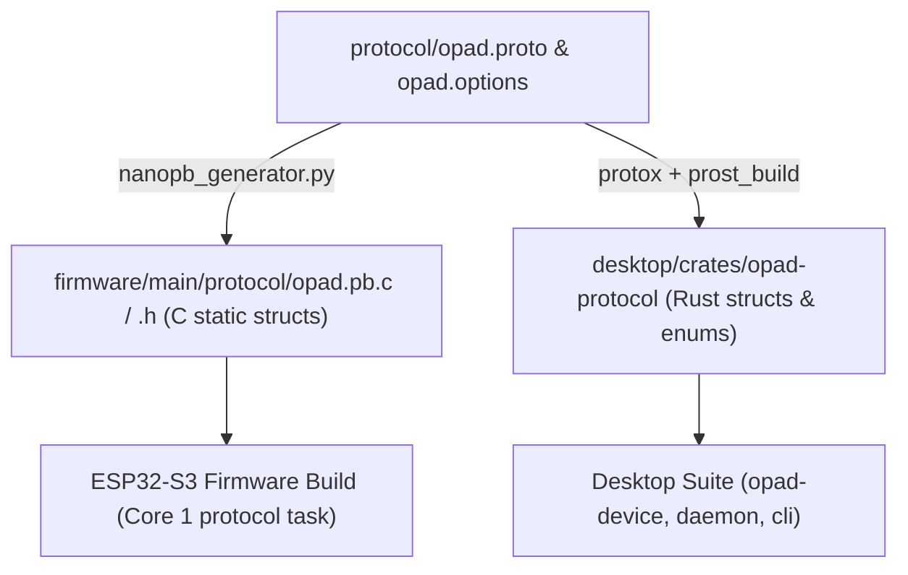

El protocolo de comunicación de OPad entre la suite de escritorio y el firmware del teclado está definido por un único esquema: [`protocol/opad.proto`](/protocol/opad.proto). Tanto los crates de escritorio en Rust como el firmware C del ESP32-S3 generan sus tipos de cable a partir de este archivo.

Dado que el firmware del teclado y el software de escritorio se actualizan de forma independiente (AGENTS.md §1.3), todo cambio en el esquema debe preservar la compatibilidad bidireccional en el cable.

## 1. Arquitectura del esquema y generación de código

La tubería del protocolo alimenta dos generadores de código:



- **Firmware (C)**: Usa nanopb incluido en el repositorio ([`firmware/main/protocol/nanopb/pb.h`](/firmware/main/protocol/nanopb/pb.h)) para codificar y decodificar mensajes con asignación estática de memoria (`pb_byte_t`). Nunca modifiques los archivos incluidos de nanopb (AGENTS.md §5).
- **Escritorio (Rust)**: Usa `protox` para compilar [`protocol/opad.proto`](/protocol/opad.proto) dentro del propio proceso sin necesitar un binario `protoc` del sistema, y después genera las estructuras Rust con `prost-build` en [`desktop/crates/opad-protocol/build.rs`](/desktop/crates/opad-protocol/build.rs).

## 2. Invariantes para la evolución del esquema

Siempre que modifiques [`protocol/opad.proto`](/protocol/opad.proto):

1. **Nunca renumeres etiquetas de campos existentes**: Las etiquetas de cable de Protobuf identifican cada campo; cambiar un número rompe la decodificación con pares antiguos o nuevos.
2. **Nunca cambies tipos de campos existentes**: Cambiar `uint32` a `uint64` o `string` a `bytes` altera el tipo en el cable.
3. **Mantén los campos nuevos compatibles hacia atrás**: En proto3, los campos escalares omitidos se decodifican a su valor cero (`0`, `false`, cadena vacía), y los campos `optional` distinguen ausencia de cero cuando `0` es un valor válido (como en `ConfigPayload.key3_hid_usage`). Marca los números retirados como `reserved` en vez de reutilizarlos (véase `reserved 14;` en `ConfigPayload`).
4. **Negocia cambios de comportamiento en el apretón de manos**: Si una función cambia el comportamiento en el cable o exige que el anfitrión sepa si el teclado la soporta, anúnciala en [`Hello`](/protocol/opad.proto) y [`HelloAck`](/protocol/opad.proto).
5. **Define límites estáticos en `protocol/opad.options`**: Cada campo `string` y `bytes` necesita `max_size`, y cada campo `repeated` necesita `max_count` en [`protocol/opad.options`](/protocol/opad.options) para que nanopb genere arreglos fijos en lugar de punteros de callback.

## 3. Procedimiento paso a paso

### Paso 1: Actualiza `protocol/opad.proto`

Añade mensajes o campos nuevos con números estrictamente crecientes y sin usar (por ejemplo, `HelloAck` termina actualmente en la etiqueta `21` para `frame_crc`):

```protobuf
message HelloAck {
    // ... existing fields ...
    uint32 key_count = 19;
    InputModule input_module = 20;
    bool frame_crc = 21;

    // Example new feature flag
    bool experimental_feature = 22;
}
```

### Paso 2: Configura los límites en `protocol/opad.options`

Si tus campos nuevos incluyen miembros `string`, `bytes` o `repeated`, añade sus límites en [`protocol/opad.options`](/protocol/opad.options):

```text
opad.MyNewMessage.name max_size:32
opad.MyNewMessage.items max_count:16
```

### Paso 3: Regenera los enlaces de Nanopb

Ejecuta [`scripts/gen_proto.sh`](/scripts/gen_proto.sh) desde la raíz del repositorio:

```sh
./scripts/gen_proto.sh
```

El script invoca `nanopb_generator` (CI fija `nanopb==0.4.9.1` en [`.github/workflows/ci.yml`](/.github/workflows/ci.yml) porque los archivos generados incrustan el comentario con la versión del generador) para sobrescribir `firmware/main/protocol/opad.pb.c` y `firmware/main/protocol/opad.pb.h`.

> [!WARNING]
> Nunca edites a mano `firmware/main/protocol/opad.pb.c` ni `firmware/main/protocol/opad.pb.h`. CI los regenera y falla ante cualquier diferencia.

### Paso 4: Recompila los crates de escritorio

[`desktop/crates/opad-protocol/build.rs`](/desktop/crates/opad-protocol/build.rs) emite `cargo:rerun-if-changed` para `protocol/opad.proto`, por lo que Cargo regenera automáticamente los enlaces Rust en la siguiente compilación:

```sh
cd desktop && cargo check
```

## 4. Verificación y comprobaciones de CI

1. **Comprobación de deriva de Protobuf**: El trabajo `proto-check` en [`.github/workflows/ci.yml`](/.github/workflows/ci.yml) instala `nanopb==0.4.9.1`, ejecuta `./scripts/gen_proto.sh` y comprueba:
   ```sh
   git diff --exit-code firmware/main/protocol/
   ```
2. **Pruebas unitarias de anfitrión y firmware**: Ejecuta `make check` ([`Makefile`](/Makefile)), que corre `cargo fmt --check`, `cargo clippy --all-targets -- -D warnings`, `cargo test` (incluyendo pruebas de ida y vuelta y entramado de `opad-protocol`), `./firmware/test/host/run_tests.sh` y `python3 scripts/release/check_versions.py`.

## 5. Estándares de commits

Al hacer commit de cambios de protocolo, incluye una línea `Compatibility:` que describa cómo interoperan las combinaciones antiguas y nuevas de app y firmware (AGENTS.md §3):

```text
feat(protocol): add experimental feature flag to HelloAck

Negotiate experimental capabilities during initial handshake.

Compatibility: bidirectional; older firmware ignores field 22.
AI: assisted
```
