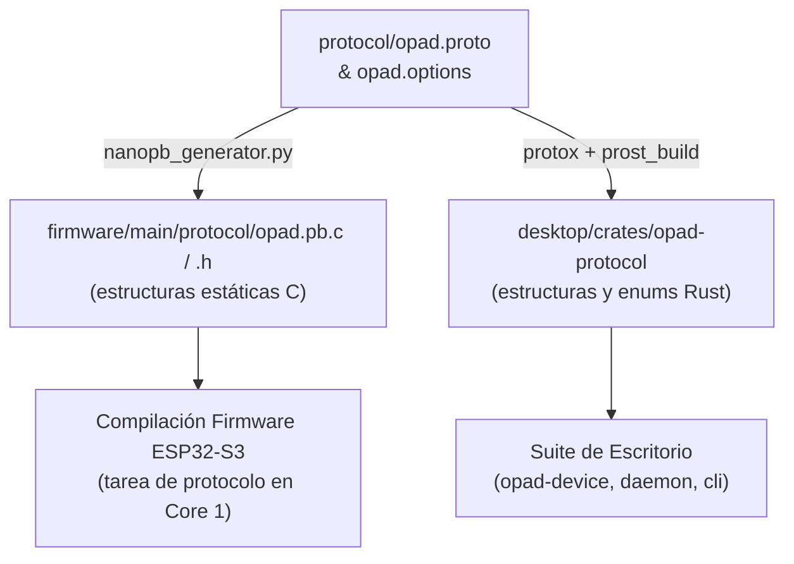

# Cambios de Protocolo y Evolución del Esquema

El protocolo de comunicación de OPad entre la suite de escritorio y el firmware del teclado está definido por un único esquema: `protocol/opad.proto`. Tanto las crates Rust de escritorio como el firmware en C para ESP32-S3 derivan sus tipos de serialización wire desde esta única fuente de verdad.

Dado que el firmware del pad y el software de escritorio se actualizan de forma independiente (AGENTS.md §1.3), cualquier cambio a este esquema debe adherirse estrictamente a las reglas de compatibilidad bidireccional.

<!-- src: /protocol/opad.proto#Hello -->
<!-- src: /protocol/opad.proto#HelloAck -->
<!-- src: /protocol/opad.options#max_size -->
<!-- src: /scripts/gen_proto.sh#nanopb_generator -->
<!-- src: /firmware/main/protocol/nanopb/pb.h#pb_byte_t -->
<!-- src: /desktop/crates/opad-protocol/build.rs#protox::compile -->

---

## 1. Schema Architecture and Codegen

El flujo de trabajo del protocolo conecta dos generadores de código independientes:



- **Firmware (C)**: Utiliza [nanopb](file:///home/paella/Documents/projects/esp32/osu-pad-esp32-docs/firmware/main/protocol/nanopb/pb.h) integrado para decodificar y codificar mensajes protobuf mediante asignación estática de memoria (`pb_byte_t`).
- **Escritorio (Rust)**: Utiliza `protox` para analizar archivos `.proto` en el propio proceso sin requerir la instalación de `protoc` en el sistema, compilándolos en estructuras Rust a través de `prost-build` ([build.rs](file:///home/paella/Documents/projects/esp32/osu-pad-esp32-docs/desktop/crates/opad-protocol/build.rs#L16-L19)).

---

## 2. Invariants for Schema Evolution

Siempre que modifiques `protocol/opad.proto`, debes seguir estas reglas:

1. **Nunca renumeres las etiquetas de campos existentes**: Las etiquetas de protobuf identifican los campos sobre el cable. Cambiar una etiqueta rompe la decodificación para cualquier dispositivo que ejecute una versión diferente.
2. **Nunca cambies los tipos de campos existentes**: Por ejemplo, cambiar `uint32` a `uint64` o `string` a `bytes` altera el formato wire.
3. **Todos los campos nuevos deben ser opcionales**: En Proto3, todos los campos escalares son opcionales por defecto. Un campo ausente se decodifica con su valor por defecto (0, false, cadena vacía).
4. **Banderas de características para cambios de comportamiento**: Si una nueva función requiere una negociación activa (como frecuencias más altas de telemetría o nuevos tipos de lotes), negociala durante el handshake mediante [Hello](file:///home/paella/Documents/projects/esp32/osu-pad-esp32-docs/protocol/opad.proto#L32) y [HelloAck](file:///home/paella/Documents/projects/esp32/osu-pad-esp32-docs/protocol/opad.proto#L43).
5. **Límites estáticos en `opad.options`**: Nanopb requiere tamaños máximos explícitos para cadenas y matrices de bytes (`max_size`), y conteos máximos para campos repetidos (`max_count`). Sin ellos, Nanopb recurre a la asignación de punteros de devolución de llamada, lo que aumenta la sobrecarga de memoria y la complejidad del código.

---

## 3. Step-by-Step Procedure

### Step 1: Update protocol/opad.proto

Añade tu nuevo mensaje o nuevos campos a los mensajes existentes. Mantén los números de campo en estricto orden creciente:

```protobuf
message HelloAck {
    // ... campos existentes ...
    bool tap_rate_per_second = 18;
    uint32 key_count = 19;
    InputModule input_module = 20;

    // Ejemplo de nueva bandera de característica
    bool experimental_feature = 21;
}
```

### Step 2: Configure Bounds in protocol/opad.options

Si tu nuevo campo contiene cadenas, vectores de bytes o elementos repetidos, define sus límites en [protocol/opad.options](file:///home/paella/Documents/projects/esp32/osu-pad-esp32-docs/protocol/opad.options):

```text
opad.MyNewMessage.name max_size:32
opad.MyNewMessage.items max_count:16
```

### Step 3: Regenerate Nanopb Bindings

Ejecuta el script generador desde la raíz del repositorio:

```bash
./scripts/gen_proto.sh
```

Esto invoca [scripts/gen_proto.sh](file:///home/paella/Documents/projects/esp32/osu-pad-esp32-docs/scripts/gen_proto.sh#L30-L31) para regenerar `firmware/main/protocol/opad.pb.c` y `firmware/main/protocol/opad.pb.h`.

> [!WARNING]
> Nunca edites manualmente `opad.pb.c` ni `opad.pb.h`. Cualquier edición manual se sobrescribirá al regenerar y la CI fallará en la comprobación de diferencias de compilación.

### Step 4: Rebuild Desktop Crates

Dado que [desktop/crates/opad-protocol/build.rs](file:///home/paella/Documents/projects/esp32/osu-pad-esp32-docs/desktop/crates/opad-protocol/build.rs#L14) vigila `protocol/opad.proto`, ejecutar `cargo build` en `desktop/` recompilará automáticamente las estructuras Rust:

```bash
cd desktop && cargo check
```

---

## 4. Verification and CI Checks

La Integración Continua aplica una estricta disciplina sobre protobuf:

1. **Comprobación de Diferencias en Protobuf**: La CI regenera los enlaces C usando `scripts/gen_proto.sh` y ejecuta:
   ```bash
   git diff --exit-code firmware/main/protocol/
   ```
   Si existe alguna discrepancia entre `opad.proto` y los archivos C confirmados, la CI falla inmediatamente.
2. **Pruebas Unitarias en el Anfitrión**: Las pruebas de ida y vuelta del protocolo en el anfitrión se ejecutan mediante `make check` (`cargo test -p opad-protocol`).

---

## 5. Commit Standards

Al confirmar cambios en el protocolo, incluye el trailer de compatibilidad requerido por AGENTS.md §3:

```text
feat(protocol): add experimental feature flag to HelloAck

Negotiate experimental capabilities during initial handshake.

Compatibility: bidirectional; older firmware ignores field 21.
AI: assisted
```
