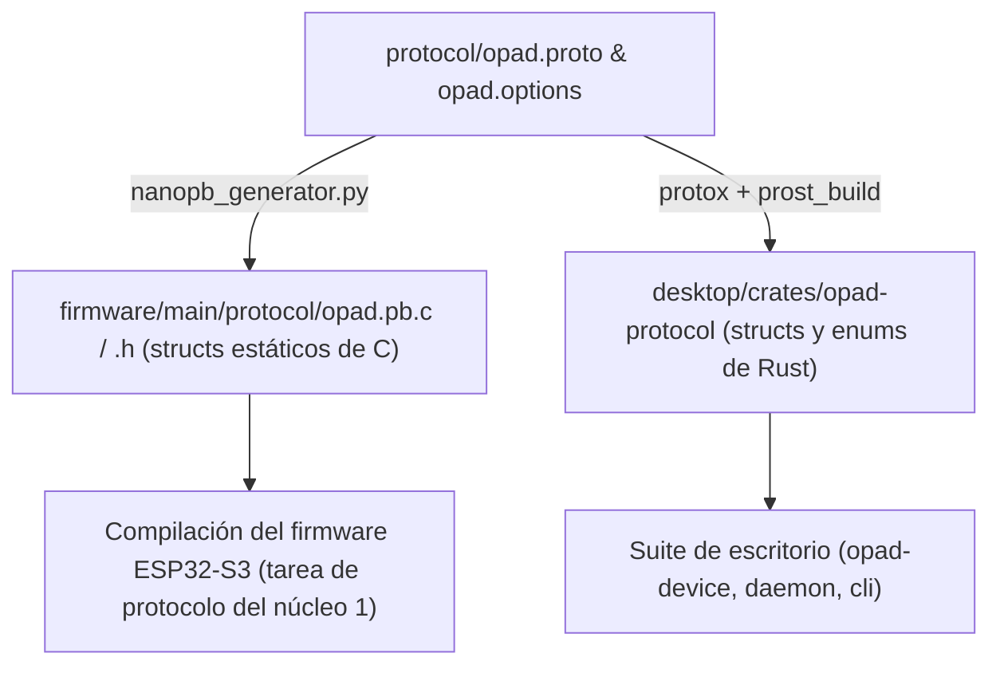

El protocolo de comunicación de OPad entre la suite de escritorio y el firmware del teclado se define en un único esquema: [`protocol/opad.proto`](https://github.com/OPad-dev/OPad/blob/main/protocol/opad.proto). Tanto los crates de escritorio en Rust como el firmware en C del ESP32-S3 generan sus tipos de cable a partir de este archivo.

Como el teclado y la app se actualizan por separado ([AGENTS.md](https://github.com/OPad-dev/OPad/blob/main/AGENTS.md) §1.3), cada cambio tiene que funcionar con una app nueva sobre firmware antiguo y con una app antigua sobre firmware nuevo. El diseño que hay detrás (entramados, banderas de capacidad, qué hace cada lado cuando el otro es más antiguo) está en [Versiones de la app y del teclado](../explanation/app-and-pad-versions.md); esta página es el procedimiento.

## De dónde salen los tipos

La canalización del protocolo alimenta dos generadores de código:



- **Firmware (C)**: usa nanopb incluido en el repositorio ([`firmware/main/protocol/nanopb/pb.h`](https://github.com/OPad-dev/OPad/blob/main/firmware/main/protocol/nanopb/pb.h)) para codificar y decodificar mensajes con asignación de memoria estática (`pb_byte_t`). Nunca modifiques los archivos de nanopb incluidos ([AGENTS.md](https://github.com/OPad-dev/OPad/blob/main/AGENTS.md) §5).
- **Escritorio (Rust)**: usa `protox` para compilar [`protocol/opad.proto`](https://github.com/OPad-dev/OPad/blob/main/protocol/opad.proto) dentro del proceso, sin necesitar un binario `protoc` del sistema, y después genera los structs de Rust con `prost-build` en [`desktop/crates/opad-protocol/build.rs`](https://github.com/OPad-dev/OPad/blob/main/desktop/crates/opad-protocol/build.rs).

## Reglas

Siempre que modifiques [`protocol/opad.proto`](https://github.com/OPad-dev/OPad/blob/main/protocol/opad.proto):

1. **Nunca renumeres las etiquetas de los campos existentes**: las etiquetas de cable de protobuf identifican los campos; cambiar una etiqueta rompe la decodificación con interlocutores más antiguos o más nuevos.
2. **Nunca cambies el tipo de los campos existentes**: pasar de `uint32` a `uint64` o de `string` a `bytes` cambia el tipo de cable.
3. **Mantén compatibles hacia atrás los campos nuevos**: en proto3, los campos escalares omitidos se decodifican con su valor cero (`0`, `false`, cadena vacía), y los campos `optional` distinguen la ausencia del cero cuando `0` es un valor válido (como con `ConfigPayload.key3_hid_usage`). Marca como `reserved` los números de etiqueta retirados en lugar de reutilizarlos (consulta `reserved 14;` en `ConfigPayload`).
4. **Negocia los cambios de comportamiento durante el saludo inicial**: si una función cambia el comportamiento en el cable o requiere que el anfitrión sepa si el teclado la admite, anúnciala en `Hello` (lo que puede hacer el anfitrión) y en `HelloAck` (lo que puede hacer el teclado). El firmware antiguo no envía la bandera, que se decodifica como `false`, así que el anfitrión recurre al comportamiento antiguo sin comprobar versiones: `HelloAck.board_test`, `restart`, `he_live` y `frame_crc` funcionan todos así. Nunca envíes a un interlocutor un mensaje que no haya dicho que entiende.
5. **Define límites estáticos en `protocol/opad.options`**: cada campo `string` y `bytes` necesita `max_size`, y cada campo `repeated` necesita `max_count` en [`protocol/opad.options`](https://github.com/OPad-dev/OPad/blob/main/protocol/opad.options), para que nanopb genere arrays fijos en lugar de punteros a callbacks.

## Procedimiento

### 1. Editar `protocol/opad.proto`

Añade los mensajes o campos nuevos con números de campo sin usar y estrictamente crecientes (por ejemplo, `HelloAck` termina ahora en la etiqueta `21`, `frame_crc`):

```protobuf
message HelloAck {
    // ... existing fields ...
    uint32 key_count = 19;
    InputModule input_module = 20;
    bool frame_crc = 21;

    // Example new feature flag
    bool experimental_feature = 22;
}
```

### 2. Fijar los límites en `protocol/opad.options`

Si tus campos nuevos incluyen miembros `string`, `bytes` o `repeated`, añade sus límites a [`protocol/opad.options`](https://github.com/OPad-dev/OPad/blob/main/protocol/opad.options):

```text
opad.MyNewMessage.name max_size:32
opad.MyNewMessage.items max_count:16
```

### 3. Regenerar los archivos de nanopb

Ejecuta [`scripts/gen_proto.sh`](https://github.com/OPad-dev/OPad/blob/main/scripts/gen_proto.sh) desde la raíz del repositorio:

```sh
./scripts/gen_proto.sh
```

El script busca `nanopb_generator` en el `PATH` o en el entorno de Python de ESP-IDF y sobrescribe `firmware/main/protocol/opad.pb.c` y `firmware/main/protocol/opad.pb.h`.

> [!WARNING]
> Nunca edites a mano `firmware/main/protocol/opad.pb.c` ni `firmware/main/protocol/opad.pb.h`. CI los regenera y falla ante cualquier diferencia. Usa nanopb **0.4.9.1**, la versión que instala CI: los archivos generados indican la versión del generador, y una distinta hace fallar el diff solo por esa línea.

### 4. Recompilar los crates de escritorio

[`desktop/crates/opad-protocol/build.rs`](https://github.com/OPad-dev/OPad/blob/main/desktop/crates/opad-protocol/build.rs) emite `cargo:rerun-if-changed` para `protocol/opad.proto`, así que Cargo regenera automáticamente los bindings de Rust en la siguiente compilación:

```sh
cd desktop && cargo check
```

### 5. Un mensaje nuevo del anfitrión al teclado

El firmware decide qué entramado habla un anfitrión antiguo o nuevo a partir de la primera trama que se decodifica como un mensaje que conoce, y solo cuentan las cargas `HostToDevice` desde `hello` (etiqueta 2) hasta `cancel_he_calibration` (etiqueta 20) (la comprobación de rango de `msg.which_payload` en `on_frame_received` en [protocol.c](https://github.com/OPad-dev/OPad/blob/main/firmware/main/protocol/protocol.c)). Un mensaje nuevo fuera de ese rango se procesa con normalidad, pero no sirve como prueba del entramado del anfitrión; `he_live_view` (etiqueta 21) ya está fuera, lo que no hace daño porque los anfitriones de OPad envían `Hello` primero. Si un mensaje nuevo pudiera ser el primero que envía un anfitrión, amplía la comprobación.

## Comprobarlo

1. **Comprobación de desviaciones:** el trabajo `proto-check` ([scripts/ci/jobs.sh](https://github.com/OPad-dev/OPad/blob/main/scripts/ci/jobs.sh)) ejecuta `./scripts/gen_proto.sh` y después:
   ```sh
   git diff --exit-code firmware/main/protocol/
   ```
2. **Pruebas:** `make check` ejecuta las pruebas de ida y vuelta y de entramado de `opad-protocol` y el `test_frame_parser` del firmware ([Pruebas](testing.md#make-check)).
3. **Ambos sentidos en un teclado:** flashea el firmware nuevo y conecta la versión anterior de la app; luego la app nueva con el firmware anterior, y comprueba que cada lado ignora lo que no conoce.

## Commit

Al commitear cambios de protocolo, incluye un trailer `Compatibility:` que diga cómo funcionan juntos la app y el firmware antiguos y nuevos ([AGENTS.md](https://github.com/OPad-dev/OPad/blob/main/AGENTS.md) §3):

```text
feat(protocol): add experimental feature flag to HelloAck

Negotiate experimental capabilities during initial handshake.

Compatibility: older firmware never sets field 22, so a new app sees
false and keeps the old behaviour; an old app ignores the field.
AI: assisted
```
