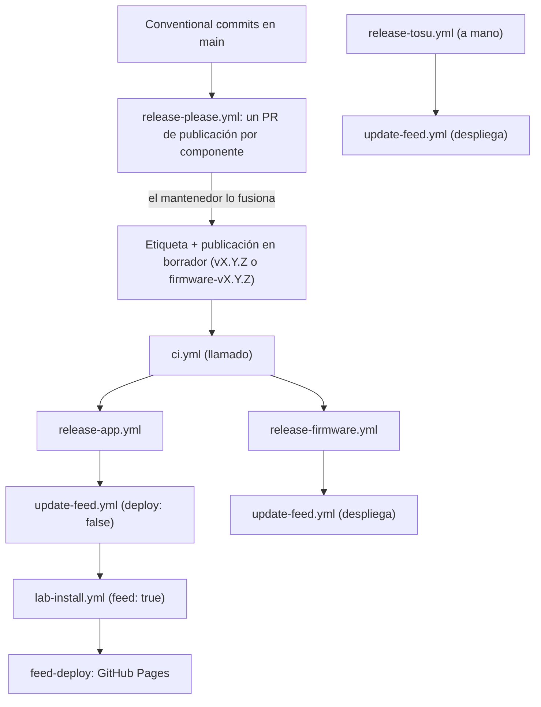

La app, el firmware y el tosu incluido se actualizan por separado ([AGENTS.md](https://github.com/OPad-dev/OPad/blob/main/AGENTS.md) §1.3), así que cada uno tiene su propia versión, etiqueta y publicación, y los tres llegan a las instalaciones a través de un único feed de actualizaciones firmado. El diseño del feed y de la actualización A/B del teclado está en [Actualizaciones y reversión automática](../explanation/updates-and-rollback.md); esta página es la canalización.

## Canalización

Una etiqueta subida con `GITHUB_TOKEN` no lanza ningún workflow, así que nada se dispara por etiquetas: [release-please.yml](https://github.com/OPad-dev/OPad/blob/main/.github/workflows/release-please.yml) llama él mismo a CI y después al workflow de construcción. Una versión solo se construye si [ci.yml](https://github.com/OPad-dev/OPad/blob/main/.github/workflows/ci.yml) pasa en ese commit (los mismos trabajos que en [Pruebas](testing.md#trabajos-de-ci)). Todos los workflows de construcción se pueden lanzar también a mano con una etiqueta.

## Versiones y etiquetas

[release-please-config.json](https://github.com/OPad-dev/OPad/blob/main/release-please-config.json) define dos componentes:

- **App** (ruta `.`, excluyendo `firmware/` y `hardware/`): versión en `desktop/Cargo.toml`, etiquetas `vX.Y.Z`, o `vX.Y.Z-rc.N` mientras la configuración tenga `"prerelease": true` con `prerelease-type: rc` (como ahora, para ambos componentes). En el PR de publicación de la app, el trabajo `lockfile` ejecuta `cargo update -w` para que `Cargo.lock` acompañe y `cargo build --locked` siga funcionando al publicar.
- **Firmware** (ruta `firmware`): versión en `firmware/CMakeLists.txt` (`PROJECT_VER`), etiquetas `firmware-vX.Y.Z` (y `-rc.N` igualmente).

Fusionar un PR de publicación lo etiqueta y crea una publicación en **borrador**; el workflow de construcción sube los archivos y publica el borrador. [scripts/release/check_versions.py](https://github.com/OPad-dev/OPad/blob/main/scripts/release/check_versions.py) comprueba en `make check` que todo esto coincide, y con `--tag` que una etiqueta corresponde al árbol.

**tosu** no tiene PR de publicación. Su versión es la fijada en el [Makefile](https://github.com/OPad-dev/OPad/blob/main/Makefile) (`TOSU_VERSION`, v4.26.2). [release-tosu.yml](https://github.com/OPad-dev/OPad/blob/main/.github/workflows/release-tosu.yml) se ejecuta a mano después de subirla, y publica `tosu-v<version>-r<revision>`; una revisión mayor recompila la misma versión upstream. Así el tosu incluido se puede actualizar entre publicaciones de la app.

Mientras la variable del repositorio `SIGNING_ENABLED` no sea `true`, no se firma nada y toda versión se publica como pre-release de GitHub. Solo una versión definitiva de la app pasa a ser la "Latest" de GitHub; el firmware y tosu nunca ([publish_release.sh](https://github.com/OPad-dev/OPad/blob/main/scripts/release/publish_release.sh)).

## Qué contiene cada publicación

| Publicación | Archivos | Construida por |
|---|---|---|
| App `vX.Y.Z` | `OPad-Windows-Setup-<v>.exe`, `OPad-Linux-Debian-Ubuntu-<v>.deb`, `OPad-Linux-Fedora-<v>.rpm`, `OPad-Linux-Arch-<v>.pkg.tar.zst`, `OPad-Linux-<v>.AppImage` y el código fuente del tosu incluido (`Source-*`) | [release-app.yml](https://github.com/OPad-dev/OPad/blob/main/.github/workflows/release-app.yml): binarios de Linux con `cargo-zigbuild` contra glibc 2.31, Windows con MSVC, el paquete de Arch con `makepkg` en un contenedor `archlinux:base-devel` |
| Firmware `firmware-vX.Y.Z` | `opad-firmware.bin` (la imagen OTA), `bootloader.bin`, `partition-table.bin`, `ota_data_initial.bin` (para un flasheo completo de recuperación) | [release-firmware.yml](https://github.com/OPad-dev/OPad/blob/main/.github/workflows/release-firmware.yml) en `espressif/idf:v5.5.2` |
| tosu `tosu-v<version>-r<n>` | tosu para Linux y Windows | [release-tosu.yml](https://github.com/OPad-dev/OPad/blob/main/.github/workflows/release-tosu.yml) |

`opad-setup.exe` es solo el nombre del instalador dentro de la compilación; el asset de la publicación se renombra. Las notas de publicación de la app empiezan indicando qué archivo descargar ([release_notes.sh](https://github.com/OPad-dev/OPad/blob/main/scripts/release/release_notes.sh)). No hay archivo `SHA256SUMS`, porque GitHub muestra el SHA-256 de cada asset. Lo que solo necesitan el laboratorio y el AUR (`FILES.sha256`, el PKGBUILD de `opad-bin` y `.SRCINFO`) es el artefacto de workflow `release-extras-<tag>` de la ejecución, no un asset de la publicación.

Con `SIGNING_ENABLED`:

- los programas de Windows y el instalador se firman mediante SignPath;
- el `.rpm` se firma con GPG (`sign-rpm`), porque el `gpgcheck=1` de dnf comprueba el propio paquete;
- cada publicación lleva la procedencia de compilación de `actions/attest@v4`, que se puede comprobar con `gh attestation verify`.

## Feed de actualizaciones

[update-feed.yml](https://github.com/OPad-dev/OPad/blob/main/.github/workflows/update-feed.yml) ejecuta `opad-feed` para construir `stable.json` y `beta.json` a partir de las publicaciones publicadas (no en borrador) y de [updates/policy.json](https://github.com/OPad-dev/OPad/blob/main/updates/policy.json), los firma y los despliega en GitHub Pages, de donde los lee cada instalación. Se ejecuta:

- después de cada publicación (lo llama cada workflow de construcción);
- a mano, tras editar `updates/policy.json` para retirar una versión o cambiar un despliegue escalonado;
- cada semana (`cron: "17 6 * * 1"`), porque un feed caduca 30 días después de construirse y tiene que volver a publicarse antes.

Cada feed recibe dos firmas minisign:

- `<channel>.json.release.minisig`, que comprueban las compilaciones a partir de 1.0.0-rc.6, se firma con la clave del feed del entorno `release`, que espera aprobación, en cuanto `FEED_KEY_ENABLED` o `SIGNING_ENABLED` es `true`;
- `<channel>.json.minisig`, para las compilaciones hasta 1.0.0-rc.5, que no confían en nada más, se firma con la clave de pruebas commiteada.

Hasta que se activa la clave del feed, ambas se firman con la clave de pruebas, en la que las compilaciones nuevas solo confían en las máquinas del laboratorio (`OPAD_TRUST_TEST_KEY`). Con `SIGNING_ENABLED`, la misma ejecución construye además repositorios apt y dnf firmados a partir del `.deb` y el `.rpm` de las tres últimas versiones de la app de cada canal ([build_repos.sh](https://github.com/OPad-dev/OPad/blob/main/scripts/release/build_repos.sh)).

### El filtro del laboratorio

Una versión de la app nunca llega al feed sin probar. `release-app.yml` llama a `update-feed.yml` con `deploy: false`, que firma los feeds y los guarda como el artefacto de Pages de la ejecución. Después ejecuta [lab-install.yml](https://github.com/OPad-dev/OPad/blob/main/.github/workflows/lab-install.yml) con `feed: true`, donde cada VM se sirve ese feed a sí misma y la versión anterior se actualiza desde él. Solo cuando pasan todas las VM, `feed-deploy` publica ese mismo feed. Si el laboratorio falla, la versión existe en GitHub pero no se ofrece a ninguna instalación. Las publicaciones de firmware y de tosu despliegan su feed directamente. El laboratorio se describe en [Laboratorio de pruebas](lab.md).

## Qué impone el actualizador

[opad-update](https://github.com/OPad-dev/OPad/tree/main/desktop/crates/opad-update/src) (`lib.rs`, `verify.rs`, `gate.rs`, `origin.rs`) aplica estas reglas diga lo que diga el feed:

1. **Primero la firma.** Un feed solo se usa si su firma minisign (Ed25519) se valida con la clave pública compilada (si no, `UpdateError::NoPublicKey` o `UpdateError::Signature`).
2. **Hash antes de usar.** Cada archivo comprimido, instalador o imagen de firmware descargado se comprueba contra el SHA-256 del feed firmado antes de ejecutarlo, extraerlo o flashearlo.
3. **Escrituras atómicas.** `write_atomic` escribe un archivo temporal, lo sincroniza y lo renombra a su sitio, así que un fallo nunca deja medio binario.
4. **Nunca durante un mapa.** `may_update_now` rechaza las actualizaciones de app, tosu y firmware salvo que el teclado esté en `Idle`: no mientras está en `Playing`, en `Cooldown` o sincronizando contadores.
5. **Cada instalación se actualiza a su manera.** El marcador `install-origin` elige la política: el instalador en Windows, el asistente de actualización mediante `pkexec` para `.deb`, `.rpm` y Arch (`apt`, `dnf`, `pacman`), una sustitución directa para el AppImage y `make install-user`, y solo un aviso para `make install` o un origen desconocido. El tosu empaquetado solo se actualiza con el paquete. La tabla completa está en [Empaquetado](packaging.md#paquetes-y-orígenes-de-instalación).
