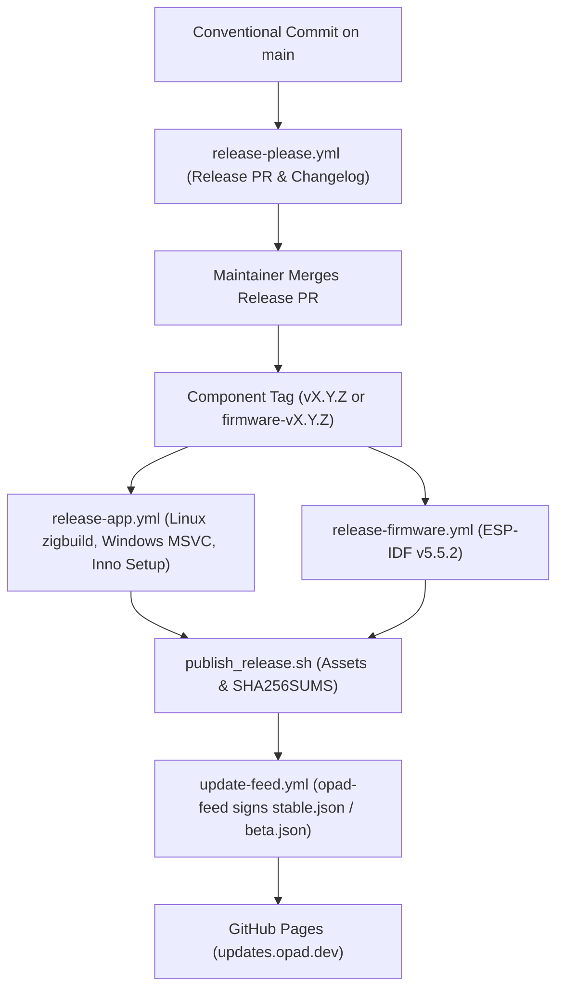

Como la aplicación de escritorio, el firmware y el `tosu` incluido se actualizan de forma independiente ([/AGENTS.md](/AGENTS.md) §1.3), OPad ejecuta tuberías de lanzamiento desacopladas que alimentan un manifiesto de actualización firmado criptográficamente.

## 1. Visión general de la tubería

## 2. Gestión de lanzamientos (`release-please`)

Configurada en [/release-please-config.json](/release-please-config.json) y [/.github/workflows/release-please.yml](/.github/workflows/release-please.yml):

- **Dos paquetes `release-please`**:
  1. **App de escritorio (`.`, componente `app`)**: Excluye `firmware` y `hardware`; actualiza `desktop/Cargo.toml` y produce etiquetas `vX.Y.Z` (o `vX.Y.Z-rc.N` mientras `prerelease: true`).
  2. **Firmware (`firmware`, componente `firmware`)**: Actualiza `firmware/CMakeLists.txt` y produce etiquetas `firmware-vX.Y.Z`.
  (El `tosu` incluido tiene su versión fijada por separado en [/Makefile](/Makefile) en `v4.26.2`.)
- **Sincronización de `Cargo.lock`**: `release-please.yml` ejecuta un trabajo `lockfile` que corre `cargo update -w` cada vez que Release Please actualiza el PR de lanzamiento de la app para que las compilaciones `--locked` sigan siendo válidas.

## 3. Compiladores de artefactos y publicación

- **Escritorio ([/.github/workflows/release-app.yml](/.github/workflows/release-app.yml))**: Compila binarios Linux x86_64 mediante `cargo-zigbuild` (glibc 2.31), binarios Windows x86_64 mediante MSVC, y empaqueta `.deb`, `.rpm`, AppImage y `opad-setup.exe`.
- **Firmware ([/.github/workflows/release-firmware.yml](/.github/workflows/release-firmware.yml))**: Compila en `espressif/idf:v5.5.2`, publicando el binario OTA y los artefactos completos de recuperación.
- **Publicación ([/scripts/release/publish_release.sh](/scripts/release/publish_release.sh))**: Sube artefactos y `SHA256SUMS` a GitHub Releases.

## 4. Feeds de actualización firmados (`opad-feed`)

[/.github/workflows/update-feed.yml](/.github/workflows/update-feed.yml) ejecuta `opad-feed` en cada lanzamiento, mediante cron semanal o disparo manual para publicar y firmar `stable.json` y `beta.json` en `https://updates.opad.dev/` (GitHub Pages), renovando las firmas antes de la ventana de caducidad de 30 días del feed.

## 5. Barreras de seguridad (`opad-update`)

Aplicadas en [/desktop/crates/opad-update/src/lib.rs](/desktop/crates/opad-update/src/lib.rs), [/desktop/crates/opad-update/src/verify.rs](/desktop/crates/opad-update/src/verify.rs) y [/desktop/crates/opad-update/src/origin.rs](/desktop/crates/opad-update/src/origin.rs):

1. **Verificación de firma Minisign (Ed25519)**: Los feeds firmados se comprueban contra la clave pública compilada en el binario; las firmas ausentes o inválidas fallan con `UpdateError::NoPublicKey` o `UpdateError::Signature`.
2. **Hash SHA-256 antes de ejecutar**: Cada archivo, instalador o imagen de firmware descargada se verifica contra el SHA-256 del manifiesto firmado antes de ejecutarse o flashearse.
3. **Escrituras atómicas**: `write_atomic` escribe en un archivo temporal, ejecuta `fsync` y renombra atómicamente a su destino.
4. **Puerta de seguridad de partida (`may_update_now`)**: Nunca aplica actualizaciones de app, `tosu` ni firmware durante `Playing` o `Cooldown`.
5. **Políticas por origen de instalación**: `windows` ejecuta el instalador; `deb`/`rpm` delegan en `apt`/`dnf` mediante polkit (sin sustituir nunca el `tosu` del paquete); `appimage`/`user` reemplazan directamente archivos propiedad del usuario; `aur`/`source`/`unknown` solo notifican.
