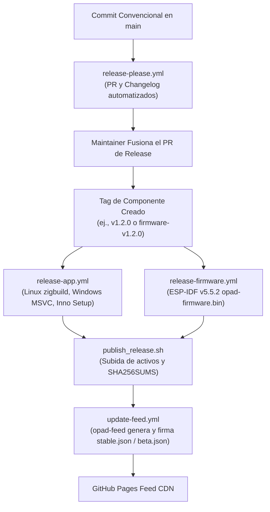

# Automatización de Releases y Feeds de Actualización

El pipeline de releases de OPad aplica una gestión de ciclo de vida independiente en todos sus componentes principales: la suite de aplicaciones de escritorio, el firmware del microcontrolador y dependencias empaquetadas como `tosu`.

Dado que la aplicación y el pad se actualizan de forma independiente (AGENTS.md §1.3), las releases están desacopladas, son reproducibles y se verifican criptográficamente.

<!-- src: /release-please-config.json#bootstrap-sha -->
<!-- src: /scripts/release/publish_release.sh#publish_release.sh -->
<!-- src: /.github/workflows/release-please.yml#release-please -->
<!-- src: /desktop/crates/opad-update/src/lib.rs#may_update_now -->
<!-- src: /desktop/crates/opad-update/src/manifest.rs#ReleaseManifest -->

---

## 1. Architectural Model and Pipeline Overview

---

## 2. Release Management (`release-please`)

OPad utiliza [Release Please](file:///home/paella/Documents/projects/esp32/osu-pad-esp32-docs/.github/workflows/release-please.yml) de Google configurado mediante [release-please-config.json](file:///home/paella/Documents/projects/esp32/osu-pad-esp32-docs/release-please-config.json).

### Component Separation

El repositorio está dividido en componentes de release diferenciados:
1. **Aplicación de Escritorio (`.`)**: Rastrea cambios en `desktop/` y en la raíz. Genera tags semver con formato `vX.Y.Z` (o `vX.Y.Z-rc.N` durante prereleases).
2. **Firmware (`firmware`)**: Rastrea cambios en `firmware/` de forma exclusiva. Genera tags con prefijo `firmware-vX.Y.Z`.
3. **Tosu (`build/tosu`)**: Rastreado y publicado como paquetes fijados independientes (por ejemplo, `tosu-v4.26.2-r1`).

### Cargo.lock Synchronization

Release Please por defecto modifica `Cargo.toml`, pero no puede actualizar las entradas de los miembros del workspace en `Cargo.lock`. Para mantener la fidelidad de compilación con `--locked`, [release-please.yml](file:///home/paella/Documents/projects/esp32/osu-pad-esp32-docs/.github/workflows/release-please.yml#L43-L60) incluye un trabajo dedicado de `lockfile`:
- Se ejecuta automáticamente siempre que Release Please actualiza la rama del PR de release.
- Ejecuta `cargo update -w` para alinear el archivo de bloqueo a la nueva versión incrementada.
- Hace push del archivo de bloqueo actualizado directamente al pull request de release.

---

## 3. Artifact Compilation and Publication

Cuando se fusiona un PR de release, GitHub Actions ejecuta el constructor de artefactos correspondiente:

- **Release de Escritorio ([.github/workflows/release-app.yml](file:///home/paella/Documents/projects/esp32/osu-pad-esp32-docs/.github/workflows/release-app.yml))**:
  - Compila binarios Linux x86_64 frente a glibc 2.31 usando `cargo-zigbuild` para garantizar una amplia compatibilidad en distribuciones antiguas (Ubuntu 20.04+, Debian 11+).
  - Compila binarios Windows x86_64 utilizando la cadena de herramientas estándar MSVC.
  - Genera paquetes `.deb`, `.rpm`, AppImage y el instalador Inno Setup para Windows.
- **Release de Firmware ([.github/workflows/release-firmware.yml](file:///home/paella/Documents/projects/esp32/osu-pad-esp32-docs/.github/workflows/release-firmware.yml))**:
  - Compila el firmware del ESP32-S3 dentro de un contenedor fijado `espressif/idf:v5.5.2`.
  - Produce `opad-firmware.bin` (el binario para actualización OTA) y `opad-firmware-merged.bin` (imagen flash completa incluyendo bootloader y tabla de particiones).
- **Publicación ([scripts/release/publish_release.sh](file:///home/paella/Documents/projects/esp32/osu-pad-esp32-docs/scripts/release/publish_release.sh))**:
  - Sube todos los binarios compilados y sus sumas de verificación SHA256 a GitHub Releases.
  - Actualiza las notas de release, añade políticas de firma de código y establece la visibilidad de la release (`latest` o `prerelease`).

---

## 4. Signed Update Feeds (`opad-feed`)

Las aplicaciones de escritorio y el firmware del teclado localizan las actualizaciones disponibles consultando feeds JSON firmados publicados en GitHub Pages:

- **Flujo de Trabajo**: [.github/workflows/update-feed.yml](file:///home/paella/Documents/projects/esp32/osu-pad-esp32-docs/.github/workflows/update-feed.yml) se ejecuta con cada release, cron semanal o disparo manual.
- **Generador de Feeds**: Compila y ejecuta la herramienta `opad-feed` del crate `opad-update`.
- **Canales de Feeds**:
  - `stable.json`: Contiene artefactos de releases en producción.
  - `beta.json`: Contiene artefactos de prereleases y release candidates.
- **Protección de Caducidad**: Cada feed tiene una ventana explícita de validez de 30 días. Las compilaciones programadas semanalmente aseguran que los feeds se actualicen y firmen continuamente antes de expirar.

---

## 5. Security Invariants and Guardrails (`opad-update`)

Debido a que los actualizadores automáticos representan un vector potencial de ejecución remota de código, el crate [opad-update](file:///home/paella/Documents/projects/esp32/osu-pad-esp32-docs/desktop/crates/opad-update/src/lib.rs) aplica restricciones defensivas estrictas:

1. **Verificación Criptográfica de Firmas**: Los manifiestos de actualización se firman con una clave privada Ed25519. La clave pública se compila directamente en el cliente. Los manifiestos sin una firma válida son rechazados (`UpdateError::NoPublicKey`, `UpdateError::Signature`).
2. **Hash-Before-Execute**: Los payloads binarios se descargan en almacenamiento temporal y se verifican contra el hash SHA256 del manifiesto antes de modificar permisos o intentar la ejecución.
3. **Reemplazo Atómico de Archivos**: Las actualizaciones sobrescriben los destinos mediante renombres atómicos de archivos temporales sincronizados con `fsync`. Un corte repentino de energía o finalización del proceso mantiene intacto el binario funcional previo.
4. **Protección en Juego**: [may_update_now](file:///home/paella/Documents/projects/esp32/osu-pad-esp32-docs/desktop/crates/opad-update/src/lib.rs#L39) monitoriza el estado del dispositivo; las actualizaciones se posponen estrictamente mientras el jugador está activo en un mapa.
5. **Respeto al Gestor de Paquetes**: Si el `install-origin` local indica un gestor de paquetes del sistema (`deb`, `rpm`, `arch`), las auto-actualizaciones en segundo plano se desactivan para evitar conflictos con los gestores de paquetes del sistema.
