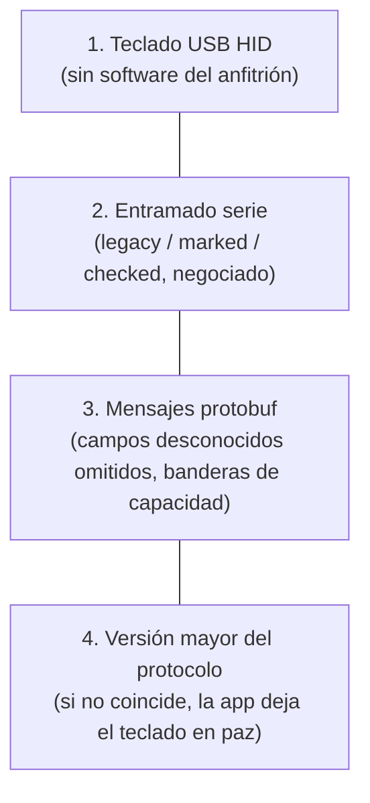
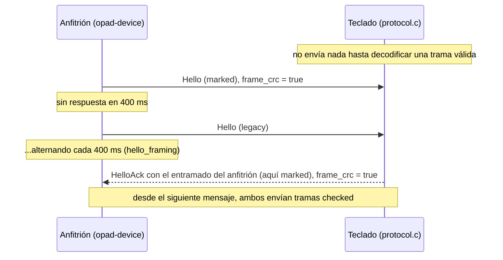

La app de escritorio y el firmware del teclado se actualizan cada uno a su ritmo ([AGENTS.md](https://github.com/OPad-dev/OPad/blob/main/AGENTS.md) §1.3). Un usuario puede actualizar la app y no el teclado durante meses, o flashear un firmware más nuevo y quedarse con una app antigua. Toda combinación tiene que funcionar, y nunca se le dice al usuario que "actualice ambos a la vez".

Funciona por capas, y cada una se degrada por su cuenta:

1. **El teclado no necesita software.** Se enumera como un teclado USB HID estándar a 1000 Hz ([usb_descriptors.c](https://github.com/OPad-dev/OPad/blob/main/firmware/main/usb/usb_descriptors.c)). Ninguna versión de la app puede romper la escritura ([AGENTS.md](https://github.com/OPad-dev/OPad/blob/main/AGENTS.md) §1.2).
2. **El entramado se negocia**, así que a un interlocutor antiguo nunca se le envían bytes que no pueda analizar.
3. **Los mensajes evolucionan añadiendo**, y las funciones se anuncian, no se suponen.
4. **Una ruptura real se detecta**, y entonces la app no estorba al teclado.

## Entramado: el teclado responde con el entramado del anfitrión

El enlace serie ha usado tres entramados a lo largo del tiempo ([`Framing`](https://github.com/OPad-dev/OPad/blob/main/desktop/crates/opad-protocol/src/lib.rs), [frame_parser.c](https://github.com/OPad-dev/OPad/blob/main/firmware/main/protocol/frame_parser.c)): legacy (sin marca, longitud y luego carga), marked (`0xAA 0x55`, longitud, carga) y checked (`0xAA 0x5A`, longitud, carga, CRC-16/CCITT-FALSE). La disposición de los bytes está en la referencia del [protocolo serie](../reference/serial-protocol.md).

Al conectarse, ninguno de los dos lados sabe lo antiguo que es el otro, así que ninguno puede suponer un entramado. La regla es que **el anfitrión habla primero y el teclado responde en el mismo formato**:

- **El anfitrión sondea.** Mientras no conoce el entramado del teclado, el anfitrión envía un `Hello` cada 400 ms (`HELLO_RETRY`), marked en los intentos pares y legacy en los impares ([`hello_framing()`](https://github.com/OPad-dev/OPad/blob/main/desktop/crates/opad-device/src/lib.rs)). El `Hello` lleva `protocol_version = 1`, `client_version`, `he_calibration = true` y `frame_crc = true` ([`hello_message()`](https://github.com/OPad-dev/OPad/blob/main/desktop/crates/opad-device/src/lib.rs)).
- **El teclado calla hasta oír uno.** Hasta que decodifica un mensaje reconocido, el firmware no envía nada (`s_host_framing_known = false` en [protocol.c](https://github.com/OPad-dev/OPad/blob/main/firmware/main/protocol/protocol.c)); una trama no solicitada podría confundir a un anfitrión antiguo. El primer mensaje reconocido fija `s_host_framing`, y a partir de ahí el analizador solo acepta esa familia.
- **Anfitrión legacy:** el teclado responde en entramado legacy durante el resto de la conexión.
- **Anfitrión marked que pide CRC** (`Hello.frame_crc = true`): el propio `HelloAck` sale como trama marked con `frame_crc = true`, y todas las tramas posteriores son checked. Los analizadores marked de ambos lados leen igual tramas marked y checked.
- **Anfitrión marked que no lo pide, o firmware anterior al CRC** (ignora el campo y su `HelloAck.frame_crc` se decodifica como `false`): ambos se quedan en entramado marked.

Siempre es el anfitrión quien avanza, y solo después de que el teclado haya dicho que puede seguirle. Un teclado antiguo, sencillamente, nunca lo dice.

## Mensajes: campos añadidos y banderas de capacidad

El esquema es [protocol/opad.proto](https://github.com/OPad-dev/OPad/blob/main/protocol/opad.proto) (proto3). Dos propiedades de protobuf hacen casi todo el trabajo:

- **Los campos desconocidos se omiten.** App nueva, firmware antiguo: nanopb ignora las etiquetas que no conoce y aplica el resto. App antigua, firmware nuevo: prost hace lo mismo con los mensajes `DeviceToHost`.
- **Los campos ausentes se leen como cero.** Un campo que el emisor no conoce se decodifica como `0`, `false` o vacío. Por eso cada campo nuevo se diseña para que cero signifique "el comportamiento antiguo", y se usa `optional` donde cero es un valor con sentido (por ejemplo `ConfigPayload.key3_hid_usage`).

Esa segunda propiedad es lo que hace funcionar las **banderas de capacidad** de `HelloAck`. El teclado anuncia lo que sabe hacer: `running_partition`, `key_press_times`, `board_test`, `builtin_animations`, `restart`, `he_input`, `he_calibration`, `he_live`, `tap_rate_per_second`, `key_count`, `input_module`, `frame_crc`. Un firmware anterior a una bandera no envía nada, el anfitrión lee `false` y recurre a la alternativa: por ejemplo, sin `key_press_times` el ritmo de pulsación se mide desde tosu en lugar de con los tiempos de pulsación del propio teclado, y sin `tap_rate_per_second` el anfitrión rechaza los diseños que dependen de él.

El firmware decodifica en búferes de tamaño fijo: [protocol/opad.options](https://github.com/OPad-dev/OPad/blob/main/protocol/opad.options) acota cada cadena y cada campo repetido, `frame_parser_feed()` descarta las tramas más largas que `FRAME_MAX_PAYLOAD` (8186 bytes), y una carga que desborda un campo falla limpiamente en `protocol_decode_host_message()` y registra `DIAG_EVENT_DECODE_FAILED`. Un campo demasiado largo enviado por una app más nueva se rechaza; no se escribe más allá del búfer.

El procedimiento para añadir un campo o un mensaje está en [Cambios en el protocolo](../develop/protocol-changes.md).

## Una ruptura real: la versión mayor del protocolo

Si algún día un cambio no puede hacerse añadiendo, cambia la versión mayor [`DEVICE_PROTOCOL_VERSION`](https://github.com/OPad-dev/OPad/blob/main/desktop/crates/opad-protocol/src/lib.rs) (ahora `1`). Cuando `HelloAck.protocol_version` es distinta, [`RuntimeController::on_event()`](https://github.com/OPad-dev/OPad/blob/main/desktop/daemon/src/runtime.rs) registra un [`IncompatibleDevice`](https://github.com/OPad-dev/OPad/blob/main/desktop/crates/opad-model/src/lib.rs) (`firmware_version`, `protocol_version`, y los `device_id`, `board_profile` y `running_partition` que necesita una actualización de firmware) y trata el teclado como no conectado:

- el teclado sigue funcionando como teclado a 1000 Hz, porque la capa 1 no depende de nada de esto;
- el daemon no sincroniza contadores, no escribe configuración ni le envía telemetría;
- `opadctl status` imprime una línea `Incompatible:` ([cli/src/main.rs](https://github.com/OPad-dev/OPad/blob/main/desktop/cli/src/main.rs)) y la GUI muestra un aviso (`incompatible_banner` en [gui/src/main.rs](https://github.com/OPad-dev/OPad/blob/main/desktop/gui/src/main.rs)); ambos indican el protocolo del teclado y el que habla la app;
- se actualiza el lado que se ha quedado atrás. A un teclado con el protocolo más antiguo se le sigue ofreciendo su actualización de firmware (`target()` en [firmware_update.rs](https://github.com/OPad-dev/OPad/blob/main/desktop/daemon/src/firmware_update.rs)): el aviso tiene un botón `Update the pad` y `opadctl update install firmware` funciona. El flasheo pasa por el bootloader de la ROM, así que no necesita nada del protocolo; se salta la sincronización de contadores que normalmente va antes, y nunca empieza de forma automática, porque el daemon no puede saber si ese teclado se está usando. Un teclado con el protocolo más nuevo no se flashea: el aviso lleva a Settings › Updates, donde se actualiza la app.

El IPC entre la GUI y el daemon tiene su propia versión, independiente (`IPC_PROTOCOL_VERSION`, consulta el [protocolo IPC de escritorio](../reference/ipc.md)); no interviene en esta comprobación.

<!-- src: /desktop/gui/src/main.rs#incompatible_banner, /desktop/cli/src/main.rs#Cmd, /desktop/crates/opad-protocol/src/lib.rs#DEVICE_PROTOCOL_VERSION, /desktop/daemon/src/firmware_update.rs#target, /desktop/daemon/src/firmware_update.rs#may_install_unasked -->
