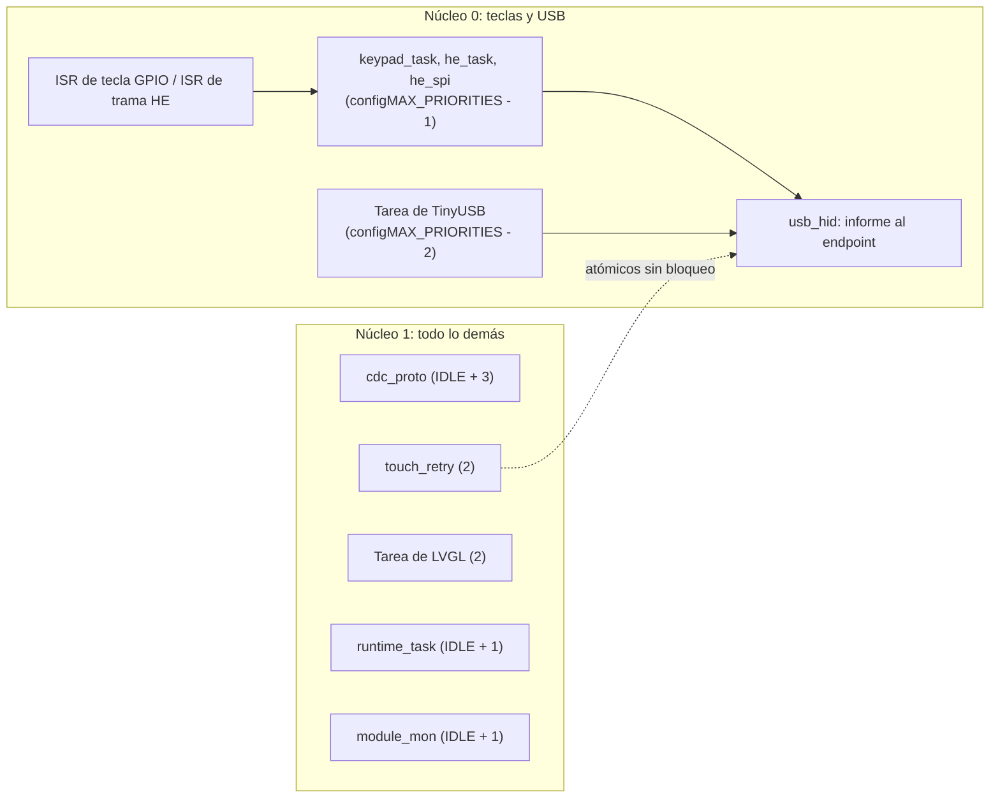
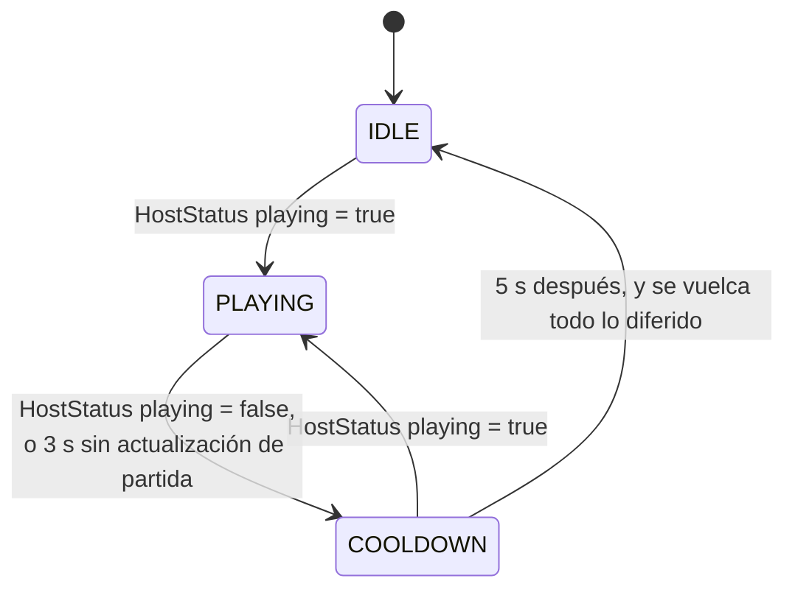

OPad gira en torno a una regla: **la latencia siempre gana** ([AGENTS.md](https://github.com/OPad-dev/OPad/blob/main/AGENTS.md) §1.1). Todo lo demás que hace el teclado (la pantalla, el protocolo serie, la pantalla táctil, el almacenamiento en flash) está organizado para que no pueda retrasar un informe de tecla. Tres decisiones cargan con casi todo ese peso:

1. **Dos núcleos, dos tareas.** El núcleo 0 ejecuta las teclas y el USB; el núcleo 1, todo lo demás.
2. **Ninguna escritura en flash durante un mapa.** Una máquina de estados retiene toda escritura en NVS hasta que terminan el mapa y un periodo de enfriamiento posterior.
3. **Un único canal ordenado hacia el teclado.** El daemon de escritorio envía sus órdenes de una en una, así que nunca compiten entre sí en el cable.

## Dos núcleos, dos tareas

El ESP32-S3 tiene dos núcleos Xtensa LX7, que funcionan a 240 MHz (`CONFIG_ESP_DEFAULT_CPU_FREQ_MHZ_240` en [sdkconfig.defaults](https://github.com/OPad-dev/OPad/blob/main/firmware/sdkconfig.defaults)). Dibujar una pantalla o analizar una trama protobuf lleva milisegundos; un informe de tecla tiene que salir en microsegundos. Ponerlos en núcleos distintos hace que el planificador nunca tenga que elegir entre ellos.

<!-- src: /firmware/main/input/keypad.c#keypad_init, /firmware/main/input/he_backend.c#he_task, /firmware/main/input/he_spi_source.c#he_spi_source_start, /firmware/main/app_main.c#tusb_cfg, /firmware/main/usb/usb_cdc.c#usb_cdc_task, /firmware/main/input/touch_retry.c#touch_retry_init, /firmware/main/ui/ui_port.c#port_cfg, /firmware/main/runtime/runtime.c#runtime_init, /firmware/main/input/module_monitor.c -->

El **núcleo 0** contiene la ruta de pulsación y nada más:

- Las tareas de entrada (`keypad_task` en [keypad.c](https://github.com/OPad-dev/OPad/blob/main/firmware/main/input/keypad.c) para interruptores; `he_task` en [he_backend.c](https://github.com/OPad-dev/OPad/blob/main/firmware/main/input/he_backend.c) y el muestreador V3 `he_spi` en [he_spi_source.c](https://github.com/OPad-dev/OPad/blob/main/firmware/main/input/he_spi_source.c) para Hall Effect) se ejecutan a `configMAX_PRIORITIES - 1`.
- La tarea de TinyUSB va un nivel por debajo (`tusb_cfg.task.priority = configMAX_PRIORITIES - 2`, `xCoreID = 0` en [app_main.c](https://github.com/OPad-dev/OPad/blob/main/firmware/main/app_main.c)), así que solo la entrada de teclas tiene más prioridad que el USB.
- La ruta se ejecuta desde IRAM. [linker.lf](https://github.com/OPad-dev/OPad/blob/main/firmware/main/linker.lf) coloca en RAM interna `keypad_task`, todo `usb_hid`, `he_frame`, `he_rt`, el muestreador V3 y las rutas críticas HID y DWC2 de TinyUSB. Desde flash, la ruta de teclas comparte la caché de instrucciones con el trabajo de pantalla del núcleo 1; el comentario de `linker.lf` deja constancia de una pulsación que tardaba ~240 µs en llegar al USB de ese modo, frente a ~70 µs desde IRAM.

El **núcleo 1** ejecuta el trabajo al que se le permite ser lento:

- `cdc_proto` ([usb_cdc.c](https://github.com/OPad-dev/OPad/blob/main/firmware/main/usb/usb_cdc.c), `tskIDLE_PRIORITY + 3`) decodifica las tramas del protocolo que llegan del anfitrión y envía las respuestas.
- `touch_retry` ([touch_retry.c](https://github.com/OPad-dev/OPad/blob/main/firmware/main/input/touch_retry.c), prioridad 2) duerme a la espera de la interrupción del controlador táctil y sondea el I2C solo mientras hay un dedo apoyado. Consulta [La pantalla táctil como tercer botón](touchscreen-third-button.md).
- La tarea de LVGL ([ui_port.c](https://github.com/OPad-dev/OPad/blob/main/firmware/main/ui/ui_port.c), `task_affinity = 1`, prioridad 2) dibuja diseños de 320×240 en el ST7789 por SPI2 a 80 MHz (`BOARD_LCD_PIXEL_CLOCK_HZ`), como mucho cada 33 ms (`CONFIG_LV_DEF_REFR_PERIOD=33`).
- `runtime_task` ([runtime.c](https://github.com/OPad-dev/OPad/blob/main/firmware/main/runtime/runtime.c), `tskIDLE_PRIORITY + 1`) ejecuta la máquina de estados descrita más abajo y realiza todas las escrituras diferidas en NVS.

Los núcleos se encuentran en un único punto: la tecla Quick Retry de la pantalla táctil comparte el informe HID de la tecla 1. Ese traspaso usa contadores de secuencia atómicos en lugar de un mutex (`hid_link_t` en [usb_hid.c](https://github.com/OPad-dev/OPad/blob/main/firmware/main/usb/usb_hid.c)), así que una tarea del núcleo 1 nunca puede retener un cerrojo que la ruta de teclas esté esperando. [Ingeniería de latencia](latency.md#seguimiento-de-secuencias-sin-bloqueos-hid_link_t) explica cómo.

### La memoria sigue el mismo reparto

La RAM interna escasea (también aloja el código IRAM de arriba), así que todo lo que la ruta de teclas nunca toca va a los 8 MB de PSRAM Octal: el pool de 160 KB de LVGL (`CONFIG_OPAD_LVGL_PSRAM`, activado por defecto en [Kconfig.projbuild](https://github.com/OPad-dev/OPad/blob/main/firmware/main/Kconfig.projbuild)) y los búferes del protocolo marcados con `EXT_RAM_BSS_ATTR`. La RAM interna se queda con las teclas, el USB y los dos búferes de dibujo DMA de 40 líneas (`UI_DRAW_BUF_LINES` en [ui.h](https://github.com/OPad-dev/OPad/blob/main/firmware/main/ui/ui.h)). Las cachés más grandes (32 KB de instrucciones, 64 KB de datos) son un compromiso: `sdkconfig.defaults` deja constancia de que reducen a la mitad el tiempo de fotograma a cambio de 48 KB de RAM interna.

El precio de todo el diseño es que el trabajo del núcleo 1 puede ir lento cuando el núcleo 0 está ocupado, y una pantalla muy cargada puede perder fotogramas. Ese es el sentido buscado: la pantalla cede ante las teclas, nunca al revés.

## Ninguna escritura en flash durante un mapa

Escribir en la flash NVS suspende la caché de instrucciones de ambos núcleos mientras dura el borrado o la escritura. Todo lo que no está en IRAM se detiene. En lugar de demostrar que cada ruta es segura durante una escritura, el firmware se niega a escribir mientras se juega un mapa. [runtime.c](https://github.com/OPad-dev/OPad/blob/main/firmware/main/runtime/runtime.c) sigue tres estados:

- **`OPAD_STATE_IDLE`**: el único estado en el que se escribe en NVS. Cada tick de 100 ms de `runtime_supervisor_task` vuelca la configuración, los diseños y la calibración Hall Effect pendientes, y guarda un punto de control de los contadores cuando toca.
- **`OPAD_STATE_PLAYING`**: se entra cuando el `HostStatus` del anfitrión dice que se está jugando un mapa ([protocol.c](https://github.com/OPad-dev/OPad/blob/main/firmware/main/protocol/protocol.c) llama a `runtime_notify_gameplay`). Quienes escriben comprueban el estado por su cuenta y mantienen los cambios en RAM, marcados como pendientes (por ejemplo, `counters.c`, `device_config.c`, `ui_store.c` y `he_cal.c` comprueban todos `runtime_get_state() != OPAD_STATE_IDLE`).
- **`OPAD_STATE_COOLDOWN`**: 5 s después de que termine un mapa (`COOLDOWN_DURATION_US`). Un reintento rápido empieza un mapa nuevo en cuestión de segundos; sin el enfriamiento, cada reintento provocaría un volcado entre intentos. Un mapa nuevo durante el enfriamiento vuelve directamente a `PLAYING`.

Las actualizaciones de partida del anfitrión hacen además de latido. Si dejan de llegar durante 3 s (`GAMEPLAY_TIMEOUT_US`), porque el daemon o tosu murieron a mitad de mapa, el firmware sale de `PLAYING` por sí solo, así que un anfitrión caído no puede bloquear el almacenamiento para siempre. Un reinicio pedido por el anfitrión también espera a `IDLE` (`runtime_request_restart`).

El coste es que un cambio hecho durante un mapa (un ajuste, un diseño, los contadores) vive solo en RAM hasta que acaba el enfriamiento: si desconectas el teclado a mitad de mapa, se pierde.

## Un único canal ordenado hacia el teclado

`opad-daemon` ([runtime.rs](https://github.com/OPad-dev/OPad/blob/main/desktop/daemon/src/runtime.rs)) es dueño del enlace USB CDC, del almacenamiento SQLite (`opad.db`), de la supervisión de tosu, de las actualizaciones y del IPC local que usan la GUI y `opadctl`. Su bucle de ejecución decide *qué* enviar; el actor de dispositivo de [device_actor.rs](https://github.com/OPad-dev/OPad/blob/main/desktop/daemon/src/device_actor.rs) decide *cuándo*.

Cada `DeviceCommand` (`TimeSync`, `ClaimOwnership`, `Config`, `HostStatus`, `DataUpdate`, `Layout`, `RequestStatus`, `PlayAnimation`) se encola en un único canal acotado (`QUEUE_DEPTH = 256`) y se envía y se espera antes de que empiece el siguiente. La cabecera del archivo explica por qué: cuando cada acción se enviaba desde su propia tarea, una configuración y el diseño que la seguía podían llegar al teclado en cualquier orden.

Cuando la cola de entrada del teclado está llena (`DeviceError::Busy`), la orden se reintenta hasta `BUSY_RETRIES = 5` veces, con `BUSY_BACKOFF = 20 ms` de separación. Un diff de telemetría (`DataUpdate`) no se reintenta: en el siguiente volcado ya estaría obsoleto, así que el actor activa `resend_data` y el bucle de ejecución envía en su lugar una instantánea completa.

El daemon aplica a su propio almacenamiento la misma regla de flash que el teclado. Cuando empieza un mapa emite `SetStorageWritesAllowed(false)`, y `Storage` rechaza las escrituras (`StorageError::WritesBlocked` en [opad-storage](https://github.com/OPad-dev/OPad/blob/main/desktop/crates/opad-storage/src/lib.rs)) hasta que termina su propio enfriamiento y empieza la sincronización de contadores posterior al mapa. La telemetría llega del WebSocket de tosu ([opad-tosu](https://github.com/OPad-dev/OPad/blob/main/desktop/crates/opad-tosu/src/lib.rs)) y [telemetry.rs](https://github.com/OPad-dev/OPad/blob/main/desktop/daemon/src/telemetry.rs) la convierte en mensajes `DataUpdate` y `HostStatus` con límite de frecuencia.

Para la vista módulo a módulo, consulta [Subsistemas del firmware](../develop/firmware/overview.md) y [Arquitectura de escritorio](../develop/desktop/overview.md).
