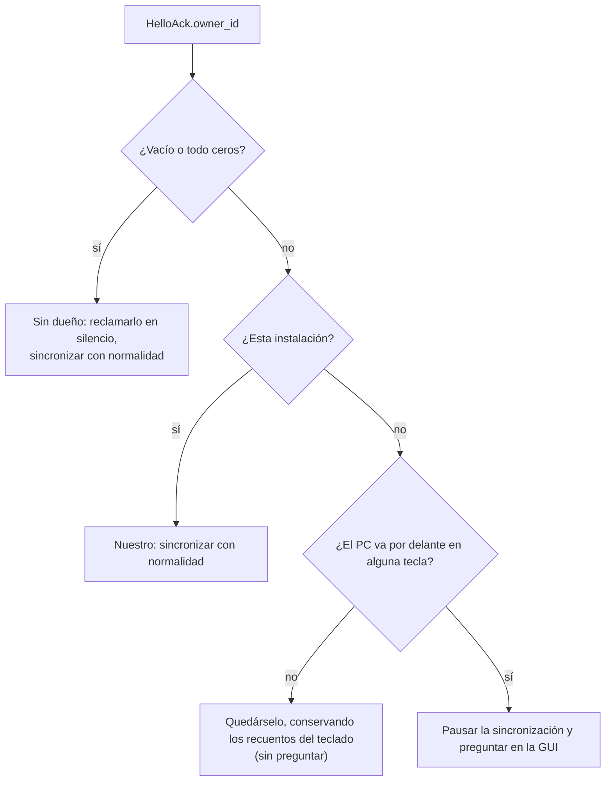

Los contadores de pulsaciones de por vida viven en dos sitios: en el teclado (flash NVS) y en el PC (SQLite, `opad.db`). El teclado tiene que contar sin PC, porque ante todo es un teclado; el PC guarda el historial y las copias de seguridad. Dos copias de un número pueden discrepar, y la pregunta de diseño es cómo fusionarlas sin perder nunca pulsaciones ni resucitar recuentos que el usuario puso a cero a propósito.

Tres ideas la responden: dentro de una **generación** los recuentos solo suben, las fusiones se quedan con el **máximo**, y el teclado registra qué instalación es su **dueña**.

## Contar en el teclado

[counters.c](https://github.com/OPad-dev/OPad/blob/main/firmware/main/counters/counters.c) y [key_event.c](https://github.com/OPad-dev/OPad/blob/main/firmware/main/input/key_event.c) llevan un contador de por vida de 64 bits por tecla (la tecla 3 solo en un módulo V3 de tres teclas):

- **Contar no cuesta nada.** Una pulsación aceptada incrementa un atómico en RAM (`key_event_press_accepted`, llamado desde la ruta de teclas en el núcleo 0). Nada toca la flash.
- **Guardar es poco frecuente.** Los recuentos llegan a NVS en un punto de control, y `counters_checkpoint()` no escribe nada salvo que el estado de ejecución sea `IDLE`, así que nunca durante un mapa ni su enfriamiento. En `IDLE`, la tarea de ejecución guarda los recuentos pendientes cuando lleva 30 s sin pulsarse ninguna tecla, o al menos cada 5 minutos mientras se siguen pulsando teclas (`counters_checkpoint_due` en [counter_sync_rules.c](https://github.com/OPad-dev/OPad/blob/main/firmware/main/counters/counter_sync_rules.c)), y de inmediato cuando el anfitrión suspende el USB, cuando el anfitrión sincroniza, tras un enfriamiento y antes de un reinicio.

El compromiso: desconectar el teclado puede perder las pulsaciones desde el último punto de control. Un PC que sincronizó entre medias todavía las tiene, y la fusión de abajo las recupera.

## Fusión: generaciones y máximo

El estado de cada lado lleva un `counter_generation` junto a los recuentos. [`reconcile_counters()`](https://github.com/OPad-dev/OPad/blob/main/desktop/crates/opad-storage/src/lib.rs) los fusiona:

```rust
if pc.counter_generation > esp.counter_generation {
    pc.clone()          // a deliberate reset or restore on the PC wins
} else if esp.counter_generation > pc.counter_generation {
    esp.clone()
} else {
    // same generation: lifetime_key1/2 = max(pc, esp)
}
```

- **Misma generación: el máximo, tecla a tecla.** Dentro de una generación los recuentos solo crecen, así que el número mayor siempre es el más completo. Se conservan las pulsaciones hechas mientras el teclado estaba desconectado de este PC.
- **La generación más alta gana sin más.** Poner a cero los contadores (`opadctl reset --yes`, o **Reset lifetime counters** en la GUI) o restaurar una copia de seguridad sube la generación. Es la única forma legítima de que un recuento *menor* sustituya a uno mayor, y la generación hace explícita la intención en lugar de adivinarla.

El teclado aplica la misma regla: [counter_sync_rules.c](https://github.com/OPad-dev/OPad/blob/main/firmware/main/counters/counter_sync_rules.c) (`counters_validate_sync_acceptance`) rechaza una sincronización de una generación más antigua, o una que bajaría un recuento dentro de la misma generación, salvo que el anfitrión la fuerce.

La reconciliación abarca las teclas 1 y 2. La tecla 3 se cuenta y se guarda en el teclado, y el anfitrión solo la reescribe al restaurar una copia de seguridad (`send_counter_sync_key3` en [ipc_handlers.rs](https://github.com/OPad-dev/OPad/blob/main/desktop/daemon/src/ipc_handlers.rs)).

### Las pulsaciones durante una sincronización no se pierden

Una sincronización tarda su tiempo en el cable, y el jugador puede pulsar una tecla mientras está en curso. Si el teclado guardara sin más el número del anfitrión, esas pulsaciones desaparecerían. En su lugar, `counters_sync_from_host()` toma una instantánea, valida la sincronización contra ella y luego mueve los contadores vivos según la *diferencia* entre la instantánea y el objetivo (`rebase_lifetime_presses`, y `key_event_add_lifetime_key3(*k3 - current.lifetime_key3)` para la tecla 3). Una pulsación contada después de la instantánea sigue contada.

## Propiedad: a qué PC pertenece un teclado

La fusión supone que ambas copias describen la misma historia. Eso falla cuando un teclado pasa a otro ordenador, o cuando se reinstala OPad: la base de datos de la nueva instalación no sabe nada del pasado del teclado, o guarda el pasado de otro teclado. Por eso el teclado almacena un dueño ([identity.rs](https://github.com/OPad-dev/OPad/blob/main/desktop/daemon/src/identity.rs)):

- **ID de instalación.** Un UUIDv4 aleatorio generado en la primera ejecución del daemon y guardado en SQLite (`app_state`, clave `install.id`). Identifica la *instalación*, no la máquina: desinstalar elimina `opad.db`, y una reinstalación recibe una identidad nueva.
- **El dueño del teclado.** 16 bytes (`OWNER_ID_LEN`), escritos por `ClaimOwnership` y guardados en la configuración NVS del teclado. Se devuelve en cada `HelloAck.owner_id`. No tiene nada de criptográfico: protege la integridad de los contadores, no la exclusividad.

La propiedad se decide en el mismo `HelloAck` que trae los recuentos, antes de reconciliar nada ([runtime.rs](https://github.com/OPad-dev/OPad/blob/main/desktop/daemon/src/runtime.rs), `ownership_of`):



- **Sin dueño** (vacío o todo ceros, que es también lo que envía el firmware anterior a la propiedad): el daemon escribe su ID de instalación en el teclado (`ClaimOwnership`, una escritura NVS solo en `IDLE`).
- **Nuestro:** reconciliación normal.
- **De otro, y el teclado tiene al menos las pulsaciones de este PC en ambas teclas** (`pc_is_ahead` es falso): [`take_over_if_pad_is_ahead()`](https://github.com/OPad-dev/OPad/blob/main/desktop/daemon/src/ipc_handlers.rs) lo reclama y conserva los recuentos del teclado. Pasar un teclado a un PC nuevo, o reinstalar, no requiere preguntar nada.
- **De otro, y este PC va por delante en alguna tecla:** quedárselo automáticamente tiraría pulsaciones en un sentido u otro, así que el daemon activa `pending_takeover` y `foreign_pad`, deja de sincronizar, y la GUI pregunta (`ResolveTakeover`): quedárselo conservando los recuentos del teclado, quedárselo escribiendo los recuentos de este PC, o dejar el teclado en paz. Un teclado que se deja en paz sigue funcionando como teclado; el daemon simplemente no escribe en él.

El conjunto completo de casos al conectar, la sustitución del dispositivo y la restauración de copias de seguridad están en [Recuperación, reflasheo y desvinculación](../recovery.md); la parte del firmware está en [Contadores (firmware)](../develop/firmware/counters.md).
