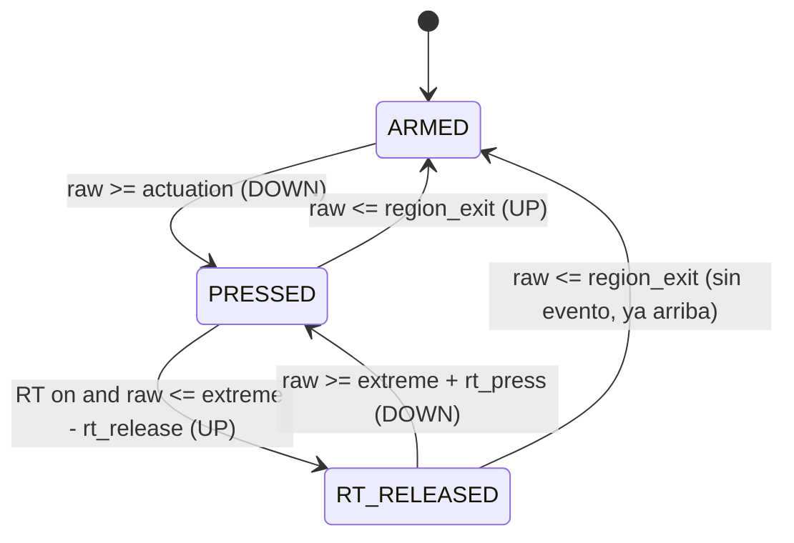

Un interruptor Hall Effect (HE) no tiene contactos. Un imán en el vástago se mueve sobre un sensor Hall lineal, así que el firmware lee *cuánto* está bajada la tecla, de forma continua, en lugar de *si* se cerró un contacto. Eso permite dos cosas: un punto de actuación que elige el usuario, y **Rapid Trigger**, que suelta una tecla en cuanto empieza a subir y la vuelve a pulsar en cuanto baja, ocurra donde ocurra dentro del recorrido.

También traslada los problemas difíciles al firmware: leer una señal analógica lo bastante rápido, distinguir el movimiento del ruido y garantizar que una lectura errónea nunca pueda dejar una tecla pulsada.

## Dos formas de leer los sensores

[he_backend.c](https://github.com/OPad-dev/OPad/blob/main/firmware/main/input/he_backend.c) admite dos generaciones de módulo:

| | HE V1 (2 teclas) | HE V3 (3 teclas) |
|---|---|---|
| Fuente | ADC1 del ESP32-S3 en modo DMA continuo (`HE_SOURCE_ESP_ADC`), sensores en GPIO10 y GPIO7 | ADC TI ADS7028 de 12 bits en el módulo, por SPI3 (`HE_SOURCE_ADS7028`) |
| Canales | Tecla 1 `ADC_CHANNEL_9`, tecla 2 `ADC_CHANNEL_6` | Tecla 1 `AIN5`, tecla 2 `AIN4`, tecla 3 `AIN3`, en autosecuencia |
| Frecuencia | 64 000 conversiones/s (`HE_SAMPLE_HZ`), 16 por trama DMA: una trama cada **250 µs** (4 kHz) | Una alarma de `gptimer` cada `HE_SPI_FRAME_US = 50` µs: **20 kHz** |
| Por trama | Mediana de las conversiones válidas de cada tecla, en la interrupción de trama (`on_frame`, IRAM) | 4 lecturas a 40 MHz (una obsoleta de la trama anterior y luego una por tecla), cada una con su CRC; una palabra con CRC erróneo se descarta y esa tecla conserva su última lectura |
| Quién decide | `on_frame` ejecuta el motor de decisión y despierta a `he_task` solo cuando cambia una tecla | La tarea `he_spi` del núcleo 0 decodifica la trama, ejecuta el motor e informa ella misma del cambio (`publish()`), sin pasar por `he_task` |
| La calibración ve | Todas las tramas (4 kHz) | Una trama de cada cinco (`HE_CAL_EVERY_V3 = 5`), los mismos 4 kHz |
| Almacén de calibración | Espacio de nombres NVS `opad_cal`, claves `cal_a` / `cal_b` | `opad_cal3`: `cal_a` / `cal_b` para las teclas 1–2, `cal3_a` / `cal3_b` para la tecla 3 |

V1 enviaba tensiones analógicas por el cable del módulo hasta el ADC del propio ESP32, que recogía ruido por el camino. V3 convierte en el módulo y solo envía SPI digital, con un CRC en cada palabra ([hardware/pcb/V2/README.md](https://github.com/OPad-dev/OPad/blob/main/hardware/pcb/V2/README.md) documenta el ruido que motivó el cambio).

Dos detalles mantienen la ruta V3 lo bastante rápida para 20 kHz. [he_spi_source.c](https://github.com/OPad-dev/OPad/blob/main/firmware/main/input/he_spi_source.c) configura SPI3 una vez mediante el driver de ESP-IDF y después inicia cada transferencia directamente sobre los registros `GPSPI3` (`ads7028_read16_again`), ahorrándose los ~10 µs por palabra del driver; las mediciones están en [las notas del ADS7028](../../hardware/components/ads7028.md). Y un cable de módulo conectado al revés se detecta en el arranque (`board_boot_cable_reversed()`), y `ads7028_carrier_pins()` intercambia los pines SPI para que coincidan.

En V1, Kconfig selecciona `ADC_CONTINUOUS_ISR_IRAM_SAFE`, así que la interrupción de trama sigue ejecutándose desde IRAM incluso mientras se escribe en flash.

## El motor Rapid Trigger

Cada tecla es una pequeña máquina de estados en [he_rt.c](https://github.com/OPad-dev/OPad/blob/main/firmware/main/input/he_rt.c) (`he_rt_step`), alimentada con una lectura por trama. `raw` crece a medida que la tecla baja. `extreme` es el punto más profundo alcanzado mientras está pulsada, o el más alto alcanzado mientras está soltada por Rapid Trigger.

- **`HE_RT_ARMED`**: soltada, esperando una primera pulsación en el punto de actuación. Tras el arranque, un cambio de ajustes o un fallo (`need_release`), la tecla tiene que verse primero de vuelta por encima del umbral de liberación antes de poder pulsarse.
- **`HE_RT_PRESSED`**: mantenida. Sin Rapid Trigger se suelta en el umbral de liberación fijo, por debajo de la actuación, lo que da histéresis. Con Rapid Trigger, `extreme` sigue a la tecla hacia abajo y la tecla se suelta en cuanto sube `rt_release` por encima de ese punto.
- **`HE_RT_RT_RELEASED`**: soltada a mitad de recorrido. Ahora `extreme` sigue a la tecla hacia *arriba*, y en cuanto vuelve a bajar `rt_press`, se pulsa, sin volver al punto de actuación.

`region_exit()` es donde termina la región de Rapid Trigger. En modo **Normal** es el umbral de liberación: si la tecla sube por encima, la siguiente pulsación necesita cruzar de nuevo la actuación por completo. En modo **Continuous** es `top_reset`, cerca de lo alto del recorrido, así que Rapid Trigger sigue activo casi hasta el reposo.

`extreme` está limitado a `peak_cap` (`cap_peak()`), la **zona muerta inferior** opcional: apretar más contra el amortiguador del fondo del interruptor no mueve el punto desde el que la tecla tiene que volver a subir.

Los umbrales nuevos nunca cambian una tecla a mitad de pulsación. `he_rt_set_params()` los deja pendientes hasta que la tecla está arriba.

## Porcentaje de un recorrido calibrado, con suelos de ruido

La fuerza del imán y la respuesta del sensor varían de un interruptor a otro y no son lineales con el recorrido, así que un ajuste en milímetros significaría algo distinto en cada tecla. Por eso los ajustes se guardan en décimas de porcentaje (0,1 %) del recorrido magnético calibrado de cada tecla, `full - rest` (`HE_PCT_FULL = 1000` en [he_params.h](https://github.com/OPad-dev/OPad/blob/main/firmware/main/input/he_params.h)); [v2-hall-effect-decisions.md](../../specs/v2-hall-effect-decisions.md) D3 documenta la decisión.

Un porcentaje puede pedir menos movimiento que el ruido del sensor. Por eso `he_params_build()` sube los umbrales de movimiento (`rt_press`, `rt_release`, la histéresis de liberación) y el margen del reinicio superior hasta los suelos de ruido medidos, y **lo dice**: cada valor subido activa una bandera `HE_PARAMS_*_RAISED` que la app muestra; nunca es un cambio silencioso. **Allow below the noise floor** (`no_floor`) baja los suelos a 1 cuenta para quien quiera asumir el riesgo de pulsaciones fantasma.

## Calibración

La calibración guiada ([he_cal_capture.h](https://github.com/OPad-dev/OPad/blob/main/firmware/main/input/he_cal_capture.h), [he_cal_runner.c](https://github.com/OPad-dev/OPad/blob/main/firmware/main/input/he_cal_runner.c)) mide los dos extremos del recorrido:

- **Reposo**: tras 64 tramas de asentamiento, la media de 64 tramas (16 ms a 4 kHz), comprobada en dispersión y en límites absolutos.
- **Pulsación completa**: cinco pulsaciones completas por tecla; se usa el pico **mediano**, así que un tope inusualmente fuerte no estira el recorrido. Una tecla que se suelta por debajo de su reposo medido falla (`HE_CAL_ERR_REST_PRESSED`).

[he_cal.c](https://github.com/OPad-dev/OPad/blob/main/firmware/main/input/he_cal.c) guarda dos copias (A/B) con números de secuencia y un CRC-32, y escribe la más antigua, así que una escritura cortada por una desconexión deja la otra intacta. V1 y V3 usan espacios de nombres distintos para que la calibración de una generación nunca gobierne la otra. Como toda escritura en NVS, el guardado espera a `IDLE`. El procedimiento para el usuario está en [Calibrar Hall Effect](../guides/calibrate-hall-effect.md).

## Un fallo nunca puede dejar una tecla pulsada

- **Bloqueo sin calibrar (D7).** Hasta que todas las teclas activas tienen una calibración válida (`he_cal_is_locked_decision`), `he_cal_suppress_input` suprime toda salida de teclas, la pantalla queda bloqueada en la pantalla de calibración, el tacto solo acciona su botón y los deslizamientos están desactivados ([he_cal_ui.c](https://github.com/OPad-dev/OPad/blob/main/firmware/main/ui/he_cal_ui.c)).
- **Bloqueos de lectura.** `he_task` comprueba el estado con regularidad ([he_health.c](https://github.com/OPad-dev/OPad/blob/main/firmware/main/input/he_health.c)): una tecla sin lectura válida durante `HE_STALL_US` (5 ms) se suelta y se ignora hasta que vuelven las lecturas; si no llega ninguna trama durante ese tiempo, se sueltan todas las teclas y se reinicia la fuente, con una espera creciente.
- **La recuperación nunca pulsa.** Una tecla soltada de este modo pasa por `he_rt_fault()`, que activa `need_release`: cuando vuelven las lecturas, la tecla tiene que verse arriba antes de poder pulsarse otra vez.
- **Pausar la fuente.** El trabajo que necesita el ADC o SPI3 en exclusiva pasa por `he_backend_run_paused()`, que primero suelta las teclas y después reanuda el flujo: en V1, `he_backend_probe_module` pausa ADC1 para leer el ID del módulo cuando ambas teclas aparecen como ausentes; en V3, las comprobaciones de ADC de la prueba de placa (`he_adc_test_run`).

Cómo encajan estas piezas en el firmware está en [Entrada (firmware)](../develop/firmware/input.md).
