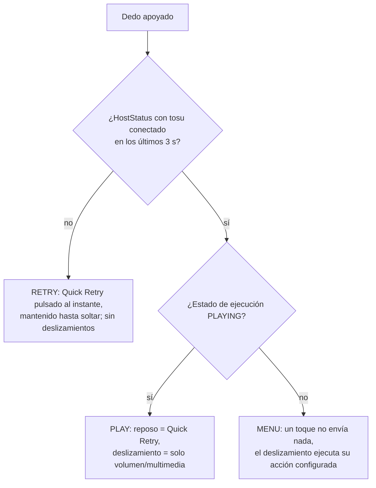

La pantalla táctil es el **tercer botón** del teclado ([AGENTS.md](https://github.com/OPad-dev/OPad/blob/main/AGENTS.md) §1.4). Durante un mapa, un dedo apoyado mantiene pulsada la tecla Quick Retry de osu! (`` ` ``) mientras siga abajo, porque el reintento de osu! es en sí una pulsación mantenida. Fuera de un mapa, la misma superficie se convierte en cuatro acciones de deslizamiento. Hacer ambas cosas en una sola superficie, con poco coste y sin confundir nunca una con otra, es de lo que trata [touch_retry.c](https://github.com/OPad-dev/OPad/blob/main/firmware/main/input/touch_retry.c).

Para el comportamiento y los ajustes de cara al usuario, consulta [Pantalla táctil y deslizamientos](../guides/touchscreen-and-swipes.md).

## Barata en reposo

El controlador CST816 está en I2C (`CST816_I2C_ADDR = 0x15`, 100 kHz, `I2C_NUM_0`) en GPIO 48 (SDA) y GPIO 47 (SCL), con una interrupción activa a nivel bajo en GPIO 46 ([board_pins.h](https://github.com/OPad-dev/OPad/blob/main/firmware/boards/waveshare_esp32s3_touch_lcd_2/board_pins.h)). Su tarea se ejecuta en el núcleo 1 con prioridad 2, lejos de las teclas.

- **Sin dedo: sin trabajo.** `touch_retry_task` se bloquea en `ulTaskNotifyTake()` hasta que salta la interrupción (`touch_int_isr`). También se despierta una vez por segundo (`TOUCH_IDLE_CHECK_MS = 1000`) como red de seguridad por si la línea INT enmudece; si la interrupción no se puede configurar en absoluto, recurre a sondear a 100 Hz.
- **Dedo apoyado: sondeo a 100 Hz.** Mientras hay contacto, la tarea lee el controlador cada `TOUCH_POLL_MS = 10` ms. INT puede dar un pulso por informe en lugar de quedarse a nivel bajo, así que lo que mantiene pulsado el botón es el número de toques, no el pin.
- **Una liberación limpia.** El botón solo se suelta tras `TOUCH_RELEASE_READS = 2` lecturas vacías seguidas (~20 ms), así que una lectura errónea no termina una pulsación mantenida.

El panel es vertical (240×320) y la interfaz se dibuja en horizontal, así que las coordenadas se intercambian y se reflejan (`TOUCH_SWAP_XY`, `TOUCH_MIRROR_Y`) para que "arriba" sea arriba tal como se sostiene el teclado.

## Tres modos, elegidos al tocar

Lo que hace un toque depende de si el teclado sabe que se está jugando un mapa. `touch_mode_now()` decide una sola vez, cuando el dedo se apoya:

| Modo | Cuándo | Un toque | Un deslizamiento |
|---|---|---|---|
| `TOUCH_MODE_RETRY` | Ningún `HostStatus` con tosu conectado en los últimos 3 s (`HOST_STATUS_TIMEOUT_US`): sin daemon, sin tosu, o un anfitrión que ha enmudecido. | Quick Retry, pulsado al tocar y mantenido hasta soltar. | Desactivado. |
| `TOUCH_MODE_PLAY` | Anfitrión visto hace poco con tosu, y el estado de ejecución es `PLAYING`. | Quick Retry en cuanto el dedo reposa (ver abajo). | Solo acciones de volumen y multimedia; nunca una tecla del teclado. |
| `TOUCH_MODE_MENU` | Anfitrión visto hace poco con tosu, y no está en `PLAYING`. | Nada. | La acción configurada. |

`RETRY` es la alternativa a propósito: sin anfitrión, el teclado no puede distinguir un mapa de un menú, y lo único que un toque nunca puede dejar de hacer es reintentar.

### Distinguir un reposo de un deslizamiento durante un mapa

En modo `PLAY`, el teclado no debe enviar Quick Retry por un dedo que está a punto de deslizar (un reintento reinicia el mapa). Así que espera, brevemente, a ver qué es ([`touch_retry_task()`](https://github.com/OPad-dev/OPad/blob/main/firmware/main/input/touch_retry.c)):

- Si el dedo se queda a menos de `PLAY_RETRY_STILL_PX = 12` px de donde se apoyó (distancia de Chebyshev, [`gesture_distance()`](https://github.com/OPad-dev/OPad/blob/main/firmware/main/input/gesture.c)) durante `PLAY_RETRY_STILL_US = 60` ms, está en reposo: Quick Retry se pulsa y se mantiene.
- Un dedo que sigue apoyado pasados `PLAY_SWIPE_WINDOW_US = 250` ms sin haberse convertido en deslizamiento es igualmente una pulsación mantenida.
- Un dedo levantado antes de cualquiera de los dos, sin deslizamiento, envía una pulsación y liberación cortas (`tap_retry()`).
- En cuanto se dispara un deslizamiento, ese toque nunca envía Quick Retry.

La espera de 60 ms no cuesta nada apreciable, porque osu! solo reintenta tras mantener la tecla un rato de todos modos.

## Deslizamientos

El movimiento se clasifica en [gesture.c](https://github.com/OPad-dev/OPad/blob/main/firmware/main/input/gesture.c):

- **Bloqueo de eje.** El dedo tiene que moverse `GESTURE_SWIPE_PX = 30` px, con un eje claramente dominante (al menos 1,5 : 1, `2·|dy| >= 3·|dx|` para el vertical), antes de elegir una dirección. Un movimiento diagonal espera a que haya más desplazamiento.
- **El vertical se repite, el horizontal se dispara una vez.** Un arrastre vertical avanza un paso cada 30 px y puede dar la vuelta, así que un arrastre largo sube o baja el volumen varias veces. Un deslizamiento horizontal se dispara una vez por toque. Solo las acciones de volumen se repiten; cualquier otra acción se dispara únicamente en el primer paso.

La acción de cada dirección sale de la configuración del dispositivo. Los valores por defecto ([touch_retry.c](https://github.com/OPad-dev/OPad/blob/main/firmware/main/input/touch_retry.c), [opad-model](https://github.com/OPad-dev/OPad/blob/main/desktop/crates/opad-model/src/lib.rs)) son:

- **Arriba / abajo: volumen.** Cuando el anfitrión informa `HostStatus.osu_active` ([osu_window.rs](https://github.com/OPad-dev/OPad/blob/main/desktop/daemon/src/osu_window.rs): osu! es la ventana en primer plano en Windows, osu!lazer se está ejecutando en Linux), el teclado cambia el volumen *de osu!* con la rueda del ratón (`usb_media_wheel`): Alt + rueda en los menús, donde la rueda sola desplaza la selección de canciones, y la rueda sola durante un mapa. Si no, envía las teclas de consumo Volume Up / Down del sistema (`usb_media_consumer_tap`).
- **Izquierda / derecha: pista anterior / siguiente** (teclas de consumo).

En los menús, [`step_volume()`](https://github.com/OPad-dev/OPad/blob/main/firmware/main/input/touch_retry.c) mantiene Alt izquierdo durante todos los pasos de un mismo arrastre. Windows interpreta una pulsación y liberación de Alt sin nada entre medias como "abrir el menú de la ventana" (`SC_KEYMENU`), lo que puede hacer que un juego pierda la siguiente tecla, así que antes de soltar Alt [`release_alt()`](https://github.com/OPad-dev/OPad/blob/main/firmware/main/input/touch_retry.c) pulsa F24 (`HID_KEY_F24`, una tecla que nada usa), esperando hasta `TOUCH_KEY_WAIT_MS = 30` ms a que se entregue cada informe.

## Lo que nunca ocurre durante un mapa

1. **Ni Alt ni teclas de más.** En modo `PLAY` el deslizamiento de volumen usa la rueda sola, y [`run_swipe_action()`](https://github.com/OPad-dev/OPad/blob/main/firmware/main/input/touch_retry.c) rechaza `SWIPE_ACTION_KEY`. El informe de teclado de la tecla 1 solo lleva las teclas de juego y Quick Retry.
2. **Nada extra en pantalla.** [`handle_swipe()`](https://github.com/OPad-dev/OPad/blob/main/firmware/main/input/touch_retry.c) muestra la respuesta visual del deslizamiento (`ui_show_swipe()`) solo fuera de un mapa.
3. **Un teclado Hall Effect sin calibrar es la excepción.** Mientras `he_cal_suppress_input()` sea verdadero (decisión D7 en [v2-hall-effect-decisions.md](../../specs/v2-hall-effect-decisions.md)), todo toque va al botón de la pantalla de calibración (`he_cal_ui_touch_sample`), los deslizamientos están desactivados y no se envía ninguna tecla. Un bloqueo que empieza con un dedo ya apoyado suelta Quick Retry y cualquier Alt mantenido al instante.

Cómo comparte la tecla táctil el informe de la tecla 1 con el interruptor del núcleo 0, sin cerrojos, está en [Ingeniería de latencia](latency.md#seguimiento-de-secuencias-sin-bloqueos-hid_link_t). Los detalles internos de la tarea están en [Tacto (firmware)](../develop/firmware/touch.md).
